{0}------------------------------------------------

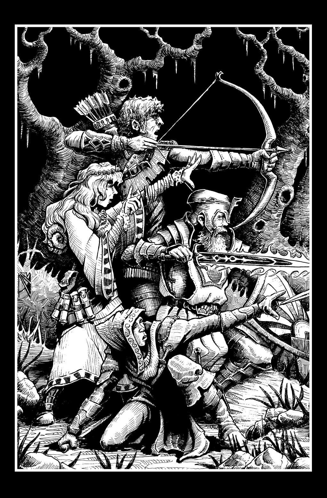

{1}------------------------------------------------

### Player's Map of the Western Reaches N

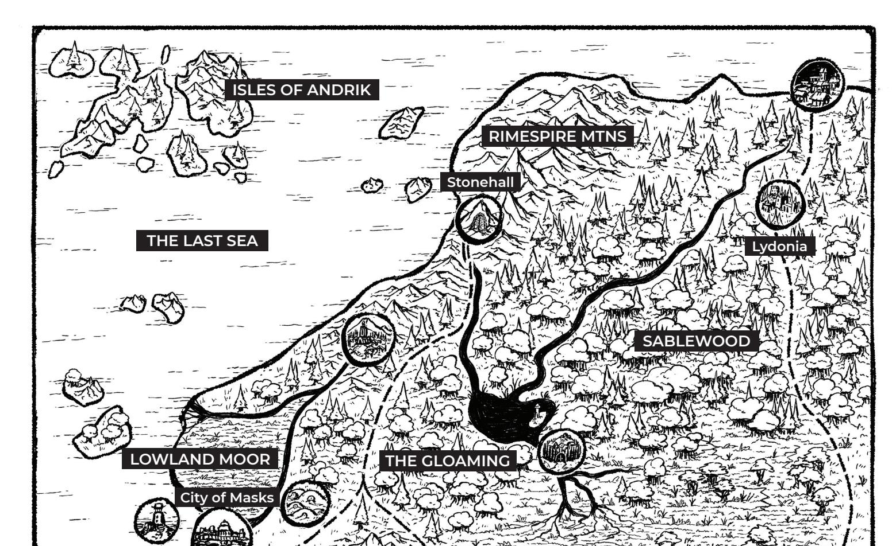

{2}------------------------------------------------

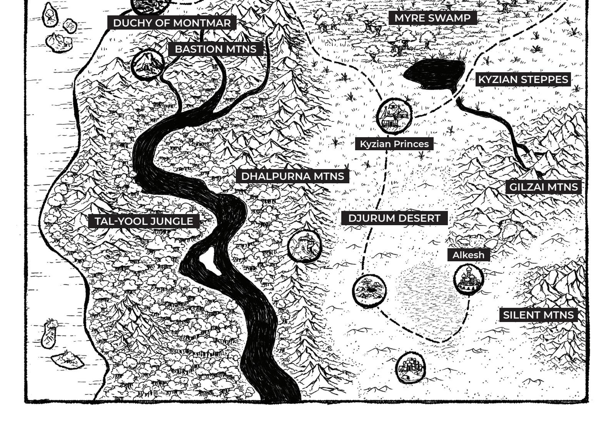

{3}------------------------------------------------

{4}------------------------------------------------

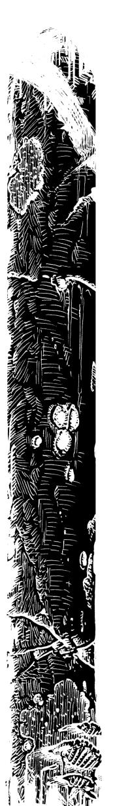

### Player's Guide to the Western Reaches

#### **Writing, Design, Layout**

Kelsey Dionne. Roustabout class designed with Michael Putlack. *Ghoul touch* and *reap the soul* spells by Mathias Cnota Harpsøe. Additional design by Jessee Egan and Katie Krickeberg. Special thanks to The Arcane Library Discord server for abundant playtesting and feedback!

#### **Art**

**Andrew Beckwith:** Cover, pgs. 89, 122, 134, 143, 162, 166, 172, 178, 229. **Bigeggs Black Pen:** pg. 165. **Brandish Gilhelm:** Trade dress (with elements by Lucas Korte). **Cameron Maas:** Player's map of the Western Reaches, pgs. 36, 60, 65, 85, 104, 117, 128, 129, 138, 148, 153 (right). **Carlos Castilho:** pgs. 149, 152, 156, 161, 163, 170, 177, 179, 183. **Del Tiegeler:** pgs. 10, 71, 81, 120, 127, 132, 137, 139, 140, 147, 154, 159, 182, back endpaper. **Helicity:** pgs. 39, 73. **Lucas Korte:** pgs. 13, 109. **Mark Lyons:** pgs. 34, 40, 68, 173, 232. **Matt Morrow:** pgs. 18, 20, 22, 24, 26, 28, 30, 32, 47, 48, 53, 55, 56, 67, 86, 181, 190, 192, 194, 196, 198, 200, 202, 204, 207, 208, 209, 210, 211, 212, 213, 214, 215, 216, 217, 218, 219, 220, 221, 222, 223, 224. **Yuri Perkowski Domingos:** pgs. 16, 43, 45, 51, 59, 62, 92, 94, 96, 98, 100, 102, 119, 123, 125, 130, 131, 133, 136, 141, 142, 144, 151, 153 (left), 158, 160, 169, 171, 174, 176, 180, 188.

#### **Fonts**

JSL Blackletter font © 2025 Jeffrey S. Lee. Old Newspaper font © 2025 Martin Steiner. Fullerton font © 2025 Emyself Design. Montserrat fonts © 2025 Julieta Ulanovsky, Sol Matas, Juan Pablo del Peral, Jacques Le Bailly.

#### **Legal Information and Attribution Statement**

Not for resale or redistribution. Permission granted to copy for personal use only. *Player's Guide to the Western Reaches* and *Shadowdark RPG* © 2026 The Arcane Library, LLC. The Arcane Library®, Shadowdark®, and The Western Reaches™ are trademarks of The Arcane Library, LLC. This work includes material taken from the System Reference Document 5.1 ("SRD 5.1") by Wizards of the Coast LLC and available at [https://dnd.wizards.com/](https://dnd.wizards.com/resources/systems-reference-document) [resources/systems-reference-document](https://dnd.wizards.com/resources/systems-reference-document). The SRD 5.1 is licensed under the Creative Commons Attribution 4.0 International License available at [https://](https://creativecommons.org/licenses/by/4.0/legalcode) [creativecommons.org/licenses/by/4.0/legalcode](https://creativecommons.org/licenses/by/4.0/legalcode).

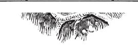

{5}------------------------------------------------

### Foreword

You've found yourself in a land of fragile civilizations, majestic landscapes, and secrets lost to the dark.

This realm of mystery and wonder is yours. It is a place for bold explorers who dare to lift a torch high in the face of an overwhelming night!

### The Western Keaches will be shaped by your hands.

Warriors and witches, mystics and mages. You who are true seekers. You who follow a hawk across the burning desert, who chase a river from its humble wellspring to its mighty crash into the sea, and who watch the dawn break from atop the mountains.

You will discover who you are as you explore this realm. Will you become the land's protector, its conquerer? Will its people sing ballads or dirges of your deeds?

There's only one way to find out, of course.

There are many unknown paths that lie before you, and there is but one thing to do: Find your way.

Within these pages, you'll meet your beginnings. What you will become is being written even now as you read these words and grasp your destiny.

So light your torch, though it is a small flame in the dark, and let it be known:

#### You are here, o fabled land!

-Kelsey Dionne, Feb. 2025

{6}------------------------------------------------

## Introduction

#### **WHAT ARE THE WESTERN REACHES?**

The Western Reaches are a place of dangerous fantasy adventuring where heroes can strike out to explore the land, find incredible treasures, and make a name for themselves.

This official *Shadowdark RPG* setting combines all the world building material from *Cursed Scroll* zines 1-6 (*CS 1-6*) into a regional setting that can be traversed from top to bottom.

The *Player's Guide to the Western Reaches* (*PGWR*) works with the *Game Master's Guide to the Western Reaches* (*GMWR*) to outline what players and GMs need to know to run and play in games in the Reaches.

If you're a player, you'll want to avoid the spoilers in the *GMWR*. This book is all you need — it will orient you to the Western Reaches and help you build a character ready to explore them!

#### **HOW DO I PLAY IN THIS SETTING?**

Check out the Overview chapter first ([pg. 11](#page-10-0)) to learn some everyday knowledge about the Western Reaches.

You as the player will know what a typical character in the Western Reaches knows about the world. That is, not much!

The Reaches are meant to be explored and discovered using **sandbox** style gameplay. That means the Game Master will supply you and your adventuring party with rumors, leads, and mysteries. But it's up to you to decide which threads to pull.

In the Reaches, your fate is in your own hands. Will your story eventually become a legend?

The later chapters of this book contain character building rules. You can also use the official, free *Shadowdark RPG* character builder, **[shadowdarklings.net](https://shadowdarklings.net)**!

{7}------------------------------------------------

## Contents

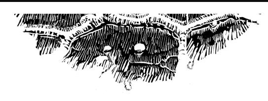

| Foreword               | 6  | Delver Class              | 38 |
|------------------------|----|---------------------------|----|
| Introduction           | 7  | Desert Rider Class        | 41 |
| Contents               | 8  | Duelist Class             | 42 |
| OVERVIEW               | 11 | Green Knight Class        | 44 |
| What Everyone Knows    | 12 | Knight of St. Ydris Class | 46 |
| Life in the Reaches    | 14 | Kyzian Archer Class       | 49 |
| CHARACTERS             | 17 | Monk of Yag-Kesh Class    | 50 |
| Dwarf Ancestry         | 18 | Necromancer Class         | 52 |
| Elf Ancestry           | 20 | Paladin Class             | 54 |
| Goblin Ancestry        | 22 | Pit Fighter Class         | 57 |
| Half-Elf Ancestry      | 24 | Ranger Class              | 58 |
| Half-Orc Ancestry      | 26 | Ras-Godai Class           | 60 |
| Halfling Ancestry      | 28 | Roustabout Class          | 63 |
| Human Ancestry         | 30 | Sea Wolf Class            | 64 |
| Kobold Ancestry        | 32 | Seer Class                | 66 |
| Bard Class             | 34 |                           |    |
| Basilisk Warrior Class | 37 | Warlock Class             | 69 |

{8}------------------------------------------------

| Witch Class         | 70  | GODS AND PATRONS     | 189 |  |
|---------------------|-----|----------------------|-----|--|
| Wyrdling Class      | 72  | Madeera the Covenant | 190 |  |
| Backgrounds         | 74  | Saint Terragnis      | 192 |  |
| Secrets             | 78  | Gede                 | 194 |  |
| Titles              | 82  | Ord                  | 196 |  |
| Factions            | 90  | Memnon               | 198 |  |
| GEAR                | 105 | Shune the Vile       | 200 |  |
| Basic Gear          | 106 | Ramlaat              | 202 |  |
| Weapons             | 110 | The Lost             | 204 |  |
| Armor               | 112 | Patrons              | 206 |  |
| Poisons             | 113 | GAMEPLAY             | 225 |  |
| Mounts              | 114 | Hex Crawling         | 226 |  |
| Boats               | 118 | Climate              | 228 |  |
| Siege Weapons       | 119 | Camping              | 230 |  |
| MAGIC               | 121 | Fast Travel          | 231 |  |
| Necromancer Spells  | 122 | Travel Procedure     | 232 |  |
| Priest Spells       | 132 | Renown               | 233 |  |
| Seer Spells         | 144 | Downtime             | 234 |  |
| Witch Spells        | 150 | Carousing            | 236 |  |
| Wizard Spells       | 166 | Bastions             | 246 |  |
| Diabolical Mishaps  | 184 | Warbands             | 248 |  |
| Necromancer Mishaps | 186 |                      |     |  |

{9}------------------------------------------------

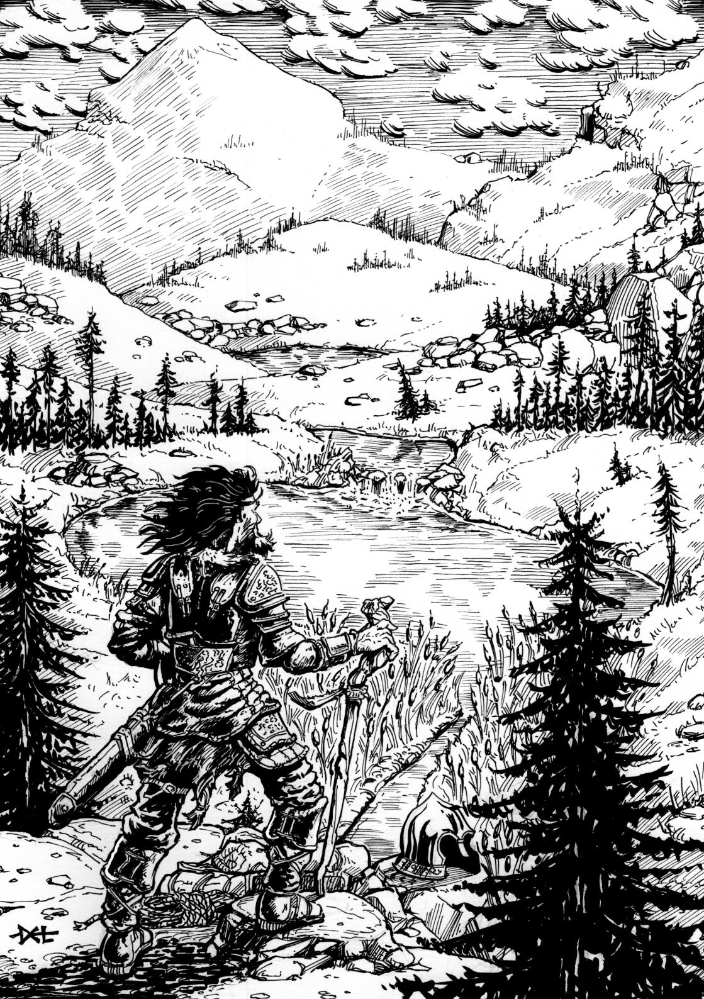

{10}------------------------------------------------

# Overview

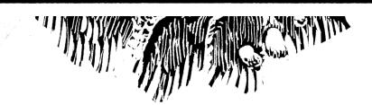

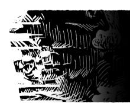

"In all my years of wandering, I have yet to slake my thirst for it." -Ulysso, human ranger

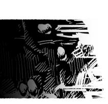

{11}------------------------------------------------

## What Everyone Knows

Ten things (which may not even be true) everyone knows about the Western Reaches.

#### **1. The Reaches are ancient.**

They've been here since the sun first rose over the western shore. Some say the land came up out of the sea, or the gods sculpted it all out of clay, or the dwarves hammered it together on anvils. Nobody really knows. But there's plenty of old stuff all around that must have been built ages ago.

#### **2. There are faraway lands.**

They say the Reaches stretch all the way up to a frozen land of endless night, and all the way down to deserts so hot they'll cook you alive. There's even a big city on the coast. City of Masks, they call it. Most people don't travel too far, though. Too risky.

#### **3. It's dangerous out there.**

Nobody's going to come riding to your rescue! These are lawless lands full of bandits and thieves. Wild beasts and trolls. Evil spirits. You'd better not go alone.

**4. The world ends at the Last Sea.** There's nothing else west of the coast. Just the Last Sea rolling on and on into mist. Some say if you keep going, you'll eventually arrive at the shores of the gods' realm and you can ask them for one thing. But you'd never make it back from there anyhow.

**5. No king has ever ruled all the Reaches.** Sure, some have tried. But the Reaches have no king, not now, not ever. There was a queen long ago who almost conquered it all from top to bottom, but her heart was dark and the gods cast her down. Every child knows the song: *Rise and fight, sun from night, dark queen tumbles out of sight.* 

**6. The gods are distant.** The gods don't walk among us anymore. And they don't intervene. There are a few rare folks like priests who can channel their power. That's how we know they're still watching over us, for good or for ill.

{12}------------------------------------------------

**7. Ancient spirits and beings dwell here.** There's all kinds of strange demons and ghosts lurking around in the wilds. You've heard of the Willowman who comes to scare children who don't listen. He's real! And there are other things like him.

**8. Magic is terribly dangerous.** Most folks don't trust a wizard, I'll tell you that. Only a madman lets a wizard cast a spell in his house. You'll get yourself blown up that way. Even touching a magic sword has half a chance of cursing you blind!

**9. Non-humans aren't very common.** Elves, dwarves, you don't often see them. We do get a traveler from time to time, and the kids always want to ask them a barrel of questions.

**10. Most of the Reaches are unexplored.** You'll hear a couple tall tales from sailors, but most folks haven't seen much farther than the ends of their own noses. Hard to believe half the stuff those sailors say, anyway. None of them have even been to the south. Can't sail a boat over the desert, can you?

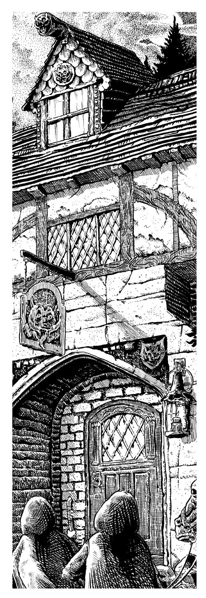

{13}------------------------------------------------

## Life in the Reaches

#### **ANCESTRIES**

Humans are by far the most common ancestry in the Western Reaches, but there are a wide scattering of other peoples and civilizations.

Dwarves, elves, and halflings are uncommon. Half-orcs, half-elves, goblins, and kobolds are rare.

**Population.** Optionally, players can roll on the below chart for their characters' ancestries if they want the party to align with the average population percentages in the Reaches.

| ANCESTRY |          |  |  |
|----------|----------|--|--|
| d100     | Ancestry |  |  |
| 01-54    | Human    |  |  |
| 55-64    | Elf      |  |  |
| 65-74    | Dwarf    |  |  |
| 75-84    | Halfling |  |  |
| 85-89    | Goblin   |  |  |
| 90-94    | Half-elf |  |  |
| 95-99    | Half-orc |  |  |
| 00       | Kobold   |  |  |

#### **POINTS OF LIGHT**

The Western Reaches is a "points of light" setting where there are small pockets of fragile civilization, usually in the form of self-governed towns and citystates. Most places outside these areas are dangerous and lawless.

#### **MIGHT MAKES RIGHT**

When there is no overall rule of law, street justice prevails. Bandits, monsters, thieves, and worse roam the wilds of the Western Reaches, often acting with impunity against the weak.

Adventurers will have to defend themselves, make allies, and act wisely if they hope to survive outside the safety of civilization.

The wilds will eventually wear down even the toughest adventurers. Characters will need to retreat back to town on a regular basis to rest, restock, and recount their exploits in a carousing celebration!

{14}------------------------------------------------

#### **CIVILIZATIONS**

Most people who dwell in the Western Reaches have at least heard of the other centers of power in the region and know a few facts about them.

**City of Masks.** The Duke reigns over this romantic city of high culture, art, and danger. It's the biggest city-state in all the Western Reaches.

**Alkesh.** A princess called the Shar rules Alkesh. The city is a mysterious, bright oasis in the desert where you can buy anything for the right price.

**Stonehall.** A dwarf king as old as three men presides over a vast hall under the mountains. The dwarves of Stonehall are the best crafters in all the land.

**Kyzian Steppes.** Wild tribes of horseback riders roam across the plains like a moving army. Their queen is a feared warrior.

**Lydonia.** An aloof elf king rules over a shining citadel deep in the forest. His rangers and knights watch from behind every tree and blade of grass.

#### **SOCIAL STRUCTURE**

Most people in the Western Reaches come from humble means and get by working in a trade or craft.

If they live in a city-state or its nearby lands, they pledge loyalty to its overlord and serve as vassals in exchange for the overlord's protection.

In most parts of the Reaches, there is no overlord. Many towns and villages have no other authority than their own and must protect themselves from outside dangers.

There is no universal set of laws, governance, or culture across the Western Reaches.

A knight from the Duchy of Montmar would not be recognized or treated as a noble by the lawless bandit lords who roam the Djurum Desert.

A visitor in the City of Masks might unknowingly break one of the Duke's laws. In Alkesh, the very same "crime" might be perfectly legal, or perhaps it is punished even more harshly.

{15}------------------------------------------------

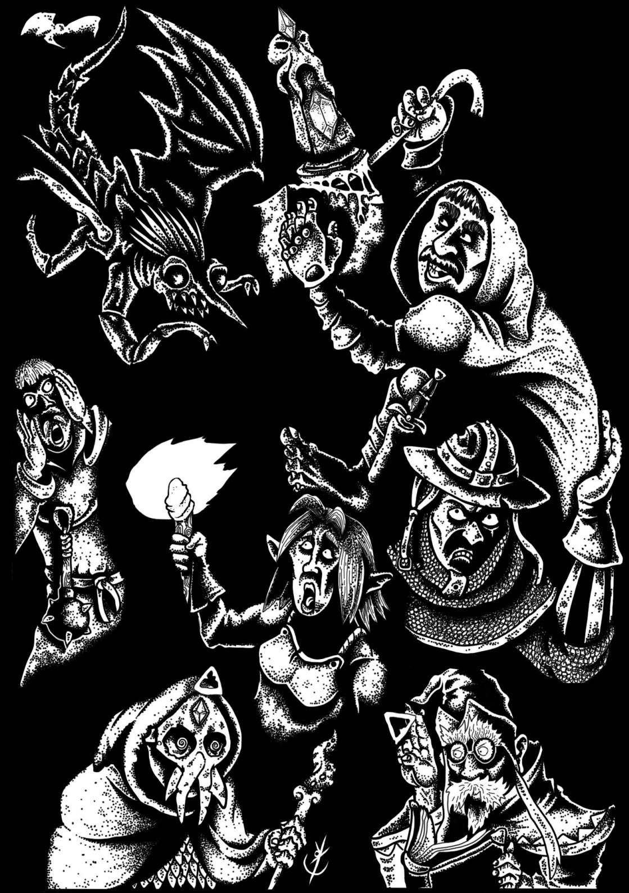

{16}------------------------------------------------

## Characters

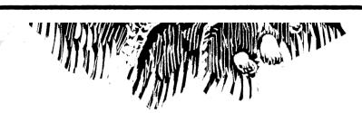

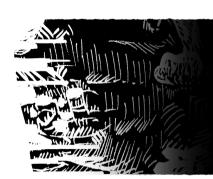

"Death is no stranger to me. Would you like to get more acquainted with it, too?" -Arienna, human necromancer, to a bandit

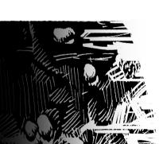

{17}------------------------------------------------

### **Dwarf Ancestry**

#### **DWARF**

Brave, stalwart folk as sturdy as the stone kingdoms they carve inside mountains.

You know the Common and Dwarvish languages.

**Stout.** Start with +2 HP. Roll hit points per level with advantage.

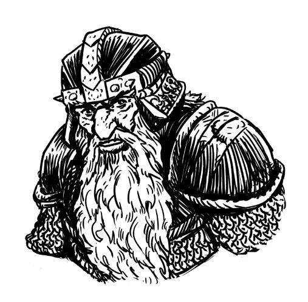

#### **POPULATION**

Dwarves are uncommon and reclusive. They account for about 10% of the population.

#### **ORIGINS**

Dwarves are the heartier cousins of the fey-like dverg who dwell in the Isles of Andrik. Both carve out vast, stone halls inside mountains. Most dwarves hail from their ancestral clans that live beneath the Rimespire and Bastion mountain chains.

|     | NAMES  |        |
|-----|--------|--------|
| d10 | Part 1 | Part 2 |
| 1   | Den-   | -dor   |
| 2   | Mel-   | -grim  |
| 3   | Bol-   | -ror   |
| 4   | Rog-   | -ek    |
| 5   | Tor-   | -dak   |
| 6   | Bal-   | -dren  |
| 7   | Gan-   | -wen   |
| 8   | Teg-   | -in    |
| 9   | Dan-   | -den   |
| 10  | Gim-   | -drol  |

{18}------------------------------------------------

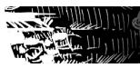

#### **DWARF TRINKET**

| d100  | Details                 | d100  | Details                   |
|-------|-------------------------|-------|---------------------------|
| 1-2   | Granite dwarf figurine  | 51-52 | Nice cooking pot          |
| 3-4   | Polished stone pipe     | 53-54 | Pet rock                  |
| 5-6   | Metal boot cleats       | 55-56 | Bone beard comb           |
| 7-8   | Heirloom whetstone      | 57-58 | Mining helmet             |
| 9-10  | Copper beard rings      | 59-60 | A perfect copper coin     |
| 11-12 | Spiced bar of soap      | 61-62 | Bag of rock salt          |
| 13-14 | Stone chiseling set     | 63-64 | Fireplace bellows         |
| 15-16 | Sturdy horned helm      | 65-66 | Jeweler's loupe           |
| 17-18 | Nearly fatal arrowhead  | 67-68 | Iron chain necklace       |
| 19-20 | Steel-toe boots         | 69-70 | Cozy knit socks           |
| 21-22 | Brass family ring       | 71-72 | Chunk of fool's gold      |
| 21-24 | Compact fishing pole    | 73-74 | Tattered love letter      |
| 25-26 | Trusty ale horn         | 75-76 | Military arm cuff         |
| 27-28 | Military service badge  | 77-78 | Father's old cloak        |
| 29-30 | Bag of cave mushrooms   | 79-80 | Iron toothpick            |
| 31-32 | Anvil pendant necklace  | 81-82 | Hefty bronze abacus       |
| 33-34 | Ceremonial drum         | 83-84 | Clockwork flint and steel |
| 35-36 | Old booklet of recipes  | 85-86 | Mini castle in a bottle   |
| 37-38 | Lock of braided hair    | 87-88 | Long iron tongs           |
| 39-40 | Mini barrel of fine ale | 89-90 | Gold panning set          |
| 41-42 | Lucky gold nugget       | 91-92 | Mother's rolling pin      |
| 43-44 | Anti-seasickness charm  | 93-94 | Horridly loud bagpipes    |
| 45-46 | Bag of prophecy stones  | 95-96 | Cloak of cave lizard hide |
| 47-48 | Fungi gardening tools   | 97-98 | Bronze spinning top       |
| 49-50 | Goat hair blanket       | 99-00 | Absurd monocle            |

PCs may start with one trinket; it is free to carry.

{19}------------------------------------------------

### Elf Ancestry

#### **ELF**

Ethereal, graceful people who revere knowledge and beauty. Elves see far and live long.

You know the Common, Elvish, and Sylvan languages.

Farsight. You get a +1 bonus to attack rolls with ranged weapons or a +1 bonus to spellcasting checks.

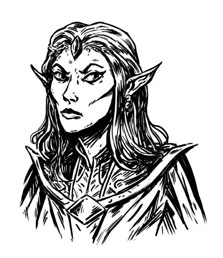

#### **POPULATION**

Elves are uncommon but widely known in the Reaches. They form 10% of the population.

#### **ORIGINS**

Many free-spirited elves roam the Djurum Desert in nomadic tribes that flow with the seasons and winds. Others live in the quiet stillness of the Sablewood, kept safe by the rangers and knights who serve the King of the Wood in his citadel, Lydonia.

|     | NAMES  |          |
|-----|--------|----------|
| d10 | Part 1 | Part 2   |
| 1   | lma-   | -rien    |
| 2   | Qala-  | -riol    |
| 3   | Tira-  | -nienne  |
| 4   | Nora-  | -ndielle |
| 5   | Rasa-  | -drion   |
| 6   | Ela-   | -riel    |
| 7   | Ena-   | -driole  |
| 8   | Tali-  | -bren    |
| 9   | Vela-  | -ndriel  |
| 10  | Sa-    | -brior   |

{20}------------------------------------------------

#### **ELF TRINKET**

| d100  | Details                 | d100  | Details                      |
|-------|-------------------------|-------|------------------------------|
| 1-2   | Delicate wind chime     | 51-52 | Thin copper circlet          |
| 3-4   | Owl feather quill       | 53-54 | Crescent moon pendant        |
| 5-6   | Embroidered silk tunic  | 55-56 | Silver sewing needle         |
| 7-8   | Amethyst earrings       | 57-58 | Ashes of a dead ancestor     |
| 9-10  | Filigreed riding saddle | 59-60 | Silk hammock                 |
| 11-12 | Ivory hand harp         | 61-62 | Old book of poetry           |
| 13-14 | Cowled velvet cloak     | 63-64 | Shell of an extinct turtle   |
| 15-16 | Bottle of blue ink      | 65-66 | Bag of magnificent tea       |
| 17-18 | Camel hair cloak        | 67-68 | Gold finger cymbals          |
| 19-20 | Bottle of elvish wine   | 69-70 | Miniature koi fish in a jar  |
| 21-22 | Glass piece of fruit    | 71-72 | Scroll of an elvish ballad   |
| 21-24 | Silver-dipped flower    | 73-74 | Silver dragon brooch         |
| 25-26 | Ancient book of fables  | 75-76 | Circlet of twisted wood      |
| 27-28 | Copper wine ewer        | 77-78 | Delicate gold earring        |
| 29-30 | Sketches of wildlife    | 79-80 | Swan-shaped hair pin         |
| 31-32 | Fortune telling cards   | 81-82 | Ceramic ocarina              |
| 33-34 | Perfect pinecone        | 83-84 | Bottle of distilled tree oil |
| 35-36 | Astrological star chart | 85-86 | Seeds of a rare flower       |
| 37-38 | Personal diary          | 87-88 | Folded paper crane           |
| 39-40 | Tiny glass animals      | 89-90 | Vial of jasmine perfume      |
| 41-42 | Roll of silk thread     | 91-92 | Elegant watering pot         |
| 43-44 | Elk horn flute          | 93-94 | Iridescent folding fan       |
| 45-46 | Peacock feather quill   | 95-96 | Stained glass bird           |
| 47-48 | Fine doeskin boots      | 97-98 | Letter from a dead king      |
| 49-50 | Ancient family sword    | 99-00 | Phoenix feather              |

PCs may start with one trinket; it is free to carry.

{21}------------------------------------------------

## Goblin Ancestry

#### **GOBLIN**

Green, clever beings who thrive in dark, cramped places. As fierce as they are tiny.

You know the Common and Goblin languages.

**Keen Senses.** You can't be surprised (you roll initiative during surprise rounds and are not treated as unaware).

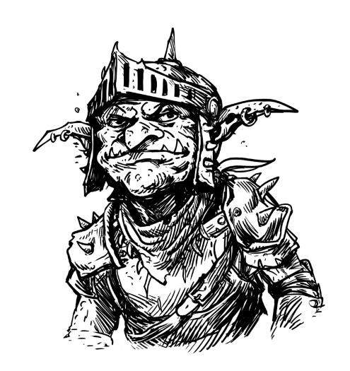

#### **POPULATION**

Goblins are very rare, comprising only 5% of the population.

#### **ORIGINS**

Goblins come mainly from the deepest parts of the Sablewood and in the cave systems beneath the Rimespire Mountains. They are very environmentally adaptable, and it's thought that large tribes of goblins live in remote areas that have little contact with the outside world.

|     | NAMES  |        |
|-----|--------|--------|
| d10 | Part 1 | Part 2 |
| 1   | Sl-    | -ib    |
| 2   | Zad-   | -laz   |
| 3   | Gor-   | -ul    |
| 4   | Baz-   | -ag    |
| 5   | Ax-    | -ogo   |
| 6   | Yal-   | -ek    |
| 7   | Prak-  | -eg    |
| 8   | Tal-   | -otog  |
| 9   | Sar-   | -ivin  |
| 10  | Mor-   | -atok  |

{22}------------------------------------------------

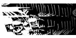

#### **GOBLIN TRINKET**

| d100  | Details                 | d100  | Details                    |
|-------|-------------------------|-------|----------------------------|
| 1-2   | Goblin finger trap toy  | 51-52 | Lucky copper coin          |
| 3-4   | Shriveled dead newt     | 53-54 | Bloodied pirate flag       |
| 5-6   | Fat red mushroom        | 55-56 | Tin of belly button lint   |
| 7-8   | Sack of old onions      | 57-58 | Mug with a hole in it      |
| 9-10  | Snakeskin boots         | 59-60 | Jar of pickled pig hooves  |
| 11-12 | Tuneless pan pipes      | 61-62 | Collection of wine corks   |
| 13-14 | Rat tail necklace       | 63-64 | Painted chicken egg        |
| 15-16 | Rusty bucket helmet     | 65-66 | Vial of mercury            |
| 17-18 | Tiny pet dung beetle    | 67-68 | Jar of bent fishing hooks  |
| 19-20 | Trilobite fossil        | 69-70 | Massive ball of twine      |
| 21-22 | Fish bone earring       | 71-72 | Collection of snail shells |
| 21-24 | Bottle of vinegary wine | 73-74 | Creepy toy doll            |
| 25-26 | Glass eyeball           | 75-76 | Jaunty eye patch           |
| 27-28 | Large owl pellet        | 77-78 | Honking accordion          |
| 29-30 | Jar of malodorous jelly | 79-80 | Four playing cards         |
| 31-32 | Ball of ear wax         | 81-82 | Iron nail file             |
| 33-34 | Wilting potted plant    | 83-84 | Broken magic wand          |
| 35-36 | Walrus tusk             | 85-86 | Bag of potpourri           |
| 37-38 | Jack-in-the-box         | 87-88 | String of prayer beads     |
| 39-40 | Bug catching net        | 89-90 | One-use stink bomb         |
| 41-42 | Box of mouse bones      | 91-92 | Weighted dice              |
| 43-44 | Cooking pot armor       | 93-94 | Single-egg frying pan      |
| 45-46 | Mummified weasel        | 95-96 | Fake wax apple             |
| 47-48 | Rusty meat cleaver      | 97-98 | Dinosaur egg               |
| 49-50 | Vest with many pockets  | 99-00 | Ruby-lens glasses          |

PCs may start with one trinket; it is free to carry.

{23}------------------------------------------------

### Half-Elf Ancestry

#### **HALF-ELF**

Lithe, long-lived humans with subtle elven features. Their boldness is tempered by insight.

You know the Common and Elvish languages, plus one additional common language.

**Adaptable.** Roll your talent rolls twice and choose which result to keep.

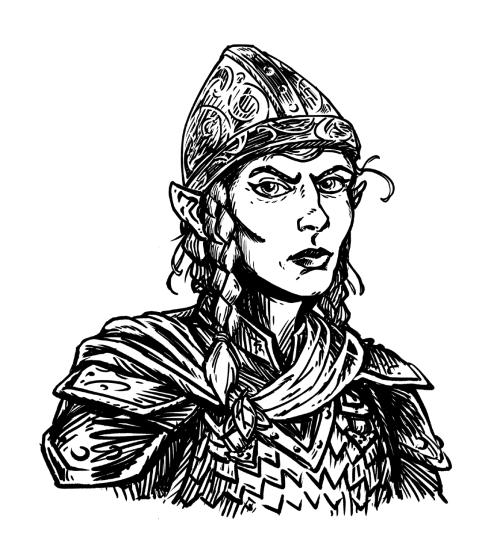

#### **POPULATION**

Half-elves are rarely seen. They make up 5% of the population.

#### **ORIGINS**

Half-elves typically hail from the Kyzian Steppes or the Djurum Desert where their parents have the greatest crossover in territory. They are beloved by both peoples and seen as a symbol of alliance. Half-elves often become legendary horse riders, archers, and leaders.

|     | NAMES  |          |
|-----|--------|----------|
| d10 | Part 1 | Part 2   |
| 1   | Me-    | -garrin  |
| 2   | Ira-   | -sandiel |
| 3   | lm-    | -rak     |
| 4   | Hu-    | -teril   |
| 5   | Gal-   | -rynn    |
| 6   | Tova-  | -barik   |
| 7   | Syr-   | -lena    |
| 8   | Or-    | -seniel  |
| 9   | Lir-   | -dess    |
| 10  | Cal-   | -dorin   |

{24}------------------------------------------------

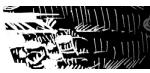

#### **HALF-ELF TRINKET**

| d100  | Details                  | d100  | Details                    |
|-------|--------------------------|-------|----------------------------|
| 1-2   | Braided horsehair lock   | 51-52 | Book of plant drawings     |
| 3-4   | Silver leaf brooch       | 53-54 | Carved bone fishhook       |
| 5-6   | Red saddle blanket       | 55-56 | Circlet of deer antlers    |
| 7-8   | Bowstring bracelet       | 57-58 | Shard of a silvery mirror  |
| 9-10  | Carved quartz ring       | 59-60 | Bag of glass marbles       |
| 11-12 | Father's sword belt      | 61-62 | A single old playing card  |
| 13-14 | Hay-stuffed luck doll    | 63-64 | Copper disc necklace       |
| 15-16 | Arrowhead necklace       | 65-66 | Filigreed hair pin         |
| 17-18 | Lucky horseshoe          | 67-68 | Green silk handkerchief    |
| 19-20 | Pressed prairie flower   | 69-70 | Silver camel hair hat      |
| 21-22 | Bottle of red sand       | 71-72 | Vial of perfumed oil       |
| 21-24 | Horse bone dice          | 73-74 | Leather hat with feather   |
| 25-26 | Wide brim straw hat      | 75-76 | Tiny locket housing a leaf |
| 27-28 | Copper gnome figurine    | 77-78 | Silver spinning top        |
| 29-30 | White silk headband      | 79-80 | Beaded dream catcher       |
| 31-32 | Embroidered overcoat     | 81-82 | Bundle of scented twigs    |
| 33-34 | Frayed horsehair brush   | 83-84 | Finely tailored dress robe |
| 35-36 | Ancestral archery bracer | 85-86 | Wax-sealed note            |
| 37-38 | Chain of horse bells     | 87-88 | Silky red arrow feathers   |
| 39-40 | Tasseled arrow quiver    | 89-90 | Wooden archery target      |
| 41-42 | Skin of wheat beer       | 91-92 | Hawk hood and glove        |
| 43-44 | Ball of knotted string   | 93-94 | Pot of black eye coal      |
| 45-46 | Bent silver nail         | 95-96 | Silver pan pipes           |
| 47-48 | Soft leather slippers    | 97-98 | Moonstone ring             |
| 49-50 | Letter from mother       | 99-00 | Heirloom family weapon     |

PCs may start with one trinket; it is free to carry.

{25}------------------------------------------------

### Half-Orc Ancestry

#### **HALF-ORC**

Towering, tusked warriors who are as daring as humans and as relentless as orcs.

You know the Common and Orcish languages.

**Mighty.** You have a +1 bonus to attack and damage rolls with melee weapons.

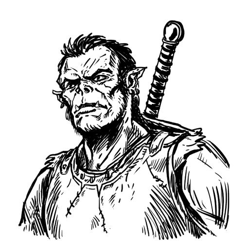

#### **POPULATION**

Half-orcs are quite rare, making up only 5% of the population.

#### **ORIGINS**

Barbarian tribes of orcs rove north of the Gilzai Mountains and into the Kyzian Steppes, where they sometimes cross paths with human tribes. Some of these groups share a mutual worship of the warrior god Ramlaat, and half-orcs can result from this rare cultural merging.

|     | NAMES  |        |
|-----|--------|--------|
| d10 | Part 1 | Part 2 |
| 1   | Bal-   | -aal   |
| 2   | Ud-    | -uk    |
| 3   | Zoran- | -uul   |
| 4   | Ulf-   | -ok    |
| 5   | Zard-  | -aash  |
| 6   | Tral-  | -esh   |
| 7   | Brog-  | -ek    |
| 8   | Yel-   | -ago   |
| 9   | Iv-    | -uun   |
| 10  | Klar-  | -asha  |

{26}------------------------------------------------

#### **HALF-ORC TRINKET**

| d100  | Details                   | d100  | Details                    |
|-------|---------------------------|-------|----------------------------|
| 1-2   | Ram horn flagon           | 51-52 | Jar of glossy beetle wings |
| 3-4   | Bog-walking stilts        | 53-54 | Ancient arrowhead          |
| 5-6   | Conical reed hat          | 55-56 | Snake skeleton             |
| 7-8   | Pot of scarlet face paint | 57-58 | Loop of blood sausage      |
| 9-10  | String of various teeth   | 59-60 | Yak hair girdle belt       |
| 11-12 | Goat hair blanket         | 61-62 | Ivory Ramlaat statuette    |
| 13-14 | Speckled hawk egg         | 63-64 | Reed bird caller           |
| 15-16 | Small meteorite chunk     | 65-66 | Polished mahogany lyre     |
| 17-18 | Pet dragonfly             | 67-68 | Painted clay tea pot       |
| 19-20 | Rabbit fur boots          | 69-70 | Woven crayfish trap        |
| 21-22 | Copper tusk rings         | 71-72 | Brass good luck amulet     |
| 21-24 | Red robe and sash         | 73-74 | Red-beaded mantle          |
| 25-26 | Polished rabbit skull     | 75-76 | String of shrunken heads   |
| 27-28 | Goat stomach wineskin     | 77-78 | Jar of fermented yak milk  |
| 29-30 | Brass cowbell             | 79-80 | Helm with ram horns        |
| 31-32 | Tattoo ink and needle     | 81-82 | Necklace of lion teeth     |
| 33-34 | Father's war banner       | 83-84 | Short reed snorkel         |
| 35-36 | Fork carved from bone     | 85-86 | Rabbit-fur-lined cloak     |
| 37-38 | Giant eagle feather       | 87-88 | Book of orcish recipes     |
| 39-40 | Lock of silver hair       | 89-90 | Cobra skin belt            |
| 41-42 | Vial with a black seed    | 91-92 | Carved sun goggles         |
| 43-44 | Baby alligator skull      | 93-94 | Mosquito-repelling salve   |
| 45-46 | Curved war horn           | 95-96 | Cauterized troll finger    |
| 47-48 | Pronged fishing spear     | 97-98 | Skull wine cup             |
| 49-50 | Woven reed hammock        | 99-00 | Demonic Ramlaat mask       |

PCs may start with one trinket; it is free to carry.

{27}------------------------------------------------

### Halfling Ancestry

#### **HALFLING**

Small, cheerful country folk with mischievous streaks. They enjoy life's simple pleasures.

You know the Common language.

**Stealthy.** Once per day, you can become invisible for 3 rounds.

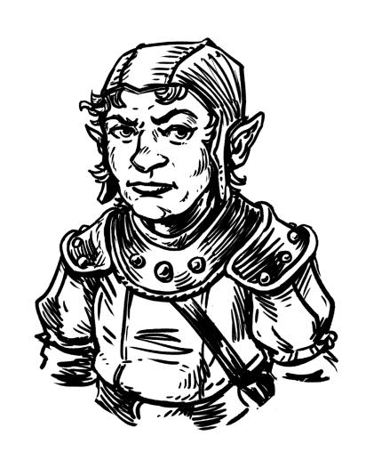

#### **HALFLINGS**

Halflings are uncommon but widely known. They form about 10% of the population.

#### **ORIGINS**

Most halfling villages are clustered in the sunny, rolling meadows in the Duchy of Montmar. Some also live on the fringes of the Lowland Moor, where they have a knack for merging seamlessly with the natural landscape.

|     | NAMES  |        |
|-----|--------|--------|
| d10 | Part 1 | Part 2 |
| 1   | Tro-   | -bin   |
| 2   | Wil-   | -do    |
| 3   | Pel-   | -ana   |
| 4   | Sam-   | -by    |
| 5   | Tul-   | -lin   |
| 6   | Ro-    | -berly |
| 7   | Sal-   | -ry    |
| 8   | Jer-   | -ly    |
| 9   | Til-   | -son   |
| 10  | Bib-   | -ra    |

{28}------------------------------------------------

#### **HALFLING TRINKET**

| d100  | Details                   | d100  | Details                     |
|-------|---------------------------|-------|-----------------------------|
| 1-2   | Amazing loaf of bread     | 51-52 | Cozy goat hair sweater      |
| 3-4   | Jar of honey              | 53-54 | Reliable dowsing rod        |
| 5-6   | Silver hair comb          | 55-56 | Carved reed flute           |
| 7-8   | Cracked spectacles        | 57-58 | Unsent love letter          |
| 9-10  | Wooden pipe               | 59-60 | Tiny coffin with dead rat   |
| 11-12 | Wheel of stinky cheese    | 61-62 | Bag of rare mushrooms       |
| 13-14 | Battered cooking pan      | 63-64 | Box of fine tooth picks     |
| 15-16 | Lucky four-leafed clover  | 65-66 | Jar of mother's best jam    |
| 17-18 | Bag of high quality flour | 67-68 | Boar tooth necklace         |
| 19-20 | Incomplete card deck      | 69-70 | Blank leather diary         |
| 21-22 | Chain of daisies          | 71-72 | Single use firework         |
| 21-24 | Endless jar of lard       | 73-74 | Lucky rabbit's foot         |
| 25-26 | Straw-stuffed doll        | 75-76 | Letter from little sister   |
| 27-28 | Book of fairy tales       | 77-78 | Tiny wooden bird house      |
| 29-30 | Cloudy monocle            | 79-80 | Stuffed bat on a string     |
| 31-32 | Painted clay ocarina      | 81-82 | Telescoping fishing rod     |
| 33-34 | Bag of carrots            | 83-84 | Bag of smooth pebbles       |
| 35-36 | Knitting needles          | 85-86 | String of tiny silver bells |
| 37-38 | Chunk of moon stone       | 87-88 | Jar of crisp pickles        |
| 39-40 | Deer bone pocket knife    | 89-90 | Chipped tea cup             |
| 41-42 | Grandpap's old fiddle     | 91-92 | Rabbit fur head pillow      |
| 43-44 | Very comfy boots          | 93-94 | Flask of strong whiskey     |
| 45-46 | Unbroken wish bone        | 95-96 | Knit pair of mittens        |
| 47-48 | Silver tuning fork        | 97-98 | Miniature marionette        |
| 49-50 | Toad in a box             | 99-00 | Uncle's gold ring           |

PCs may start with one trinket; it is free to carry.

{29}------------------------------------------------

### **Human Ancestry**

#### **HUMAN**

Bold, adaptable, and diverse people who learn quickly and accomplish mighty deeds.

You know the Common language and one additional common language.

**Ambitious.** You gain one additional talent roll at 1st level.

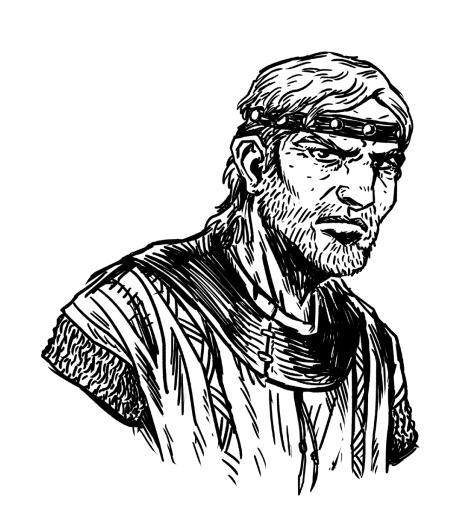

#### **POPULATION**

Humans are the most common people in the Reaches, making up about 55% of the population.

#### **ORIGINS**

There are few civilizations more far-flung than those of humans. They come from all territories within the Reaches and are deeply adaptable to the terrain around them. Humankind holds dominion over the land's largest and most powerful city-states.

|     | NAMES  |        |
|-----|--------|--------|
| d10 | Part 1 | Part 2 |
| 1   | Ar-    | -fen   |
| 2   | Mar-   | -ten   |
| 3   | II-    | -esa   |
| 4   | Rin-   | -ien   |
| 5   | Gir-   | -an    |
| 6   | EI-    | -tor   |
| 7   | Nev-   | -ilo   |
| 8   | Rom-   | -ek    |
| 9   | Jaf-   | -ora   |
| 10  | Bran-  | -as    |

{30}------------------------------------------------

#### **HUMAN TRINKET**

| d100  | Details                  | d100  | Details                   |
|-------|--------------------------|-------|---------------------------|
| 1-2   | Father's worn coat       | 51-52 | Copper mouth harp         |
| 3-4   | Wood holy symbol         | 53-54 | Tiny potted plant         |
| 5-6   | Chunk of whale blubber   | 55-56 | Vial of silver flakes     |
| 7-8   | Bag of pipe weed         | 57-58 | Antler back scratcher     |
| 9-10  | Dented drinking mug      | 59-60 | Box of marzipan cookies   |
| 11-12 | Bag of sugar plums       | 61-62 | Carved scarab necklace    |
| 13-14 | Mother-of-pearl seashell | 63-64 | Pot of blue war paint     |
| 15-16 | Wooden bird caller       | 65-66 | Rare tropical fruit       |
| 17-18 | Shark tooth necklace     | 67-68 | Chatty pet parrot         |
| 19-20 | Masquerade mask          | 69-70 | Skin of fine autumn ale   |
| 21-22 | Whittling knife          | 71-72 | Alligator skin cloak      |
| 21-24 | Silver horse shoe        | 73-74 | Crumpled wanted poster    |
| 25-26 | Bag of sunflower seeds   | 75-76 | Shards of a broken sword  |
| 27-28 | Heavy monk's robes       | 77-78 | Hand-sized brass gong     |
| 29-30 | Red fishing bobber       | 79-80 | Charm for good health     |
| 31-32 | Fine leather gloves      | 81-82 | Unfinished map            |
| 33-34 | Gaudy costume jewelry    | 83-84 | Brass frog paper weight   |
| 35-36 | Wind up music box        | 85-86 | Bundle of raven feathers  |
| 37-38 | Fox tail hat             | 87-88 | Withered flower crown     |
| 39-40 | Old forgotten key        | 89-90 | Bear claw necklace        |
| 41-42 | Jade hair comb           | 91-92 | Long smoking pipe         |
| 43-44 | Local fair winner ribbon | 93-94 | Shard of bone in a bottle |
| 45-46 | Chunk of clear amber     | 95-96 | Tiger skin tunic          |
| 47-48 | Rabbit skin hat          | 97-98 | Unopened letter           |
| 49-50 | Ivory dragon figurine    | 99-00 | Deed to a distant castle  |

PCs may start with one trinket; it is free to carry.

{31}------------------------------------------------

## Kobold Ancestry

#### **KOBOLD**

Tiny, humanoid dog-lizards with a penchant for tinkering, trap building, and a hint of magic.

You know the Common and Draconic languages.

**Knack.** You get +1 to spellcasting checks or may begin each session with a luck token.

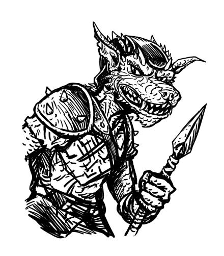

#### **POPULATION**

Kobolds are extremely rare beings. They comprise less than 1% of the population.

#### **ORIGINS**

Kobolds almost never venture outside their clans, which are mainly centered around remote deserts and volcanoes. Scholars believe they naturally emerge in places that have large packs of coyotes plus the sorcerous influence of a nearby dragon.

|     | NAMES  |        |  |
|-----|--------|--------|--|
| d10 | Part 1 | Part 2 |  |
| 1   | Sk-    | -ix    |  |
| 2   | Tal-   | -az    |  |
| 3   | Ir-    | -og    |  |
| 4   | Dr-    | -ax    |  |
| 5   | Gr-    | -ulg   |  |
| 6   | Bir-   | -ig    |  |
| 7   | Min-   | -oz    |  |
| 8   | Tim-   | -ev    |  |
| 9   | Gor-   | -ak    |  |
| 10  | Yal-   | -ov    |  |

{32}------------------------------------------------

#### **KOBOLD TRINKET**

| d100  | Details                 | d100  | Details                  |
|-------|-------------------------|-------|--------------------------|
| 1-2   | Ball of wax             | 51-52 | High pitched whistle     |
| 3-4   | Bag of bent nails       | 53-54 | Stone chiseling set      |
| 5-6   | Large red scale         | 55-56 | Tarantula in a box       |
| 7-8   | Copper tooth caps       | 57-58 | Rusty bear trap          |
| 9-10  | Jar of blue paint       | 59-60 | Oversized boots          |
| 11-12 | Pumice figurine         | 61-62 | Ring of carved bone      |
| 13-14 | Ball of string          | 63-64 | Bolt of fine yellow silk |
| 15-16 | Perfectly round pebble  | 65-66 | Lead horseshoe           |
| 17-18 | Amethyst talisman       | 67-68 | Father's canine tooth    |
| 19-20 | Four lizard tails       | 69-70 | A dozen blue eggs        |
| 21-22 | Mother's finger claw    | 71-72 | Copper arm cuff          |
| 21-24 | Ball of red string      | 73-74 | Butterfly collection     |
| 25-26 | Bucket with a hole      | 75-76 | Stone dragon statuette   |
| 27-28 | Scrimshaw set           | 77-78 | Half a deck of cards     |
| 29-30 | Jar of bacon grease     | 79-80 | Chunk of fool's gold     |
| 31-32 | Six sticks of chalk     | 81-82 | Tiny hermit crab         |
| 33-34 | Fake spell scroll       | 83-84 | Silver piece on a string |
| 35-36 | Chunk of desert glass   | 85-86 | Bag of white sand        |
| 37-38 | Taxidermied scorpion    | 87-88 | Shards of dragon egg     |
| 39-40 | Reflective metal scrap  | 89-90 | One gold hoop earring    |
| 41-42 | Rabbit pelt blanket     | 91-92 | Set of divining bones    |
| 43-44 | Bronze water cup        | 93-94 | Bladder of squid ink     |
| 45-46 | Snake fang necklace     | 95-96 | Woven reed hat           |
| 47-48 | Clay pot full of pepper | 97-98 | Ostrich feather quill    |
| 49-50 | Mummy linen wraps       | 99-00 | Family's obsidian dagger |

PCs may start with one trinket; it is free to carry.

{33}------------------------------------------------

## Bard Class

Bards are welcome wanderers and wise advisors; it is their task to protect and share knowledge handed down through the ages.

**Weapons:** Crossbow, dagger, mace, shortbow, shortsword, spear, staff

**Armor:** Leather armor, chainmail, shields

**Hit Points:** 1d6 per level

**Languages.** You know four additional common languages and one rare language.

**Bardic Arts.** You're trained in oration, performing arts, lore, and diplomacy. You have advantage on related checks.

**Fascinate** (Focus). Make a DC 12 CHA check. On a success, you transfix all targets in near whose LV is equal to or less than 1 + half your level (round down). If you fail, excluding focus, you can't use this again until you rest.

**Inspire.** Each day, you can grant a number of luck tokens equal to your Charisma modifier (min. 1).

**Magical Dabbler.** You can activate spell scrolls and wands using your Charisma modifier. If you critically fail, roll a wizard mishap.

In place of making a talent roll, you may choose to find a random priest or wizard wand (you decide which type).

#### **BARD TALENTS**

#### **2d6 Effect (2 duplicate = reroll)** 2 You have ADV on downtime checks (excluding carousing) 3-6 +1 to melee and ranged attacks or +1 to Fascinate rolls 7-9 +2 points to distribute to any stats 10-11 Add +2 to your group's carousing event rolls 12 Choose a talent

{34}------------------------------------------------

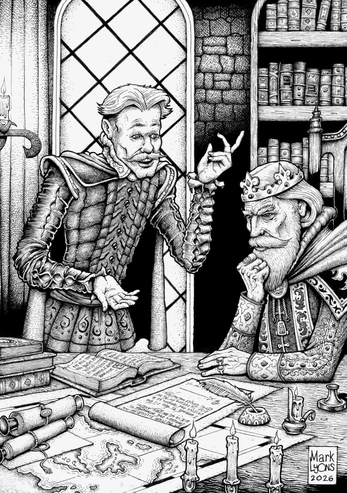

{35}------------------------------------------------

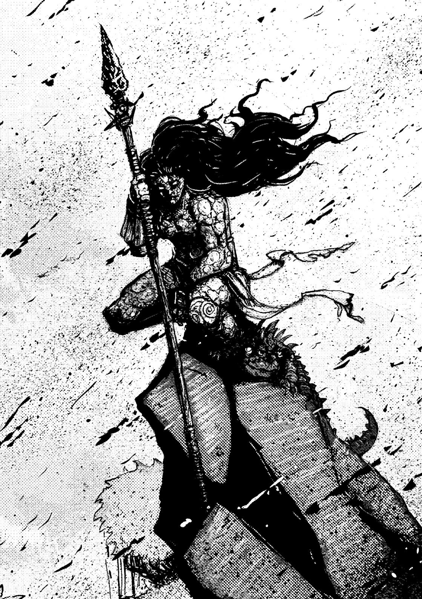

{36}------------------------------------------------

## Basilisk Warrior Class

Blazing-eyed warriors who coat their skin in mud and stone. Their ancient combat style mimics the basilik's regal poise and ferocious strikes.

**Weapons:** Boomerang, club, dagger, spear, spear-thrower

**Armor:** None

**Hit Points:** 1d8 per level

**Basilisk Blood.** You have ADV on CON checks to avoid harmful maladies, poisons, or afflictions.

**Petrifying Gaze.** One creature of your level or less that meets your gaze must pass a DC 15 CON check or be petrified for 1d4 rounds. It still takes damage as normal while petrified.

You can use this talent a number of times per day equal to your CON modifier (minimum 1).

**Stone Skin.** Add 2 + half your level (round down) to your AC if you are otherwise unarmored. You have advantage on checks to hide in natural environments.

#### **BASILISK WARRIOR TALENTS**

- **2d6 Effect (reroll 2 if you currently have a basilisk)** 2 You find a basilisk egg; a loyal hatchling emerges in 1d4 days 3-6 +1 to weapon attacks and damage 7-9 +2 to Strength, Dexterity, or Constitution stat 10-11 +1 use per day of Petrifying Gaze
  - 12 Choose a talent or +2 points to distribute to stats

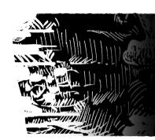

 "A stone does not feel. Or bleed. Or die." -Basilisk warrior saying

{37}------------------------------------------------

## Delver Class

Steely-eyed explorers who delve the forgotten places of the earth. They always have the right tool or know-how to get out of a jam.

**Weapons:** Club, crossbow, dagger, shortbow, shortsword, spear, staff, whip

**Armor:** Leather armor, chainmail, shields

**Hit Points:** 1d6 per level

**Languages.** You know two additional common languages.

**Scavenger.** When you expend the last of a consumable item you've carried since your last rest, roll a d6. On a 5 or 6, you regain one use of that item.

**Trailblazer.** You are adept at exploring inhospitable, lost, or unknown places. You have advantage on the following tasks:

- Climbing
- Swimming
- Foraging
- Understanding unknown languages
- Avoiding or escaping natural terrain hazards

**Trusty Gear.** Choose one type of gear or weapon you can wield. You gain 1 + half your level (round down) on checks or attack rolls made with that type of gear or weapon.

#### **2d6 Effect (reroll 10-11 if Scavenger success range is 3-6)** 2 You gain 2 gear slots and an additional Trusty Gear 3-6 +1 to melee or ranged attacks and damage

**DELVER TALENTS**

- 7-9 +2 to Strength, Dexterity, or Constitution stat
- 10-11 Add one more point to your Scavenger success range
  - 12 Choose a talent or +2 points to distribute to stats

{38}------------------------------------------------

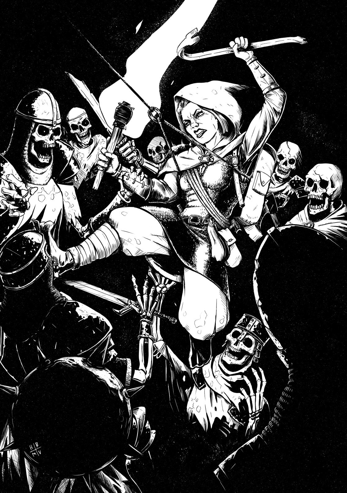

{39}------------------------------------------------

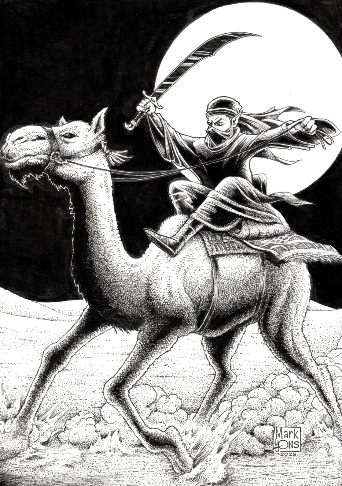

{40}------------------------------------------------

## Desert Rider Class

Howling barbarians thundering across the sand on wild horses, elven spies wielding curved blades atop silvery camels, or bandits wrapped in colorful silks racing on sleek, desert stallions.

**Weapons:** Club, dagger, javelin, longsword, pike, shortbow, scimitar, spear, whip

**Armor:** Leather armor, shields

**Hit Points:** 1d8 per level

**Charge.** 3/day, you can charge into combat by moving at least near before attacking. Each time you do this, your melee attacks deal double damage that round.

**Mount.** You have a common camel or horse with a lovely demeanor ([pg. 114](#page-113-1)). It comes when you call. You can only have one such mount at a time.

While riding your mount, you both get a bonus to AC equal to half your level (round down). Your mount has additional levels equal to half your level (round down). You can freely leap on or off your mount once per round.

If you lose your mount, you can use your downtime to acquire and train another. Pass a DC 15 CHA check for the new creature to become your mount. Lower the DC one step each attempt.

#### **2d6 Effect (2 duplicate = reroll)** 2 You can use any rider-bearing creature as your mount 3-6 You gain +1 to attacks or damage 7-9 +2 to Strength or Dexterity stat, or +1 to melee attacks 10-11 Gain an additional use of your Charge talent each day

**DESERT RIDER TALENTS**

12 Choose a talent or +2 points to distribute to stats

{41}------------------------------------------------

## Duelist Class

Spinning swordsmen and fasttalking fame mongers. Duelists deliver insults and injuries alike to defeat their foes in style.

**Weapons:** Dagger, all swords

**Armor:** Leather armor, mithral chainmail

**Hit Points:** 1d8 per level

**Parry.** Once per day, an attack of your choice that would hit you misses instead.

**Tale Spinner.** You may make a DC 15 CHA check. If you pass, unknown people around you believe you are famous and important for the remainder of your interaction with them.

The same individual cannot be fooled by this twice.

**Taunt.** When an enemy misses you with an attack, you have advantage on attacks against that enemy next round.

#### **2d6 Effect (2 duplicate = +1 use per day)** 2 1/day, all attacks that would hit you this round miss instead 3-6 +1 to melee attacks and damage or +1 Parry per day 7-9 +2 to Strength, Dexterity, or Charisma stat 10-11 Deal +1d6 damage when you hit with a Taunt attack 12 Choose a talent or +2 points to distribute to stats **DUELIST TALENTS**

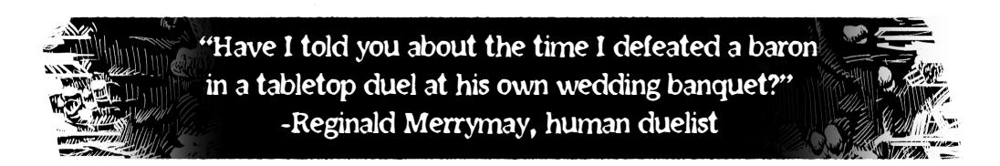

{42}------------------------------------------------

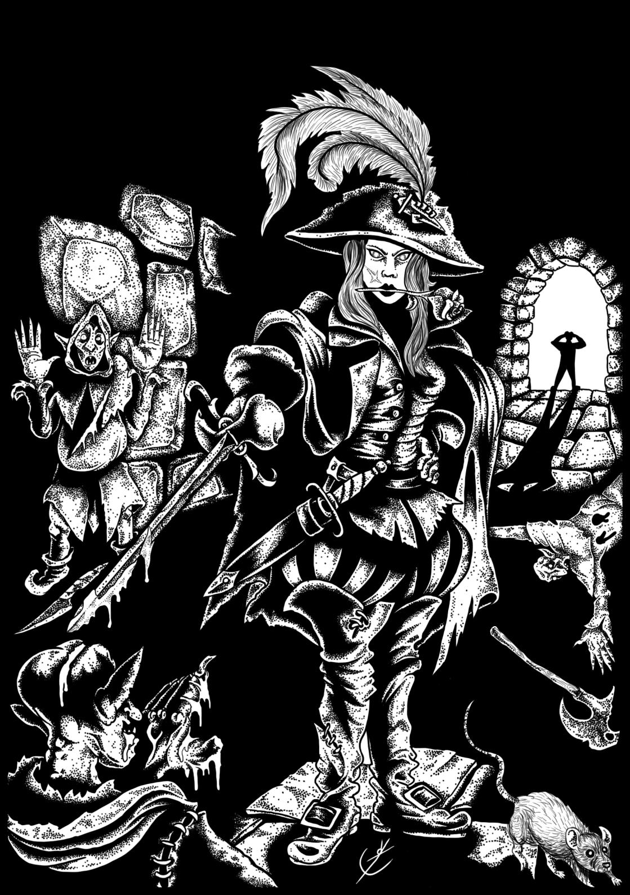

{43}------------------------------------------------

## Green Knight Class

Green-clad knights of the deep wood with armor of antler and bone. Protectors of Gede's realm from the unnatural, the demonic, and the destructive.

**Weapons:** Bastard sword, crossbow, dagger, greataxe, greatsword, handaxe, spear, staff

**Armor:** All armor and shields

**Hit Points:** 1d6 per level

**Deity.** Your deity is Gede.

**Languages.** You know Sylvan.

**Rooted.** 3/day, activate on your turn. Negate all damage you take until your next turn begins. **Spellcasting.** You can cast druid spells you know (see [pg. 166](#page-165-1)).

Each time you gain a level, you choose new druid spells to learn according to the Druid Spells Known table.

You use your Wisdom modifier to cast druid spells. The DC is 10 + the spell's tier.

If you fail a spellcasting check, you can't cast that spell again until you complete a rest. If you roll a natural 1 on a spellcasting check, you can't cast that spell again until you complete penance in accordance with Gede's demands (see [pg. 194\)](#page-193-1).

#### **GREEN KNIGHT TALENTS**

| 2d6   | Effect (2 duplicate = +1 use per day)                    |  |  |
|-------|----------------------------------------------------------|--|--|
| 2     | 1/day, step into a tree and exit from another within far |  |  |
| 3-6   | +1 to melee or ranged attacks and damage                 |  |  |
| 7-9   | +2 to Strength, Dexterity, or Constitution stat          |  |  |
| 10-11 | +2 to Wisdom stat or +1 to druid spellcasting checks     |  |  |
| 12    | Choose a talent or +2 points to distribute to stats      |  |  |

{44}------------------------------------------------

#### **DRUID SPELLS KNOWN**

| Level | 1 | 2 | 3 |
|-------|---|---|---|
| 1     | - | - | - |
| 2     | 1 | - | - |
| 3     | 2 | - | - |
| 4     | 3 | - | - |
| 5     | 3 | 1 | - |
| 6     | 3 | 2 | - |
| 7     | 3 | 3 | - |
| 8     | 3 | 3 | 1 |
| 9     | 3 | 3 | 2 |
| 10    | 3 | 3 | 3 |

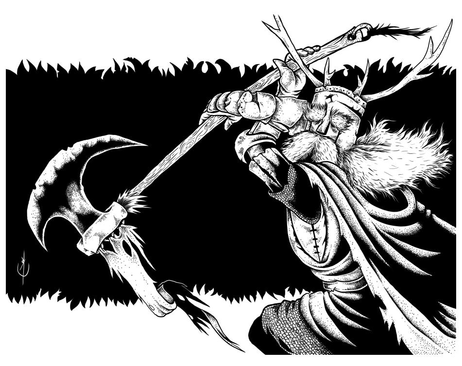

{45}------------------------------------------------

## Knight of St. Ydris Class

Cursed knights who walk the path of St. Ydris the Unholy, the Possessed. They embrace the darkness in order to fight it, cleansing evil with a flurry of steel and forbidden sorcery.

**Weapons:** All melee weapons, crossbow

**Armor:** All armor and shields

**Hit Points:** 1d6 per level

**Languages.** You know Diabolic.

**Demonic Possession.** 3/day, gain a +1 bonus to your attack and damage rolls that lasts 3 rounds. In addition, add half your level to the bonuses (round down).

**Spellcasting.** You can cast witch spells you know (see [pg. 150](#page-149-1)).

Each time you gain a level, you choose new witch spells to learn according to the Witch Spells Known table.

You use your Charisma modifier to cast witch spells. The DC is 10 + the spell's tier.

If you fail a spellcasting check, you can't cast that spell again until you complete a rest.

If you roll a natural 1 on a spellcasting check, you must also roll on the corresponding Diabolical Mishap table (see [pg.](#page-183-1)  [184\)](#page-183-1) for the spell's tier.

#### **KNIGHT OF ST. YDRIS TALENTS**

|       | 2d6 | Effect                                                 |
|-------|-----|--------------------------------------------------------|
|       | 2   | Your Demonic Possession bonus increases by 1 point     |
|       | 3-6 | +1 to melee or ranged attacks                          |
|       | 7-9 | +2 to Strength, Dexterity, or Constitution stat        |
| 10-11 |     | +2 to Charisma stat or +1 to witch spellcasting checks |
|       | 12  | Choose a talent or +2 points to distribute to stats    |

{46}------------------------------------------------

#### **WITCH SPELLS KNOWN**

#### **Spells Known By Spell Tier**

| Level | 1 | 2 | 3 |
|-------|---|---|---|
| 1     | - | - | - |
| 2     | 1 | - | - |
| 3     | 2 | - | - |
| 4     | 3 | - | - |
| 5     | 3 | 1 | - |
| 6     | 3 | 2 | - |
| 7     | 3 | 3 | - |
| 8     | 3 | 3 | 1 |
| 9     | 3 | 3 | 2 |
| 10    | 3 | 3 | 3 |

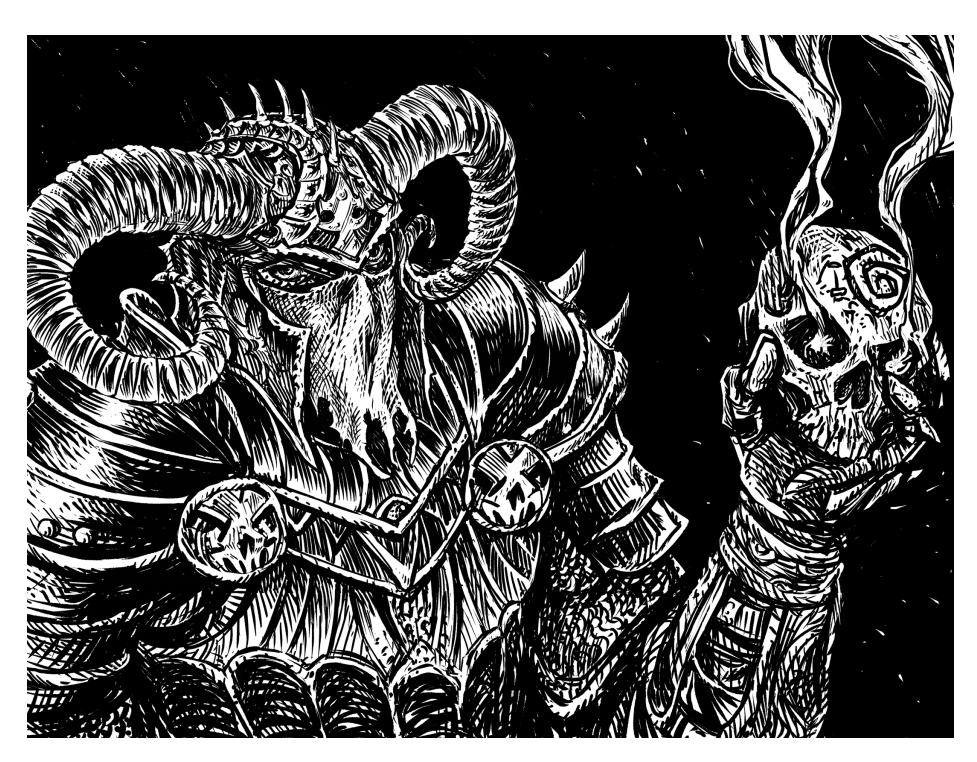

{47}------------------------------------------------

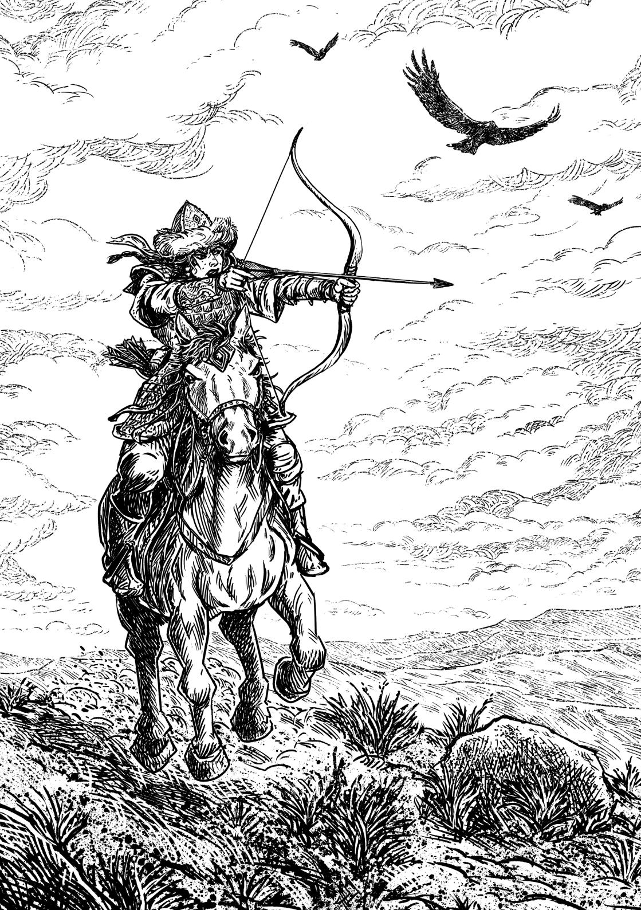

{48}------------------------------------------------

## Kyzian Archer Class

Swift horse riders who race across the Steppes like wolf packs. They are trained in the deadly Kyzian archery style.

**Weapons:** Dagger, longbow, shortbow, sling, scimitar

**Armor:** Leather armor

**Hit Points:** 1d6 per level

**Hawk Eye.** Three times per day, add 1 + half your level (round down) to your next ranged attack and its damage roll.

**Kyzian Quiver.** One of your arrow quivers can hold up to 80 arrows while only occupying one gear slot.

**Mount.** You have a warhorse with a lovely demeanor [\(pg.](#page-113-1)  [114\)](#page-113-1). It comes when you call. You can only have one such mount at a time.

Your mount has additional levels equal to half your level (round down).

While riding your mount in combat, you are not slowed by difficult terrain.

If you lose your mount, you can use your downtime to acquire and train another warhorse. Pass a DC 15 CHA check for the new warhorse to become your mount. Lower the DC by one step with each attempt.

#### **KYZIAN ARCHER TALENTS**

| 2d6   | Effect                                                |
|-------|-------------------------------------------------------|
| 2     | The damage of one weapon type you wield becomes a d10 |
| 3-6   | +1 to ranged attacks and damage                       |
| 7-9   | +2 to Strength, Dexterity, or Constitution stat       |
| 10-11 | Gain an additional use of Hawk Eye per day            |
| 12    | Choose a talent or +2 points to distribute to stats   |

{49}------------------------------------------------

## Monk of Yag-Kesh Class

Still, quiet monks in light linen garb. They undergo intense physical and mental training from early childhood in the Monastery of Yag-Kesh.

**Weapons:** Staff, strikes

**Armor:** None

**Hit Points:** 1d8 per level

**Eye Of Yag-Kesh.** While unarmored, add your Wisdom modifier (if positive) to your AC.

**Fist Of The Moon God.** Your strikes are +0 magic weapons that deal a d8 damage. They become +1 at 2nd level, +2 at 4th level, and +3 at 8th level.

**Still The Heart.** You can stop your metabolism for a total number of rounds per day equal to your level.

You gain the following benefits for the duration:

- You do not need to breathe.
- Delay the onset of any poisons until this effect ends.
- If you drop to 0 HP, you do not fall unconscious or begin dying until this effect ends.

**Sun On The Water.** Once per day, when a melee or ranged attack misses you, reflect the attack back at the source using the attacker's bonus.

#### **2d6 Effect (2 duplicate = +1 use per day)** 2 Once per day, double your movement speed for 3 rounds 3-6 +1 to melee attacks and damage 7-9 +2 to Strength, Dexterity or Wisdom stat 10-11 Gain an additional use per day of Sun On The Water

**MONK OF YAG-KESH TALENTS**

12 Choose a talent or +2 points to distribute to stats

{50}------------------------------------------------

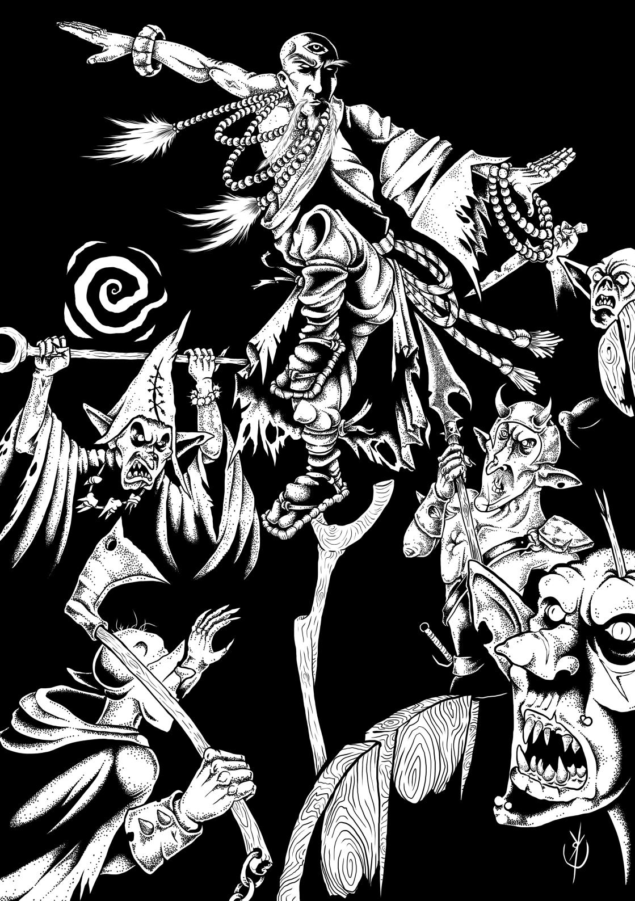

{51}------------------------------------------------

## Necromancer Class

Feared mystics who see beyond the shores of the living world. These warrior-mages guide the dead to their final rest or call them back from its dark waters to walk again in life.

**Weapons:** Crossbow, dagger, longsword, scimitar, staff, stave

**Armor:** Leather armor, chainmail

**Hit Points:** 1d6 per level

**Death Sense.** You can sense the location and general nature of undead and dying creatures within near of you.

**River of Death.** Your spirit has walked in the eternal river, and you have learned to resist the pull of death. You do not die at 0 CON, and you roll a d6 for your death timer instead of a d4.

**Spellcasting.** You can cast necromancer spells you know.

You know two tier 1 spells of your choice from the necromancer spell list (see [pg. 122\)](#page-121-1).

Each time you gain a level, you choose new necromancer spells to learn according to the Necromancer Spells Known Table.

You use your Charisma modifier to cast necromancer spells. The DC is 10 + the spell's tier. If you fail a spellcasting check, you can't cast that spell again until you complete a rest.

If you roll a natural 1 on a spellcasting check, you must also roll on the corresponding Necromancer Mishaps table for the spell's tier (see [pg. 186](#page-185-1)).

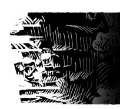

 "The dead don't talk? The living don't listen." -Gezion, half-orc necromancer

{52}------------------------------------------------

#### **NECROMANCER SPELLS KNOWN**

| Level | 1 | 2 | 3 | 4 | 5 |
|-------|---|---|---|---|---|
| 1     | 2 | - | - | - | - |
| 2     | 3 | - | - | - | - |
| 3     | 3 | 1 | - | - | - |
| 4     | 3 | 2 | - | - | - |
| 5     | 3 | 2 | 1 | - | - |
| 6     | 3 | 2 | 2 | - | - |
| 7     | 3 | 3 | 2 | 1 | - |
| 8     | 3 | 3 | 2 | 2 | - |
| 9     | 3 | 3 | 2 | 2 | 1 |
| 10    | 3 | 3 | 3 | 2 | 2 |

#### **NECROMANCER TALENTS**

- **2d6 Effect (2 repeat = additional use)**
- The next time you die, you may return to life with full HP
- 3-7 +1 to your spellcasting checks or +1 to melee attacks
- 8-9 +2 to Strength, Constitution, or Charisma stat
- 10-11 Gain advantage on casting one spell you know
  - Choose a talent or +2 points to distribute to stats

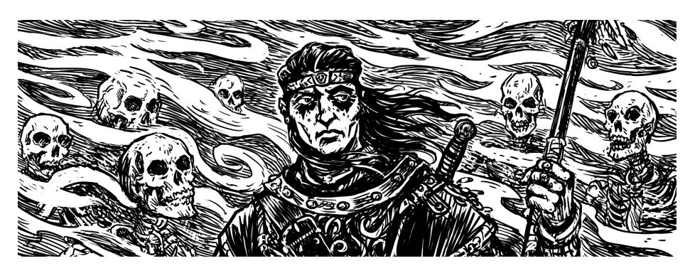

{53}------------------------------------------------

## Paladin Class

Steel-clad paragons of knighthood who exemplify its highest ideals. They embody honor, duty, and courage.

**Weapons:** Bastard sword, dagger, greatsword, javelin, lance, longsword, shortsword

**Armor:** All armor and shields

**Hit Points:** 1d8 per level

**Chivalric Oath.** You swear to act with integrity, humility, and chivalry. You must give honor and mercy to the deserving.

If you break this oath, you lose your Inspiring Presence and Named Blade talents until completing a holy quest of great challenge.

**Inspiring Presence.** Allies within near of you rise from dying on a roll of 18-20 and regain HP equal to your CHA bonus (min. 1).

Enemies within near of you lose immunity to morale checks.

**Mount.** You have a warhorse with a lovely demeanor [\(pg.](#page-113-1)  [114\)](#page-113-1). It comes when you call.

You can only have one such mount at a time. Your mount has additional levels equal to half your level (round down).

If you lose your mount, you can use your downtime to acquire and train another. Pass a DC 15 CHA check for the new warhorse to become your mount. Lower the DC one step each attempt.

**Named Blade.** At 1st level, you gain a sword of your choice. It is a +0 magic weapon.

It becomes a +1 weapon at 2nd level, +2 at 5th level, and +3 at 8th level.

When you reach 3rd level, it gains a random magic weapon benefit (see *SD* pg. 293).

If you lose your Named Blade, you can find another by completing a holy quest.

{54}------------------------------------------------

| 2d6   | Effect                                                 |  |
|-------|--------------------------------------------------------|--|
| 2     | Your Named Blade gains a random magic weapon benefit   |  |
| 3-6   | Gain +1 to attacks and damage with your Named Blade    |  |
| 7-9   | +2 to Strength, Constitution, or Charisma stat         |  |
| 10-11 | Increase your Inspiring Presence dying roll range by 1 |  |
| 12    | Choose a talent or +2 points to distribute to stats    |  |

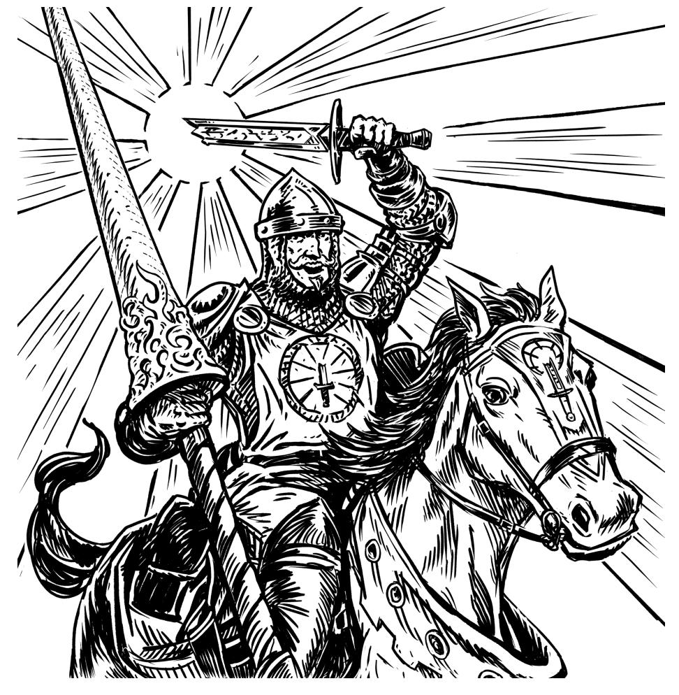

{55}------------------------------------------------

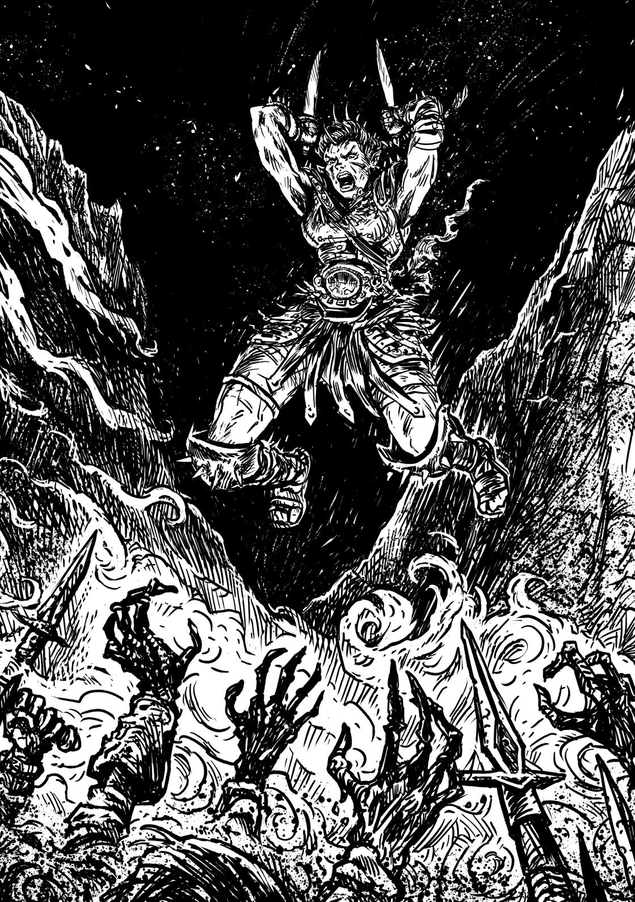

{56}------------------------------------------------

## Pit Fighter Class

Blood-soaked warriors circling each other in a roaring arena, scarred desert bandits dueling for the right to lead their gang, or brash tavern brawlers who never turn down a challenge.

**Weapons:** All weapons

**Armor:** Leather armor, shields

**Hit Points:** 1d8 per level

**Flourish.** 3/day, regain 1d6 hit points when you hit an enemy with a melee attack.

**Implacable.** You have advantage on Constitution checks to resist injury, poison, or endure extreme environments.

**Last Stand.** You get up from dying with 1 HP on a natural d20 roll of 18-20. Once per day, automatically pass this check.

**Relentless.** While you are dying, you may forgo d20 rolls to rise from dying. If you do, you remain conscious and can act. Each time you take damage in this state, lose 1 death timer round.

#### **2d6 Effect (2 duplicate = additional use per day)** 2 1/day, ignore all damage and effects from one attack 3-6 +1 to melee attacks and damage 7-9 +2 to Strength or Constitution stat, or +3 HP

**PIT FIGHTER TALENTS**

10-11 Increase the HP you regain from Flourish by 1d6 12 Choose a talent or +2 points to distribute to stats

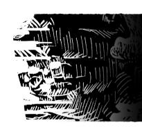

 "It's over when I SAY it's over!" -Markesh, human pit fighter

{57}------------------------------------------------

## Ranger Class

Skilled trackers, stealthy wanderers, and peerless warriors who call the wilds their home.

**Weapons:** Dagger, longbow, longsword, shortbow, shortsword, spear, staff

**Armor:** Leather armor, chainmail

**Hit Points:** 1d8 per level

**Wayfinder.** You have advantage on checks associated with:

- Navigation
- Tracking
- Bushcraft
- Stealth
- Wild animals

**Herbalism.** Make an INT check to prepare an herbal remedy you choose. If you fail, you can't make that remedy again until you successfully rest. Unused remedies expire in 3 rounds.

#### **DC Effect** 11 **Salve.** Heals 1 HP 12 **Stimulant.** You can't be surprised for 10 rounds 13 **Foebane.** You get ADV on attacks and damage against one creature type you choose for 1d6 rounds 14 **Restorative.** Ends one poison or disease 15 **Curative.** Equivalent to a *Potion of Healing* **HERBAL REMEDY**

#### **RANGER TALENTS**

| 2d6   | Effect                                                   |
|-------|----------------------------------------------------------|
| 2     | You deal d12 damage with one weapon type you choose      |
| 3-6   | +1 to melee or ranged attacks and damage                 |
| 7-9   | +2 to Strength, Dexterity, or Intelligence stat          |
| 10-11 | You gain ADV on Herbalism checks for a remedy you choose |
| 12    | Choose a talent or +2 points to distribute to stats      |

{58}------------------------------------------------

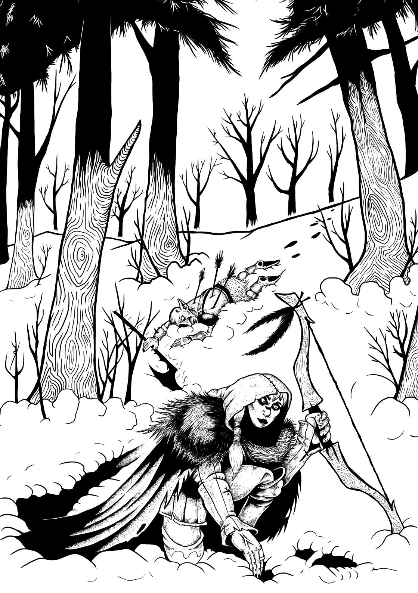

{59}------------------------------------------------

## Ras-Godai Class

Black-clad assassins who train from childhood inside a hidden desert monastery. They gain their sorcerous powers from a legendary black lotus flower that was given to them by a demon.

**Weapons:** Blowgun, bolas, dagger, razor chain, scimitar, shuriken, spear

**Armor:** Leather armor

**Hit Points:** 1d6 per level

**Languages.** You know Diabolic.

**Assassin.** You have advantage on checks to sneak and hide. Your attacks deal double damage against targets that are unaware of your presence.

**Smoke Step.** 3/day, teleport to a location you can see within near. This does not use your action.

**Black Lotus.** You earned the right to eat a petal of the fabled black lotus flower, and you survived its sorcerous effects. Roll one talent on the Black Lotus Talents table.

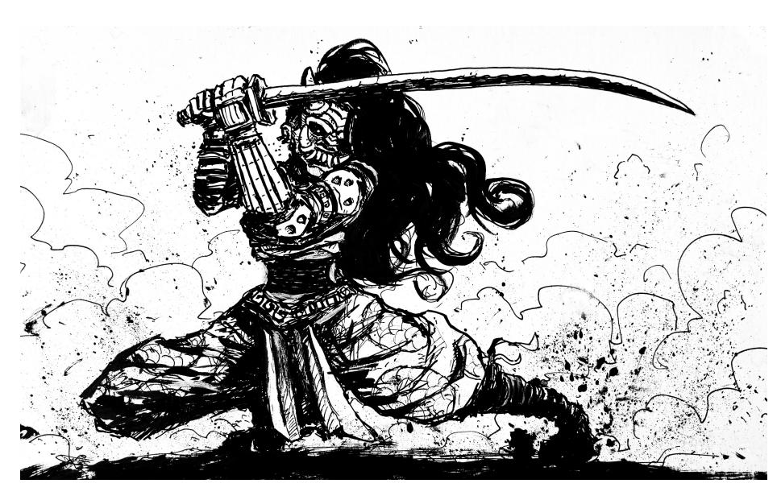

{60}------------------------------------------------

#### **2d6 Effect (2 duplicate = reroll)** 2 You are trained in the use of poisons (see [pg. 113\)](#page-112-1) 3-6 Roll an additional talent on the Black Lotus Talents table 7-9 +2 to Strength or Dexterity stat, or +1 to melee attacks 10-11 Gain an additional use of your Smoke Step talent **RAS-GODAI TALENTS**

12 Choose a talent or +2 points to distribute to stats

|     | BLACK LOTUS TALENTS                                                                                                                   |
|-----|---------------------------------------------------------------------------------------------------------------------------------------|
| d12 | Details (You may keep or reroll duplicates)                                                                                           |
| 1   | Gain two Black Lotus talents (reroll further 1s this instance)                                                                        |
| 2   | 1/day, paralyze a target of LV 9 or less for 1d4 rounds when you damage it with a weapon                                           |
| 3   | You have advantage on Dexterity checks to avoid entrapment or injury                                                               |
| 4   | You gain +1 to your AC when wielding a melee weapon in each hand                                                                   |
| 5   | You gain an additional hit points die                                                                                                 |
| 6   | You deal triple damage with your Assassinate talent                                                                                   |
| 7   | When enemies who can see you make a morale check, the DC is 18 instead of 15                                                       |
| 8   | 1/day, you can walk on water as if it were solid for 1d4 rounds                                                                       |
| 9   | 1/day, choose a living creature of LV 5 or less you can see within near; it must pass a DC 15 CON check or fall asleep             |
| 10  | 1/day, you can walk on sheer surfaces such as walls for 1d4 rounds                                                                 |
| 11  | You deal +1 damage with melee weapons                                                                                                 |
| 12  | 1/day, choose a creature of LV 9 or less you can see; it must pass a DC 15 WIS check or it can't see or hear you for 1d4 rounds |

{61}------------------------------------------------

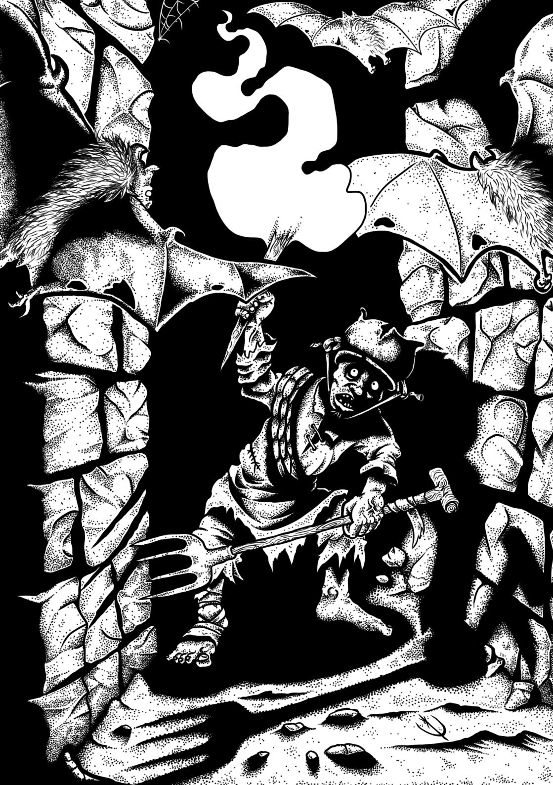

{62}------------------------------------------------

## Roustabout Class

Average laggards of no particular talent. They wield weapons and magic with the elegance of a hog-tied kobold. But if their back is against a wall, a glint of bravery may, on rare occasions, rise to the surface.

**Weapons:** Club, dagger, staff

**Armor:** Leather armor

**Hit Points:** 1d4 per level

**Knowaguy.** You have advantage on checks related to interacting with commoners and sourcing favors.

**Lucksmith.** Whenever another player uses your luck token, they have advantage on the new roll.

**Surprising Guts.** When you are reduced to half your HP or lower, you have advantage on your next roll.

#### **2d6 Effect** 2 +1 to any stat and roll another talent 3-6 Gain the ability to wield a new weapon or armor 7-9 +1 to any two stats (they can't be the same) 10-11 Roll an extra hit points die this level **ROUSTABOUT TALENTS**

12 Learn any spell of a tier equal to half your level rounded down (min. 1). Cast it using that class's spellcasting stat

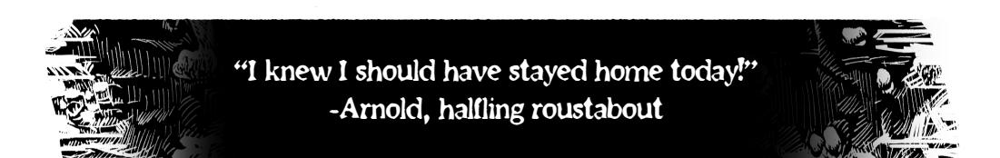

{63}------------------------------------------------

## Sea Wolf Class

Seafaring raiders who prowl the isles for plunder in dragonheaded longboats. When the warhorn sounds, they become fierce berserkers and shield maidens who hope to please their gods with a brave death.

**Weapons:** Dagger, greataxe, handaxe, longbow, longsword, spear

**Armor:** Leather armor, chainmail, shields

**Hit Points:** 1d8 per level

**Seafarer.** You have advantage on checks related to navigating and crewing boats.

**Old Gods.** Each day, your purpose aligns with one of the three Old Gods of the nords. Choose one of the below options after you complete a rest; you gain its benefits until you complete your next rest.

- **Odin.** You regain 1d4 HP every time you kill an enemy.
- **Freya.** Once a day, gain a luck token if you don't have one. Each time you use a luck token, add 1d6 to your roll.
- **Loki.** You have advantage on checks to lie, sneak, and hide.

**Shield Wall.** If you wield a shield, you can use your action to take a defensive stance. Your AC becomes 20 during this time.

|       | SEA WOLF TALENTS                                            |
|-------|-------------------------------------------------------------|
| 2d6   | Effect (2 duplicate = +1 use/day, 10-11 duplicate = reroll) |
| 2     | 1/day, go berserk: immune to damage for 3 rounds            |
| 3-6   | Your attacks deal +1 damage                                 |
| 7-9   | +2 to Strength or Constitution stat, or +1 to attacks       |
| 10-11 | Duality; choose two different Old Gods effects each day     |
| 12    | Choose a talent or +2 points to distribute to stats         |

{64}------------------------------------------------

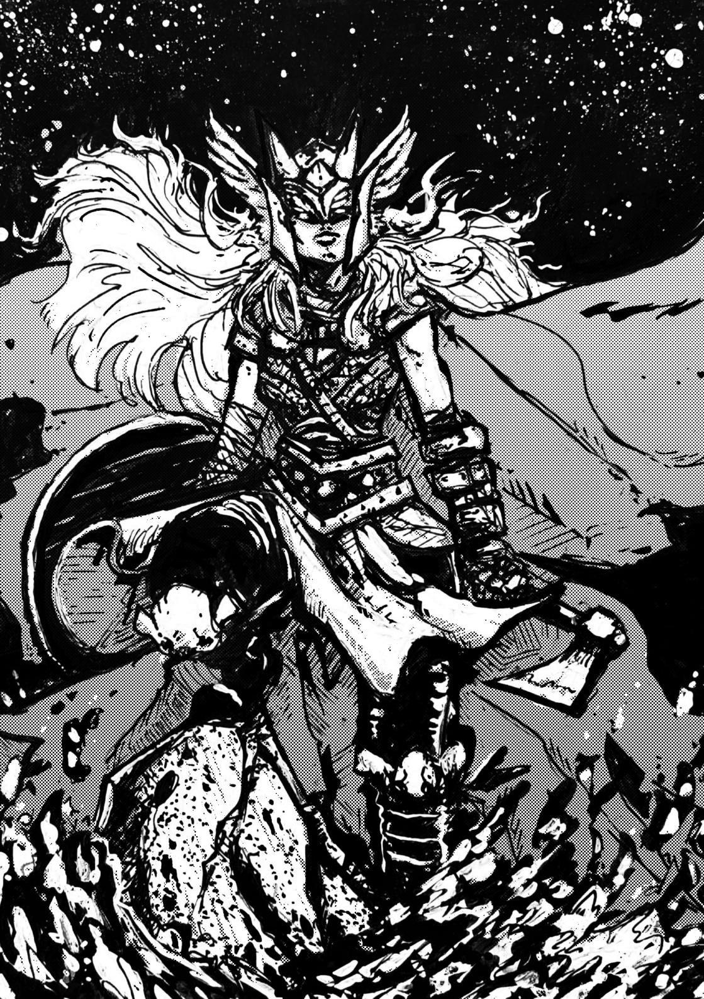

{65}------------------------------------------------

## Seer Class

Baleful diviners who reek of smoke and blood. They untangle the whispers of the gods by reading the runes, the bones, and the stars. Their knowledge of fate allows them to bend it.

**Weapons:** Dagger, stave, spear

**Armor:** Leather armor

**Hit Points:** 1d6 per level

**Destined.** Whenever you use a luck token, add 1d6 to the roll.

**Omen.** 3/day, you can make a DC 9 WIS check. On a success, gain a luck token (you can't have more than one luck token at a time).

**Spellcasting.** You can cast seer spells you know. You know one tier 1 spell of your choice from the seer spell list (see [pg. 144](#page-143-1)).

Each time you gain a level, you choose a new seer spell to learn according to the Seer Spells Known table.

You use your Wisdom modifier to cast seer spells. The DC is 10 + the spell's tier.

If you fail a spellcasting check, you can't cast that spell again until you complete a rest. If you roll a natural 1 on a spellcasting check, you can't cast that spell again until you complete Seer Penance.

#### **SEER TALENTS**

| 2d6   | Effect                                                    |
|-------|-----------------------------------------------------------|
| 2     | Learn an additional seer spell from any tier you can cast |
| 3-6   | Gain an additional use of your Omen talent each day       |
| 7-9   | +2 to WIS or CHA stat, or +1 to spellcasting checks       |
| 10-11 | Increase the die category of your Destined talent by one  |
| 12    | Choose a talent or +2 points to distribute to stats       |

{66}------------------------------------------------

|       |   | SEER SPELLS KNOWN          |   |   |   |
|-------|---|----------------------------|---|---|---|
|       |   | Spells Known By Spell Tier |   |   |   |
| Level | 1 | 2                          | 3 | 4 | 5 |
| 1     | 1 | -                          | - | - | - |
| 2     | 2 | -                          | - | - | - |
| 3     | 2 | 1                          | - | - | - |
| 4     | 2 | 2                          | - | - | - |
| 5     | 2 | 2                          | 1 | - | - |
| 6     | 2 | 2                          | 2 | - | - |
| 7     | 2 | 2                          | 2 | 1 | - |
| 8     | 2 | 2                          | 2 | 2 | - |
| 9     | 2 | 2                          | 2 | 2 | 1 |
| 10    | 2 | 2                          | 2 | 2 | 2 |

|            | SEER PENANCE                                                                   |
|------------|--------------------------------------------------------------------------------|
| Spell Tier | Sacrifice                                                                      |
| 1          | Temporarily give up 1d4 HP (you stay at 1 HP minimum); it returns in a week |
| 2          | Temporarily lower your WIS stat by 2 points; it returns in two weeks        |
| 3          | Sacrifice 1 point of Charisma; it never returns                                |
| 4          | Ritualistically sink a burning longboat into the sea                           |
| 5          | Ritualistically sacrifice 9 humanoid lives                                     |

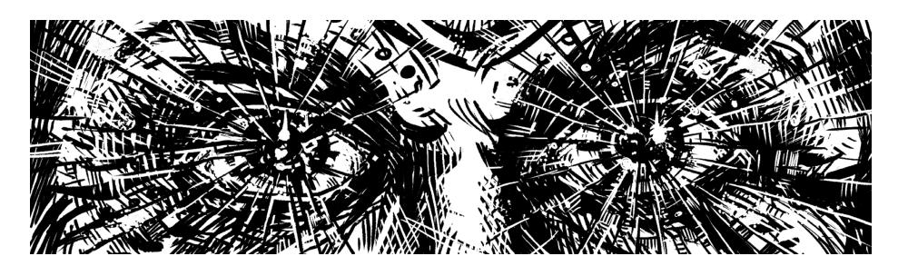

{67}------------------------------------------------

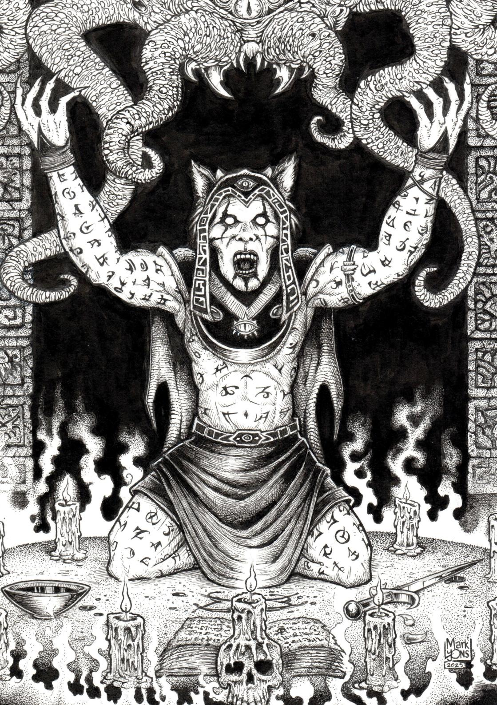

{68}------------------------------------------------

## Warlock Class

Howling warriors with sharpened teeth, wild-eyed doomspeakers preaching of The Dissolution, and cloaked lore-hunters bearing the hidden Mark of Shune.

**Weapons:** Club, crossbow, dagger, mace, longsword

**Armor:** Leather armor, chainmail, and shields

**Hit Points:** 1d6 per level

**Languages.** You know either Celestial, Diabolic, Draconic, Primordial, or Sylvan.

**Patron.** Choose a patron to serve (see [pg. 206](#page-205-1)). Your patron can choose to remove the Patron Boons it has granted you if you displease it.

You gain a new Patron Boon at every even level.

**Patron Boon.** At 1st level, you gain a random Patron Boon talent based on your chosen patron (see [pg. 206](#page-205-1)).

Whenever you gain a new talent roll, you may choose to roll on your Patron Boon table rather than the Warlock Talents table.

#### **2d6 Effect** 2 Roll a Patron Boon from any patron; an unexplained gift 3-6 Add +1 point to two stats (they must be different) 7-9 +1 to melee or ranged attacks

**WARLOCK TALENTS**

10-11 Roll two Patron Boons and choose one to keep 12 Choose a talent or +2 points to distribute to stats

{69}------------------------------------------------

## Witch Class

Cackling crones stooped over cauldrons, chanting shamans smeared in blood and clay, and outcast maidens with milky eyes that see portents and secrets.

**Weapons:** Dagger, staff

**Armor:** Leather armor

**Hit Points:** 1d4 per level

**Languages.** You know Diabolic, Primordial, and Sylvan.

**Familiar.** You have a small animal such as a raven, rat, or frog who serves you loyally. It can speak Common.

Your familiar can be the source of spells you cast. Treat it as though it were you for determining spell ranges.

If your familiar dies, you can restore it to life by permanently sacrificing 1d4 hit points.

**Spellcasting.** You can cast witch spells you know.

You know three tier 1 spells of your choice from the witch spell list (see [pg. 150](#page-149-1)).

Each time you gain a level, you choose new witch spells to learn according to the Witch Spells Known table.

You use your Charisma modifier to cast witch spells. The DC is 10 + the spell's tier.

If you fail a spellcasting check, you can't cast that spell again until you complete a rest.

If you roll a natural 1 on a spellcasting check, you must also roll on the corresponding Diabolical Mishap table for the spell's tier (see [pg. 184\)](#page-183-1).

{70}------------------------------------------------

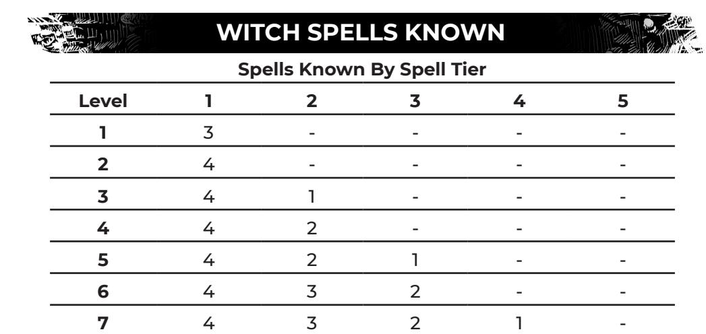

 4 4 2 2 - 4 4 3 2 1 4 4 4 2 2

|       | WITCH TALENTS                                            |
|-------|----------------------------------------------------------|
| 2d6   | Effect (2 duplicate = +1 use per day)                    |
| 2     | 1/day, teleport to your familiar's location as a move    |
| 3-7   | +2 to Charisma stat or +1 to witch spellcasting checks   |
| 8-9   | Gain advantage on casting one spell you know             |
| 10-11 | Learn an additional witch spell of any tier you can cast |
| 12    | Choose a talent or +2 points to distribute to stats      |

{71}------------------------------------------------

## Wyrdling Class

Those who have been called down into the dark, have listened to the gibbering of vile abominations, and have felt the rapturous presence of The Lost walking with them in the abyss.

**Weapons:** Club, crossbow, dagger, pseudopod, shortbow, shortsword, spear

**Armor:** Leather armor, chainmail, shields

**Hit Points:** 1d6 per level

**Languages.** You know Primordial.

**Corruption.** Roll one talent on the Corruption Table.

**Hideous Biology.** You can hideously stretch your body to fit through inch-wide cracks. It takes you 3 rounds to pass through an obstacle in this way.

**Pseudopod.** You can sprout a clawed, horrid pseudopod from your body. See its details below.

#### **2d6 Effect** 2 Gain two new Corruption talents 3-6 +2 to Strength, Dexterity, or Charisma stats 7-9 Gain a new Corruption talent **WYRDLING TALENTS**

10-11 Gain +1 to attacks and damage rolls with your pseudopod

12 Choose a talent or +2 points to distribute to stats

#### **Weapon Cost Type Range Damage Properties** Pseudopod - M N 1d6 F **PSEUDOPOD**

**Finesse (F).** You may use your STR or DEX when attacking with this weapon.

{72}------------------------------------------------

- **Mad Certainty.** You are immune to effects that target your mind or spirit, including The Chittering (*GMWR* pg. 70).
- **Vicious Pseudopod.** Your pseudopod sprouts barbs. Increase its damage die by one step (reroll if its die is d12).
- **Segmented Pseudopod.** Your pseudopod's range increases to double near.
- **Fish Gills.** You can breathe underwater.
- **Dorsal Hump.** You permanently gain 1d6 hit points.
  - **Thickened Skin.** You gain +1 to your armor class.
  - **Fish Eyes.** You cannot be surprised (goblins reroll).
  - **Abominable Hunger.** Once a day, regain 2d6 HP by devouring humanoid flesh. +1 use each time rolled.
  - **Creepy Stillness.** You gain ADV on DEX checks to hide and sneak.
  - **Evolution.** Distribute +3 points between your stats and HP.

{73}------------------------------------------------

## Backgrounds

#### **BACKGROUNDS**

| d100/d12 | Desert                                                          |
|----------|-----------------------------------------------------------------|
| 01       | Alkeshi. You have helpful contacts in the City-State of Alkesh  |
| 02       | Outlander. You came with a caravan from a distant land          |
| 03       | Siruul. The desert elves raised you and taught you survival     |
| 04       | Assassin. You were a killer for hire before leaving it behind   |
| 05       | Escapee. You escaped a cult dedicated to the demon Molek        |
| 06       | Miraged. You got lost in the desert and forgot who you are      |
| 07       | Scrag Trainer. You can ride scrag and teach them tricks         |
| 08       | Bandit. You have connections with your old bandit crew          |
| 09       | Gladiator. You survived the arena and have a few local fans     |
| 10       | Merchant. You are a skilled haggler and always get a deal       |
| 11       | Hunted. The Ras-Godai assassins have a contract to kill you     |
| 12       | Arcanist. You know how to find Gehemna, the fabled library      |
|          | Swamp                                                           |
|          |                                                                 |
| 13       | Stilt Orcs. Reclusive orcs raised you to thrive in the swamps   |
| 14       | Snake Catcher. You know how to trick and charm snakes           |
| 15       | Ghostly. Swamp halflings raised you to move about unseen        |
| 16       | Haunted. A restless spirit follows you; it wants something      |
| 17       | Feral. You grew up alone and lived by survival of the fittest   |
| 18       | Bogborn. You can easily spot the bog's hidden dangers           |
| 19       | Chosen. An eldritch force calls to you in the dark of the night |
| 20       | Mystic. You see portents in the moonlit waters of the bog       |
| 21       | Spirited Away. A hag kidnapped you and raised you for years     |

{74}------------------------------------------------

#### **BACKGROUNDS**

| 23 | Sworn. You made a risky bargain with a swamp demon             |
|----|----------------------------------------------------------------|
| 24 | Death-Touched. You are often mistaken for being undead         |
|    | Island and Ocean                                               |
| 25 | Nord. A warrior clan from the Isles of Andrik raised you       |
| 26 | Fisher. You can catch a fish better than just about anyone     |
| 27 | Shipwright. You know how to build and repair ships             |
| 28 | Pirate. You have a criminal past and friends in low places     |
| 29 | Pearl Diver. You can swim and dive like the merfolk of lore    |
| 30 | Marooned. You were left for dead but somehow survived          |
| 31 | Displaced. Your home was destroyed and you seek revenge        |
| 32 | Skald. You've been trained to sing the legends of the nords    |
| 33 | Prisoner. You escaped a hard life of rowing in a ship's galley |
| 34 | Trader. You know your way around every port city and town      |
| 35 | Sailor. You're at home on the water and capable at sailing     |
|    |                                                                |
| 36 | Privateer. You work for a lord to catch and punish pirates     |
|    | Grassland                                                      |
| 37 | Kyzian. You belong to a nomadic Kyzian clan led by a prince    |
| 38 | Horse Trader. You know all about horses, and they like you     |
| 39 | Warden. You tend to the ancient tombs and burial mounds        |
| 40 | Scavenger. You prey on the weak and survive on scraps          |
| 41 | Meadowborn. Halflings treat you as a cousin or good friend     |
| 42 | Pariah. Your family cast you out to make an example of you     |
| 43 | Hawk Trainer. Birds of prey view you as a kindred spirit       |
| 44 | Warrior. You have pledged military service to a Kyzian Prince  |
| 45 | Antiquarian. You know all about rare curios and odd trinkets   |
| 46 | Palaceborn. You are a minor noble from the Ivory Palace        |
| 47 | Stormborn. A spirit of wind and thunder watches over you       |

{75}------------------------------------------------

#### **BACKGROUNDS**

#### **Mountain**

| 49 | Stoneborn. The dwarves of Stonehall raised you proudly        |
|----|---------------------------------------------------------------|
| 50 | Deep Dweller. You know the ways of deep and silent places     |
| 51 | Blacksmith. You are skilled in the peerless dwarvish craft    |
| 52 | Miner. You have an instinct for the stone's many dangers      |
| 53 | Astronomer. You know the stars and their complex patterns     |
| 54 | Rimeborn. Bitter cold does not affect you as it does others   |
| 55 | Abducted. You awoke with no memory on a mountain peak         |
| 56 | Monk. You were a student in the Monastery of Yag-Kesh         |
| 57 | Goatherd. Domestic animals trust you and follow your lead     |
| 58 | Ras-Godai. You trained among the Ras-Godai assassins          |
| 59 | Orcish. Mountain orcs raised you and taught you their ways    |
| 60 | Goblinborn. A tribe of goblins reared you as one of their own |
|    |                                                               |
|    | Forest                                                        |
| 61 | Lydonian. You grew up in Lydonia and have contacts there      |
| 62 | Hunter. You're an expert at hunting game in the woods         |
| 63 | Orphan. You wandered into town as a ragged, lost child        |
| 64 | Fugitive. You're hiding in the woods from the authorities     |
| 65 | Witchborn. You inherited a strong talent for the occult       |
| 66 | Herbalist. You know the forest's remedies and poisons         |
| 67 | Grave Digger. You know more about the dead than most          |
| 68 | Demonic. You were found beneath a cursed Marrow tree          |
| 69 | Elfborn. Elves raised you to know art, beauty, and magic      |
| 70 | Penitent. You came to the forest to find forgiveness          |
| 71 | Fey Touched. A fey being has watched over you from birth      |

{76}------------------------------------------------

#### **BACKGROUNDS**

#### **Jungle**

| 73    | Witness. You've seen a lost city deep within the jungle      |
|-------|--------------------------------------------------------------|
| 74    | Marked. A powerful being has chosen you for a purpose        |
| 75    | Indebted. You are trying to outrun an impossible debt        |
| 76    | Riverfolk. You are good with canoes and river navigation     |
| 77    | Doomseer. Brief, apocalyptic visions haunt your dreams       |
| 78    | Itzalca. A human tribe raised you to know their ways         |
| 79    | Academic. You study ancient ruins and lost civilizations     |
| 80    | Treasure Hunter. You've followed a rumor for many years      |
| 81    | Castaway. Your ship and crew sank off the jungle's shore     |
| 82    | Isolated. You're the first to ever leave your remote village |
| 83    | Fireborn. You can endure volcanic heat better than anyone    |
| 84    | Cartographer. You are skilled at creating and selling maps   |
|       | Civilization                                                 |
|       |                                                              |
| 85-86 | Meridian. You're from the City of Masks and know it well     |
| 87-88 | Peasant. You scrape out a living under a lord's protection   |
| 89-90 | Beggar. You are adept at surviving in the urban streets      |
| 91-92 | Soldier. You served in an army; other soldiers respect you   |
| 93    | Noble. You are the child of a noble (5:6) or royal (1:6)     |
| 94    | Apprentice. You were a wizard apprentice at Gedgarrin        |
| 95    | Thief. You have connections to a local Thieves' Guild        |
| 96    | Acolyte. You're a low-ranking member of a church or cult     |
| 97    | Barkeep. You're talented at gossip and hospitality           |
| 98    | Exiled. You're exiled from your homeland, never to return    |
| 99    | Revived. Someone brought your spirit back from death         |

{77}------------------------------------------------

## Secrets

|      | SECRETS                                                          |
|------|------------------------------------------------------------------|
| d100 | Details                                                          |
| 01   | You didn't mean to kill him! It just happened. Accidentally.     |
| 02   | The Thieves' Guild sent their final threat two weeks ago.        |
| 03   | You saw what they did, and they know it. You'll be next.         |
| 04   | A cloaked rider left you with a box. And you opened it.          |
| 05   | You fell down a well, and there was something down there.        |
| 06   | You ran away that day and never looked back. Clean slate.        |
| 07   | The Duke's guards are hunting for you, but you're innocent!      |
| 08   | You can't remember anything before the incident last year.       |
| 09   | You found a silver coin that has a tiny map carved onto it.      |
| 10   | You died once, but somehow you have come back to life.           |
| 11   | You know the hiding place of a legendary magical item.           |
| 12   | You failed in your duties, and someone died as a result.         |
| 13   | The last fake identify fell apart, but so far so good this time. |
| 14   | You owe six people money. They're all trying to collect.         |
| 15   | You never give your real name to strangers, just in case.        |
| 16   | You have a natural talent for charming snakes.                   |
| 17   | You have a vestigial tail that you take great effort to hide.    |
| 18   | You have a birthmark that says something in Diabolic.            |
| 19   | You deserted a losing army on the eve of a great battle.         |
| 20   | You can understand the vague thoughts of nearby trees.           |
| 21   | A traveling circus performer gave you a talking marmoset.        |
| 22   | You have a sleepwalking problem, but you don't know it.          |
| 23   | You have an overly acute sense of smell. Everything stinks.      |

{78}------------------------------------------------

#### **SECRETS**

| d100 | Details                                                           |
|------|-------------------------------------------------------------------|
| 24   | A fortune teller said you would betray your closest friend.       |
| 25   | On your birthday, your sinister fairy godmother visits.           |
| 26   | You sometimes have flashes of memories from past lives.           |
| 27   | You pretend to be a devotee of a god you do not worship.          |
| 28   | Your family had to live under a false name for their safety.      |
| 29   | You tell everyone you are married, but you are not.               |
| 30   | You have vivid nightmares you are a killer. Are they real?        |
| 31   | You were an ill-behaved child until you met the Willowman.        |
| 32   | You burned a house down on purpose and got away with it.          |
| 33   | You owe a fey creature a debt, but you've avoided it so far.      |
| 34   | You have stretches of "lost time" that you can't remember.        |
| 35   | You suspect you're actually the child of a local noble.           |
| 36   | You have a full second row of teeth that are a bit sharp.         |
| 37   | You've lost everything to gambling more than once.                |
| 38   | You betrayed a close friend to the City Guard and regret it.      |
| 39   | You cheated to win at a famous fishing competition.               |
| 40   | You write scandalous books and stories under a pen name.          |
| 41   | Your sibling is a werewolf. You desperately seek a cure.          |
| 42   | You catastrophically failed out of a famous wizard's college.     |
| 43   | You're a reformed highway bandit trying to make amends.           |
| 44   | You're obviously not who you claim to be.                         |
| 45   | You gave up being an artist in order to save the family farm.     |
| 46   | You trapped a horrible creature inside a well. Is it still there? |
| 47   | You're a notorious poacher known only as "The Hawk."              |
| 48   | Your great grandfather is a vampire who sometimes visits.         |
| 49   | You took the blame for a horrible crime you didn't commit.        |
| 50   | Your entire family is in a cult. It seemed normal growing up.     |

{79}------------------------------------------------

#### **SECRETS**

| d100 | Details                                                       |
|------|---------------------------------------------------------------|
| 51   | You already failed once at adventuring and nearly died.       |
| 52   | You lost your family's fortune on a bad business deal.        |
| 53   | The Thieves' Guild framed you for poisoning a countess.       |
| 54   | You lived with wolves as a child, and some habits die hard.   |
| 55   | You came here 12 years ago on a meteor. Nobody believes it.   |
| 56   | You stole, lied, and killed for someone who betrayed you.     |
| 57   | You sneeze so loudly and suddenly that you startle people.    |
| 58   | You keep seeing and hearing a creature nobody else sees.      |
| 59   | You have an angelic singing voice but are shy to use it.      |
| 60   | You have premonitions that sometimes come to pass.            |
| 61   | You're a barely restrained pyromaniac.                        |
| 62   | You have a sentient, friendly parasite attached to your back. |
| 63   | You've been finding acorns in your pockets your whole life.   |
| 64   | You apprenticed to an apothecary who died mysteriously.       |
| 65   | You knit beautifully. You try to knit a bit between things.   |
| 66   | You can read and write a lost language from an ancient era.   |
| 67   | You can barely swim and it's quite embarrassing to watch.     |
| 68   | When you look in a mirror, something else is looking back.    |
| 69   | Your blood is a strange and disturbingly garish color.        |
| 70   | You know how to play the bagpipes. It's not appreciated.      |
| 71   | You feel a strong urge to let domesticated animals escape.    |
| 72   | You were addicted to Bloodroot, but you're mostly over it.    |
| 73   | Once a year, the same ghost possesses you for a full night.   |
| 74   | A demon gave you an incredible talent you're afraid to use.   |
| 75   | You're looking for the person who killed your father.         |
| 76   | Cultists hunt you, claiming you are their destined prophet.   |
| 77   | You were blamed for brining a curse down on your village.     |

{80}------------------------------------------------

#### **SECRETS**

| d100 | Details                                                         |
|------|-----------------------------------------------------------------|
| 78   | You miraculously recovered from a completely fatal disease.     |
| 79   | You were petrified 500 years ago and it only just wore off.     |
| 80   | A wizard created you in a lab and keeps regular tabs on you.    |
| 81   | Ever since you touched that idol, cats ferociously hate you.    |
| 82   | You were a chicken in a past life. You remember it vividly.     |
| 83   | You regret stealing your childhood best friend's favorite toy.  |
| 84   | You have an actual allergic reaction to the Elvish language.    |
| 85   | You sometimes suck your thumb while you're sleeping.            |
| 86   | You are the only survivor of a famous adventuring party.        |
| 87   | You suffered a humiliating defeat in a pit fighting arena.      |
| 88   | You helped your friend in a heist, but he took the fall for it. |
| 89   | You carry around a yellow baby chick in your pocket.            |
| 90   | A miscast spell permanently burned off all your facial hair.    |
| 91   | You have two souls in your body. You are both, and neither.     |
| 92   | You've never met a bard you trusted. Charming liars, the lot.   |
| 93   | Your last memory is climbing out of a well covered in slime.    |
| 94   | A famous wizard took credit for all of your clever inventions.  |
| 95   | You'd do anything to get your family back. You'll find a way.   |
| 96   | You're supposed to inherit an important job you don't want.     |
| 97   | You must gain a noble title to marry your secret noble love!    |
| 98   | You defeated a famous knight by a total freak accident.         |
| 99   | You kidnapped someone once but felt bad and let them go.        |
| 100  | You're a god being punished to live out one mortal life.        |

{81}------------------------------------------------

## Titles

|       |             | BARD TITLES  |             |
|-------|-------------|--------------|-------------|
| Level | Lawful      | Chaotic      | Neutral     |
| 1-2   | Storyteller | Guttersnipe  | Seeker      |
| 3-4   | Balladeer   | Charlatan    | Witness     |
| 5-6   | Philosopher | Satirist     | Speaker     |
| 7-8   | Poet        | Silvertongue | Voice       |
| 9-10  | Master Poet | Doomspeaker  | Truthbearer |

| BASILISK WARRIOR TITLES |       |                |                   |                   |
|-------------------------|-------|----------------|-------------------|-------------------|
|                         | Level | Lawful         | Chaotic           | Neutral           |
|                         | 1-2   | Stone Warrior  | Stone Warrior     | Stone Warrior     |
|                         | 3-4   | Strong Stone   | Sharp Stone       | Silent Stone      |
|                         | 5-6   | Protector      | Slayer            | Watcher           |
|                         | 7-8   | Sun Serpent    | Moon Serpent      | Sky Serpent       |
|                         | 9-10  | Amber Basilisk | Obsidian Basilisk | Sapphire Basilisk |

|       |               | DELVER TITLES |              |
|-------|---------------|---------------|--------------|
| Level | Lawful        | Chaotic       | Neutral      |
| 1-2   | Explorer      | Intruder      | Investigator |
| 3-4   | Researcher    | Opportunist   | Observer     |
| 5-6   | Antiquarian   | Larcenist     | Pathfinder   |
| 7-8   | Archaeologist | Tomb Robber   | Trailblazer  |
| 9-10  | Professor     | Defiler       | Pioneer      |

{82}------------------------------------------------

#### **DESERT RIDER TITLES**

| Level | Lawful      | Chaotic           | Neutral |
|-------|-------------|-------------------|---------|
| 1-2   | Outrider    | Bandit            | Rat     |
| 3-4   | Sandrunner  | Robber            | Fox     |
| 5-6   | Trailblazer | Raider            | Wolf    |
| 7-8   | Swift Wind  | Scourge           | Tiger   |
| 9-10  | Stormrunner | Bandit King/Queen | Dragon  |

|       |             | DUELIST TITLES |             |
|-------|-------------|----------------|-------------|
| Level | Lawful      | Chaotic        | Neutral     |
| 1-2   | Fencer      | Ruffian        | Student     |
| 3-4   | Defender    | Heckler        | Challenger  |
| 5-6   | Mongoose    | Viper          | Mouser      |
| 7-8   | Wolf        | Cobra          | Panther     |
| 9-10  | Swordmaster | Swordmaster    | Swordmaster |

|  |       |                 | GREEN KNIGHT TITLES |                 |
|--|-------|-----------------|---------------------|-----------------|
|  | Level | Lawful          | Chaotic             | Neutral         |
|  | 1-2   | Sapling         | Weed                | Seedling        |
|  | 3-4   | Summer Sun      | Winter Wind         | Spring Rain     |
|  | 5-6   | Verdant Knight  | Blighted Knight     | Rose Knight     |
|  | 7-8   | Master of Trees | Master of Thorns    | Master of Roots |
|  | 9-10  | Mighty Oak      | Weeping Willow      | Wise Elm        |

{83}------------------------------------------------

#### **KNIGHT OF ST. YDRIS TITLES**

| Level | Lawful         | Chaotic     | Neutral          |
|-------|----------------|-------------|------------------|
| 1-2   | Arbiter        | Traitor     | Brother/Sister   |
| 3-4   | Enforcer       | Fallen      | Exorcist         |
| 5-6   | Knight Marshal | Oathbreaker | Reverend Knight  |
| 7-8   | Judge          | Blackguard  | Inquisitor       |
| 9-10  | Justiciar      | Demonlord   | Grand Inquisitor |

#### **KYZIAN ARCHER TITLES**

| Level | Lawful      | Chaotic     | Neutral       |
|-------|-------------|-------------|---------------|
| 1-2   | Feather     | Stinger     | Talon         |
| 3-4   | Striker     | Deadeye     | Hunter        |
| 5-6   | Fierce Wind | Frozen Wind | Burning Wind  |
| 7-8   | Gold Arrow  | Black Arrow | Crimson Arrow |
| 9-10  | Eagle       | Scorpion    | Hawk          |

#### **MONK OF YAG-KESH TITLES**

| Level | Lawful        | Chaotic        | Neutral       |
|-------|---------------|----------------|---------------|
| 1-2   | Disciple      | Disciple       | Disciple      |
| 3-4   | Path of Light | Path of Night  | Path of Dream |
| 5-6   | Sun Warrior   | Shadow Warrior | Moon Warrior  |
| 7-8   | Golden Soul   | Dark Soul      | Silver Soul   |
| 9-10  | Sun Master    | Shadow Master  | Moon Master   |

 "There are many paths to mastery. But few ever take the first step." -Saida Mu Bo, human Monk of Yag-Kesh

{84}------------------------------------------------

| NECROMANCER TITLES |       |                |              |                  |
|--------------------|-------|----------------|--------------|------------------|
|                    | Level | Lawful         | Chaotic      | Neutral          |
|                    | 1-2   | Apprentice     | Adept        | Seeker           |
|                    | 3-4   | Walker         | Weeper       | Watcher          |
|                    | 5-6   | Guardian       | Reaper       | Guide            |
|                    | 7-8   | River Master   | Death Master | Gate Master      |
|                    | 9-10  | Angel of Death | Undying One  | Arbiter of Death |

|       |                     | PALADIN TITLES |                      |
|-------|---------------------|----------------|----------------------|
| Level | Lawful              | Chaotic        | Neutral              |
| 1-2   | Page                | Page           | Page                 |
| 3-4   | Squire              | Squire         | Squire               |
| 5-6   | Knight              | Fell Knight    | Knight Errant        |
| 7-8   | Knight Banneret     | Oathbreaker    | Knight Penitent      |
| 9-10  | Knight of the Cross | Blackguard     | Knight of the Legion |

{85}------------------------------------------------

#### **PIT FIGHTER TITLES**

| Level | Lawful    | Chaotic | Neutral    |
|-------|-----------|---------|------------|
| 1-2   | Rookie    | Ruffian | Underdog   |
| 3-4   | Gladiator | Brawler | Dark Horse |
| 5-6   | Hero      | Heel    | Wild Card  |
| 7-8   | Champion  | Villain | Victor     |
| 9-10  | Legend    | Legend  | Legend     |

{86}------------------------------------------------

|  |       |          | RANGER TITLES |           |  |
|--|-------|----------|---------------|-----------|--|
|  | Level | Lawful   | Chaotic       | Neutral   |  |
|  | 1-2   | Wanderer | Hood          | Stranger  |  |
|  | 3-4   | Strider  | Outlaw        | Wayfarer  |  |
|  | 5-6   | Warden   | Fugitive      | Outlander |  |
|  | 7-8   | Guardian | Exile         | Recluse   |  |
|  | 9-10  | Sentinel | Pariah        | Hermit    |  |

|  |       |             | RAS-GODAI TITLES |             |  |
|--|-------|-------------|------------------|-------------|--|
|  | Level | Lawful      | Chaotic          | Neutral     |  |
|  | 1-2   | Acolyte     | Acolyte          | Acolyte     |  |
|  | 3-4   | Mirror Path | Shadow Path      | Fire Path   |  |
|  | 5-6   | Monk        | Monk             | Monk        |  |
|  | 7-8   | Master      | Assassin         | Demon Blade |  |
|  | 9-10  | White Lotus | Black Lotus      | Red Lotus   |  |

|       |                | ROUSTABOUT TITLES |                  |
|-------|----------------|-------------------|------------------|
| Level | Lawful         | Chaotic           | Neutral          |
| 1-2   | Handyman/woman | Rascal            | Drifter          |
| 3-4   | Crafter        | Hustler           | Vagabond         |
| 5-6   | Foreman        | Rogue             | Seeker           |
| 7-8   | Master Crafter | Rebel             | Wayfinder        |
| 9-10  | Guild Leader   | Renegade          | Nomad King/Queen |

{87}------------------------------------------------

#### **SEA WOLF TITLES**

| Level | Lawful           | Chaotic   | Neutral    |
|-------|------------------|-----------|------------|
| 1-2   | Freefolk         | Rabble    | Wanderer   |
| 3-4   | Shieldman/maiden | Raider    | Explorer   |
| 5-6   | Thane            | Reaver    | Adventurer |
| 7-8   | Jarl             | Conqueror | Renowned   |
| 9-10  | King/Queen       | Usurper   | Legendary  |

|  |       |              | SEER TITLES  |                |  |
|--|-------|--------------|--------------|----------------|--|
|  | Level | Lawful       | Chaotic      | Neutral        |  |
|  | 1-2   | Guide        | Hedge Witch  | Fortune Teller |  |
|  | 3-4   | Chanter      | Whisperer    | Singer         |  |
|  | 5-6   | Rune Reader  | Bone Reader  | Star Reader    |  |
|  | 7-8   | Wise One     | Dreaded One  | Blessed One    |  |
|  | 9-10  | Seer of Odin | Seer of Loki | Seer of Freya  |  |

|       |             | WARLOCK TITLES |              |  |
|-------|-------------|----------------|--------------|--|
| Level | Lawful      | Chaotic        | Neutral      |  |
| 1-2   | Favored     | Marked         | Chosen       |  |
| 3-4   | Herald      | Zealot         | Channeler    |  |
| 5-6   | Eminent     | Occultist      | Prophesied   |  |
| 7-8   | Exalted     | Champion       | Transcendent |  |
| 9-10  | Incarnation | Harbinger      | Avatar       |  |

 "The sea will one day drown the kingdoms of mankind!" -Eziria Garven, half-orc warlock of Krraktanamak

{88}------------------------------------------------

|  |       |                | WITCH TITLES |            |  |
|--|-------|----------------|--------------|------------|--|
|  | Level | Lawful         | Chaotic      | Neutral    |  |
|  | 1-2   | Fortune Teller | Whisperer    | Shaman     |  |
|  | 3-4   | Far Seer       | Hexer        | Conjurer   |  |
|  | 5-6   | Prophet        | Hag/Elder    | Soothsayer |  |
|  | 7-8   | Wise One       | Crone/Uncle  | Conduit    |  |
|  | 9-10  | Baba           | Baba         | Baba       |  |

|  |       |            | WYRDLING TITLES |             |
|--|-------|------------|-----------------|-------------|
|  | Level | Lawful     | Chaotic         | Neutral     |
|  | 1-2   | Chosen One | Chosen One      | Chosen One  |
|  | 3-4   | Cursed     | Blessed         | Seeker      |
|  | 5-6   | Haunted    | Consecrated     | Listener    |
|  | 7-8   | Tortured   | Revered         | Watcher     |
|  | 9-10  | Crazed One | Exalted One     | Learned One |

{89}------------------------------------------------

## Factions

#### **OVERVIEW**

Factions are organizations the PCs can join that have specific **missions** and **bylaws**.

PCs who join a faction have the opportunity to accrue special **benefits** as long as they remain in good standing.

Parties who have multiple PCs from the same faction will accrue benefits more quickly.

#### **LEADERSHIP**

Each faction has an NPC **leader** who holds final authority over the faction's members, bylaws, and proceedings.

The faction leader can decide the outcome of any disputes between members or leave the decision up to a majority vote.

A new leader must make a DC 15 CHA check for a peaceful transfer of power. On a failure, the faction splinters into 2 conflicting organizations.

#### **BEING IN A FACTION**

**Joining.** PCs can join a faction by participating in an initiation ceremony. A PC can only be in one faction at a time and must renounce prior factions in order to change to a new one.

**Standing.** PCs remain in good standing with a faction as long as they follow its bylaws. PCs caught breaking the bylaws can be expelled from the faction by a majority vote of its members or by the faction's leader.

PCs who leave a faction lose access to its benefits.

**Benefits.** Combine the levels of all PCs in the party who are in the same faction to determine which faction benefits they gain. Only members of the faction gain its benefits.

If a PC leaves the party due to any reason other than death, subtract their LV from their faction's total. This may cause the party to lose benefits.

{90}------------------------------------------------

#### **FACTION GENERATOR**

| d20 | Mission              | Symbol          | Leader             |
|-----|----------------------|-----------------|--------------------|
| 1   | Slay demons          | Unfurled scroll | Secretive wizard   |
| 2   | Political spying     | Twin swords     | Disguised diplomat |
| 3   | Protect the weak     | Lightning bolt  | Retired explorer   |
| 4   | Find worshippers     | Rearing snake   | Beggar king        |
| 5   | Profit from crime    | Round shield    | Humble priest      |
| 6   | Salvage artifacts    | Jeweled crown   | College professor  |
| 7   | Overthrow a noble    | Ancient coin    | Zealous warlock    |
| 8   | Map lost lands       | Lit candle      | Fallen knight      |
| 9   | Vigilante justice    | Grinning devil  | Silent oracle      |
| 10  | Hunt abominations    | Pouncing lion   | Renowned historian |
| 11  | Conquer the weak     | Bloody axe      | Disgraced warrior  |
| 12  | Root out corruption  | Crystal ball    | Charming bandit    |
| 13  | Dismantle society    | Playing card    | High-ranking noble |
| 14  | Restore lost honor   | Twisted tree    | Master thief       |
| 15  | Uncover history      | Charging bull   | Tyrannical warlord |
| 16  | Undo a calamity      | Vampire bat     | Benevolent killer  |
| 17  | Destroy a creature   | Crescent moon   | Religious fanatic  |
| 18  | Achieve great fame   | White rose      | Mysterious witch   |
| 19  | Steal rare treasures | Skull on a pike | Champion gladiator |
| 20  | Contain a danger     | Radiant sun     | A patron or god    |

"Our cause was just, once. To the few who remember it." -Nathanial Tarleson, human Knight of St. Ydris

{91}------------------------------------------------

## The Bards

The Bards is a **lawful** faction that fights for knowledge and justice.

Their **symbol** is a gold pendant of a nine-pointed star, often referred to as The Duke's Rose.

The faction is led by the honorable and wise **Master Poet Yeothin**, chancellor of the Bardic College in the City of Masks.

#### **MISSION**

To preserve important knowledge and prevent the rise of evil in the Western Reaches.

#### **BYLAWS**

- 1. Do not allow evil to stand uncontested.
- 2. Bring light and hope to the weak and defenseless.
- 3. Seek artifacts, knowledge, and experience so it may be kept safe in your hands.

#### **IN THE REACHES**

The Bards operate out of the City of Masks, but they travel far around the Reaches in small groups. People greet bards with joy and, often, requests for help.

Typical members include bards, fighters, lawful priests, and those with strong moral fiber.

Members in good standing learn a mix of rumors about **evil plots**, **magic items**, and **people who need help**.

{92}------------------------------------------------

|           | MEMBERSHIP BENEFITS                                                                                |
|-----------|----------------------------------------------------------------------------------------------------|
| Total LVs | Benefits While In Good Standing                                                                    |
| 1         | Once per level, you may choose to automatically pass a CHA check you are about to make          |
| 10        | Gain 1 XP each time you help a good NPC in a heroic way (once per NPC)                          |
| 20        | Maximize one hit points roll you've made                                                           |
| 30        | Master Poet Yeothin awards your party a noble keep in High Harbor district in the City of Masks |
| 40        | Faction members who sleep at your bastion have +2 on their next carousing event rolls           |

|               | CITY-STATE PRESENCE                                                                                                                                                                                                                                |
|---------------|----------------------------------------------------------------------------------------------------------------------------------------------------------------------------------------------------------------------------------------------------|
| City-State    | Details                                                                                                                                                                                                                                            |
| City of Masks | Members of The Bards are honored throughout the city. They gather at the Bardic College and The Round theater in Gedgarrin district to recount exploits and discuss where they are most needed.                                           |
| Alkesh        | The Bards are viewed with mild suspicion for always offering to help. The priests at the Temple of Madeera in The Spires district can point them toward people genuinely in need.                                                         |
| Stonehall     | The long-lived dwarves have not forgotten their past alliances with The Bards. King Roggen Iverlord might seek their aid in secret.                                                                                                          |
| Kyzian Tribes | Bards are welcome travelers who the Princes take pride in hosting in exchange for stories.                                                                                                                                                      |
| Lydonia       | The residents of Lydonia revere the performing arts and look upon The Bards as highly as they do the rangers in The Wolves of Lydonia. Both factions occasionally work together on efforts to protect travelers and stamp out threats. |

{93}------------------------------------------------

## The Jeweled Eye

The Jeweled Eye is a **neutral** faction that places the pursuit of knowledge and secrets above all.

Their **symbol** is a ring with a gem carved like a cat's eye.

The order's secretive leader is **Afarim Zarad**, a wealthy and reclusive wizard who lives in The Spires district of Alkesh.

#### **MISSION**

To accumulate information and magical artifacts for the individual members' benefit.

#### **BYLAWS**

- 1. Pursue that which you seek with all your skill and effort.
- 2. Gather knowledge to yourself. Use it to shape the world.
- 3. Respect the right of first claim of fellow Jeweled Eye members. Ignore it for all others.

#### **IN THE REACHES**

The Jeweled Eye is secretive and does not make its presence widely known, though its members conduct clandestine meetings in all major cities.

Typical members include wizards, non-lawful priests, and the magically inclined who also have deep personal ambitions.

Members in good standing learn an abundance of rumors about **magical treasures.**

{94}------------------------------------------------

#### **MEMBERSHIP BENEFITS**

| Total LVs | Benefits While In Good Standing                                                                                                                   |  |
|-----------|---------------------------------------------------------------------------------------------------------------------------------------------------|--|
| 1         | Once per level, ascertain whether an item or object is magical simply by inspecting it closely                                                 |  |
| 10        | Gain 1 XP each time you recover a magic item (limit once per treasure find)                                                                    |  |
| 20        | You are immune to all curses that one magic item you own inflicts; you can switch this effect to a different magic item whenever you choose |  |
| 30        | Afarim Zarad grants your party a majestic keep in the Spires district of Alkesh                                                                |  |
| 40        | Faction members have ADV on Learning downtime checks while at your bastion                                                                     |  |

|               | CITY-STATE PRESENCE                                                                                                                                                                                 |
|---------------|-----------------------------------------------------------------------------------------------------------------------------------------------------------------------------------------------------|
| City-State    | Details                                                                                                                                                                                             |
| City of Masks | Members gather at The Pale Toad tavern in Gedgarrin district, often posing as visiting arcane researchers. They have limited access to the private library in Gedgarrin university.        |
| Alkesh        | Afarim Zarad occasionally holds silent court at midnight in the tunnels beneath The Suq. Cowled members do not speak; they share rumors and knowledge in writing they burn before leaving. |
| Stonehall     | Arcane spellcasters and relic-hunters make the dwarves of Stonehall suspicious. They reluctantly engage with such types only when in great need.                                              |
| Kyzian Tribes | An agent of The Jeweled Eye named Imran Talik is the vizier to Taru the Hawk Queen herself, and he is secretly helpful and sympathetic to members.                                            |
| Lydonia       | The long-lived elves of Lydonia respect The Jeweled Eye's subtlety and offer their quiet aid.                                                                                                    |

{95}------------------------------------------------

## The Scarlet Bones

The Scarlet Bones is a **chaotic** pirate faction that seeks to plunder its way to grand riches.

Their **symbol** is a dancing, blood red skeleton on a black flag.

The Scarlet Bones are led by two sworn brothers, **Lukahz Grimlight** and **Trivor Sawplanks**, both witty and charming rogues.

#### **MISSION**

Loot and pillage along seaborne trade routes and coastal areas, but keep to the Pirate's Code.

#### **PIRATE'S CODE**

- 1. Anyone who demands parlay must be given the opportunity.
- 2. Do not harm defenseless victims or your crewmates.
- 3. All crew is entitled to a vote in any matter and must be given an equal share of the loot.

#### **IN THE REACHES**

Most members of the infamous Scarlet Bones are pirates who ply their ships up and down the waterways of the Reaches.

Rumor has it that The Scarlet Bones controls a hidden port and lawless shanty town along the coast of the Tal-Yool jungle.

Members in good standing hear rumors about **buried treasure, events at sea**, and which ships and villages are ripe to **plunder**.

{96}------------------------------------------------

|               | CITY-STATE PRESENCE                                                                                                                                         |
|---------------|-------------------------------------------------------------------------------------------------------------------------------------------------------------|
| City-State    | Details                                                                                                                                                     |
| City of Masks | Members of The Scarlet Bones gather in the various seedy bars in the Gutterwash district, but so do rival pirate crews looking for trouble.           |
| Alkesh        | Pirates are treated as bandits. Shar Yasmila grants no mercy to those who disrupt commerce in her lands, and so pirates would do well to stay hidden. |
| Stonehall     | Dwarves revile thieves only slightly more than they loathe the sea itself. Pirates are seen as crazy at best and as irredeemable criminals at worst.  |
| Kyzian Tribes | The Kyzian Princes accept the tradition of plunder by force. Pirates have their cautious respect.                                                        |
| Lydonia       | Piracy is viewed as a crime and distasteful way of life. Suspected pirates are arrested and put to trial.                                                |

{97}------------------------------------------------

## The Society

The Society is a **chaotic** faction of power brokers who seek to gain influence through crime.

Their **symbol** is a skeleton key with an owl face as the bow.

It is led by a master manipulator known as **The Watcher**, a being rumored to be immortal who only speaks to a chosen few.

#### **MISSION**

To secretly be the neck that turns the heads of powerful figures in the Western Reaches.

#### **BYLAWS**

- 1. Never speak of The Society to outsiders.
- 2. Put people in a position where they owe you. Collect on it at the most advantageous time.
- 3. Crime is a tool. Use it wisely, and don't get caught.

#### **IN THE REACHES**

The Society reaches its tendrils into all centers of power. There is a secret ally in every king's court or wizard's college.

Its members include thieves and assassins, expert criminals, and spellcasters who value power above all else.

Members in good standing are sent to **assassinate targets, threaten the influential**, and collect **powerful treasures**.

{98}------------------------------------------------

#### **MEMBERSHIP BENEFITS**

| Total LVs | Benefits While In Good Standing                                                                                                                                                                                      |
|-----------|----------------------------------------------------------------------------------------------------------------------------------------------------------------------------------------------------------------------|
| 1         | Once per level, you may choose to automatically pass a DEX check you are about to make                                                                                                                            |
| 10        | Gain 1 XP each time you pull off a theft, bribery, or extortion (limit once per individual)                                                                                                                       |
| 20        | Treat your successful attacks or damage-dealing spells as critical successes during surprise rounds                                                                                                               |
| 30        | An anonymous benefactor grants your party a secret outpost in a cave outside a City-State of your party's choosing (it is so well-hidden that it does not roll on the monthly Disasters table, see pg. 246) |
| 40        | The authorities drop the criminal pursuit of any faction members who hide out at your bastion for a week                                                                                                          |

|               | CITY-STATE PRESENCE                                                                                                                                                                               |
|---------------|---------------------------------------------------------------------------------------------------------------------------------------------------------------------------------------------------|
| City-State    | Details                                                                                                                                                                                           |
| City of Masks | Seren, the head of the Thieves' Guild, is a member of The Society. She initiates her most promising guild members into the "veil behind the veil."                                          |
| Alkesh        | The Society's lack of overt allegiance concerns Shar Yasmila almost as much as her failure to spy on the organization. Members meet in secret in an abandoned temple in The Old Quarter. |
| Stonehall     | Agents of The Society are so rare and subtle in Stonehall that even the King barely knows of the faction and assumes (falsely) they are not present.                                        |
| Kyzian Tribes | A long campaign of manipulation allows The Society to exist undetected among the Kyzians.                                                                                                      |
| Lydonia       | An infamous deserter from The Society hides under a false identity in Lydonia and works in secret to identify and capture its agents.                                                       |

{99}------------------------------------------------

## The Torchbearers

The Torchbearers is a **neutral** faction that believes in living a glorious life full of adventure.

Their **symbol** is a dagger with a pommel shaped as a flame.

They do not have a centralized leader, but members induct each other and enforce the bylaws by local majority vote.

#### **MISSION**

To delve into forgotten places, loot them, and come back with amazing stories to tell.

#### **BYLAWS**

- 1. Share knowledge, rumors, strategies, and ideas. The glory of one is the glory of all.
- 2. Compensate Torchbearers who help you. Share the spoils.
- 3. Do what you must, but do not harm fellow Torchbearers.

#### **IN THE REACHES**

The Torchbearers can be found all around the Reaches. They have a presence in all major cities and choose a favorite tavern to turn into their regular meeting grounds.

Typical members include those of all backgrounds and skill sets who seek adventure and glory.

Members in good standing learn a blend of rumors about **adventuring sites** and **treasures**.

{100}------------------------------------------------

#### **MEMBERSHIP BENEFITS**

| Total LVs | Benefits While In Good Standing                                                                                  |
|-----------|------------------------------------------------------------------------------------------------------------------|
| 1         | Once per level, you may roll on the treasure table matching your level and immediately gain the item          |
| 10        | Gain 1 XP each time you publicly one-up a rival adventuring party (limit once per encounter with them)        |
| 20        | Gain 2 additional gear slots                                                                                     |
| 30        | A noble who is a fan of your exploits grants your party a luxurious keep in any region your party agrees upon |
| 40        | Faction members who rest at your bastion gain +5 temporary HP (max 5 at any given time from this effect)      |

|               | CITY-STATE PRESENCE                                                                                                                                                                           |
|---------------|-----------------------------------------------------------------------------------------------------------------------------------------------------------------------------------------------|
| City-State    | Details                                                                                                                                                                                       |
| City of Masks | Members meet at The Bull's Pen tavern in Silvertop district. They organize forays to pursue rumors of treasure and glory in the nearby Lowland Moor and The Gloaming.                |
| Alkesh        | Torchbearers gather at The Jewel of Borak tavern in the Forgotten Quarter. They often plan delves into the ancient tunnels beneath the city.                                            |
| Stonehall     | Members are welcome at The Braided Beard tavern in The Clanks district where dwarf prospectors contract them to clear out dangerous mines and investigate weird findings.            |
| Kyzian Tribes | The Kyzian Princes are willing to leave the Torchbearers to their adventuring as long as they pay a 5% tribute tax to Taru the Hawk Queen on any treasure they find in Kyzian lands. |
| Lydonia       | Members host jovial meetings at The Court of Mab tavern in the Cerulean Quarter. They are viewed as blunt instruments by the noble elves.                                               |

{101}------------------------------------------------

## The Wolves of Lydonia

The Wolves of Lydonia is a **lawful** faction that works tirelessly to defend civilization from harm.

Their **symbol** is a silver wolf's head brooch used to fasten a traveling cloak.

The Wolves are led by the sharpeyed captain of the King's Guard in Lydonia, **Sir Eledin Mirithiel**.

#### **MISSION**

To protect civilization from harm and push back the dangers of the encroaching wilderness.

#### **BYLAWS**

- 1. Pursue threats vigorously. Do not let your prey escape.
- 2. Act bravely but wisely. Wolves do not rush into danger; they hunt their prey strategically.
- 3. The wolf pack is your family. Stop at nothing to defend them.

#### **IN THE REACHES**

The Wolves are most prevalent in the Sablewood, where they protect travelers and the people of Lydonia. But they range as far and wide as opportunity allows.

Typical members include rangers, fighters, lawful and neutral priests, and those who wish to defend their people.

Members in good standing are the first to hear of **threats and potential dangers in the wilds.**

{102}------------------------------------------------

| Total LVs | Benefits While In Good Standing                                                                         |
|-----------|---------------------------------------------------------------------------------------------------------|
| 1         | Once per level, you can move your party 8 hexes overland by foot and ignore all impacts of terrain   |
| 10        | Gain 1 XP each time you defeat or capture a dangerous threat in the wilds (limit once per encounter) |
| 20        | You gain ADV on CON checks vs. poisons and toxins because of your knowledge of herbal remedies       |
| 30        | King Saren Sindalian of Lydonia grants your party a stately keep in the Sablewood Forest             |
| 40        | Faction members can return to your bastion from anywhere within the same region in one day's time    |

|               | CITY-STATE PRESENCE                                                                                                                                                                                  |
|---------------|------------------------------------------------------------------------------------------------------------------------------------------------------------------------------------------------------|
| City-State    | Details                                                                                                                                                                                              |
| City of Masks | Most urban folk doubt the gravity of the threats in the nearby Sablewood and Gloaming, but traveling merchants are keen to hire The Wolves.                                                    |
| Alkesh        | Bandits and assassins resent the capability of The Wolves of Lydonia; Shar Yasmila herself respects their sense of honor and secretly seeks their aid when she needs plausible deniability. |
| Stonehall     | The Wolves sometimes pursue threats into dwarven lands, and the soldiers of Stonehall quietly welcome their aid even though King Roggen nurses an ancient grudge against them.              |
| Kyzian Tribes | Wolves are welcome in the tent of old Prince Demir, a minor lord who spent years ranging with them in the north when he was younger.                                                           |
| Lydonia       | Members are regarded as local heroes and get free food and housing at The Lodge, the headquarters of The Wolves of Lydonia.                                                                    |

{103}------------------------------------------------

{104}------------------------------------------------

"There's always a tool for the job! But there isn't always a job for the tool, admittedly." -Tarven, dwarf delver and notorious hoarder

{105}------------------------------------------------

## Basic Gear

|                     | BASIC GEAR |                               |
|---------------------|------------|-------------------------------|
| Item                | Cost       | Quantity Per Gear Slot        |
| Arrows (20)         | 1 gp       | 1-20                          |
| Backpack            | 2 gp       | 1 (first one free to carry)   |
| Ball bearing        | 1 gp       | 1                             |
| Bolas               | 2 gp       | 1                             |
| Caltrops (one bag)  | 5 sp       | 1                             |
| Candle (3)          | 5 cp       | 1-3                           |
| Charcoal, jar       | 1 gp       | 1                             |
| Coin                | Varies     | 100 (first 100 free to carry) |
| Crossbow bolts (20) | 1 gp       | 1-20                          |
| Crowbar             | 5 sp       | 1                             |
| Flash seed          | 1 gp       | 1                             |
| Flask or bottle     | 3 sp       | 1                             |
| Flint and steel     | 5 sp       | 1                             |
| Gem                 | Varies     | 1-10                          |
| Glow paste, jar     | 2 gp       | 1                             |
| Grappling hook      | 1 gp       | 1                             |
| Holy water, flask   | 5 sp       | 1                             |
| Iron spikes (10)    | 1 gp       | 1-10                          |
| Lantern             | 5 gp       | 1                             |
| Lantern hook        | 5 sp       | 1                             |
| Miner's putty, jar  | 5 sp       | 1                             |
| Mirror              | 10 gp      | 1                             |
| Net                 | 5 sp       | 1                             |

{106}------------------------------------------------

| Oil, flask       | 5 sp   | 1                                     |
|------------------|--------|---------------------------------------|
| Pole             | 5 sp   | 1                                     |
| Rations (3)      | 5 sp   | 1                                     |
| Rope, 60'        | 1 gp   | 1                                     |
| Rope, morzo silk | 50 gp  | 1                                     |
| Saddle           | 30 gp  | 1 (first one free to carry on mount)  |
| Spear-thrower    | 2 gp   | 1                                     |
| Tallow, jar      | 5 sp   | 1                                     |
| Torch            | 5 sp   | 1                                     |
| Traveler's lamp  | 10 gp  | 1                                     |
| Wagon            | 120 gp | 15 (first one free to carry on mount) |

**Arrows.** Ammunition for shortbows or longbows.

**Backpack.** Holds all the gear you can carry. Don't lose it.

**Ball bearing.** A hefty marble of glossy metal. On a DC 12 DEX check, it rolls a near distance along a straight line. It triggers traps as if it were the footfalls of an adult human. Once it triggers a trap, it is lost or destroyed.

**Bolas.** Near range, one target. DC 15 DEX to entangle a legged creature the size of a horse or smaller. On a success, the target's speed is reduced to close. It can free itself on its turn with a DC 15 STR or DEX check.

**Caltrops.** Tiny, triangle-shaped iron spikes. Living creatures who step on caltrops take 1 damage and can only move at half speed for 10 rounds.

**Candle.** Sheds light out to a close distance for 20 minutes of real time. Light can be hidden from outside observation behind a cloak or hand.

**Charcoal.** One use. This powder leeches the poison out of an edible item, making it safe.

**Coin.** One gold piece (**gp**) is worth 10 silver pieces (**sp**) or 100 copper pieces (**cp**). Some call gold pieces "draks," silver pieces "drems," and copper pieces "jibs." 

{107}------------------------------------------------

**Crossbow bolts.** Ammunition for crossbows.

**Crowbar.** Grants ADV on checks to pry open stuck objects.

**Flash seed.** A sulfurous seed the size of a peach pit that explodes in a flash of light when it strikes a hard surface. Dark-adapted creatures within near who see it must pass a DC 12 CON check or be blinded for 1 round.

**Flask or bottle.** Glass containers that hold one draught of liquid.

**Flint and steel.** A small fire starter. With it, routine attempts to light a fire always succeed.

**Gem.** Gems come in numerous varieties and are very valuable.

**Glow paste.** Five uses of a clear, sticky paste that glows faintly green when exposed to air, leaving a subtle mark. Its dim glow lasts for one day.

**Grappling hook.** A rope anchor with three curved tines.

**Holy water.** The blessed contents of one flask deals 2d4 damage to an undead creature. **Iron spikes.** Strong spikes with holes for threading rope. Can be hammered into hard materials.

**Lantern.** Casts light to a double near distance. One flask of oil fuels it for an hour of real time. Has a shutter to hide the light.

**Lantern hook.** Connects to a belt and allows the hands-free use of a lantern.

**Miner's putty.** A jar with three uses of a tacky brown putty. One glob is strong enough to bond 500 pounds of weight. After use, it dries and flakes off in one day.

**Mirror.** A small, polished mirror.

**Net.** Close range, one target. DC 15 DEX to entrap a creature of human size or smaller. An entangled creature can make a DC 12 DEX check on its turn, escaping on a success.

**Oil flask.** One flask covers a close area and burns for 4 rounds, dealing 1d4 damage each round.

**Pole.** Wooden, 10' long.

**Rations.** One day of food and water supply for one person.

{108}------------------------------------------------

**Rope.** Hemp, 60' long.

**Rope, morzo silk.** A pencilthin, 60' rope of tough morzo worm silk. It is immune to all damage except from a silvered or magical source.

**Saddle.** A rider on the mount wearing it has ADV on checks to stay mounted.

**Spear-thrower.** When used to throw a spear, increase the spear's range to far.

**Tallow.** One application of shiny yellow tallow. It can grease a door-sized object, a person, or close area, making it absurdly slippery. The effect lasts one day.

**Torch.** Sheds light to a near distance. Burns for one hour of real time.

**Traveler's lamp.** Burns one flask of oil a day. Provides enough meager light to see during hex travel in darkness (but not during combat/crawling rounds).

**Wagon.** One per mount. Mount moves 4 hexes a day during overland travel, can't carry a rider, and gains +15 gear slots.

{109}------------------------------------------------

## Weapons

|               |       |      | WEAPONS |          |                  |
|---------------|-------|------|---------|----------|------------------|
| Weapon        | Cost  | Type | Range   | Damage   | Properties       |
| Bastard sword | 10 gp | M    | C       | 1d8/1d10 | V, 2 slots       |
| Blowgun       | 5 gp  | R    | N       | 1        | Sn               |
| Boomerang     | 3 gp  | R    | N       | 1d4      | R, Th            |
| Chakram       | 20 gp | R    | N       | 1d6      | R, Th            |
| Club          | 5 cp  | M    | C       | 1d4      | O                |
| Crossbow      | 8 gp  | R    | F       | 1d6      | 2H, L            |
| Dagger        | 1 gp  | M/R  | C/N     | 1d4      | F, O, Th         |
| Falchion      | 12 gp | M    | C       | 1d8      | 2H, F            |
| Greataxe      | 10 gp | M    | C       | 1d8/1d10 | V, 2 slots       |
| Greatsword    | 12 gp | M    | C       | 1d12     | 2H, 2 slots      |
| Handaxe       | 2 gp  | M/R  | C/N     | 1d6      | F, Th            |
| Javelin       | 5 sp  | M/R  | C/F     | 1d4      | Th               |
| Lance         | 15 gp | M    | C       | 1d12     | C, D, M, 3 slots |
| Longbow       | 8 gp  | R    | F       | 1d8      | 2H               |
| Longsword     | 9 gp  | M    | C       | 1d8      | -                |
| Mace          | 5 gp  | M    | C       | 1d6      | -                |
| Morningstar   | 5 gp  | M    | C       | 1d6/1d8  | V                |
| Pike          | 10 gp | M    | 2x C    | 1d10     | 2H, 2 slots      |
| Rapier        | 8 gp  | M    | C       | 1d8      | B, F             |
| Razor chain   | 12 gp | M    | N       | 1d6      | F                |
| Sai           | 8 gp  | M    | C       | 1d4      | 2H, F, S         |
| Scimitar      | 8 gp  | M    | C       | 1d6      | F                |
| Shortbow      | 6 gp  | R    | F       | 1d4      | 2H               |

{110}------------------------------------------------

| Shortsword | 7 gp  | M   | C   | 1d6  | -         |
|------------|-------|-----|-----|------|-----------|
| Shuriken   | 1 gp  | R   | N   | 1d4  | See below |
| Sling      | 5 sp  | R   | F   | 1d4  | L         |
| Spear      | 5 sp  | M/R | C/N | 1d6  | O, Th     |
| Staff      | 5 sp  | M   | C   | 1d4  | 2H        |
| Stave      | 2 gp  | M   | C   | 1d6  | 2H, S     |
| Strikes    | -     | M   | C   | 1d4  | 0 slots   |
| Warhammer  | 10 gp | M   | C   | 1d10 | 2H        |
| Whip       | 3 gp  | M   | N   | 1d4  | F         |

**Breakable (B).** This weapon breaks on a natural 1 attack roll.

**Charge (C).** You can only attack with this weapon after moving at least a near distance.

**Devastating (D).** This weapon deals x4 damage on a critical hit and is then destroyed.

**Finesse (F).** You may use your STR or DEX when attacking with this weapon.

**Loading (L).** You must forgo moving to reload this weapon.

**Mounted (M).** This weapon can only be wielded while mounted.

**Obsidian (O).** Can be obsidian: +5 gp cost, gain **Breakable**, increase damage die one step.

**Returning (R).** This weapon returns to the thrower.

**Sniper (Sn).** You can stay hidden after attacking with this weapon.

**Sundering (S).** When you are hit with a melee attack, you may destroy this weapon to negate all damage from the attack.

**Thrown (Th).** You may throw this weapon to make a ranged attack with it using STR or DEX.

**Two-handed (2H).** You must use this weapon with two hands.

**Versatile (V).** You can use this weapon with one or two hands. Use the higher damage die if you're wielding it with two.

**Shuriken.** Can use as caltrops.

{111}------------------------------------------------

## Armor

|                          |        | ARMOR      |              |            |
|--------------------------|--------|------------|--------------|------------|
| Item                     | Cost   | Gear Slots | AC           | Properties |
| Leather armor            | 10 gp  | 1          | 11 + DEX mod | M          |
| Chainmail                | 60 gp  | 2          | 13 + DEX mod | L, M, R    |
| Chainmail, mithral    | 240 gp | 1          | 13 + DEX mod | M          |
| Plate mail               | 130 gp | 3          | 15           | H, L, M    |
| Plate mail, mithral   | 520 gp | 2          | 15           | M          |
| Round shield             | 15 gp  | 1          | +2           | C, S       |
| Round shield, mithral | 60 gp  | 0          | +2           | C, S       |
| Shield                   | 10 gp  | 1          | +2           | C          |
| Shield, mithral          | 40 gp  | 0          | +2           | C          |

**Carried (C).** This armor occupies one hand while using it.

**Heavy (H).** You cannot swim while wearing this armor.

**Loud (L).** You have DISADV on checks to move stealthily while wearing this armor.

**Mount (M).** Mounts can wear this armor. The armor's properties affect the mount.

**Restrictive (R).** You have DISADV on checks to swim while wearing this armor.

**Sundering (S).** When you are hit with a melee attack, you may destroy this weapon to negate all damage from the attack.

{112}------------------------------------------------

## Poisons

Tinctures, powders, oils, and gasses. Poisons are difficult to procure and are usually illegal.

**Cost.** Common: 20 gp per dose. Uncommon: 80 gp per dose.

Rare: 150 gp per dose.

**Use.** An untrained user must pass a DC 12 DEX check while employing a non-edible poison or accidentally poison themselves with it. Only living creatures of LV 10 or less are affected by poisons.

|    |                 | POISONS  |                 |                                                      |  |
|----|-----------------|----------|-----------------|------------------------------------------------------|--|
| d8 | Name            | Rarity   | Use             | Effects                                              |  |
| 1  | Aminiita root   | Common   | Eat             | DC 12 CON or 3d6 damage                           |  |
| 2  | Bluewort paste  | Common   | Injure          | DC 12 CON or paralyzed 1d4 rds                    |  |
| 3  | Drowsy dust     | Uncommon | Touch (eyes) | DC 12 CON or deep sleep for 1d4 hours             |  |
| 4  | Ether of Idos   | Uncommon | Inhale          | DC 12 CON or vivid, waking nightmares 1d4 rds  |  |
| 5  | Kingslayer oil  | Uncommon | Eat             | DC 18 CON or delayed onset (1 hour) go to 0 HP |  |
| 6  | Nuzule oil      | Rare     | Injure          | DC 15 CON or unconscious 3 rds                    |  |
| 7  | Truth-speak oil | Rare     | Touch           | DC 18 CON or gibber truths 1 hr                   |  |
| 8  | Vapor of Leng   | Rare     | Inhale          | DC 15 CON or INT stat becomes 3 for 1d4 hours  |  |

{113}------------------------------------------------

## Mounts

#### **RARITY**

Mounts are common (C), uncommon (U), rare (R), or legendary (L). All rarities except **common** require training to ride.

**Rare** mounts are difficult to find and train. **Legendary** mounts are only found in the wild and must be trained from youth.

#### **GEAR SLOTS**

Mounts have a number of gear slots equal to 5x their STR bonus.

A **rider** and the rider's carried gear (such as a backpack and worn items) occupy 10 slots.

#### **MOVEMENT**

When riding a mount during combat or crawling rounds, use its speed for your movement.

**Flying.** Flying mounts are unaffected by difficult or impassable terrain, but they cannot end overland travel movement in impassable terrain.

#### **PERSONALITY**

Most mounts need to make a morale check (use rider's CHA) when under duress or startled.

#### **COMBAT**

A rider and mount act on the rider's initiative. Either the rider or mount can take an action on the rider's turn (rider decides).

Getting on or off a mount uses up your entire movement.

#### **LEVELING UP**

A mount gains 1d8 HP per level and +1 to attacks on even levels.

#### **FEEDING MOUNTS**

Mounts find their own rations in familiar environments if they are allowed to **graze**. For instance, camels can subsist in the desert.

Mounts must be given a ration each day in an environment they are not accustomed to enduring, such as camels in the arctic.

{114}------------------------------------------------

#### **MOUNTS**

| Name          | Cost   | Rarity | Gear Slots | Properties |
|---------------|--------|--------|------------|------------|
| Camel         | 50 gp  | C      | 15         | -          |
| Camel, silver | 200 gp | R      | 15         | G          |
| Donkey        | 40 gp  | C      | 20         | S          |
| Elephant      | 400 gp | R      | 30         | S          |
| Griffon       | -      | L      | 20         | A, F       |
| Hippogriff    | -      | L      | 15         | A, F       |
| Horse         | 50 gp  | C      | 15         | -          |
| Horse, prized | 90 gp  | C      | 15         | G          |
| Horse, war    | 100 gp | U      | 20         | A, S       |
| Moose         | 200 gp | R      | 15         | -          |
| Pegasus       | -      | L      | 15         | A, F, G    |
| Pony          | 60 gp  | C      | 20         | G, S       |
| Scrag         | 150 gp | U      | 10         | -          |
| Scrag, war    | 250 gp | R      | 15         | A          |
| Worg          | 200 gp | U      | 10         | A          |

**Armor (A).** This mount can wear armor (see [pg. 112\)](#page-111-1).

**Good-Tempered (G).** Add +2 to this mount's personality roll.

**Flying (F).** This mount can fly while bearing one rider.

**Sturdy (S).** This mount has +5 gear slots (included on table).

#### **MOUNT PERSONALITY**

| 2d6 + CHA mod Demeanor |               |          | Behaviors                             |  |  |
|---------------------------|---------------|----------|---------------------------------------|--|--|
|                           | 0-4 Horrid |          | DISADV on morale, stubborn, mean      |  |  |
|                           | 5-7           | Ornery   | Tolerates familiar rider, sassy, rude |  |  |
|                           | 8-9           | Reliable | ADV on morale, protective, patient    |  |  |
|                           | 10+           | Lovely   | Immune to morale, loyal, intelligent  |  |  |

{115}------------------------------------------------

#### **CAMEL**

*Ornery, tan-furred desert beasts.*

**AC** 10, **HP** 12, **ATK** 1 hoof +3 (1d6) or 1 spit (near) +0 (1d4), **MV** double near, **S** +3, **D** +0, **C** +3, **I** -2, **W** +1, **Ch** -3, **AL** N, **LV** 2

#### **CAMEL, SILVER**

*Rare camels with soft, silvery hair and affable dispositions.* 

**AC** 10, **HP** 13, **ATK** 1 hoof +3 (1d6) or 1 spit (near) +0 (1d4), **MV** double near, **S** +3, **D** +0, **C** +4, **I** -2, **W** +1, **Ch** +0, **AL** N, **LV** 2

#### **DONKEY**

*Stocky, long-eared equines.* 

**AC** 10, **HP** 6, **ATK** 1 hoof +3 (1d4), **MV** near, **S** +3, **D** +0, **C** +2, **I** -2, **W** +1, **Ch** -2, **AL** N, **LV** 1

#### **ELEPHANT**

*Mighty mammals with tough hide, flappy ears, and a trunk.*

**AC** 14, **HP** 34, **ATK** 2 tusks +6 (1d8), **MV** near, **S** +5, **D** +0, **C** +3, **I** -2, **W** +1, **Ch** +0, **AL** N, **LV** 7

**Charge.** Move up to double near in straight line and make 1 tusks attack. If hit, x3 damage.

#### **GRIFFON**

*Winged hunters with the head of an eagle and body of a lion. Their favored food is horses.*

**AC** 12, **HP** 19, **ATK** 2 rend +4 (1d10), **MV** double near (fly), **S** +4, **D** +2, **C** +1, **I** -3, **W** +1, **Ch** -1, **AL** N, **LV** 4

#### **HIPPOGRIFF**

*Fierce, winged creatures with the lower body of a horse and upper body of a giant eagle.*

**AC** 13, **HP** 14, **ATK** 2 rend +3 (1d8), **MV** double near (fly), **S** +3, **D** +3, **C** +1, **I** -3, **W** +1, **Ch** -2, **AL** N, **LV** 3

#### **HORSE**

*Powerful, swift herd animals that roam open plains.*

**AC** 11, **HP** 11, **ATK** 1 hooves +3 (1d6), **MV** double near, **S** +3, **D** +1, **C** +2, **I** -3, **W** +1, **Ch** -2, **AL** N, **LV** 2

#### **HORSE, PRIZED**

*Horses bred for their bravery and good temperament.* 

**AC** 11, **HP** 15, **ATK** 1 hooves +4 (1d6), **MV** double near, **S** +3, **D** +1, **C** +2, **I** -3, **W** +1, **Ch** +0, **AL** N, **LV** 3

{116}------------------------------------------------

#### **HORSE, WAR**

*Muscular destriers trained to carry warriors into combat.* 

**AC** 11, **HP** 15, **ATK** 1 hooves +4 (1d6), **MV** double near, **S** +3, **D** +1, **C** +2, **I** -3, **W** +1, **Ch** -1, **AL** N, **LV** 3

#### **MOOSE**

*A towering, brown-haired grazer with weighty, flat antlers.*

**AC** 11, **HP** 19, **ATK** 2 antler +3 (1d6), **MV** double near, **S** +3, **D** +0, **C** +1, **I** -2, **W** +0, **Ch** -2, **AL** N, **LV** 4

#### **PEGASUS**

*Winged horses with noble bearings and pearly white coats.*

**AC** 12, **HP** 15, **ATK** 2 hooves +3 (1d6), **MV** double near (fly), **S** +3, **D** +2, **C** +2, **I** -3, **W** +1, **Ch** +0, **AL** N, **LV** 3

#### **PONY**

*Stout, dependable draft animals half the height of a horse.*

**AC** 6, **HP** 11, **ATK** 1 hooves +3 (1d4), **MV** near, **S** +3, **D** +1, **C** +2, **I** -3, **W** +1, **Ch** -2, **AL** N, **LV** 1

#### **SCRAG**

*Tan monitor lizards as large as cows. They scamper low to the ground on wall-clinging feet.* 

**AC** 12, **HP** 11, **ATK** 1 claw +2 (1d6), **MV** near (climb), **S** +2, **D** +2, **C** +2, **I** -2, **W** +1, **Ch** -3, **AL** N, **LV** 2

#### **SCRAG, WAR**

*Oversized scrag lizards trained to be unflinching in combat.* 

**AC** 12, **HP** 15, **ATK** 1 claw +3 (1d6), **MV** near (climb), **S** +3, **D** +2, **C** +2, **I** -2, **W** +1, **Ch** -3, **AL** N, **LV** 3

#### **WORG**

*Bat-faced wolves that speak Goblin and often serve as war mounts for goblinkind.*

**AC** 11, **HP** 14, **ATK** 1 bite +3 (1d6), **MV** double near, **S** +2, **D** +1, **C** +1, **I** -2, **W** +1, **Ch** -2, **AL** C, **LV** 3

{117}------------------------------------------------

## Boats

**Passengers.** A boat can carry a number of passengers equal to its HP. Passengers and their standard carried gear do not occupy the boat's gear slots.

**Repair.** Repairs take one week and cost 1 gp per HP of damage. **Speed.** The number of hexes the boat can travel in a day. A boat may move **near** in combat on the captain's turn, but its siege weapons can't fire that round.

**Sinking.** Boats sink in 1d4 rounds once at 0 HP.

|          | BOATS    |       |    |    |            |            |
|----------|----------|-------|----|----|------------|------------|
| Name     | Cost     | Speed | AC | HP | Gear Slots | Properties |
| Canoe    | 200 gp   | 4     | 9  | 10 | 20         | -          |
| Galleon  | 1,500 gp | 8     | 18 | 80 | 500        | C, R, W    |
| Junk     | 400 gp   | 8     | 12 | 50 | 300        | C, R, W    |
| Longboat | 500 gp   | 10    | 15 | 40 | 200        | C, F, R    |
| Raft     | 40 gp    | 2     | 9  | 10 | 20         | U          |
| Rowboat  | 200 gp   | 4     | 12 | 10 | 30         | U          |
| Sailboat | 700 gp   | 8     | 15 | 60 | 200        | C, F, W    |
| Sloop    | 400 gp   | 8     | 15 | 30 | 300        | C          |

**Crew (C).** This boat can't move without 4+ trained crew aboard.

**Fast (F).** This boat has a speed of double near in combat.

**Row Galley (R).** This boat treats difficult terrain as normal terrain. **Unseaworthy (U).** This boat has a cumulative 1:6 chance of sinking each time it's caught in stormy weather on the open sea.

**Weapons (W).** This boat can employ up to two siege weapons (trebuchets on galleons only).

{118}------------------------------------------------

## Siege Weapons

**Ammunition.** Siege weapon ammunition costs 1 gp per piece. Each occupies 2 gear slots.

**Assembly.** It takes 10 rounds to assemble or dismantle a siege engine. It cannot be moved while assembled.

**Gear Slots.** Siege weapons each occupy 30 gear slots. While dismantled, they can be split up.

**Operating.** One operator must use their full turn to reload a siege engine. It can't be fired that same round.

#### **Weapon Cost Type Range Damage Properties** Ballista 150 gp R F 3d6 E **SIEGE WEAPONS**

| Ballista        | 150 gp | R | F | 3d6 | E    |
|-----------------|--------|---|---|-----|------|
| Catapult        | 100 gp | R | F | 3d8 | B    |
| Crossbow, heavy | 50 gp  | R | F | 2d8 | -    |
| Trebuchet       | 300 gp | R | F | 5d6 | B, E |

**Blast (B).** This weapon deals damage to all objects and creatures in a near-sized cube around the point of impact.

**Exploding (E).** If you roll the maximum number on any damage die, roll that die again and add it to the total. There is no limit to these additional rolls.

{119}------------------------------------------------

{120}------------------------------------------------

# Magic

"Flutter wings, shadows speak. Grant the knowledge that I seek!" -Witch prayer to the Mother of Night

{121}------------------------------------------------

## Necromancer Spells

#### **TIER 1**

- [First Gate](#page-124-0)
- [Protection From Evil](#page-126-0)
- [Seal Soul](#page-128-0)
- [Turn Undead](#page-129-0)
- [Undeath](#page-130-0)
- [Withermark](#page-130-1)

#### **TIER 2**

- [Bane](#page-122-0)
- [Command Undead](#page-123-0)
- [Final Toll](#page-124-1)
- [Ghoul Touch](#page-125-0)
- [Lamentation](#page-125-1)
- [Second Gate](#page-128-1)

#### **TIER 3**

- [Animate Dead](#page-122-1)
- [Drain Life](#page-123-1)
- [Lay To Rest](#page-125-2)
- [Reap The Soul](#page-127-0)
- [Speak With Dead](#page-128-2)
- [Third Gate](#page-129-1)

#### **TIER 4**

- [Ashes To Ashes](#page-122-2)
- [Excoriate](#page-124-2)
- [Fourth Gate](#page-125-3)
- [Necronomicon](#page-126-1)
- [Revenant](#page-127-1)
- [Vision](#page-130-2)

#### **TIER 5**

- [Anchor](#page-122-3)
- [Create Undead](#page-123-2)
- [Dust To Dust](#page-123-3)
- [Fifth Gate](#page-124-3)
- [Riverwalk](#page-127-2)
- [Summon Soul](#page-129-2)

{122}------------------------------------------------

#### **ANCHOR**

*Tier 5, necromancer*

**Duration:** Permanent

**Range:** Close

One creature you touch of LV 10 or less becomes fixed to its location by a black thread that can only be cut by a silver or magic blade (this spell ends when it is severed).

The creature becomes comatose and immune to all harm while under the effects of this spell.

#### **ANIMATE DEAD**

*Tier 3, necromancer*

**Duration:** 1 day

**Range:** Close

You touch one humanoid's remains, and it rises as a zombie or skeleton under your control. The remains must have at least three limbs and its head intact.

The undead creature acts on your turn. After 1 day, the creature collapses into grave dust.

#### **ASHES TO ASHES**

*Tier 4, necromancer*

**Duration:** Focus

**Range:** Near

A living creature you target begins crumbling into ash.

You can target a creature you can see of LV 5 or less.

If you successfully focus on this spell for 3 rounds in a row, the target dies and crumbles into a pile of ash.

#### **BANE**

*Tier 2, necromancer*

**Duration:** 5 rounds

**Range:** Close

One weapon you touch is empowered with necrotic energy. It deals an additional 1d6 damage against living creatures for the duration.

{123}------------------------------------------------

#### **COMMAND UNDEAD**

*Tier 2, necromancer*

**Duration:** Focus

**Range:** Far

You issue a verbal command to one undead creature of LV 5 or less in range.

The command must be one word, such as "stop." The target obeys the command for as long as you focus.

#### **CREATE UNDEAD**

*Tier 5, necromancer*

**Duration:** 1 day

**Range:** Close

You conjure a vengeful undead creature to do your bidding.

When you cast this spell, you choose to summon either a wight or wraith. It appears next to you and is under your control.

The undead creature acts on your turn. After 1 day, it melts away into smoke.

#### **DRAIN LIFE**

*Tier 3, necromancer*

**Duration:** Instant

**Range:** Close

One living creature you touch

takes 2d6 damage.

You regain HP equal to half the damage you dealt (round down).

If you target an undead creature with this spell, you take damage and it regains HP instead.

#### **DUST TO DUST**

*Tier 5, necromancer*

**Duration:** Instant

**Range:** Near

You command the spirits of the dead to seek their final rest.

All undead creatures of LV 10 or less within range must make a DC 15 CHA check. On a failure, they are destroyed.

{124}------------------------------------------------

#### **EXCORIATE**

*Tier 4, necromancer*

**Duration:** Focus

**Range:** Near

You burn the life force away from one living creature in range, dealing it 1d10 damage per round. Undead creatures are healed by this spell instead.

#### **FIFTH GATE**

*Tier 5, necromancer*

**Duration:** Instant

**Range:** Near

You can target one dying

creature in range.

The target gains 5 rounds on its death timer. It becomes conscious and may act normally while dying.

If the creature would take damage while under the effects of this spell, it instead loses a round on its death timer.

If the creature dies while under the effects of this spell, it may make a DC 18 CON check. On a success, it returns to life at 1 HP.

#### **FINAL TOLL**

*Tier 2, necromancer*

**Duration:** Instant

**Range:** Close

One undead you touch of LV 2 or less instantly crumbles to dust.

#### **FIRST GATE**

*Tier 1, necromancer*

**Duration:** Instant

**Range:** Close

You can target a living creature of LV 2 or less or an undead creature of LV 4 or less.

The creature falls into a deep sleep. Being injured wakes it.

{125}------------------------------------------------

#### **FOURTH GATE**

*Tier 4, necromancer*

**Duration:** 10 rounds

**Range:** Close

You transform a willing creature you touch of LV 10 or less into an undead creature of equal level or less for the spell's duration.

Any gear the target carries melds into its new form. It can't cast spells while under the effects of this one.

In place of the above effect, you can permanently restore a shape-changed creature back to its original form.

#### **GHOUL TOUCH**

*Tier 2, necromancer*

**Duration:** Instant

**Range:** Close

You strike at the life force of a living creature, dealing it 1d6 damage. If the target is LV 4 or less, it becomes paralyzed for 1d4 rounds.

#### **LAMENTATION**

*Tier 2, necromancer*

**Duration:** Focus

**Range:** Near

You sing a haunting death dirge about one creature in range. The target must be of a level equal to or less than your own.

The target cannot act on its turn unless it passes a CHA check equal to your last spellcasting check.

#### **LAY TO REST**

*Tier 3, necromancer*

**Duration:** Instant

**Range:** Close

You instantly send an undead creature you touch to its final afterlife, destroying it utterly.

You can target an undead creature of LV 9 or less.

{126}------------------------------------------------

#### **NECRONOMICON**

*Tier 4, necromancer*

**Duration:** 3 rounds

**Range:** Self

You draw on your studies of the Book of the Dead to interpret portents you glimpse in burning flames and dark waters.

You can ask the GM up to three yes or no questions (one each round). The GM truthfully answers "yes" or "no" to each.

If you cast this spell more than once a week, treat a failed spellcasting check for it as a critical failure instead.

#### **PROTECTION FROM EVIL**

*Tier 1, necromancer*

**Duration:** Focus

**Range:** Close

For the spell's duration, chaotic beings have disadvantage on attack rolls and hostile spellcasting checks against the target. These beings also can't possess, compel, or beguile it.

When cast on an alreadypossessed target, the possessing entity makes a CHA check vs. the last spellcasting check. On a failure, the entity is expelled.

{127}------------------------------------------------

#### **REAP THE SOUL**

*Tier 3, necromancer*

**Duration:** Instant

**Range:** Near

You draw life force from one creature in range that was killed within the last round.

You gain HP and a bonus to your next attack roll or spellcasting check equal to the target's level.

#### **REVENANT**

*Tier 4, necromancer*

**Duration:** Instant

**Range:** Close

You bolster an undead creature, infusing it with potent energy.

Transform an undead creature you touch into another undead creature that is up to two levels higher.

You can't bring an undead creature above 10th level with this spell.

#### **RIVERWALK**

*Tier 5, necromancer*

**Duration:** Instant

**Range:** Self

You can only cast this spell while standing in a river.

You briefly step into the River of Death, sliding between space and time itself.

You and any willing creatures you choose within close range teleport to another river you've stood in on your same plane.

{128}------------------------------------------------

#### **SEAL SOUL**

*Tier 1, necromancer*

**Duration:** Permanent

**Range:** Close

One dead body you touch becomes sealed against necromantic energy.

This body cannot be used to create an undead creature or be possessed by a dead spirit.

#### **SECOND GATE**

*Tier 2, necromancer*

**Duration:** Focus

**Range:** Near

You render one creature in range mute for the spell's duration. It cannot speak and has DISADV on spellcasting checks.

In place of the above effect, you can restore the lost speech and/ or thought of one creature in range for the spell's duration.

#### **SPEAK WITH DEAD**

*Tier 3, necromancer*

**Duration:** Instant

**Range:** Close

A dead body you touch answers your questions in a distant, wheezing voice.

You can ask the dead body up to three yes or no questions (one at a time). The GM truthfully answers "yes" or "no" to each.

If you cast this spell more than once in 24 hours, treat a failed spellcasting check for it as a critical failure instead.

{129}------------------------------------------------

#### **SUMMON SOUL**

*Tier 5, necromancer*

**Duration:** 10 rounds

**Range:** Near

An undead being comes to your aid. You must know the being's name in order to summon it.

The being appears within near of you. It acts of free will to aid you on your turn, treating you as an ally for the spell's duration.

If you harm the being, the spell ends. After 10 rounds, the being departs.

You cannot cast this spell again to summon the same being for a year's time.

#### **THIRD GATE**

*Tier 3, necromancer*

**Duration:** Instant

**Range:** Near

You read the mind of a creature within range, learning one of its memories of your choosing.

In place of the above effect, you can permanently erase one memory of a creature within range.

#### **TURN UNDEAD**

*Tier 1, necromancer*

**Duration:** Instant

**Range:** Near

You rebuke undead creatures, forcing them to flee.

Undead creatures within near of you must make a CHA check vs. your spellcasting check.

If a creature fails by 10+ points and is equal to or less than your level, it is destroyed.

Otherwise, on a fail, it flees from you for 5 rounds.

{130}------------------------------------------------

#### **UNDEATH**

*Tier 1, necromancer*

**Duration:** 5 rounds

**Range:** Close

You touch one humanoid's remains, and it rises as a zombie or skeleton under your control. The remains must have at least three limbs and its head intact.

The creature acts on your turn.

You can only create one undead creature with this spell at a time. When the spell ends, the corpse collapses into grave dust.

#### **VISION**

*Tier 4, necromancer*

**Duration:** 5 rounds

**Range:** Self

You can only cast this spell while standing in a river.

The waters around you become the River of Death itself, and visions dance on its surface.

For the spell's duration, you can see and hear a creature or location you choose.

Treat a failed spellcasting check for this spell as a critical failure.

#### **WITHERMARK**

*Tier 1, necromancer*

**Duration:** Instant

**Range:** Far

You fling a dark rune of necrotic energy at a target in range.

The target takes 1d4 damage. This damage increases to 2d4 when you reach 5th level.

Undead creatures are unharmed by this spell.

{131}------------------------------------------------

## Priest Spells

### Lawful

Priests who worship a **lawful**  deity can choose from the below spells in addition to standard priest spells.

#### **TIER 1**

- [Prayer](#page-134-0)
- [Fortify](#page-133-0)

#### **TIER 2**

- [Consecrate](#page-132-0)
- [Peace](#page-133-1)

#### **TIER 3**

- [Covenant](#page-132-1)
- [Revitalize](#page-134-1)

#### **TIER 4**

- [Halo](#page-132-2)
- [Wheel of Flames](#page-134-2)

#### **TIER 5**

- [Death Ward](#page-132-3)
- [Rapture](#page-134-3)

{132}------------------------------------------------

#### **CONSECRATE**

*Tier 2, priest (L)*

**Duration:** Focus

**Range:** Near

A near-sized area around where you cast this spell becomes sanctified with a holy blessing.

Chaotic creatures of LV 4 or less cannot physically enter this area for the spell's duration.

If your deity is Saint Terragnis, cast this spell with ADV.

#### **COVENANT**

*Tier 3, priest (L)*

**Duration:** 5 rounds

**Range:** Self

You become a beacon of cosmic order, banishing the forces of

chaos and entropy.

For the spell's duration, you are immune to all spells and magical effects from chaotic sources.

If your deity is Madeera, cast this spell with ADV.

#### **DEATH WARD**

*Tier 5, priest (L)*

**Duration:** 5 rounds

**Range:** Close

You touch a living creature, sealing its life force against death itself.

The target of this spell cannot go below 1 HP for the duration.

#### **HALO**

*Tier 4, priest (L)*

**Duration:** 10 rounds

**Range:** Self

A brilliant halo of golden light appears over your head.

Hostile spells that target you are DC 18 to cast for this spell's duration.

{133}------------------------------------------------

#### **FORTIFY**

*Tier 1, priest (L)*

**Duration:** 5 rounds

**Range:** Close

One creature you touch gains 1d6 temporary HP for the spell's duration.

You cannot target the same creature with this spell again until its effects end.

#### **PEACE**

*Tier 2, priest (L)*

**Duration:** 5 rounds

**Range:** Near

You calm the anger and hostility of all living creatures of LV 4 or less within near range.

These creatures will not attack you or your allies for the spell's duration. This spell ends if the creatures notice any attempts to harm them.

When this spell ends, the creatures revert to their original dispositions.

{134}------------------------------------------------

#### **PRAYER**

*Tier 1, priest (L)*

**Duration:** 5 rounds

**Range:** Close

You say a prayer over one creature, granting it resolve.

The next time the target fails an attack roll during this spell's duration, it succeeds instead and this spell ends.

You cannot target the same creature with this spell again until its effects end.

#### **RAPTURE**

*Tier 5, priest (L)*

**Duration:** Instant

**Range:** Far

The searing light of Law itself blazes out from you, washing over everything in sight.

All other creatures of LV 15 or less in range must pass a DC 15 CHA check or be permanently rendered mute and blind.

You cannot cast this spell again until you complete penance.

#### **REVITALIZE**

*Tier 3, priest (L)*

**Duration:** Instant

**Range:** Close

One creature you touch surges with healing energy.

Roll a number of d10s equal to 1 + half your level (rounded down).

The target regains that many hit points.

#### **WHEEL OF FLAMES**

*Tier 4, priest (L)*

**Duration:** Instant

**Range:** Near

You summon a blazing wheel of flames and eyes that envelops one creature in holy energy.

The target takes 3d6 damage.

If the target is a demon or devil, it must pass a DC 15 CHA check or be paralyzed for 3 rounds.

{135}------------------------------------------------

### Neutral

Priests who worship a **neutral** deity can choose from the below spells in addition to standard priest spells.

#### **TIER 1**

- [Detect Magic](#page-136-0)
- [Thorn](#page-138-0)

#### **TIER 2**

- [Feast](#page-137-0)
- [Regrowth](#page-137-1)

#### **TIER 3**

- [Dispel Magic](#page-136-1)
- [Serpent](#page-137-2)

#### **TIER 4**

- [Bear Shape](#page-136-2)
- [Siphon](#page-138-1)

#### **TIER 5**

- [Balance](#page-136-3)
- [Root](#page-137-3)

{136}------------------------------------------------

#### **BALANCE**

*Tier 5, priest (N)*

**Duration:** Instant

**Range:** Close

One creature you touch of LV 10 or less becomes partially or fully petrified in the exact manner of your choosing (for instance, one limb, both eyes, whole body).

You also become petrified in the exact same way.

#### **BEAR SHAPE**

*Tier 4, priest (N)*

**Duration:** 10 rounds

**Range:** Self

You and your gear transform into a bear of your choice for the spell's duration.

You assume the bear's STR, DEX, CON, HP, AC, speed, attacks, and physical characteristics, but retain your INT, WIS, and CHA.

You can cast spells in this form. If you go to 0 HP, you revert to your true shape at 0 HP.

#### **DETECT MAGIC**

*Tier 1, priest (N)*

**Duration:** Focus

**Range:** Near

You can sense the presence of magic within near range for the spell's duration. If you focus for two rounds, you discern its general properties.

Full barriers block this spell.

#### **DISPEL MAGIC**

*Tier 3, priest (N)*

**Duration:** Instant

**Range:** Near

End one spell that affects one target you can see in range.

{137}------------------------------------------------

#### **FEAST**

*Tier 2, priest (N)*

**Duration:** Instant

**Range:** Near

All food within near of you is blessed by Gede's bounty.

Creatures who willingly join you in eating the food who are not friendly toward you become so for one day. This effect ends if you do anything to harm them.

Creatures who are already friendly toward you regain 1d6 HP and may make an additional check to end any poisons or diseases affecting them.

A being can only be affected by this spell once per day.

Uneaten food loses the effects of this spell after the meal is over.

#### **REGROWTH**

*Tier 2, priest (N)*

**Duration:** Instant

**Range:** Close

One creature you touch regains 1 HP or regrows a lost body part of your choice.

#### **ROOT**

*Tier 5, priest (N)*

**Duration:** Focus

**Range:** Close

One creature you touch is immune to damage for the spell's duration.

You cannot cast this spell again until you complete penance.

#### **SERPENT**

*Tier 3, priest (N)*

**Duration:** 5 rounds

**Range:** Close

An ordinary stick you touch turns into a loyal cobra.

The cobra acts on your turn and follows simple instructions you give it, such as "attack" or "wait."

When the spell ends, the cobra slithers away.

{138}------------------------------------------------

#### **SIPHON**

*Tier 4, priest (N)*

**Duration:** Focus

**Range:** Far

You suppress all the magical effects on one creature or from one object in range for the spell's duration.

You also suppress the effects of all spells cast on the target except this spell for its duration.

You have ADV on the next spell you cast after this one ends.

If your deity is Ord, cast this spell with ADV.

#### **THORN**

*Tier 1, priest (N)*

**Duration:** 5 rounds

**Range:** Close

A weapon or suit of armor you touch sprouts dense thorns.

Weapons become magical and deal +1d4 damage for the spell's duration.

Armor becomes magical and deals 1d4 damage to anyone who hits its wearer with a melee attack for the spell's duration.

If your deity is Gede, cast this spell with ADV.

{139}------------------------------------------------

### Chaotic

Priests who worship a **chaotic** deity can choose from the below spells in addition to standard priest spells.

#### **TIER 1**

- [Darkness](#page-141-0)
- [Protection From Good](#page-142-0)

#### **TIER 2**

- [Extract](#page-141-1)
- [Inflict Wounds](#page-141-2)

#### **TIER 3**

- [Blood Rite](#page-140-0)
- [Rend](#page-142-1)

#### **TIER 4**

- [Contagion](#page-140-1)
- [Unhinge](#page-142-2)

#### **TIER 5**

- [Damnation](#page-140-2)
- [Harm](#page-141-3)

{140}------------------------------------------------

#### **BLOOD RITE**

*Tier 3, priest (C)*

**Duration:** 5 rounds

**Range:** Self

You enter a supernatural rage.

For the spell's duration, you have ADV on melee attacks, and your attacks deal +1d8 damage.

You must make a melee attack against the creature nearest to you on your turn, even if it's an ally. If you cannot, the spell ends.

If your deity is Ramlaat, cast this spell with ADV.

#### **DAMNATION**

*Tier 5, priest (C)*

**Duration:** Instant

**Range:** Near

Choose one creature in range of LV 10 or less. You can only target the same creature with this spell one time.

The creature is cast into your god's domain. Unless the creature is a worthy follower of your god, it is trapped there to suffer eternal punishment.

You cannot cast this spell again until you complete penance.

#### **CONTAGION**

*Tier 4, priest (C)*

**Duration:** Permanent

**Range:** Close

A creature you touch is inflicted with a horrible wasting disease.

Choose a stat. The target must pass a DC 15 CON check each day or lose 1d6 points from this stat that cannot heal with rest.

The target dies when the stat reaches 0.

{141}------------------------------------------------

#### **DARKNESS**

*Tier 1, priest (C)*

**Duration:** Instant

**Range:** Near

The light cast by one object in range (even a magical object) is permanently extinguished.

#### **EXTRACT**

*Tier 2, priest (C)*

**Duration:** Instant

**Range:** Close

A creature you touch is compelled to tell you its secrets.

On its turn, the target tells you the secret it holds most dear that you do not already know.

If your deity is Shune the Vile, cast this spell with ADV.

#### **HARM**

*Tier 5, priest (C)*

**Duration:** Instant

**Range:** Close

One creature you touch goes to

0 hit points.

You cannot cast this spell again until you complete penance.

#### **INFLICT WOUNDS**

*Tier 2, priest (C)*

**Duration:** Instant

**Range:** Near

A vile word you utter drains the life from a creature in range.

The target takes 2d4 damage.

{142}------------------------------------------------

#### **PROTECTION FROM GOOD**

*Tier 1, priest (C)*

**Duration:** Focus

**Range:** Close

For the spell's duration, lawful beings have disadvantage on attack rolls and hostile spellcasting checks against the target. These beings also can't possess, compel, or beguile it.

When cast on an alreadypossessed target, the possessing entity makes a CHA check vs. the last spellcasting check. On a failure, the entity is expelled.

#### **REND**

*Tier 3, priest (C)*

**Duration:** 5 rounds

**Range:** Self

You become a conduit of pure chaos, shredding all organized magic around you.

For the spell's duration, you are immune to all spells and magical effects from lawful sources.

If your deity is Memnon, cast this spell with ADV.

#### **UNHINGE**

*Tier 4, priest (C)*

**Duration:** Focus

**Range:** Near

One creature in range of LV 5 or less descends into total madness.

It spends its turn raving and stalking around uselessly.

If you successfully focus on this spell for 3 rounds in a row, the madness becomes permanent.

If your deity is The Lost, cast this spell with ADV.

{143}------------------------------------------------

## Seer Spells

#### **TIER 1**

- [Chant](#page-144-0)
- [Evoke Rage](#page-144-1)
- [Potion](#page-146-0)
- [Trance](#page-147-0)

#### **TIER 2**

- [Fate](#page-144-2)
- [Read The Runes](#page-146-1)
- [Sacrifice](#page-147-1)
- [Soulbind](#page-147-2)

#### **TIER 3**

- [Cast Out](#page-144-3)
- [Hallucinate](#page-145-0)
- [Raven](#page-146-2)
- [Wolfshape](#page-148-0)

#### **TIER 4**

- [Freya's Omen](#page-145-1)
- [Loki's Trickery](#page-145-2)
- [Odin's Wisdom](#page-145-3)
- [Thor's Thunder](#page-147-3)

#### **TIER 5**

- [Ragnarok](#page-146-3)
- [Valkyrie](#page-148-1)
- [World Serpent](#page-148-2)
- [World Tree](#page-148-3)

{144}------------------------------------------------

#### **CAST OUT**

*Tier 3, seer*

**Duration:** Focus

**Range:** Far

You turn a creature aside, throwing it out of your presence.

Choose a creature you can see. For the spell's duration, that creature can't come within near range of you. It can still attack you from outside of near range.

#### **CHANT**

*Tier 1, seer*

**Duration:** Focus

**Range:** Self

You begin an unearthly chant that lifts your vision beyond its ordinary limitations.

For the spell's duration, you can see all invisible and hidden things as though they were plainly visible. This spell does not allow you to see in a way that you could not normally, such as in darkness or through walls.

#### **EVOKE RAGE**

*Tier 1, seer*

**Duration:** 1d4 rounds

**Range:** Close

You call out the berserk rage locked inside someone.

One willing humanoid you touch enters a berserk state. The target is immune to morale checks, has ADV on STR checks and melee attacks, and deals +1d4 damage for the spell's duration.

If the target does not attack another creature on its turn, the spell ends.

### **FATE**

*Tier 2, seer*

**Duration:** Instant

**Range:** Near

You painfully twist the golden threads of a creature's fate.

One creature you target in range takes 1d10 damage and loses any luck tokens it has.

{145}------------------------------------------------

#### **FREYA'S OMEN**

*Tier 4, seer*

**Duration:** 1d6 rounds

**Range:** Self

For the spell's duration, you do not lose the ability to cast a spell if you fail its spellcasting check.

If you critically fail a spellcasting check, you may reroll your check once. You must use the new result.

#### **HALLUCINATE**

*Tier 3, seer*

**Duration:** Focus

**Range:** Near

One creature you target in near whose level is less than or equal to your own is overcome by visions of what might yet come to pass.

For the spell's duration, the target cannot act on its turn unless it passes a Wisdom check equal to your last spellcasting check.

#### **LOKI'S TRICKERY**

*Tier 4, seer*

**Duration:** Instant

**Range:** Near

You are filled with Loki's hypnotic guile. Creatures who hear you speak will alter their own beliefs and memories to match your suggestion.

Target one creature who can hear and understand you within range. You make one plausible statement, true or not.

The target must make a Wisdom check vs. your spellcasting check. If it fails, it now believes what you stated as though it were fact, regardless of what it knows.

#### **ODIN'S WISDOM**

*Tier 4, seer*

**Duration:** 1d6 rounds

**Range:** Self

For the spell's duration, add your level as an additional bonus to your Wisdom checks and spellcasting checks.

{146}------------------------------------------------

#### **POTION**

*Tier 1, seer*

**Duration:** Instant

**Range:** Close

As a part of casting this spell, you must bless a single drink of any liquid.

The liquid gains healing properties for 1 day. A creature who imbibes it may end the effects of one poison or may immediately stop dying (the creature remains at 0 HP).

#### **RAGNAROK**

*Tier 5, seer*

**Duration:** Instant

**Range:** Far

You look deep into the strands of fate, learning the final destiny of one soul after the battle of Ragnarok. Do they live, or die?

Choose one creature in range. You can only target the same creature with this spell one time.

That creature must pass a CON check equal to your spellcasting check or die instantly.

#### **RAVEN**

*Tier 3, seer*

**Duration:** Instant

**Range:** Unlimited

You whisper a message to Odin's own ravens, and they carry it across all worlds to its recipient.

Speak a short sentence, and the name of its recipient, dead or alive. That creature hears your utterance whispered in its mind.

#### **READ THE RUNES**

*Tier 2, seer*

**Duration:** Instant

**Range:** Self

You ask the gods a question and cast the runestones, interpreting the meaning of the results.

Ask the Game Master one yes or no question. The Game Master truthfully answers "yes" or "no."

{147}------------------------------------------------

#### **SACRIFICE**

*Tier 2, seer*

**Duration:** Instant

**Range:** Close

As a part of casting this spell, you must ritually sacrifice a living creature of LV 2 or higher.

The target you touch gains a bonus to their next check or attack roll equal to the sacrificed creature's level.

#### **SOULBIND**

*Tier 2, seer*

**Duration:** Focus

**Range:** Close

You seal the soul of a living creature, preventing magic from leeching into it.

One creature you touch becomes nearly impervious to all magic. For the spell's duration, all other spells targeting the creature (harmful or helpful) are DC 18 to cast.

This spell ends as soon as the target is affected by another spell.

#### **THOR'S THUNDER**

*Tier 4, seer*

**Duration:** Instant

**Range:** Far

Thor casts down a bolt of lightning to strike one target. The target takes 3d6 damage.

#### **TRANCE**

*Tier 1, seer*

**Duration:** Instant

**Range:** Close

You enter a trance, catching small glimpses of a creature's fate. One humanoid creature you touch (you can't target yourself) gains a luck token. It can't have more than one luck token at once.

{148}------------------------------------------------

#### **VALKYRIE**

*Tier 5, seer*

**Duration:** 10 rounds

**Range:** Near

You summon a valkyrie to your aid. She appears in a location within near and acts of her own free will to help you. She returns to Valhalla when the spell ends.

You can't cast this again until you complete penance.

#### **WOLFSHAPE**

*Tier 3, seer*

**Duration:** Focus

**Range:** Self

You and your gear transform into a wolf for the spell's duration. You assume the wolf's STR, DEX, CON, HP, AC, speed, attacks, and physical characteristics, but retain your INT, WIS, and CHA.

You can cast spells in this form. If you go to 0 HP, you revert to your true shape at 0 HP.

If you are level 5+, you can transform into a dire wolf or a winter wolf instead.

#### **WORLD SERPENT**

*Tier 5, seer*

**Duration:** Focus

**Range:** Close

The torturous venom of the World Serpent drips from the weapons of a creature you touch.

The target deals x2 damage with each attack (x4 on a critical hit) for the spell's duration.

#### **WORLD TREE**

*Tier 5, seer*

**Duration:** Focus

**Range:** Close

The roots of the life-giving World Tree wrap around the soul of a

creature you touch.

For the spell's duration, the target can't be brought below 1 HP.

{149}------------------------------------------------

## Witch Spells

#### **TIER 1**

- [Cauldron](#page-153-0)
- [Charm Person](#page-154-0)
- [Eyebite](#page-156-0)
- [Fog](#page-156-1)
- [Hypnotize](#page-157-0)
- [Oak, Ash, Thorn](#page-158-0)
- [Puppet](#page-160-0)
- [Shadowdance](#page-161-0)
- [Willowman](#page-163-0)
- [Witchlight](#page-163-1)

#### **TIER 2**

- [Alter Self](#page-151-0)
- [Augury](#page-151-1)
- [Bogboil](#page-152-0)
- [Cacklerot](#page-153-1)
- [Cat's Eye](#page-153-2)
- [Frog Rain](#page-156-2)
- [Invisibility](#page-157-1)
- [Poison](#page-159-0)
- [Spidersilk](#page-162-0)
- [Toadstool](#page-162-1)

#### **TIER 3**

- [Broomstick](#page-152-1)
- [Coven](#page-154-1)
- [Divination](#page-155-0)
- [Howl](#page-156-3)
- [Mistletoe](#page-157-2)
- [Pin Doll](#page-159-1)
- [Speak With Dead](#page-162-2)
- [Swarm](#page-162-3)
- [Void Stare](#page-163-2)
- [Whisper](#page-163-3)

#### **TIER 4**

- [Beguile](#page-152-2)
- [Cloak of Night](#page-154-2)
- [Curse](#page-154-3)
- [Dimension Door](#page-155-1)
- [Glassbones](#page-156-4)
- [Moonbeam](#page-157-3)
- [Nightmare](#page-158-1)
- [Polymorph](#page-159-2)

{150}------------------------------------------------

{151}------------------------------------------------

#### **ALTER SELF**

*Tier 2, witch*

**Duration:** 5 rounds

**Range:** Self

You magically change your physical form, gaining one feature that modifies your existing anatomy.

For example, you can grow functional gills on your neck or bear claws on your fingers. This spell can't grow wings or limbs.

#### **ANATHEMA**

*Tier 5, witch*

**Duration:** Instant

**Range:** Close

All allies revile and abandon the creature you touch for 1 day.

Each time you or your allies harm the target, its former allies may pass a DC 15 Wisdom check to end the effects of the spell.

#### **AUGURY**

*Tier 2, witch*

**Duration:** Instant

**Range:** Self

You interpret the meaning of supernatural portents and omens. Ask the GM one question about a specific course of action. The GM says whether the action will lead to "weal" or "woe."

{152}------------------------------------------------

#### **BEGUILE**

*Tier 4, witch*

**Duration:** Focus

**Range:** Near

You conjure a convincing visible and audible illusion within

range.

Creatures who perceive the illusion react to it as though it were real, although it can't cause actual harm.

Touching the illusion instantly reveals its false nature.

You may force a creature who interacts with the illusion to make a DC 15 Wisdom check. If the creature fails, it is enchanted by the illusion for the spell's duration and seeks to protect it.

#### **BOGBOIL**

*Tier 2, witch*

**Duration:** 5 rounds

**Range:** Far

You turn a near-sized cube of ground within range into a muddy, boiling bog of quicksand.

A creature stuck in the bog can't move and must succeed on a Dexterity check vs. your spellcasting check to free itself.

#### **BROOMSTICK**

*Tier 3, witch*

**Duration:** Focus

**Range:** Self

You conjure a flying broomstick in your hand. The broomstick's rider can fly a near distance each round and can hover in place.

{153}------------------------------------------------

#### **CACKLEROT**

*Tier 2, witch*

**Duration:** Focus

**Range:** Close

One target you touch of LV 4 or less collapses helplessly with disturbing, pained laughter for the spell's duration.

#### **CAT'S EYE**

*Tier 2, witch*

**Duration:** Focus

**Range:** Self

Your irises grow to fill your eyes and your pupils turn into black, vertical slits.

You can see invisible creatures and secret doors for the spell's duration.

#### **CAULDRON**

*Tier 1, witch*

**Duration:** 1 round

**Range:** Close

You conjure a bubbling cauldron next to you. It can produce one of the following effects:

- Any broken mundane item placed inside the cauldron is repaired.
- A fat, croaking toad leaps out and follows your instructions for the next 3 rounds.
- You can place up to 3 item slots of items inside the cauldron. The cauldron expels these items the next time you cast this spell (expelling items counts as the cauldron's single effect).

{154}------------------------------------------------

#### **CHARM PERSON**

*Tier 1, witch*

**Duration:** 1d8 days

**Range:** Near

You magically beguile one humanoid of level 2 or less within near range, who regards you as a friend for the duration.

The spell ends if you or your allies do anything to hurt it that it notices.

The target knows you magically enchanted it after the spell ends.

#### **CLOAK OF NIGHT**

*Tier 4, witch*

**Duration:** 10 rounds

**Range:** Self

Your wrap yourself in a swirling cloak of shadows. For the spell's duration, your armor class becomes 17 (20 on a critical spellcasting check).

You have advantage on Dexterity checks to sneak and hide for the spell's duration.

#### **COVEN**

*Tier 3, witch*

**Duration:** Instant

**Range:** Self

You call upon the magic you share with your fellow witches.

You regain the use of one tier 3 spell or lower that you can no longer cast for the day.

After successfully casting this spell, you can't do so again until you complete a rest.

#### **CURSE**

*Tier 4, witch*

**Duration:** Permanent

**Range:** Close

A creature you touch is afflicted by one of the following curses:

- Hideous boils and warts
- All food tastes of ash
- Voice becomes shrill
- Disturbing nightmares
- Always lose at gambling
- An ally turns into an enemy
- Fear of something ordinary

{155}------------------------------------------------

#### **DIMENSION DOOR**

*Tier 4, witch*

**Duration:** Instant

**Range:** Self

You teleport yourself and up to one other willing creature within close to any point you can see.

#### **DIVINATION**

*Tier 3, witch*

**Duration:** Instant

**Range:** Self

You throw the divining bones or peer into the blackness between the stars, seeking a portent.

You can ask the GM one yes or no question. The GM truthfully answers "yes" or "no."

If you cast this spell more than once in 24 hours, treat a failed spellcasting check for it as a critical failure instead.

#### **DREAMWALK**

*Tier 5, witch*

**Duration:** Instant

**Range:** Self

You and any willing creatures you choose within close range step into the dream of a sleeping creature you name that is on your same plane.

You and anyone traveling with you can step out of the creature, appearing next to it as if having teleported there.

#### **ENFEEBLE**

*Tier 5, witch*

**Duration:** Instant

**Range:** Close

A creature you touch has a random stat reduced to 3 (-4) for one week. Roll a d6 to determine which stat:

**1.** Strength, **2.** Dexterity, **3.** Constitution, **4.** Intelligence, **5.** Wisdom, **6.** Charisma.

If you fail the spellcasting check, you have a random stat reduced to 3 for a week instead.

{156}------------------------------------------------

#### **EYEBITE**

*Tier 1, witch*

**Duration:** Instant

**Range:** Near

One creature you target takes 1d4 damage, and it can't see you until the end of its next turn.

#### **FINGER OF DEATH**

*Tier 5, witch*

**Duration:** Instant

**Range:** Close

One creature you touch of LV 9

or less dies.

Treat a failed spellcasting check for this spell as a critical failure, and roll the mishap with disadvantage.

#### **FOG**

*Tier 1, witch*

**Duration:** Focus

**Range:** Close

A thick cloud of fog blooms in a close area around you, making you hard to see. The cloud moves with you. Attacks against creatures in the cloud have disadvantage.

#### **FROG RAIN**

*Tier 2, witch*

**Duration:** Instant

**Range:** Far

A rain of indignant frogs pelts a near-sized cube around a point you can see within range.

All creatures within the frog rain take 1d6 damage. Any surviving frogs hop away and disappear.

#### **GLASSBONES**

*Tier 4, witch*

**Duration:** Focus

**Range:** Close

A creature you touch becomes fragile. It takes double damage for the spell's duration.

#### **HOWL**

*Tier 3, witch*

**Duration:** Instant

**Range:** Near

All enemies within near range of you must immediately make a morale check. This spell does not affect creatures that are immune to morale checks.

{157}------------------------------------------------

#### **HYPNOTIZE**

*Tier 1, witch*

**Duration:** Focus

**Range:** Near

One creature of LV 3 or less that can see you is rendered

stupefied.

Breaking the creature's line of sight to you allows it to make a DC 15 Charisma check. On a success, the spell ends.

#### **INVISIBILITY**

*Tier 2, witch*

**Duration:** 10 rounds

**Range:** Close

A creature you touch becomes invisible for the spell's duration. The spell ends if the target attacks or casts a spell.

#### **MISTLETOE**

*Tier 3, witch*

**Duration:** 1d8 days

**Range:** Near

Two creatures you can see within near of you become enchanted with each other for 1d8 days.

Each time one of the affected creatures takes damage, it may make a DC 15 Charisma check. On a success, the spell ends.

#### **MOONBEAM**

*Tier 4, witch*

**Duration:** Instant

**Range:** Far

A wavering ray of silvery moonlight strikes one creature within far. It takes 3d6 damage.

{158}------------------------------------------------

#### **MOTHER OF NIGHT**

*Tier 5, witch*

**Duration:** Instant

**Range:** Self

You beseech the Mother of Night

to lend you power.

Make a single wish, stating it as exactly as possible. Your wish occurs, as interpreted by the GM.

If you fail this spellcasting check, the Mother of Night pulls you into The Nightfall for judgment. You can't cast this spell again until you appease her demands.

#### **NIGHTMARE**

*Tier 4, witch*

**Duration:** Focus

**Range:** On the same plane

You visit the dreams of one sleeping creature, sending it heart-stopping nightmares.

You can target a creature whose level is less than or equal to half your level rounded down (minimum 1). The target must be sleeping, and you must have seen it before in person.

If you successfully focus on this spell for 3 rounds in a row, the creature dies of fright.

#### **OAK, ASH, THORN**

*Tier 1, witch*

**Duration:** Focus

**Range:** Self

For the spell's duration, faeries, demons, and devils can't attack you. These beings also can't possess, compel, or beguile you.

{159}------------------------------------------------

#### **PIN DOLL**

*Tier 3, witch*

**Duration:** Focus

**Range:** On the same plane

You pin a piece of hair or flesh taken from one creature to a small, burlap doll the spell conjures.

On your turn while focusing on this spell, you can push a pin into the doll. Each time you do this, the creature who the hair or flesh belonged to takes 2d6 damage. After this spell ends, the piece of hair or flesh burns to ash.

#### **POISON**

*Tier 2, witch*

**Duration:** 5 rounds

**Range:** Close

One worn or carried object you touch becomes toxic for the spell's duration. Any creature in contact with the object at the start of its turn takes 1d6 damage.

#### **POLYMORPH**

*Tier 4, witch*

**Duration:** 10 rounds

**Range:** Close

You transform a creature you touch into another natural creature you choose of equal or smaller size. Any gear the target carries melds into its new form.

The target gains the creature's physical stats and features, but it retains its non-physical stats and features.

If the target goes to 0 hit points, it reverts to its true form at half its prior hit points.

You can target any willing creature with this spell, or an unwilling creature whose level is less than or equal to half your level rounded down (min. 1).

{160}------------------------------------------------

#### **SCRYING**

*Tier 5, witch*

**Duration:** Focus

**Range:** Self

You look into a crystal ball or reflecting pool, calling up images of a distant place.

For the spell's duration, you can see and hear a creature or location you choose that is on the same plane.

This spell is DC 18 to cast if you try to scry on a creature or location that is unfamiliar to you.

Each round, creatures you view may make a Wisdom check vs. your last spellcasting check. On a success, they become aware of your magical observation.

#### **PUPPET**

*Tier 1, witch*

**Duration:** Focus

**Range:** Close

One humanoid creature of LV 2 or less you touch becomes ensnared by your movements. On your turn, the creature mimics all your movements.

If mimicking you would cause the creature to directly harm itself or an ally, it can make a DC 15 Charisma check. On a success, it resists mimicking you.

{161}------------------------------------------------

#### **SHADOWDANCE**

*Tier 1, witch*

**Duration:** 3 rounds

**Range:** Near

You spin shadowstuff into a convincing visible and audible illusion at a point within near.

The illusion can be as big as a person and can move within a near range of where it appeared.

The illusion can't affect physical objects. Touching the illusion reveals its false nature.

#### **SHAPECHANGE**

*Tier 5, witch*

**Duration:** Focus

**Range:** Self

You transform yourself and any gear you carry into another natural creature you've seen of level 10 or less. You assume the creature's physical stats and features, but you retain your non-physical stats and features (including INT, WIS, and CHA).

If you go to 0 HP while under the effects of this spell, you revert to your true form at 1 HP.

#### **SOUL JAR**

*Tier 5, witch*

**Duration:** Permanent

**Range:** Close

You transfer the soul of one creature you touch of LV 9 or less into a vessel, such as a jar. The creature's body becomes comatose, but it doesn't die.

If the vessel opens or breaks, the creature's soul returns to its body.

You can possess the empty body with your own spirit, taking control of it. Your body becomes comatose during this time.

If the body dies while you possess it, your soul returns to your body.

{162}------------------------------------------------

#### **SPEAK WITH DEAD**

*Tier 3, witch*

**Duration:** Instant

**Range:** Close

A dead body you touch answers your questions in a distant, wheezing voice.

You can ask the dead body up to three yes or no questions (one at a time). The GM truthfully answers "yes" or "no" to each.

If you cast this spell more than once in 24 hours, treat a failed spellcasting check for it as a critical failure instead.

#### **SPIDERSILK**

*Tier 2, witch*

**Duration:** Focus

**Range:** Self

Sticky spidersilk covers your

hands and feet.

For the spell's duration, you can walk on vertical surfaces as easily as if it were flat ground.

#### **SWARM**

*Tier 3, witch*

**Duration:** Focus

**Range:** Far

A dense swarm of biting bats, rats, or locusts appears in a nearsized cube around a point you can see within range.

All creatures that start their turn within the swarm take 2d6 damage and are blinded.

#### **TOADSTOOL**

*Tier 2, witch*

**Duration:** Instant

**Range:** Self

You conjure a plump, speckled toadstool in your hand. It disappears at the end of your next turn.

A creature that eats the toadstool regains 1d6 hit points.

{163}------------------------------------------------

#### **VOID STARE**

*Tier 3, witch*

**Duration:** Focus

**Range:** Far

Your eyes turn black as you look into the dark between the stars.

One creature of LV 6 or less you can see falls under your control. You decide its actions during its turn.

#### **WHISPER**

*Tier 3, witch*

**Duration:** Instant

**Range:** Close

You whisper into another creature's ear, planting a false memory in its mind.

You describe one brief, false memory that the target believes is true going forward.

If you fail this spellcasting check, the GM chooses a short, false memory to plant in your mind instead.

#### **WILLOWMAN**

*Tier 1, witch*

**Duration:** Instant

**Range:** Near

You call upon the Willowman to appear in one creature's mind, filling it with supernatural terror.

Choose one creature of LV 2 or less within range. That creature must immediately make a morale check.

Even creatures that are not normally subject to morale checks (such as undead) must do so.

#### **WITCHLIGHT**

*Tier 1, witch*

**Duration:** Focus

**Range:** Near

You summon a floating marsh light that bobs in the air and casts light out to a close radius around it.

The light can change colors and take on vague shapes. It can float up to a near distance on your turn.

{164}------------------------------------------------

{165}------------------------------------------------

## Wizard Spells

### Druids

**Neutral** wizards can choose from the below spells in addition to standard wizard spells.

#### **TIER 1**

- [Breath](#page-167-0)
- [Instill](#page-167-1)
- [Oxidize](#page-168-0)
- [Whisperw](#page-170-0)ind

#### **TIER 2**

- [Barkskin](#page-166-0)
- [Befriend](#page-166-1)
- [Magnetize](#page-168-1)
- [Truespeech](#page-170-1)

#### **TIER 3**

- [Alchemy](#page-166-2)
- [Anima](#page-166-3)
- [Locusts](#page-167-2)
- [Treeshape](#page-169-0)

#### **TIER 4**

- [Mycelium](#page-168-2)
- [Summon Storm](#page-169-1)

#### **TIER 5**

- [Earthquake](#page-167-3)
- [Naming](#page-168-3)

{166}------------------------------------------------

#### **ALCHEMY**

*Tier 3, wizard (N)*

**Duration:** Instant

**Range:** Close

One inanimate object of human size or less you touch turns into another material of equal or lesser value.

#### **ANIMA**

*Tier 3, wizard (N)*

**Duration:** Focus

**Range:** Close

You animate the life force of one natural object you touch the size of a horse or less.

The object becomes a loyal creature for the spell's duration using the below stats. Its level is equal to yours.

The creature acts on your turn. You may use your action to command it, which it obeys. Otherwise, it does not act.

**AC** 10 + LV, **HP** 4.5 x LV, **ATK** 2 bash +7 (1d12), **MV** near, **S** +4, **D** +0, **C** +0, **I** -4, **W** +0, **Ch** +0, **AL** N, **LV** \*

#### **BARKSKIN**

*Tier 2, wizard (N)*

**Duration:** 1 day

**Range:** Self

Your skin hardens into tough tree bark. Your AC becomes 15 (18 on a critical spellcasting check) for the spell's duration.

You take double damage from fire while you are under the spell's effects.

#### **BEFRIEND**

*Tier 2, wizard (N)*

**Duration:** 5 rounds

**Range:** Close

A tiny natural creature you touch (such as a mouse or moth) regards you as a friend for the spell's duration.

You may give the creature one command, which it tries to complete to the best of its ability and intelligence even after the spell ends.

If the command would directly harm the creature, it abandons the task.

{167}------------------------------------------------

#### **BREATH**

*Tier 1, wizard (N)*

**Duration:** 10 rounds

**Range:** Self

You can hold your breath for the

spell's duration.

#### **EARTHQUAKE**

*Tier 5, wizard (N)*

**Duration:** Instant

**Range:** Double near

The earth shakes violently and splits open, swallowing creatures down to their doom.

All creatures standing on the ground within double near of you take 4d6 damage.

Each affected creature of LV 9 or less must pass a DEX check equal to the damage they took or else be swallowed by the earth, never to be seen again.

#### **INSTILL**

*Tier 1, wizard (N)*

**Duration:** 5 rounds

**Range:** Self

One weapon you wield is imbued with life force. It becomes a +1 weapon for the spell's duration.

If the weapon is a staff, it deals d6 damage instead of d4.

#### **LOCUSTS**

*Tier 3, wizard (N)*

**Duration:** Focus

**Range:** Near

A disorienting cloud of angry, biting locusts fills an area around you out to near.

The cloud moves with you as you move. You are not affected by it.

Creatures in the area of effect take 1d10 damage per round at the start of their turn. They must pass a CON check equal to your last spellcasting check or be unable to move on their turn.

{168}------------------------------------------------

#### **MAGNETIZE**

*Tier 2, wizard (N)*

**Duration:** 5 rounds

**Range:** Close

One object you touch up to the size of a horse becomes powerfully magnetized.

It attracts all smaller magnetic objects within near.

If it can move, it is pulled toward larger magnetic objects within near. A metal creature must pass a STR check equal to your spellcasting check to resist.

#### **MYCELIUM**

*Tier 4, wizard (N)*

**Duration:** Instant

**Range:** Self

You connect your mind with the earth's vast fungi network.

Ask the GM one question of up to 15 words. The GM answers truthfully using up to 15 words.

If you cast this spell more than once in 24 hours, treat a failed spellcasting check for it as a critical failure instead.

#### **NAMING**

*Tier 5, wizard (N)*

**Duration:** Instant

**Range:** Close

You learn the *True Name* (*Shadowdark RPG* pg. 319) of one creature you touch.

If the creature is willing, you may give it a new *True Name*. A creature may only change its *True Name* once in its lifetime.

If it does so, its alignment changes to your alignment.

#### **OXIDIZE**

*Tier 1, wizard (N)*

**Duration:** Instant

**Range:** Close

One inanimate object you touch the size of a door or less ages

d100 years.

{169}------------------------------------------------

#### **SUMMON STORM**

*Tier 4, wizard (N)*

**Duration:** 10 rounds

**Range:** 1 mile

You summon a violent storm that affects an area around you out to one mile for the duration.

The storm brings darkened skies, severe wind, and driving rain.

For the duration of the spell, you can cast *control water*  (*Shadowdark RPG* pg. 57), even if you do not know the spell.

For the duration of the spell, you can cast *lightning bolt (Shadowdark RPG* pg. 64*)*, even if you do not know the spell.

#### **TREESHAPE**

*Tier 3, wizard (N)*

**Duration:** 10 rounds

**Range:** Self

You and your gear turn into a treant with the below stats for the spell's duration (you do not have the Animate Tree talent).

You can't cast spells while under the effect of this spell. You retain your INT, WIS, and CHA stats.

If you go to 0 HP while under the effects of this spell, you revert to your true form at 0 HP.

**AC** 14, **HP** 38, **ATK** 2 slam +8 (1d12) or 1 rock (far) +8 (2d6), **MV** near, **S** +4, **D** -1, **C** +2, **I** \*, **W** \*, **Ch** \*, **AL** N, **LV** 8

{170}------------------------------------------------

#### **TRUESPEECH**

*Tier 2, wizard (N)*

**Duration:** Instant

**Range:** Close

A natural creature you touch understands and can communicate with you in the true language of all animals.

You can ask the creature one yes or no question. The GM truthfully answers "yes" or "no."

If you cast this spell more than once on the same creature in 24 hours, treat a failed spellcasting check for it as a critical failure instead.

#### **WHISPERWIND**

*Tier 1, wizard (N)*

**Duration:** Instant

**Range:** Far

You send a brief, whispered message that reaches any creature in range.

{171}------------------------------------------------

### Mages

**Lawful** wizards can choose from the below spells in addition to standard wizard spells.

#### **TIER 1**

- [Cleanse](#page-172-0)
- [Flare](#page-172-1)
- [Reveal](#page-175-0)
- [Ward](#page-176-0)

#### **TIER 2**

- [Absorb](#page-172-2)
- [Meld](#page-174-0)
- [Pacify](#page-174-1)
- [Push/Pull](#page-174-2)

#### **TIER 3**

- [Banish](#page-172-3)
- [Forbid](#page-173-0)
- [Identify](#page-174-3)
- [Speak With Object](#page-175-1)

#### **TIER 4**

- [Glyph](#page-173-1)
- [Stasis](#page-176-1)

#### **TIER 5**

- [Abjure](#page-172-4)
- [Permanence](#page-174-4)

{172}------------------------------------------------

#### **ABJURE**

*Tier 5, wizard (L)*

**Duration:** Instant

**Range:** Close

You and one creature you touch

both die.

#### **ABSORB**

*Tier 2, wizard (L)*

**Duration:** 5 rounds

**Range:** Self

You create an absorptive barrier

of force around you.

Halve all damage you take for the spell's duration (round

down).

#### **BANISH**

*Tier 3, wizard (L)*

**Duration:** Instant

**Range:** Near

With a word of power, you send one extraplanar creature of LV 6 or less who hears you back to its

dimension of origin.

#### **CLEANSE**

*Tier 1, wizard (L)*

**Duration:** Instant

**Range:** Close

You expunge natural toxins from

one creature you touch.

End the effects of one poison currently affecting the target.

#### **FLARE**

*Tier 1, wizard (L)*

**Duration:** 1 round

**Range:** Near

A flash of white-hot light fills a near-sized cube extending from you. All creatures in the area of effect are blinded for one round.

{173}------------------------------------------------

#### **FORBID**

*Tier 3, wizard (L)*

**Duration:** 10 rounds

**Range:** Self

Creatures cannot teleport into, out of, or within an area of effect extending out to double near from you. This area of effect moves with you.

#### **GLYPH**

*Tier 4, wizard (L)*

**Duration:** 1 week

**Range:** Close

You draw an arcane symbol on an object that imparts one of the following magical effects:

- **Bind.** A reader of LV 6 or less is paralyzed for 1 hour.
- **Harm.** The reader takes 3d6 damage.
- **Message.** The reader hears a brief mental message.
- **Teleportation Sigil.** Treat the object as a teleportation sigil per the *teleport* spell.

The glyph disappears once activated.

{174}------------------------------------------------

#### **IDENTIFY**

*Tier 3, wizard (L)*

**Duration:** Instant

**Range:** Close

You learn all the magical properties of one item you touch. You cannot cast this spell again until you complete a rest.

#### **MELD**

*Tier 2, wizard (L)*

**Duration:** 5 rounds

**Range:** Self

You merge slightly with the ethereal plane, freeing yourself from physical hindrances.

You may ignore any effect that would impact your movement for the spell's duration.

#### **PACIFY**

*Tier 2, wizard (L)*

**Duration:** Instant

**Range:** Near

Choose one creature within range of LV 3 or less. It must make a morale check (creatures immune to morale checks are not affected by this spell).

#### **PERMANENCE**

*Tier 5, wizard (L)*

**Duration:** 1 year

**Range:** Close

In order to cast this spell, you must sprinkle a powdered diamond on the target.

Choose one object in range that is currently under the effects of a spell you have cast. The duration of that spell becomes 1 year.

You cannot alter the original spell's effects after casting *permanence*. For instance, you can no longer move an object under the effects of *telekinesis*.

#### **PUSH/PULL**

*Tier 2, wizard (L)*

**Duration:** Instant

**Range:** Near

You move one human-sized object or a creature of LV 4 or less a near distance.

If the target is anchored in a way that prevents free movement, the DC to cast this spell is 18.

{175}------------------------------------------------

#### **REVEAL**

*Tier 1, wizard (L)*

**Duration:** Instant

**Range:** Near

End all invisibility effects out to a

near distance from you.

You also become aware of the location of any hiding creatures within range.

#### **SPEAK WITH OBJECT**

*Tier 3, wizard (L)*

**Duration:** Instant

**Range:** Close

An object you touch mentally answers your questions.

The object's wit matches the rarity of its primary materials. A diamond is wittier than a stone.

You can ask the object up to three yes or no questions (one at a time). The GM truthfully answers "yes" or "no" to each.

If you cast this spell more than once in 24 hours, treat a failed spellcasting check for it as a critical failure instead.

{176}------------------------------------------------

#### **STASIS**

*Tier 4, wizard (L)*

**Duration:** Permanent

**Range:** Close

A willing creature you touch becomes suspended in time. If the target is unwilling, it must be of LV 5 or less.

The target becomes unconscious and does not age. Its bodily functions cease, though it remains alive.

You may end the spell at any time or when a predefined condition you chose while casting the spell is met.

#### **WARD**

*Tier 1, wizard (L)*

**Duration:** 10 rounds

**Range:** Self

You ward yourself with a magical charm against ambush.

For the spell's duration, you can't be surprised (you roll initiative during surprise rounds and are treated as aware of all enemies).

{177}------------------------------------------------

### Sorcerers

**Chaotic** wizards can choose from the below spells in addition to standard wizard spells.

#### **TIER 1**

- [Blight](#page-178-0)
- [Eyebite](#page-180-0)
- [Mischief](#page-181-0)
- [Protection From Good](#page-142-0)

#### **TIER 2**

- [Envenom](#page-179-0)
- [Phantoms](#page-181-1)
- [Wither](#page-182-0)
- [Wrack](#page-182-1)

#### **TIER 3**

- [Betrayal](#page-178-1)
- [Defile](#page-178-2)
- [Mazzim's Mesmerism](#page-180-1)
- [Unlife](#page-182-2)

#### **TIER 4**

- [Dismember](#page-178-3)
- [Dominate](#page-179-1)

#### **TIER 5**

- [Feeblemind](#page-180-2)
- [Subjugate](#page-182-3)

{178}------------------------------------------------

#### **BETRAYAL**

*Tier 3, wizard (C)*

**Duration:** Focus

**Range:** Near

One creature of LV 7 or less you can see in range turns on its allies, regarding them as hostile enemies for the spell's duration.

#### **BLIGHT**

*Tier 1, wizard (C)*

**Duration:** 5 rounds

**Range:** Self

When you cast this spell, a closesized patch of earth around you crumbles into lifeless ash.

You gain +1 to your spellcasting checks for the spell's duration.

#### **DEFILE**

*Tier 3, wizard (C)*

**Duration:** 5 rounds

**Range:** Self

When you cast this spell, a nearsized circle of earth around you disintegrates into infertile ash.

For this spell's duration, treat all tier 1-3 spells you successfully cast as critical successes.

You cannot cast this spell while under its effects.

#### **DISMEMBER**

*Tier 4, wizard (C)*

**Duration:** Focus

**Range:** Near

One creature in range of LV 9 or less loses an arm or leg (roll randomly to determine which). It takes 1d8 damage each time this happens.

The target loses a new limb each round of the spell's duration. If it has no other limbs to lose, it is instead beheaded and dies.

{179}------------------------------------------------

#### **DOMINATE**

*Tier 4, wizard (C)*

**Duration:** Focus

**Range:** Near

You subjugate the will of one creature of LV 9 or less that you can see within range.

The creature cannot act except to follow your commands for the spell's duration.

On your turn, you can command the creature to take actions and move.

The creature acts and moves on its turn, following any instructions you gave it.

#### **ENVENOM**

*Tier 2, wizard (C)*

**Duration:** Instant

**Range:** Close

You turn one cup or vial of potable liquid into a toxic poison. It still appears to be the original liquid in all ways.

A living creature of LV 10 or less who drinks the liquid must pass a DC 15 CON check or go to 0 HP.

{180}------------------------------------------------

#### **EYEBITE**

*Tier 1, wizard (C)*

**Duration:** Instant

**Range:** Near

One creature you target takes 1d4 damage, and it can't see you until the end of its next turn.

#### **FEEBLEMIND**

*Tier 5, wizard (C)*

**Duration:** 1d8 days

**Range:** Near

One creature of LV 10 or less within range has its INT and CHA reduced to 1 for the duration. It can't cast spells during this time.

#### **MAZZIM'S MESMERISM**

*Tier 3, wizard (C)*

**Duration:** Focus

**Range:** Near

You weave a mind-numbing miasma of dark magic around nearby creatures.

At the start of their turn, all humanoid creatures of LV 5 or less in range must pass a CHA check vs. the last spellcasting check you made.

Creatures who fail stand motionless and agape, staring at unseen images.

{181}------------------------------------------------

#### **MISCHIEF**

*Tier 1, wizard (C)*

**Duration:** 5 rounds

**Range:** Near

You magically beguile one humanoid of level 2 or less within near range.

The target is overcome with a compulsion to commit harmful mischief for the spell's duration.

Each round, it tries to commit a sneaky, cruel act that would hinder or inconvenience its nearest ally.

The spell ends if you or your allies do anything to hurt the target that it notices.

#### **PHANTOMS**

*Tier 2, wizard (C)*

**Duration:** Instant

**Range:** Near

You conjure a terrifying illusion that appears in the mind of one target of LV 3 or less in range.

The target must immediately make a morale check.

#### **PROTECTION FROM GOOD**

*Tier 1, wizard (C)*

**Duration:** Focus

**Range:** Close

For the spell's duration, lawful beings have disadvantage on attack rolls and hostile spellcasting checks against the target. These beings also can't possess, compel, or beguile it.

When cast on an alreadypossessed target, the possessing entity makes a CHA check vs. the last spellcasting check. On a failure, the entity is expelled.

{182}------------------------------------------------

#### **SUBJUGATE**

*Tier 5, wizard (C)*

**Duration:** 1 year

**Range:** Close

In order to cast this spell, you must sprinkle a powdered diamond on the target.

Choose one creature in range that is currently under the effects of a *dominate*, *feeblemind*, or *polymorph* spell you have cast. The duration of that spell becomes 1 year.

#### **UNLIFE**

*Tier 3, wizard (C)*

**Duration:** 1 day

**Range:** Close

A humanoid skull you touch regains a semblance of its former life, animating with red

witchlight in its eyes.

The skull can converse in Common. It retains its personality and memories from life, but its recall can be spotty if it's been dead a long time.

When the spell ends, the skull crumbles into grave dust.

#### **WITHER**

*Tier 2, wizard (C)*

**Duration:** Instant

**Range:** Close

Your touch drains the life-energy of one target in range, dealing it

1d6 damage.

The target takes double damage from the next attack or damagedealing spell that affects it.

### **WRACK**

*Tier 2, wizard (C)*

**Duration:** Focus

**Range:** Far

A creature you can see within range of LV 5 or less is overcome by agonizing pain.

The target must pass a CON check on its turn equal to your last spellcasting check or it cannot move or act.

{183}------------------------------------------------

## Diabolical Mishaps

|     | DIABOLICAL MISHAP 1-3                                                                                                                                                        |
|-----|------------------------------------------------------------------------------------------------------------------------------------------------------------------------------|
| d12 | Effect                                                                                                                                                                       |
| 1   | Diablerie! Roll twice and combine both effects (reroll any further 1s)                                                                                                    |
| 2   | Wither! You take 1d6 damage per spell tier                                                                                                                                   |
| 3   | Newt! You turn into a tiny, 1 hit point newt for 3 rounds. You can't cast spells in this form                                                                             |
| 4   | Shune's baleful gaze! You can't cast this spell and another random spell again for a week                                                                                 |
| 5   | Thieving fairies! You lose a random piece of gear                                                                                                                            |
| 6   | Cobwebs! Mental cobwebs cloud your mind; you can't cast this spell again for a week                                                                                       |
| 7   | Cackles! You fall to the ground in a fit of cackling, unable to do anything but laugh for the next 3 rounds                                                               |
| 8   | Double trouble! You lose the ability to cast a random spell until you complete a rest                                                                                     |
| 9   | Swamp gas! The air fills with sulfurous gas in a near-sized cube around you. All creatures who end their turn in it are blinded and take 1d6 damage. It lasts 3 rounds |
| 10  | Bat! An angry bat appears on your head, flapping and clinging to your face. You are blinded for 3 rounds or until you can toss the beastie away from you               |
| 11  | Salt! You're surrounded by a ring of salt and can't touch it or pass through it until something breaks the ring                                                           |
| 12  | Siphon! You have disadvantage on casting spells of the same tier or lower for the next 10 rounds                                                                          |

{184}------------------------------------------------

11 **Fiddlesticks!** You have disadvantage on casting all spells for the next 10 rounds

until you complete a rest

12 **Nemesis!** Somewhere, a child is born who will grow up to become a mighty, sworn enemy to you

{185}------------------------------------------------

## Necromancer Mishaps

|     | NECROMANCER MISHAP 1-3                                                                                                  |
|-----|-------------------------------------------------------------------------------------------------------------------------|
| d12 | Effect                                                                                                                  |
| 1   | Calamity! Roll twice and combine both effects (reroll any further 1s)                                                |
| 2   | Life drain! You take 1d6 damage per spell tier                                                                          |
| 3   | Zombification! You transform into a mindless zombie for 1d4 rounds (if you go to 0 HP, you return to normal at 1 HP) |
| 4   | Misfire! Your spell targets a random creature you can see, even if it would not normally be possible                 |
| 5   | Spectral hands! You lose a random piece of gear                                                                         |
| 6   | Skeletons! 1d4 hostile skeletons appear within near of you and target you with their attacks                         |
| 7   | Leech! You cannot cast this spell again for a week                                                                      |
| 8   | Silence! You cannot speak or cast spells for 10 rounds                                                                  |
| 9   | Somnolence! You fall into a deep sleep for 1d4 rounds                                                                   |
| 10  | Slow! For the next 5 rounds, you can only move or take an action on your turn, not both                              |
| 11  | Ennui! Next round, you must pass a DC 12 CHA check on your turn or you cannot act                                    |
| 12  | Memory fog! You have DISADV on casting spells of the same tier for the next 10 rounds                                |

{186}------------------------------------------------

- life and death and wreak havoc on the living around them
- 10 **Hopelessness!** Your spirit is drained of all hope and will, leaving you unable to act for the next 5 rounds
- 11 **Sap power!** You have DISADV on casting all spells for the next 10 rounds
- 12 **Wellspring!** The River of Death breaks through into the world where you stand, causing a spring of necrotic water to bubble forth; hordes of undead emerge through this breach each day until it is somehow closed

{187}------------------------------------------------

{188}------------------------------------------------

# Gods and Patrons

"And so the first Name was given, and Madeera brought forth the land from nothingness." -Passage from the Covenant

{189}------------------------------------------------

## Madeera the Covenant

#### **LAWFUL GODDESS**

Madeera upholds order, civilization, and cooperation. She is the mother of all else that is; reality springs from the cosmic laws she created at the beginning of the universe called the Covenant. Her followers value discipline, self-sacrifice, and tradition. Madeera is loving, but also unyielding.

#### **TENETS**

- 1. All things bear a *True Name* written in the Covenant. Names hold great power; protect them.
- 2. The Covenant is unchanging. Everything that is, has been, or will come to be is described in it.
- 3. Do not permit the destructive forces of chaos to undo that which was written.
- 4. Disorder brings weakness, and weakness brings destruction.

#### **IN THE REACHES**

Madeera is the primary god of the dwarves, who revere order and discipline above all else. Dwarves inscribe passages from the Covenant on unseen surfaces of their buildings, weapons, and armor to protect them from rust and decay.

Many humans also worship Madeera, though her ways are seen as archaic. Legend holds that the goddess laid the first stone to build the City of Masks.

{190}------------------------------------------------

#### **SPELL PENANCE**

| Spell Tier | Details                                                                                                   |
|------------|-----------------------------------------------------------------------------------------------------------|
| 1          | Cleanse all rust, rot, and damage from your equipment                                                     |
| 2          | Spend a week applying a ritual tattoo onto your skin detailing a specific Law of the Covenant          |
| 3          | Fully rebuild a decayed or crumbling structure anew                                                       |
| 4          | Find a being of great chaos or evil and destroy it                                                        |
| 5          | Locate a lawless settlement, convert their leaders to Madeera, and enshrine their laws in written form |

|  |                       | HOLY DAYS                                                                                                                       |
|--|-----------------------|---------------------------------------------------------------------------------------------------------------------------------|
|  | Name                  | Details                                                                                                                         |
|  | Feast of the Covenant | Begins at dawn on the seventh day of spring; feasts of traditional lamb and wine, ritualistic home cleansings and repairs |
|  | Forgefire             | In the dark of winter, forges are stoked high to craft holy symbols of Madeera                                               |
|  | Laying of the Stone   | Colorful fall parade in the City of Masks that ends with people stoning a criminal effigy (no longer a real criminal)     |

#### **PRAYER GENERATOR**

| d6 | Detail 1              | Detail 2          | Detail 3             |
|----|-----------------------|-------------------|----------------------|
| 1  | By the Writ of Law,   | may order         | be restored!         |
| 2  | In Madeera's name,    | justice shall     | overcome darkness!   |
| 3  | So says the Covenant, | order shall       | defeat Chaos!        |
| 4  | Take heart;           | Her Word shall    | cast out the wicked! |
| 5  | By the Covenant,      | the resolute will | restore integrity!   |
| 6  | Do not falter;        | strength will     | show us the way!     |

{191}------------------------------------------------

## Saint Terragnis

#### **LAWFUL GODDESS**

Saint Terragnis embodies righteousness, piousness, and charity. She was a human knight long ago who fought back the hellish legions of the Ninth Circle and ascended into godhood. While the youngest of the Nine, she is widely beloved. She gives humble grace to the needy and fiery punishment to the wicked.

#### **TENETS**

- 1. Do not keep for yourself that which could be given to a person in greater need of it.
- 2. Offer grace to the repentant, healing to the sick, and justice to the wronged.
- 3. In the face of absolute evil, destroy it without mercy.
- 4. Take on suffering so that others need not bear it. Blessed are those who shelter the weak.

#### **IN THE REACHES**

Saint Terragnis is the most popular deity among the northern humans of the Reaches, although the Nords in the Isles of Andrik ferociously reject the paladins who travel far and wide preaching her tenets.

Other ancestries prefer the older gods, who, unlike Saint Terragnis, often have an aspect matching their own people. Still, a knight of Saint Terragnis is a welcome sight to those in need.

{192}------------------------------------------------

#### **SPELL PENANCE**

| Spell Tier | Details                                                |
|------------|--------------------------------------------------------|
| 1          | Give aid and alms to a lowly person in need            |
| 2          | Convert someone to the worship of Saint Terragnis      |
| 3          | Personally administer justice to correct a great wrong |
| 4          | Give your possession of greatest value to the poor     |
| 5          | Seek a legendary foe of extreme evil and dispatch it   |

|  |                   | HOLY DAYS                                                                                                                                                                                   |  |
|--|-------------------|---------------------------------------------------------------------------------------------------------------------------------------------------------------------------------------------|--|
|  | Name              | Details                                                                                                                                                                                     |  |
|  | The Ascension     | The day in late winter when Saint Terragnis ascended to godhood; worshippers lay roses at the grave sites of the revered dead                                                         |  |
|  | Remembrance       | In high summer, the faithful re-pledge themselves to charity and humility by wading through running water in simple white robes                                                       |  |
|  | Night of Mourning | In the first week of autumn, stage performers re-enact the Battle at Devil's Peak, where St. Terragnis led her knights against the demons of the Ninth Circle in a Pyrrhic victory |  |

|  |    |               | PRAYER GENERATOR         |                     |
|--|----|---------------|--------------------------|---------------------|
|  | d6 | Detail 1      | Detail 2                 | Detail 3            |
|  | 1  | Give thanks;  | the true-hearted shall   | defeat the wicked!  |
|  | 2  | Harken;       | the faithful shall       | triumph!            |
|  | 3  | Take heart;   | the holy fire will       | shine in darkness!  |
|  | 4  | By Her blade, | the light of truth shall | drive out all evil! |
|  | 5  | With Her aid, | the pure shall           | give us absolution! |
|  | 6  | By Her word,  | the Saint will           | strengthen us!      |

{193}------------------------------------------------

## Gede

#### **NEUTRAL GODDESS**

Gede revels in life and welcomes death, knowing both are equal. She is neither benevolent nor hateful; she simply is. Gede dwells in the lashing storm and the gentle sky. Her smile is a plentiful harvest, her tears a cruel famine. Gede's faithful know that all comes from and one day returns to her embrace.

#### **TENETS**

- 1. Life hungers. Feast and be merry, live fully, and drink deeply of the bounties around you.
- 2. Death nourishes. All things must return to the earth, and new life shall spring from it.
- 3. Protect the natural order from that which would destroy it.
- 4. Accept the shape that nature takes, be it cruel or kind. All that exists serves a purpose.

#### **IN THE REACHES**

Gede is the deity of those deeply connected to nature. Elves and halflings traditionally follow her, though halflings tend to focus their worship on revelry and bountiful harvests, while elves are more philosophical, centering their rites on the natural cycles of life and death.

Some humans and half-elves align with Gede's tenets, especially those who spend most of their time in the wilds.

{194}------------------------------------------------

#### **SPELL PENANCE**

| Spell Tier | Details                                                 |  |
|------------|---------------------------------------------------------|--|
| 1          | Plant a seed in the wild and nurture it for a week      |  |
| 2          | Conduct a holy feast worthy of Gede's blessings         |  |
| 3          | Endure the violence of a storm without shelter or aid   |  |
| 4          | Find a powerful corruption of nature and destroy it     |  |
| 5          | Locate the oldest tree alive and bring it a worthy gift |  |

|  |            | HOLY DAYS                                                                                                                                                    |
|--|------------|--------------------------------------------------------------------------------------------------------------------------------------------------------------|
|  | Name       | Details                                                                                                                                                      |
|  | Awakening  | When the first flowers bloom, priests of Gede declare Awakening has come; celebrants trade sweets, dance, and wear woven twig crowns                   |
|  | Merry-Make | The fall harvest heralds a grand feast to celebrate the year's bounty; spiced wine, spit-roasted meats, and jubilant contests of strength mark the day |
|  | The Pale   | In late winter, when the land has the pallor of death, worshippers shape humanoid figurines of clay, paint them, and bury them in the earth            |

| PRAYER GENERATOR |  |
|------------------|--|
|                  |  |

|  | d6 | Detail 1                       | Detail 2                   | Detail 3                |
|--|----|--------------------------------|----------------------------|-------------------------|
|  | 1  | By Gede,                       | nature shall               | overcome!               |
|  | 2  | Beneath Her verdant boughs, | the sacred balance will | endure all challenges!  |
|  | 3  | In life or death,              | our resolve will           | grow anew!              |
|  | 4  | We give a toast:               | may the wilds              | be ever more beautiful! |
|  | 5  | In sun or storm,               | may Her glory              | find a way!             |
|  | 6  | Like a mighty tree,            | we shall                   | be unstoppable!         |

{195}------------------------------------------------

## Ord

#### **NEUTRAL GOD**

Ord is the arbiter of magic itself, the force that binds Law and Chaos together into a balance of power. Ord's task is to protect this sacred equilibrium between making and unmaking. Legend holds that Ord founded the Library of Gehemna, a secret order of mages that has existed for more a thousand years.

#### **TENETS**

- 1. Magic is the most sacred force in the cosmos. Do not allow it to be corrupted or abused.
- 2. Knowledge can be a mighty friend or foe. Share wisdom, but keep dangerous secrets hidden.
- 3. Keep equilibrium in all things. A light shines only in darkness.
- 4. Do not allow ignorance to rule. Gather knowledge to yourself and preserve it for others to use.

#### **IN THE REACHES**

No single culture worships Ord as its primary deity, but spellcasters and scholars are often drawn to the Wise One.

The most prominent cults of Ord exist among the elvish mages of Lydonia and the wizards of Gedgarrin in the City of Masks.

Typical magic-fearing folk see priests and mages of Ord as much the same thing and regard both with unease.

{196}------------------------------------------------

| Spell Tier | Details                                                |
|------------|--------------------------------------------------------|
| 1          | Use wizard spell mishaps instead of penance for 1 week |
| 2          | Recover a piece of lost knowledge and share it         |
| 3          | Destroy all existing records of a dangerous secret     |
| 4          | Eradicate a magical force unbalancing Law vs. Chaos    |
| 5          | See to the creation or unmaking of a mighty artifact   |

|               | HOLY DAYS                                                                                                                      |
|---------------|--------------------------------------------------------------------------------------------------------------------------------|
| Name          | Details                                                                                                                        |
| Ord's Chariot | A sparking, green comet that passes the sky once every three years; spellcasters gift green trinkets to their colleagues |
| Binding Day   | A day in high summer dedicated to the binding of books; contests are held for the most beautifully crafted tome          |
| Equilibrium   | During the day and night of winter's first new moon, adherents eat only bread and water and abstain from using any magic |

|  |    |                             | PRAYER GENERATOR           |                        |
|--|----|-----------------------------|----------------------------|------------------------|
|  | d6 | Detail 1                    | Detail 2                   | Detail 3               |
|  | 1  | With His wisdom,            | equilibrium will           | be protected!          |
|  | 2  | The cosmic forces speak: | the flow of magic shall | fill the void!         |
|  | 3  | For all eternity,           | knowledge must             | not fall to ignorance! |
|  | 4  | With our power,             | balance shall              | persist above all!     |
|  | 5  | By Ord's staff,             | the deep lore will         | endure!                |
|  | 6  | So it is foretold:          | let sacred magic           | be safeguarded!        |

{197}------------------------------------------------

## Memnon

#### **CHAOTIC GOD**

Memnon is the harbinger of destruction, disorder, and anarchy. All things fall to decay, and all must eventually be unmade. Memnon's followers wish to see kings cast down, monuments toppled, and cities reduced to smoking ash. Cruelty and hatred are the destructive flames Memnon stokes.

#### **TENETS**

- 1. Beauty is a useless waste. Ugliness is an affront. Burn the beautiful and the ugly so only purified ash remains.
- 2. Laws are weapons the weak use to control the strong. Do not allow this to be so.
- 3. All that exists must one day fall to ruin. See that it is done.
- 4. Order is a lie. It is empty, false, temporary. Cast it out.

#### **IN THE REACHES**

Most of society views the open worship of Memnon as malicious and deranged. Only villains, tyrants, and pariahs pledge loyalty to the King of Woe.

Yet Memnon's name carries an undeniable power when wielded by a revolutionary. Dynasties crumble and dark ages encroach when his champions rise; these conquerors shape history with blood and fire. In times of ruin, Memnon is with the victorious.

{198}------------------------------------------------

|  |            | HOLY DAYS                                                                                                                                                   |  |
|--|------------|-------------------------------------------------------------------------------------------------------------------------------------------------------------|--|
|  | Name       | Details                                                                                                                                                     |  |
|  | The Razing | On a night in midwinter, worshippers burn people, animals, and objects chosen by Memnon for offering                                                     |  |
|  | Six-Lash   | When the first storm of summer arrives, the faithful must lash themselves six times before the storm ends to prove their devotion to its violent fury |  |
|  | Chainbreak | In high summer, prisoners are armed, painted in ash in blood, and given a chance to fight for their release against a brutal champion of Memnon       |  |

| d6 | Detail 1                      | Detail 2                       | Detail 3                             |
|----|-------------------------------|--------------------------------|--------------------------------------|
| 1  | By Memnon's lash,             | may flames                     | annihilate all!                      |
| 2  | Let slip havoc;               | our rage shall                 | cut a path of death!                 |
| 3  | With His wrath,               | may rot and ruin               | shatter all bonds!                   |
| 4  | By blood and pain,            | our fury shall                 | unmake all that is!                  |
| 5  | In the King of Woe's name, | cast down our foes and      | render this world into ash!       |
| 6  | Unleash our hatred;        | the violence we wreak shall | abolish the laws of the Covenant! |
|    |                               |                                |                                      |

**PRAYER GENERATOR**

{199}------------------------------------------------

## Shune the Vile

#### **CHAOTIC GODDESS**

Shune is the keeper of unbound magic that springs forth from need and want rather than academic study and formula. The Mother of Night revels in the power to defy Law; even death itself need not be obeyed. Dark secrets and passions are her currency, arcane might and undeath her gifts.

#### **TENETS**

- 1. Discover the secrets within all things. Search for the deep shadows cast by the flame.
- 2. Gather power to yourself. Use it to enact your will.
- 3. Embrace your passions and emotions, however dark they may be. Do not deny the truth of what you hold in your heart.
- 4. Obey only your personal code; there is no law above your own.

#### **IN THE REACHES**

In the Reaches, the open worship of Shune is the same as admitting criminal behavior. Lawful society universally reviles the Dark Lady's tenets.

Lone witches and power-hungry mages share a reverence for Shune's unapologetic ambitions. Their fringe cults and covens gather secretly in the dark of the night, and some claim to have spoken to Shune. Of all the gods, she is closest to her children.

{200}------------------------------------------------

#### **SPELL PENANCE**

| Tier | Details                                                        |
|------|----------------------------------------------------------------|
| 1    | Learn a minor secret, write it in ink, burn it in offering     |
| 2    | Steal a tooth from a dead body and wear it as a necklace       |
| 3    | Learn a major secret, write it in blood, throw it into the sea |
| 4    | Wear a blindfold and keep a candle lit without fail for a week |
| 5    | Learn a secret nobody else knows, whisper it to one other      |

living person, and then offer that person in ritual sacrifice

|  |                   | HOLY DAYS                                                                                                                                    |
|--|-------------------|----------------------------------------------------------------------------------------------------------------------------------------------|
|  | Name              | Details                                                                                                                                      |
|  | Night of Whispers | Each new moon of the three summer months, celebrants comb the wilds at night to find an animal skull and whisper a secret to it        |
|  | Candle-Burn       | Anyone who sees or hears a raven on a full moon of winter must keep a candle burning all night without fail; Shune herself might visit |
|  | March of Bones    | In late fall, adherents perform a grim, silent march with rattles and drums made of bone                                                  |

|  |    |                    | PRAYER GENERATOR  |                       |
|--|----|--------------------|-------------------|-----------------------|
|  | d6 | Detail 1           | Detail 2          | Detail 3              |
|  | 1  | In Shune's name,   | may shadows       | torment our foes!     |
|  | 2  | In pacts of blood, | the spirits shall | devour the weak!      |
|  | 3  | By rotting skulls, | our fury will     | reveal all secrets!   |
|  | 4  | By the moon,       | dark magic will   | punish the righteous! |
|  | 5  | Under Shune's eye, | our mischief will | grant us power!       |
|  | 6  | At the midnight    | may demons        | steal the breath of   |
|  |    | hour,              | and devils        | the living!           |

{201}------------------------------------------------

## Ramlaat

#### **CHAOTIC GOD**

Ramlaat is the god of war, freedom, betrayal, and survival of the fittest. His adherents prepare themselves for The Blood Rite, a doom that will one day annihilate all but the strongest and most clever of his herd. Ramlaat rewards those who gain victory through any means necessary.

#### **TENETS**

- 1. Seek to overthrow those who command you; if they are worthy of leading, they will endure.
- 2. Prepare always for The Blood Rite. It will arrive without warning, and all fate will be decided on that day.
- 3. Do not suffer weakness. Destroy it lest it infect you.
- 4. Test your strength and skill. Do not shrink from a challenge.

#### **IN THE REACHES**

Orcs and goblinkind worship Ramlaat throughout the Reaches. Goblins exalt Ramlaat's cunning and treachery, while orcs and hobgoblins focus on the god's demand for physical strength and warrior skill.

Ramlaat's worshippers view the mountain ram as a symbol of tenacity, freedom, and combativeness. Orcs in the Gilzai Mountains earn the right to wear ram horns as a symbol of honor.

{202}------------------------------------------------

#### **SPELL PENANCE**

| Spell Tier | Details                                                 |
|------------|---------------------------------------------------------|
| 1          | Publicly destroy an object of beauty and artistic value |
| 2          | Turn the skull of a foe into a helm; wear it for a week |
| 3          | Openly break a major law in civilization; avoid arrest  |
| 4          | Defeat three worthy enemies in single combat each       |
| 5          | Ritually sacrifice a great warrior or ally on an altar  |

|  |            | HOLY DAYS                                                                                                                                           |
|--|------------|-----------------------------------------------------------------------------------------------------------------------------------------------------|
|  | Name       | Details                                                                                                                                             |
|  | Blood Moon | Once every three years, a full blood moon reminds Ramlaat's faithful of the coming Blood Rite; violent gladiatorial games winnow out the weak |
|  | Ram's Run  | At the start of spring, celebrants race through narrow ravines ahead of a pack of charging rams                                                  |
|  | Catterghat | A night of unholy rumpus chosen once a year at random by the local priest of Ramlaat; percussive music, feasting, and cruel mischief abound   |

#### **PRAYER GENERATOR**

| d6 | Detail 1                | Detail 2              | Detail 3                 |
|----|-------------------------|-----------------------|--------------------------|
| 1  | By The Blood Rite,      | may death             | be dealt!                |
| 2  | By Ramlaat's horns,     | let violence          | destroy the weak!        |
| 3  | Show no mercy;          | doom shall            | reign supreme!           |
| 4  | In the final days,      | His rage will         | overtake all!            |
| 5  | Through blood and fire, | may Chaos             | consume the cowardly! |
| 6  | Ramlaat has spoken:     | our strength shall | prevail!                 |

{203}------------------------------------------------

## The Lost

#### **CHAOTIC GODS**

The Lost were once two of The Nine primary gods in the Reaches. But the other gods cast them down for unspeakable crimes, expelling them from even their own memories. These gods' names are lost, expunged, and forgotten. Yet there are those who seek to remember this forbidden knowledge.

#### **TENETS**

- 1. Seek The Lost. They are out there, whispering and waiting. They want to be found. They must be found.
- 2. Free The Lost. They are held imprisoned, and it can not be. They want to be freed. They must be freed.
- 3. Destroy those who cast out The Lost. They have sown their own fates. The Lost want vengeance. It must be reaped.

#### **IN THE REACHES**

Worshipping The Lost is a form of blasphemy. Most people in the Reaches consider it bad luck to even speak about The Lost, let alone revere them. Whatever they did to be cast down by the other gods must have been unforgivable.

Cultists of The Lost gather in many hidden corners of the Reaches, and these zealots who pledge their souls to the fallen gods are dangerous indeed.

{204}------------------------------------------------

#### **SPELL PENANCE**

| Spell Tier | Details                                             |
|------------|-----------------------------------------------------|
| 1          | Deface a temple to one of the remaining seven gods  |
| 2          | Commune with a being who has memory of The Lost     |
| 3          | Slay a priest of one of the remaining seven gods    |
| 4          | Swim to the ocean floor and leave a worthy offering |
| 5          | Locate one of The Lost or a direct link to them     |

|              | HOLY DAYS                                                                                                                                   |  |
|--------------|---------------------------------------------------------------------------------------------------------------------------------------------|--|
| Name         | Details                                                                                                                                     |  |
| Imprisonment | A day each year chosen by a high priest; worshippers spend the day in total darkness to mourn, fast, and drive nails into their flesh |  |
| Bloodletting | Worshippers stand at the edge of the sea in winter and let the blood of human and animal sacrifices into the water                          |  |
| Three-Moon   | In the spring thaw, worshippers spend 3 days without sleep to induce holy hallucinations                                                    |  |

| PR |    |                        | YER GENERATO      | DR S                             |
|----|----|------------------------|-------------------|----------------------------------|
|    | d6 | Detail 1               | Detail 2          | Detail 3                         |
|    | 1  | Though The Lost sleep, | their memory will | annihilate the betrayer gods! |
|    | 2  | When The Lost awaken,  | may their fury    | fill the cosmos with terror!     |
|    | 3  | In deep dreams,        | may their return  | evaporate all souls!             |
|    | 4  | The chains erode;      | their power shall | blast all minds!                 |
|    | 5  | From the void,         | their echoes will | bring darkest night!             |
|    | 6  | Our day comes;         | may their names   | shatter the balance!             |

{205}------------------------------------------------

## Patrons

#### **PATRONS**

Patrons are eldritch beings of immense power who grant magical abilities and boons to mortals who earn their favor.

A patron can be a god, but more often, a patron is simply a being who has transcended ordinary existence through great strength or magical ability.

Patrons do not seek worship from petitioners. Instead, they want mystical offerings in exchange for their gifts.

For instance, the Willowman might demand to feast upon the petitioner's nightmares on the dark of a moonless night.

Mugdulblub might require the boiling of tooth and bone into a broth that must be consumed.

It is not always clear why patrons desire such things, but their reasoning is far beyond mortal understanding.

#### **COMMUNING WITH PATRONS**

A patron imparts a ritual to its petitioners that they can use to commune with it. This rite takes several hours to enact and should not be used lightly.

Patrons are unpredictable, immortal beings whose agendas are far beyond understanding. They are angered by trifling matters and foolish requests.

#### **GAINING BOONS**

A patron grants a **warlock** PC a Patron Boon at every even level (see class description, [pg. 69\)](#page-68-1).

Petitioners, including warlocks, also gain a Patron Boon when they meet one of the patron's demands (once per demand).

Cunning petitioners might juggle multiple patrons and gain numerous boons by doing so. However, some patrons would be angered to learn their petitioner has a split allegiance.

{206}------------------------------------------------

## Almazzat

A wolf-headed arch-demon with six eyes and six horns. Almazzat seeks to wrest the *Sands of the Ages* from his father, Kytheros. With his six eyes, Almazzat can see six potential futures, but he cannot choose which one comes to pass. This knowledge of what could be, and the inability to influence it, drives him to rage.

#### **2d6 Effect (2 duplicate = +1 use/day, 3-7 duplicate = +1 round)** 2 1/day, gain advantage on melee attacks for 3 rounds 3-7 You can transform into a dire wolf for 3 rounds per day 8-9 +2 to Strength or Constitution stat or +1 to melee damage 10-11 Gain advantage on initiative rolls (reroll if duplicate) 12 Choose one option or 2 points to distribute to stats **ALMAZZAT BOONS**

#### **DEMANDS**

- 1. Stoke your rage to its utmost potential. Embrace total fury.
- 2. Give me an artifact of Father Kytheros, the Lord of Time.
- 3. Take terrible vengeance for a deed worthy of your justice.

#### **IN THE REACHES**

Almazzat comes to those with angry souls who have been the victims of so-called fate. They have been wronged by destiny, and it has made them as bitter and restless as wolves trapped in cages. Almazzat offers them the power to take vengeance.

{207}------------------------------------------------

## Freya

The neutral **Old God** of love and hatred. The Queen of Shield Maidens whose valkyries carry worthy souls who died in battle to the Great Feast in Valhalla. The First Seer who places her omens in bones, blood, and entrails. Freya inspires the poets with creative passion and then torments them with its lack.

|  |       | FREYA BOONS                                                  |
|--|-------|--------------------------------------------------------------|
|  | 2d6   | Effect (2 duplicate = reroll)                                |
|  | 2     | When you use a luck token, add +1d4 to the roll              |
|  | 3-7   | Gain +1 to melee or ranged attacks and damage                |
|  | 8-9   | +2 to Charisma or Wisdom stat or +1 to spellcasting checks   |
|  | 10-11 | Learn a seer spell, tier = half your level. Cast it with WIS |
|  | 12    | Choose one option or 2 points to distribute to stats         |

#### **DEMANDS**

- 1. Allow poetry and song to surge from you in a crucial moment.
- 2. Uncover a great prophecy and witness it come to pass.
- 3. Shatter or mend the heart of a worthy individual.

#### **IN THE REACHES**

Freya is the mother of the nords; she hands each of their souls over at birth and decides if they are worthy of Valhalla when they die. While worshippers of Odin and Loki are often at odds, all nords give deference to Freya and the omens she imparts.

{208}------------------------------------------------

## Krraktanamak

The deep waters grow deeper, the tides rise higher. The Lord of Claws waits in the lightless depths for salt water to wash over the earth and drown the world in silence. The mighty flood came once, and it will come again. Krraktanamak knows. Krraktanamak sees. His claws will tear limbs and flesh!

|       | KRRAKTANAMAK BOONS                                         |
|-------|------------------------------------------------------------|
| 2d6   | Effect (2 and 10-11 duplicate = reroll)                    |
| 2     | You grow functional gills and can swim effortlessly        |
| 3-7   | Your skin hardens; gain +1 AC (reroll if at +3)            |
| 8-9   | +2 to Strength or Constitution stat or +1 to melee attacks |
| 10-11 | Your arm turns into a crab claw you can wield (melee, d8)  |
| 12    | Choose one option or 2 points to distribute to stats       |

#### **DEMANDS**

- 1. Drop a glorious offering into the deepest trench of the sea.
- 2. Drown a powerful foe who doubts Krraktanamak's might.
- 3. Flood a place untouched by water or sink a large ship.

#### **IN THE REACHES**

Sailors who spent too much time at sea or marooned on islands start to hear the chant in their dreams: "The deep water grows deeper. The tides rise higher." They know a watery apocalypse is coming to cover the earth. Nobody ever believes them.

{209}------------------------------------------------

## Kytheros

The Lord of Time who sees all possible futures. Kytheros seeks the fulfillment of all destinies as they were meant to be. He is the guardian of what is supposed to pass, good or ill, and yet he does not endorse passivity. Mortals must act; they must strive to their utmost. Only then does fate follow its natural course.

|       | KYTHEROS BOONS                                              |
|-------|-------------------------------------------------------------|
| 2d6   | Effect (2 duplicate = +1 use per day)                       |
| 2     | 1/day, force the GM to reroll a single roll                 |
| 3-7   | Gain +1 to your AC through foresight (reroll if at +3 AC)   |
| 8-9   | +2 to Strength, Dexterity, or Wisdom stat                   |
| 10-11 | 3/day, add your WIS bonus to any roll (reroll if duplicate) |
| 12    | Choose one option or 2 points to distribute to stats        |

#### **DEMANDS**

- 1. Seek knowledge of your destiny so you may pursue it.
- 2. Defeat a preacher of false omens and prophecies.
- 3. Help someone who doubts their destiny to see it fulfilled.

#### **IN THE REACHES**

Kytheros is an ancient and distant god whose worship has been lost to time. His temples crumble. His prayers and rituals are forgotten. Time marches on, and Kytheros watches with grim resolve. Destinies must play out, and fates must come to pass.

{210}------------------------------------------------

## Loki

A chaotic **Old God**. The Deceiver who wins with wit and wile. The wolf who disguises himself as a sheep. Loki is glib and infuriating; his words cut like steel, and his laughter howls like a gale. His followers do not seek rest in the halls of Valhalla, for they know it will fall when Ragnarok comes.

|       | LOKI BOONS                                                   |
|-------|--------------------------------------------------------------|
| 2d6   | Effect (10-11 duplicate = reroll, 3-7 duplicate = +2 rounds) |
| 2     | 1/day, turn invisible for 3 rounds (reroll if duplicate)     |
| 3-7   | Create an illusory duplicate of yourself for up to 5 rds/day |
| 8-9   | +2 to Dexterity or Charisma stat or +1 to weapon damage      |
| 10-11 | If you use a luck token on a DEX/CHA check, regain it        |
| 12    | Choose one option or 2 points to distribute to stats         |

#### **DEMANDS**

- 1. Weave a potent lie that sows dismay, confusion, and chaos.
- 2. Steal a powerful artifact from where it is carefully guarded.
- 3. Slay a mighty foe using trickery and deception.

#### **IN THE REACHES**

All nords treat worshippers of Loki with a measure of caution. The trickster god eventually betrays everyone, for that is his nature; only a fool would blindly trust one of his devotees. Still, Loki is an Old God, and the nords hold deep respect for his guile.

{211}------------------------------------------------

## Molek

A demon of the outer darkness who dwells within a massive labyrinth below a temple in the desert. Here, Molek's priestesses conduct the same inscrutable rituals they have practiced for centuries, and the demon lies quiescent. Yet his cult dwindles, and his sleep grows long. Soon, his eye will open once again.

|       | MOLEK BOONS                                                      |
|-------|------------------------------------------------------------------|
| 2d6   | Effect (10-11 = reroll if all taken)                             |
| 2     | Choose one stat to increase to 18 or gain 2d4 HP                 |
| 3-7   | +2 to Strength or Intelligence stat or +1 to melee attacks       |
| 8-9   | Learn a sorcerer spell, tier = half your level. Cast it with INT |
| 10-11 | You become immune to: 1. fire, 2. drowning, or 3. poison         |
| 12    | Choose one option or 2 points to distribute to stats             |

#### **DEMANDS**

- 1. Leave a human sacrifice in the central chamber of my labyrinth.
- 2. Restore fear of Molek's name. Make kings cower to hear it.
- 3. Bring great wealth to my temple. Overflow its coffers.

#### **IN THE REACHES**

Molek's priestesses once wielded immense power, but their influence waned over the centuries as the light of civilization drove back the primordial darkness of old. Still, ancient people of the desert fear the memory of Molek's wrath.

{212}------------------------------------------------

## Mugdulblub

The Elder Ooze that leaks between the cracks in memory and the darkness between the stars. Mugdulblub seeks the dissolution of all physical form. As Mugdulblub feeds on the substances and energies of the world, The Dissolution draws closer. It is inevitable that one day all shall be dissolved.

|       | MUGDULBLUB BOONS                                              |
|-------|---------------------------------------------------------------|
| 2d6   | Effect (2 duplicate = +1 use per day)                         |
| 2     | 1/day, turn into a crawling puddle of slime for 3 rounds      |
| 3-7   | Gain +3 HP or add 1 point to any stat                         |
| 8-9   | +2 to Dexterity or Constitution stat                          |
| 10-11 | Become immune to 1: acid, cold, poison (reroll if no options) |
| 12    | Choose one option or 2 points to distribute to stats          |

#### **DEMANDS**

- 1. Boil the bones of a powerful enemy and drink the broth.
- 2. Feed Mugdulblub an object of singular novelty and power.
- 3. Sacrifice a limb to the Elder Ooze; no magic can regrow it.

#### **IN THE REACHES**

Wild-eyed zealots and algaeeaters claim to hear the voice of Mugdulblub urging them to bring about The Dissolution. They are drawn to the Elder Ooze's side where they compete to feed it the most delectable morsel of physical material.

{213}------------------------------------------------

## Oatali

The Jeweled Snake, the Rainbow King. Oatali is a primeval force born of the jungle itself, making him the mightiest and most ancient *genius loci* in all the Reaches. As long as the jungle endures, so too will Oatali embody its riot of bejeweled colors, its ferocious strength, and its abundance of life and death.

|       | OATALI BOONS                                                     |
|-------|------------------------------------------------------------------|
| 2d6   | Effect (2 duplicate = +1 use per day, 8-9 = reroll if all taken) |
| 2     | 1/day, turn into a couatl for 5 rounds                           |
| 3-7   | Gain +2 to one stat or the ability to walk on water              |
| 8-9   | You are immune to: 1. fire, 2. poison, or 3. electricity         |
| 10-11 | You sprout multi-hued, iridescent scales and gain +1 AC          |
| 12    | Choose one option or 2 points to distribute to stats             |

#### **DEMANDS**

- 1. Commune peacefully with a powerful creature of the jungle.
- 2. Bring ferocious death to those who would harm the jungle.
- 3. Leave a worthy offering to Oatali beneath a rainbow's arc.

#### **IN THE REACHES**

Before knowledge of the Nine gods came to the jungle, there was Oatali. In the times of snakemen and star-things, before mankind crawled from the mud, there was Oatali. All those of the jungle revere him; it has always been and will always be.

{214}------------------------------------------------

## Obe-Ixx of Azarumme

Obe-Ixx is the first vampire and a fearsome warlord who once brought the Reaches to its knees with her armies of undead warriors. She will return the Azarummian empire to its former glory one day, and her generals will stand beside her in honor when she finally takes her throne as the Queen of Night.

|  |       | OBE-IXX BOONS                                              |
|--|-------|------------------------------------------------------------|
|  | 2d6   | Effect                                                     |
|  | 2     | You gain +2 upgrades for your warbands (see pg. 250)       |
|  | 3-7   | Gain an additional warband of skeletons (free to maintain) |
|  | 8-9   | Your warbands each gain a LV (+8 HP, +1 attack bonus)      |
|  | 10-11 | You can command 1 additional warband (see pg. 248)         |
|  | 12    | Choose one option or 2 points to distribute to stats       |

#### **DEMANDS**

- 1. Destroy an army in battle and bask in your foes' lamentations.
- 2. Find a vampire and persuade it into an alliance with you.
- 3. Enact a dark ritual or rite that enhances your power.

#### **IN THE REACHES**

Obe-Ixx has been known by many names and many dark legends throughout her millennia walking the earth. She hasn't been seen in centuries and is fading into distant myth, yet her vile deeds still haunt the oldest songs and stories.

{215}------------------------------------------------

## Odin

The Allfather, a lawful **Old God**. Odin the One-Eyed values strength and cleverness. His twin ravens wing through the night, spying on dreams and memories. Worthy warriors are brought to the Great Hall of Valhalla when they die to feast and fight beside him until the day Ragnarok comes.

|       | ODIN BOONS                                                |
|-------|-----------------------------------------------------------|
| 2d6   | Effect (2 or 10-11 duplicate = reroll)                    |
| 2     | 1/day, use your action to pray and be restored to full HP |
| 3-7   | Gain +1 to melee attacks and damage                       |
| 8-9   | +2 to Strength or Intelligence stat or +1 to melee damage |
| 10-11 | Increase the damage die of a weapon you wield to a d12    |
| 12    | Choose one option or 2 points to distribute to stats      |

#### **DEMANDS**

- 1. Defeat a mighty foe honorably using strength and cunning.
- 2. Learn a great truth and whisper it to Odin's ravens.
- 3. Abandon all caution and defense against a worthy foe.

#### **IN THE REACHES**

Odin is the father of the nords, and he breathes strong life into their lungs at their first breath. Great warriors sing his name in battle and hope bring honor to his halls. Worshippers of Odin are honorable and proud; fear cannot touch their hearts.

{216}------------------------------------------------

## Oros

Oros is a lesser god of power, dominance, and brutality. He seeks glorious bloodshed and slaughter. Those who gain the bull god's favor do so by crushing lesser foes in an unrelenting attack. Oros manifests through these champions, filling them with supernatural strength and rage.

|       | OROS BOONS                                                      |
|-------|-----------------------------------------------------------------|
| 2d6   | Effect (2 duplicate = +1 use per day, 10-11 duplicate = reroll) |
| 2     | 1/day, double all damage you deal for 3 rounds                  |
| 3-7   | +1 to melee attacks and +2 to melee damage                      |
| 8-9   | Gain +2 to Strength or Constitution stat or +1d6 HP             |
| 10-11 | When you kill a foe, your next hit becomes a critical hit       |
| 12    | Choose one option or 2 points to distribute to stats            |

#### **DEMANDS**

- 1. Demonstrate superior physical strength over a legendary foe.
- 2. Punch an enemy's skull onto the horns of Oros's great statue.
- 3. Force a mighty warlord to convert to the worship of Oros.

#### **IN THE REACHES**

Long ago, the cult of Oros held sway over the southern Kyzian Steppes when a dynasty of warrior-kings ruled in the bull god's name. Their last king, Minoros, was a bloodthirsty tyrant whose reign collapsed from an unknown doom.

{217}------------------------------------------------

## Rathgamnon

The first being Madeera the Covenant drew from a pillar of marble was Rathgamnon. Since that moment, the Alabaster Lion has watched over the endless reverberations of cause and effect that have played out on a cosmic scale. He is the first witness of creation and serves as its most stalwart guardian.

#### **RATHGAMNON BOONS**

- **2d6 Effect (2 duplicate = reroll, 8-9 = reroll if no options)**
  - 2 Hostile magical effects that target you are DC 18 to cast
- 3-7 Gain +2 to Intelligence, Wisdom, or Charisma
- 8-9 Learn a lawful priest spell, tier = half your LV. Cast it with WIS
- 10-11 Move as many points as you wish from one stat to another
  - 12 Choose one option or 2 points to distribute to stats

#### **DEMANDS**

- 1. Restore a just and rightful ruler to the leadership they have lost.
- 2. Undo a great calamity caused by agents of Chaos.
- 3. Defend a bastion of Law from a major attack or incursion.

#### **IN THE REACHES**

Rathgamnon dwells on the highest mountain peak in the most remote part of the Reaches. He waits for those who are capable enough to find him, knowing these champions are worthy of Madeera's investiture as guardians of Law itself.

{218}------------------------------------------------

## Saint Ydris

Saint Ydris is the Cursed Knight, the sacrificial martyr who trapped the spirit of a mighty demon within his own body so that it may be caged forever. In doing so, he birthed a zealous new order of knights who can wield demonic powers in the service of a higher calling. He suffers so they may fight.

#### **2d6 Effect** 2 Learn two witch spells of different tiers up to tier 3 3-7 Learn one witch spell of a tier you can cast (tier 1 if none) 8-9 +2 to Strength, Constitution, or Charisma stat 10-11 Gain an additional hit points die or +1 to spellcasting checks 12 Choose one option or 2 points to distribute to stats **SAINT YDRIS BOONS**

#### **DEMANDS**

- 1. Destroy a powerful demon that infests this world.
- 2. Find the *Emerald Blade* that the Green Knights once wielded.
- 3. Overcome a curse or evil power and bend it to your will.

#### **IN THE REACHES**

Saint Ydris is viewed as both a savior and an abomination. His black-clad knights war eternally with the Green Knights of old. Both fractured orders lay claim to the same artifacts and the same mission, yet their methods could not be more different.

{219}------------------------------------------------

## Shune the Vile

A goddess, the Mother Witch who speaks to her children in the flicker of candles and the rattle of dry bones. Shune seeks hidden secrets and lost lore. Of all the Nine major gods, Shune tampers the most in the lives of mortals, tempting them with promises of power in exchange for devotion and obedience.

#### **2d6 Effect (2 duplicate = +1 use per day)** 2 1/day, read the mind of a creature you touch for 3 rounds 3-7 Learn a witch spell, tier = half your level. Cast it with CHA 8-9 +2 to Dexterity, Intelligence, or Charisma stat 10-11 +1 XP whenever you learn a valuable or significant secret 12 Choose one option or 2 points to distribute to stats **SHUNE THE VILE BOONS**

#### **DEMANDS**

- 1. Find a secret of immense rarity and importance to give to me.
- 2. Prove that your loyalty to me transcends all other loyalties.
- 3. Defend my daughters from witch-hunters and puritans.

#### **IN THE REACHES**

Priests who worship Shune as a goddess see her as a cosmic force, while her patrons come to know her as the human she once was. Shune appears to her faithful in the way they expect her to, almighty being or human witch, for she is, in fact, both.

{220}------------------------------------------------

## Titania

The fickle Queen of the Fey who views all of existence as a whimsical dream with hidden meaning and poignant drama. Titania seeks mischief, beauty, and artistry. Giving a stirring performance is the highest calling to the fey of her court, one worth real blood, tears, and even a dramatic death.

|     |       | TITANIA BOONS                                                   |
|-----|-------|-----------------------------------------------------------------|
|     | 2d6   | Effect (2 duplicate = +1 use per day, 10-11 duplicate = reroll) |
|     | 2     | 1/day, hypnotize a LV 5 or less creature for 3 rounds           |
|     | 3-7   | You can wield a longbow; +1 to ranged attacks and damage        |
| 8-9 |       | +2 to Dexterity or Charisma stat                                |
|     | 10-11 | Hostile spells that target you are always hard to cast          |
|     | 12    | Choose one option or 2 points to distribute to stats            |

#### **DEMANDS**

- 1. Give a stirring performance before Titania and her court.
- 2. Incorporate a real death or tragedy into a performance.
- 3. Inspire an entire City-State of mortals with your artistry.

#### **IN THE REACHES**

Titania's royal court haunts the Gloaming and Sablewood forests in places where the trees and mushrooms grow into the mortal world and fey realm at the same time. The moon and stars wink down slyly at these leylines where two worlds meet.

{221}------------------------------------------------

## Willowman, The

A ghostly, elongated being who stalks misty forests and watches from the edge of nightmares. The Willowman seeks fear. It is the nourishment he drinks and the power he collects. The Willowman teaches his patrons that fear is a knife that lives in the hearts of all mortals, and it can be plucked out and wielded.

#### **THE WILLOWMAN BOONS**

| 2d6   | Effect (2 and 10-11 duplicate = +1 use per day)            |  |
|-------|------------------------------------------------------------|--|
| 2     | 1/day, teleport to a far location you see as your move     |  |
| 3-7   | +1 to melee or ranged attacks and damage                   |  |
| 8-9   | +2 to Strength or Dexterity stat                           |  |
| 10-11 | 1/day, force a close being to check morale, even if immune |  |

12 Choose one option or 2 points to distribute to stats

#### **DEMANDS**

- 1. Instill an everlasting fear in a worthy victim.
- 2. Discover a potent nightmare and make it come true.
- 3. Overcome your greatest fear and cast your own terror aside.

#### **IN THE REACHES**

The Willowman moves through the mortal world and dreams alike. He drifts on moonless nights past windows where dreamers toss and turn, only to appear miles away before a lone traveler lost in the woods. He visits everyone at some point.

{222}------------------------------------------------

## Yag-Kesh

Yag-Kesh is an ageless being from a distant dimension of space and time. His mind holds countless senses and thoughts at once, knitting them into a vast constellation of understanding beyond the ken of mortals. Those who make brief mental contact with him gain 1,000 years of insight in one moment.

|  |       | YAG-KESH BOONS                                                 |
|--|-------|----------------------------------------------------------------|
|  | 2d6   | Effect (2 duplicate = reroll, 10-11 = reroll if +3 total)      |
|  | 2     | Your Wisdom stat becomes 20 (+5)                               |
|  | 3-7   | Gain +2 to Strength, Dexterity, or Wisdom stat                 |
|  | 8-9   | Increase the damage die of your strikes 1 step (reroll if d12) |
|  | 10-11 | All weapons you wield gain an additional +1 magical bonus      |
|  | 12    | Choose one option or 2 points to distribute to stats           |

#### **DEMANDS**

- 1. Surrender to total peace in a moment of immense danger.
- 2. Cleanse a powerful soul suffering from wrath or hatred.
- 3. Use no weapon but your own hands for three moon cycles.

#### **IN THE REACHES**

Yag-Kesh has been worshipped as both an apocalyptic demon and a benevolent god by many cults (he failed to notice most of this during his meditations). His current monk students of the last 1,000 years have a true understanding of his teachings.

{223}------------------------------------------------

{224}------------------------------------------------

# Gameplay

"Where am I from? Smarter to ask where I'm going." -Grumby Billows, halfling fighter

{225}------------------------------------------------

## Hex Crawling

#### **TRAVEL PER DAY**

Hexes are **6-miles** across. The PCs can enter a number of hexes per day based on travel method.

#### **MOVEMENT**

PCs move from hex to hex as a group while traveling overland. Shift into combat or crawling rounds if an encounter occurs.

Check for a **random encounter** twice a day and twice overnight with a 1:6 chance each time. Roll a d12 to determine what time of day the encounters happen.

#### **WEATHER**

Check the weather each day by rolling a d6.

On a 1, the weather is **stormy**. Normal terrain becomes difficult for one day. In a **harsh climate**, (see pg. 42), terrain becomes impassable for one day instead.

On a 6, the weather is excellent. Roll the next weather with ADV.

#### **ENTERING HEXES**

| Travel Method | Hexes per Day |  |
|---------------|---------------|--|
| Walking       | 4             |  |
| Mounted       | 6             |  |
| Sailing       | 8*            |  |

#### **TERRAIN TYPES**

| Terrain    | Hex Cost to Enter |  |
|------------|-------------------|--|
| Normal     | 1                 |  |
| Difficult  | 2                 |  |
| Impassable | Cannot enter      |  |

#### **FOOD AND WATER**

PCs and mounts must each consume one ration per day, taking 1 CON damage (death at 0) if they do not. A PC can **forage** for 1 ration a day during travel with an INT check.

#### **PUSHING**

At the start of the day, the PCs can choose to **push** to multiply their hexes per day by 1.5 times. Increase the random encounter chance by 1:6 that day. PCs can't **forage** on a day they push.

{226}------------------------------------------------

#### **HEX VISIBILITY**

The PCs can see the terrain and points of interest in all **adjacent hexes.** They can also see major terrain features, such as mountains, from any hex while their visibility is not hindered.

PCs can try to enter an adjacent hex they can't see into, but they bounce off it if they don't have enough available movement.

Some conditions in the PCs' **current hex** can affect the visibility of surrounding hexes:

#### **HEX VISIBILITY**

| Condition         | Hexes |
|-------------------|-------|
| Darkness          | -1    |
| Stormy weather    | -1    |
| Excellent weather | +1    |
| Slight elevation  | +1    |
| High elevation    | +3    |

#### **TERRAIN IN THE REACHES**

| Terrain      | Type                    | Hex Cost to Enter |
|--------------|-------------------------|-------------------|
| Arctic sea   | Impassable without boat | 1                 |
| Coast        | Normal                  | 1                 |
| Deep tunnels | Normal                  | 1                 |
| Desert       | Normal                  | 1                 |
| Forest       | Difficult               | 2                 |
| Grassland    | Normal                  | 1                 |
| Jungle       | Difficult               | 2                 |
| Lake         | Impassable without boat | 1 with boat       |
| Lava         | Impassable              | -                 |
| Mountain     | Difficult               | 2                 |
| Ocean        | Impassable without boat | 1 with boat       |
| River        | Difficult               | 2 (1 with boat)   |
| Path         | Normal                  | 1                 |
| Salt Flat    | Normal                  | 1                 |
| Swamp        | Difficult               | 2                 |

{227}------------------------------------------------

## Climate

The Western Reaches are home to a wide variety of climates and that can pose dangers to adventurers.

Most regions have moderate weather in the **spring** and **fall**. The weather is the most severe in the **summer** and **winter**.

#### **HARSH CLIMATE**

Some seasons and regions bring challenging survival conditions.

On the Climate In The Reaches Table, entries with a dagger*†* have a harsh climate **at all times**. Entries with an asterisk\* have a harsh climate only during **stormy weather** (see [pg. 226](#page-225-1)).

In a harsh climate:

- Each PC and mount must consume double rations or be treated as if they consumed none today.
- Trying to **forage** or **hunt** is DC 18 in normal weather and impossible in stormy weather.

#### **ISLES OF ANDRIK**

This northernmost part of the Western Reaches experiences full seasons of long-term day and night.

**Midnight Sun.** Spring and summer. The sun never fully sets. There is enough light to see clearly outside at all hours.

**Harvest.** Fall. Sunny during the day and dark at night.

**Long Dark.** Winter. Night never ends. Only dark-adapted creatures can see without light.

#### **UNDERGROUND**

In the depths of the earth, there are neither seasons nor weather. Instead, these deep tunnels are humid and cool year round, never changing in a way that drives creatures of the sun mad.

When the **season changes** on the surface, PCs far underground must pass DC 12 CHA checks or take 1d4 CHA damage.

{228}------------------------------------------------

#### **CLIMATE IN THE REACHES**

| Region           | Spring/Fall | Summer      | Winter    |
|------------------|-------------|-------------|-----------|
| Bastion Mtns     | Temperate   | Temperate   | Cold*     |
| Dhalpurna Mtns   | Temperate   | Hot         | Cold*     |
| Djurum Desert    | Hot*        | Scorching†  | Temperate |
| Duchy of Montmar | Temperate   | Hot         | Cold      |
| Gilzai Mtns      | Hot*        | Scorching*  | Temperate |
| Gloaming, The    | Temperate   | Temperate   | Cold*     |
| Isles of Andrik  | Cold*       | Temperate   | Freezing† |
| Kyzian Steppes   | Temperate   | Hot*        | Cold*     |
| Last Sea, The    | Temperate   | Temperate*  | Cold*     |
| Lowland Moor     | Temperate   | Temperate   | Cold*     |
| Rimespire Mtns   | Cold*       | Temperate   | Freezing† |
| Sablewood        | Temperate   | Temperate   | Cold*     |
| Silent Mtns      | Hot*        | Scorching*  | Temperate |
| Tal-Yool Jungle  | Hot*        | Sweltering† | Temperate |
|                  |             |             |           |

*† Harsh climate at all times \* Harsh climate in stormy weather* 

{229}------------------------------------------------

## Camping

Optionally, characters can choose to undertake camping procedures during a rest.

#### **CAMPFIRE**

The PCs can make a **campfire** using 3 torches; it lasts 8 hours while a PC remains near to it and casts light out to a near distance. Without a campfire, the PCs have DISADV on tasks marked with an asterisk\*.

#### **TASKS**

Each PC can do one task while camping and still get a full rest. PCs can do the same task.

The GM determines the DC of each task check based on the situation. Default to **DC 12.**

**Bed Down.\*** WIS or CON. You do not need to make checks to benefit from rest if your sleep is interrupted during this rest.

**Cook.\*** INT or WIS. Each PC who consumes a ration gains +2 temporary HP that lasts 1 day.

**Craft.\*** DEX. Create 2d4 pieces of mundane weapon ammunition or one torch. Alternatively, repair a broken piece of mundane gear.

**Entertain\*.** CHA. Grant 1 luck token to another PC.

**Firewood.** STR or CON. Make one free campfire this rest without expending torches.

**Hunt.** STR or DEX. Find 1d4 rations. You cannot hunt if you pushed during today's travel.

**Keep Watch.\*** WIS. You cannot be surprised during one half of the rest (you choose which).

**Predict.** INT or WIS. You may force a re-roll of tomorrow's weather after learning the result.

#### **PROCEDURE**

- **1.** The PCs make task checks in any order they choose.
- **2.** After resolving tasks, the GM follows normal resting and random encounter procedures.

{230}------------------------------------------------

## Fast Travel

#### **OVERVIEW**

The GM may allow the PCs to **fast travel** between two hexes they have previously entered.

The PCs must travel between these points through hexes they have already explored; they can't pass through unexplored hexes.

#### **TIME**

The GM estimates the time needed for the PCs to reach their destination per the table below.

The GM should factor in the travel method (mounted, sailing, etc.), distance, and terrain.

When needing a specific time length, roll 2d6 per estimated week of travel to determine how many days the journey takes.

#### **FAST TRAVEL**

| Time Needed   | Min. Rations |
|---------------|--------------|
| A few days    | 1-3          |
| About a week  | 3            |
| Several weeks | 3/week       |

#### **RATIONS**

The PCs must eat the minimum number of rations required if they have them available.

PCs who cannot eat the required number of rations arrive drained.

**Drained.** You take CON damage equal to half your current CON score (round down). You have DISADV on all checks and attack rolls until you successfully rest.

One PC can make an INT check (GM sets the DC based on region and climate) to **scavenge** during the journey. On a success, the group avoids arriving drained.

#### **PROCEDURE**

- **1.** The GM estimates the time needed for the journey.
- **2.** One PC may make an INT check to **scavenge** for the group.
- **3.** The PCs reach their intended destination. They arrive **drained**, if applicable.

{231}------------------------------------------------

## Travel Procedure

**Step 1: Weather.** Roll a d6 to determine the weather.

**Step 2: Visible Hexes.** Determine which hexes the PCs can see.

**Step 3: Travel Method.** The PCs decide their mode of travel.

**Step 4: Travel Speed.** The PCs decide whether to move at normal speed or **push**.

**Step 5: Traveling.** The PCs move, expending as much available movement as they want. Update the visible hexes as they travel.

**Step 6: Traveling Encounters.** Check for and trigger random encounters while the PCs travel.

**Step 7: Resting.** Optionally, the PCs may **camp**. They can **forage** for rations if they didn't **push**. They consume rations (double if in a harsh climate) and rest.

**Step 8: Resting Encounters.** Check for and trigger random encounters while the PCs rest.

{232}------------------------------------------------

## Renown

A character's **renown** can grow over time and increase their fame (or infamy). Having a high renown confers benefits.

#### **RENOWN**

A PC's renown starts out being equal to their CHA modifier (it can be negative).

**3 or Less.** You're mostly invisible, even to regular folks. You're not welcome in upscale places.

**4-7.** Gain a **+1 renown bonus** on carousing event rolls. Regular folk view you favorably. People of high status ignore you, especially in upscale places.

**8-11.** Gain a **+2 renown bonus** on carousing event rolls. You're a known name. High-status people treat you as a peer.

**12+.** Gain a **+3 renown bonus** on carousing event rolls. You're a celebrity, welcome in the most luxurious of places. People of high status defer to you.

#### **GAINING RENOWN**

PCs gain a point of renown each time the following occurs:

- Gaining a level
- Being honored publicly
- Extravagant public spending
- A major triumph or success

#### **LOSING RENOWN**

PCs lose a point of renown each time the following occurs:

- Public humiliation
- A negative run-in with the law
- Committing a fashion mistake
- Making a cultural faux pas
- Offending a person of higher renown or social status

#### **REACTIONS**

PCs may add their renown bonus to their **reaction rolls** when they are in a location where they are likely to be recognized. Double 1s always result in a hostile reaction.

{233}------------------------------------------------

## Downtime

PCs can do **one** downtime activity between adventures. Activities marked with an **asterisk\*** cost 50 gp per attempt.

To succeed on a downtime activity, a character must pass the associated check. PCs can't use luck tokens on these checks.

If a PC fails a check, **reduce** its DC one step the next time they attempt it (reset after success).

#### **SPIRITUALISM**

Meditation, prayer, selfreflection, or mystical study.

#### **WIS Check**

- **DC 9:** Gain favor with a local church. Your renown increases by 1 point.
- **DC 12:** Spiritual strengthening. You gain 2 XP.
- **DC 15\*:** Find personal insight. Reroll one prior talent roll.
- **DC 18***\****:** Spiritual cleansing. End one curse afflicting you.

#### **SKULDUGGERY**

Thievery, criminal activity, or churning the rumor mill.

#### **CHA Check**

- **DC 9:** Start a rumor about one person. Their renown increases or decreases by 1 point (you choose).
- **DC 12:** Lay low. Escape the authorities over a small crime.
- **DC 15:** Extortion. Increase the value of your next sale by 25%, or reduce the cost of your next purchase by 25%.
- **DC 18:** Hide out. Escape the authorities over a big crime.

#### **DEX Check**

- **DC 15:** Get away with a minor crime, such as petty theft. If you fail, the crime fails and the authorities investigate.
- **DC 18***\****:** Get away with a major crime, such as murder. If you fail, the crime fails and the authorities investigate.

{234}------------------------------------------------

#### **MARTIAL TRAINING**

Weapons and armor training by a suitable expert. Different training is available to PCs based on their class's **hit points die**.

#### **d4. INT, STR, or DEX Check**

- **DC 15\*:** +1 to hit or damage with one weapon. Limit once of each per weapon.
- **DC 18\*:** Learn to wield a new weapon (d6 damage max).

#### **d6. INT, STR, or DEX Check**

- **DC 12\*:** +1 to hit and damage with one weapon. Limit once per weapon.
- **DC 15\*:** Learn to wield a new weapon (d10 damage max) or the next step up in armor.

#### **d8+. INT, STR, or DEX Check**

- **DC 9\*:** Learn to wield a new armor or weapon.
- **DC 12\*:** +1 to hit and damage with one weapon. Limit once per weapon.
- **DC 15\*:** Increase the damage die of one weapon by one step (d12 damage max). Limit twice per weapon.

#### **MAGICAL RESEARCH**

Studying spells, praying to the gods, or consulting oracles.

Spellcasters make spellcasting checks for the below activities.

#### **INT or CHA Spellcasters**

- **DC 12:** Gain ADV on your next check to utilize a scroll.
- **DC 15***\****:** Create a scroll of one spell you know of tier 3 or less.
- **DC 15***\****:** Create one *Potion* from the following list: *Flying, Forgetfulness, Giant Strength, Invisibility*, or *Polymorph*.
- **DC 20***\****:** Create a wand of one spell you know of tier 3 or less. You can't create a new wand of the same spell until the prior wand breaks.

#### **WIS or CHA Spellcasters**

- **DC 12:** Gain advantage on the next three spells you cast.
- **DC 15***\****:** Create a scroll of one spell you know of tier 3 or less.
- **DC 15***\****:** Trade one spell you know for another (same tier).
- **DC 18***\****:** Create a *Potion of Healing*.

{235}------------------------------------------------

## Carousing

These rules are an expansion to the Carousing rules from *Shadowdark RPG* pg. 92.

#### **GOING CAROUSING**

Characters can go carousing as their downtime activity. To participate, each PC pitches in toward the **total cost** of the event on the below table.

Then, each participant rolls 1d8 + the event's **bonus** to determine their result on the Carousing Outcome table.

#### **NEW BONUSES**

PCs can gain bonuses to their carousing event rolls due to many factors including renown, holidays, bard talents, and even their garb or carousing site.

#### **OUTCOME**

Each PC gains the **XP** noted for their result, as well as the listed number of rolls on the d100 Carousing **Benefit** and **Mishap** tables. Add the corresponding **d100 Modifier** to these d100 rolls.

|            | CAROUSING EVENT                                |       |
|------------|------------------------------------------------|-------|
| Total Cost | Example Event                                  | Bonus |
| 30 gp      | Night at the tavern to toast and gossip        | +0    |
| 100 gp     | Festive day of high spirits and revelry        | +1    |
| 300 gp     | Full day and night of raucous celebration      | +2    |
| 600 gp     | Three days of merrymaking and antics           | +3    |
| 900 gp     | Five-day spree of exuberant feasting           | +4    |
| 1,200 gp   | Full week of total excess and indulgence       | +5    |
| 1,800 gp   | Hazy, weeklong voyage into splendid luxury     | +6    |
| 2,400 gp   | Lavish, weeklong party of outrageous finery    | +7    |
| 3,000 gp   | 2-week, city-wide festival of supreme opulence | +8    |
| 4,000 gp   | Extravagant, 2-week fete in a noble's court    | +9    |
|            |                                                |       |

{236}------------------------------------------------

|     |        | CAROUSING OUTCOME |               |    |
|-----|--------|-------------------|---------------|----|
| d8  | Mishap | Benefit           | d100 Modifier | XP |
| 1   | 2      | -                 | -20           | 2  |
| 2   | 1      | -                 | -20           | 2  |
| 3   | 1      | -                 | -15           | 3  |
| 4   | 1      | 1                 | -15           | 3  |
| 5   | -      | 1                 | -10           | 3  |
| 6   | 1      | -                 | -             | 4  |
| 7   | 1      | 1                 | -             | 4  |
| 8   | -      | 1                 | -             | 4  |
| 9   | 1      | -                 | -             | 5  |
| 10  | 1      | 1                 | -             | 5  |
| 11  | -      | 1                 | +5            | 5  |
| 12  | -      | 2                 | +5            | 5  |
| 13  | 1      | 1                 | +5            | 6  |
| 14  | -      | 1                 | +5            | 6  |
| 15  | -      | 2                 | +5            | 6  |
| 16  | 1      | 1                 | +10           | 7  |
| 17  | -      | 1                 | +10           | 7  |
| 18  | -      | 2                 | +10           | 7  |
| 19  | 1      | 1                 | +15           | 8  |
| 20  | -      | 1                 | +15           | 8  |
| 21  | -      | 2                 | +15           | 8  |
| 22  | 1      | 1                 | +20           | 9  |
| 23  | -      | 2                 | +20           | 9  |
| 24  | -      | 2                 | +25           | 10 |
| 25+ | -      | 3                 | +25           | 10 |

{237}------------------------------------------------

## Carousing Benefit

#### **d100 Details** Terrible luck dogs you; re-roll this benefit as a mishap You drank with a gossiper and learned a random rumor A helpful, friendly raven follows you around for 1 week A soothsayer reads your palm; gain a luck token A sea wolf raider offers you free passage on his ship You stopped a **zombie**; a local priest owes you a favor A falling gargoyle missed you by an inch; gain a luck token Children like you for 1 week thanks to a clever magic trick You converted a street thug to piety; gain an **acolyte** ally You've been knighted and don't remember how or why You saved a burning boat; its owner offers you a free ride You mistakenly receive a sealed letter meant for a noble A priest mistakes your revelry for worship; gain a **priest** ally A street cat befriends you; you can't be surprised for 1 week You win an arm-wrestling contest; +1 renown You distracted a Thieves' Guild mark; gain a **thief** ally A shaman offers you free spiritual cleansing (see [pg. 234\)](#page-233-1) You got lucky this time; roll your next benefit with ADV You won a pit fight; gain +1 renown and a **gladiator** ally An eager, helpful **acolyte** follows you around for 1 week An honest heart-to-heart turns a former enemy into an ally You testified for an innocent man; he'll do the same for you You unwittingly aided in a murder; gain an **assassin** ally **BENEFIT**

{238}------------------------------------------------

#### **BENEFIT**

| d100 | Details                                                        |
|------|----------------------------------------------------------------|
| 24   | You fall in a well and find something you lost long ago        |
| 25   | You caught a thief; gain a City Guard ally (guard), +1 renown  |
| 26   | A beggar gives you a gutter trinket (roll an ancestry trinket) |
| 27   | You're a regular now; +1 on next carousing event roll          |
| 28   | A minor nobles offers you his heir's hand in marriage          |
| 29   | A retiring farmer gave you his best horse and a grumpy pig  |
| 30   | You found and returned a lost wizard hat; gain a mage ally     |
| 31   | You won 50 gp against a famous gambler; +1 renown              |
| 32   | A stray mastiff likes you; it defends you in your next combat  |
| 33   | A forgiving guard clears you of your next crime accusation     |
| 34   | You discover a codex in the sewers; learn one rare language    |
| 35   | You learn you have an anonymous sorcerer ally helping you      |
| 36   | A swordsman offers you free downtime martial training          |
| 37   | You earned a flattering nickname or title; +1 renown           |
| 38   | You survived the Rat Plague (see rat); now you're immune       |
| 39   | The Thieves' Guild helps you; cancel your next mishap          |
| 40   | A silk trader from Alkesh gifts you a fine horse worth 100 gp  |
| 41   | You got an epic tattoo in a visible location; gain +1 renown   |
| 42   | Merchants charge you 10% less than normal for 1 week           |
| 43   | You loot a dead body; gain a roll on the Treasure 0-3 Table    |
| 44   | You publicly busted a cheating dice trickster; +1 renown       |
| 45   | You saved a mage's pet; he identifies a magic item for you     |
| 46   | You won a philosophy debate; +1d4 INT points for 1 week        |
| 47   | You sang a beloved sea shanty; gain a pirate ally, +1 renown   |
| 48   | Good rest cleared your mind; +1d4 WIS points for 1 week        |
| 49   | You find a note in your bag: "I.O.U., town square, noon"       |
| 50   | You find a discarded bag; roll on your level's Treasure Table  |

{239}------------------------------------------------

#### **BENEFIT**

| d100 | Details                                                         |  |  |  |  |  |
|------|-----------------------------------------------------------------|--|--|--|--|--|
| 51   | You start an iconic new fashion trend; +2 renown                |  |  |  |  |  |
| 52   | You find the secret sewer entrance to a noble's mansion         |  |  |  |  |  |
| 53   | You break into a warrior's tomb and find mithral chainmail      |  |  |  |  |  |
| 54   | A beggar gave you herbal oils; +1d4 CON points for 1 week       |  |  |  |  |  |
| 55   | You win a well-made dingy after gambling with a fisherman       |  |  |  |  |  |
| 56   | You gracefully dodged a bull; +1 renown, +1d4 temporary HP      |  |  |  |  |  |
| 57   | You impressed a bard; +2 on your next carousing event roll      |  |  |  |  |  |
| 58   | The warlord Krell (berserker) now owes you a blood debt         |  |  |  |  |  |
| 59   | You woke up in a lab; gain two random magic potions             |  |  |  |  |  |
| 60   | You discover an iron key to the local prison in your bag        |  |  |  |  |  |
| 61   | You won a weight lifting match; +1d4 STR points for 1 week      |  |  |  |  |  |
| 62   | You tossed a thug from a bar; +2 to next carousing event roll   |  |  |  |  |  |
| 63   | You beat a wizard at dice and won a Potion of Polymorph         |  |  |  |  |  |
| 64   | A retiring street magician gifts you an uncuttable rope         |  |  |  |  |  |
| 65   | You filled in for a sick performer at a show; +2 renown         |  |  |  |  |  |
| 66   | You aided a cartographer; gain a useful map of your choice      |  |  |  |  |  |
| 67   | A member of the clergy gave you a Potion of Healing             |  |  |  |  |  |
| 68   | You won at five-finger filet; +1d4 DEX points for 1 week        |  |  |  |  |  |
| 69   | A chatty parrot reveals the name of a noble's illicit paramour  |  |  |  |  |  |
| 70   | A thug offers to commit a free crime for you (see pg. 234)      |  |  |  |  |  |
| 71   | The Undertaker, a beggar gladiator, protects you for 1 week     |  |  |  |  |  |
| 72   | You won a bull-riding match; +1 renown, +1d6 temporary HP       |  |  |  |  |  |
| 73   | Treat your renown as 12 for 1 week thanks to a famous bard      |  |  |  |  |  |
| 74   | You win The Pumpkin Toss; eat free at this tavern for life      |  |  |  |  |  |
| 75   | You freed a pegasus; it serves as your mount for 1 week         |  |  |  |  |  |
| 76   | Find a flask of Van Dinkle Whisky (SD pg. 137) with 5 sips left |  |  |  |  |  |
| 77   | You saved a life; gain a City Guard (guard) ally, +2 renown     |  |  |  |  |  |

{240}------------------------------------------------

#### **BENEFIT**

| d100 | Details                                                         |  |  |  |  |  |
|------|-----------------------------------------------------------------|--|--|--|--|--|
| 78   | Fantastic haircut; +1 renown, +1d4 CHA points for 1 week        |  |  |  |  |  |
| 79   | You learn the True Name of a member of a noble's family         |  |  |  |  |  |
| 80   | A nobleman was impressed by your sharp wit; +3 renown           |  |  |  |  |  |
| 81   | You find the Golden Rook; trade it for any merchant's item      |  |  |  |  |  |
| 82   | You find a Kytherian Cog (SD pg. 305) in a strange place        |  |  |  |  |  |
| 83   | A famous sculptor made a public statue of you; +3 renown        |  |  |  |  |  |
| 84   | You outsing a famous bard; +5 to next carousing event roll      |  |  |  |  |  |
| 85   | A legendary tailor gifts you an 800 gp outfit; +2 renown        |  |  |  |  |  |
| 86   | You won at fencing against a noble's cousin; +3 renown          |  |  |  |  |  |
| 87   | You won the annual Jester's Leap contest; +4 renown             |  |  |  |  |  |
| 88   | You find a one-time, one-person teleporter to anywhere          |  |  |  |  |  |
| 89   | You drank something magical; permanently gain 1 HP              |  |  |  |  |  |
| 90   | An exotic animal handler gives you a trained panther            |  |  |  |  |  |
| 91   | You stop a noble's assassination; +5 renown and noble ally      |  |  |  |  |  |
| 92   | You prayed at a blessed tomb; gain Wraithsight (SD pg. 281)     |  |  |  |  |  |
| 93   | A kind old lady gifts you a roll on your level's Treasure Table |  |  |  |  |  |
| 94   | A disguised archangel follows you for 1 week to defend you      |  |  |  |  |  |
| 95   | You earned a major favor from the highest noble in the area     |  |  |  |  |  |
| 96   | Divine favor: permanently gain 1 stat point of your choice      |  |  |  |  |  |
| 97   | Get a roll at +15 on your level's Treasure Table                |  |  |  |  |  |
| 98   | Get a roll at +20 on your level's Treasure Table                |  |  |  |  |  |
| 99   | Get a roll at +20 on the Treasure Table one up from your LV     |  |  |  |  |  |
| 100  | Get a roll at +20 on the LV 10+ Treasure Table                  |  |  |  |  |  |

{241}------------------------------------------------

## Carousing Mishap

#### **d100 Details** You wake up in the local jail accused of a major crime You wake up in the stocks accused of a minor crime A gloating thief burgled 50% of your wealth; -3 renown You offended an important noble advisor; -5 renown You wake up robbed in a gutter; lose 40% of your wealth You lost 35% of your wealth to a notorious con artist You lost 30% of your wealth in a string of gambling failures You blew a high-level spy's cover; gain an enemy **assassin** You accidentally burned down a tavern; -4 renown A pickpocket successfully lifted 1d4 pieces of your gear You traded your best weapon for a cooked turkey leg You hit your head; lose one common language you spoke A seemingly kind old lady stole a random piece of your gear A nobleman overheard your joke about him; -3 renown Wizard duel crossfire; you are turned into a frog for a week The City Guard hunts for you regarding a major crime A demagogue priest declared you possessed; -2 renown A rival threw a random piece of your gear into the river Your cheers distracted a pit fighter; gain an enemy **knight** You deeply insulted a wizard; gain an enemy **mage** You unwittingly interfered in a heist; gain an enemy **thief** You broke the taboos of a church; gain an enemy **priest** You lost a bet to a hated rival; -1 renown and lose 50 gp **MISHAP**

{242}------------------------------------------------

#### **MISHAP**

| d100 | Details                                                      |  |  |  |  |  |  |
|------|--------------------------------------------------------------|--|--|--|--|--|--|
| 24   | A corrupt City Guard member blackmailed you for 50 gp        |  |  |  |  |  |  |
| 25   | You agreed to a marriage with a disgraced noble in 1 week    |  |  |  |  |  |  |
| 26   | A prophet saw bad omens; roll next check with DISADV         |  |  |  |  |  |  |
| 27   | You got an awful tattoo in a visible location; -2 renown     |  |  |  |  |  |  |
| 28   | A pack of children humiliated you with a prank; -2 renown    |  |  |  |  |  |  |
| 29   | You got mugged by a local gang of thugs for 40 gp            |  |  |  |  |  |  |
| 30   | A snide bard performed a rude song about you; -2 renown      |  |  |  |  |  |  |
| 31   | You lost 40 gp to an amateur gambler; -1 renown              |  |  |  |  |  |  |
| 32   | You sank a boat; nobody will transport you for a month       |  |  |  |  |  |  |
| 33   | You wake up wearing a famous noble's missing outfit          |  |  |  |  |  |  |
| 34   | You witnessed a crime; the Thieves' Guild now hunts you      |  |  |  |  |  |  |
| 35   | You bribed a door guard 40 gp to look the other way          |  |  |  |  |  |  |
| 36   | A fashion critic eviscerated your choice in garb; -2 renown  |  |  |  |  |  |  |
| 37   | A rival crawler challenged you to a duel at midday today     |  |  |  |  |  |  |
| 38   | You wake up wearing the signet ring of a murdered noble      |  |  |  |  |  |  |
| 39   | You contract the Rat Plague (see rat) from a poxy old crone  |  |  |  |  |  |  |
| 40   | You upset a judge; your next crime is fined at 900 gp        |  |  |  |  |  |  |
| 41   | You angered a bard; -2 on your next carousing event roll     |  |  |  |  |  |  |
| 42   | You borrowed 500 gp from a loan shark and lost it all        |  |  |  |  |  |  |
| 43   | You gave 40 gp to a tiny, dancing monkey in a vest and hat   |  |  |  |  |  |  |
| 44   | You've been cursed; you can't use luck tokens for 2 weeks    |  |  |  |  |  |  |
| 45   | Awful haircut; -1 renown, lower CHA 1d4 points for 1 week    |  |  |  |  |  |  |
| 46   | You awake in an alley manacled to an escaped criminal        |  |  |  |  |  |  |
| 47   | You spent 40 gp to win a gold ring; it turned out to be fake |  |  |  |  |  |  |
| 48   | The gravediggers thought you dead; you wake up in a coffin   |  |  |  |  |  |  |
| 49   | The City Guard hunts for you regarding a minor crime         |  |  |  |  |  |  |
| 50   | You got locked in the stocks for three days; -2 renown       |  |  |  |  |  |  |

{243}------------------------------------------------

#### **MISHAP**

| d100 | Details                                                              |  |  |  |  |  |
|------|----------------------------------------------------------------------|--|--|--|--|--|
| 51   | Exhaustion; you have DISADV on all checks for 1d4 days               |  |  |  |  |  |
| 52   | An irritating and tricksome ghost has begun haunting you             |  |  |  |  |  |
| 53   | You got fleas; -1 HP (min. 1) from itchy sores until treated         |  |  |  |  |  |
| 54   | A gambling disagreement turns a former ally into an enemy            |  |  |  |  |  |
| 55   | You smell strongly of pickled herring for a week; -1 renown          |  |  |  |  |  |
| 56   | You wake up locked inside a tomb in the local graveyard              |  |  |  |  |  |
| 57   | You let 2d6 prize mastiffs escape a kennel; find them or else        |  |  |  |  |  |
| 58   | You got an awful, hidden tattoo; -1 renown if anyone sees it         |  |  |  |  |  |
| 59   | You joined a strict cult of (d6) 1-2: evil, 3-4: nature, 5-6: purity |  |  |  |  |  |
| 60   | An annoying apprentice has become your clingy admirer                |  |  |  |  |  |
| 61   | You confessed a dark secret to a manipulative beggar                 |  |  |  |  |  |
| 62   | Your nice new boots turned out to be Boots of Dancing                |  |  |  |  |  |
| 63   | You've earned an unflattering new nickname; -1 renown                |  |  |  |  |  |
| 64   | A robber took pity on you; now you owe him a major favor             |  |  |  |  |  |
| 65   | Merchants charge you 20% more than normal for 1 week                 |  |  |  |  |  |
| 66   | A sorcerer tricked you into looking into a Mirror of Mischief        |  |  |  |  |  |
| 67   | Bad concussion; DISADV on INT checks for 1 week                      |  |  |  |  |  |
| 68   | A fake City Guard "fined" you 30 gp; you'd recognize her             |  |  |  |  |  |
| 69   | An angry wizard made you dance like a puppet; -1 renown              |  |  |  |  |  |
| 70   | Poked in the eye; DISADV on WIS checks for 1 week                    |  |  |  |  |  |
| 71   | You dropped a small item into a sewer grate; it's still there!       |  |  |  |  |  |
| 72   | You wake up holding a basket with a sleeping baby in it              |  |  |  |  |  |
| 73   | Violent food poisoning; DISADV on CON checks for 1 week              |  |  |  |  |  |
| 74   | You tipped a raft; nobody will transport you for 1 week              |  |  |  |  |  |
| 75   | You awake with a contract to buy a 1,000 gp elephant today           |  |  |  |  |  |
| 76   | Wrenched your back; DISADV on STR checks for 1 week                  |  |  |  |  |  |
| 77   | A fortune teller has hexed you; you can't use luck for 1 week        |  |  |  |  |  |

{244}------------------------------------------------

#### **MISHAP**

| d100 | Details                                                        |  |  |  |  |  |
|------|----------------------------------------------------------------|--|--|--|--|--|
| 78   | You forgot to pay a tab; -1 on next carousing event roll       |  |  |  |  |  |
| 79   | Knife throwing accident; DISADV on DEX checks for 1 week       |  |  |  |  |  |
| 80   | You started a massive fight in a tavern and are now banned     |  |  |  |  |  |
| 81   | Your most expensive garb is completely soiled; -1 renown       |  |  |  |  |  |
| 82   | Punched in the face; DISADV on CHA checks for 1 week           |  |  |  |  |  |
| 83   | You insulted a merchant; all purchases +20% gp for 1 month     |  |  |  |  |  |
| 84   | A press gang of 2d6 bandits tries to abduct you by night       |  |  |  |  |  |
| 85   | You slapped a street mime; children dislike you for 1 week     |  |  |  |  |  |
| 86   | An ally helps you escape arrest; now you owe them a favor      |  |  |  |  |  |
| 87   | You stole a tavern's sign; you're in big trouble if you return |  |  |  |  |  |
| 88   | A witch tricked you into drinking a Potion of Forgetfulness    |  |  |  |  |  |
| 89   | You wake up with a manor house deed; it might be fake          |  |  |  |  |  |
| 90   | You begin to appear on wanted posters around the city          |  |  |  |  |  |
| 91   | You find a blood-stained masquerade costume in your bag        |  |  |  |  |  |
| 92   | You learned your True Name and told it to 1d4 strangers        |  |  |  |  |  |
| 93   | You find a note in your bag: "We're watching you closely."     |  |  |  |  |  |
| 94   | You fell into sewage; -1 renown and check vs. rat disease      |  |  |  |  |  |
| 95   | You awake dangling by a fraying rope tied to a high location   |  |  |  |  |  |
| 96   | You find a note written in blood in your bag: "I'll be back."  |  |  |  |  |  |
| 97   | Total blackout; you can't remember the last two weeks          |  |  |  |  |  |
| 98   | You dropped 30 gp into a cursed well; lose all luck tokens     |  |  |  |  |  |
| 99   | A bard writes a heroic ode to you but misstates your name      |  |  |  |  |  |
| 100  | Misfortune favors you; re-roll this mishap as a benefit        |  |  |  |  |  |

{245}------------------------------------------------

## Bastions

#### **BASTIONS**

A character can have a bastion constructed by paying its cost.

**AC and HP.** Bastions have an AC and HP. At 0 HP, the bastion's walls are breached. Ordinary weapons can't damage bastions, but siege weapons, destructive elements like fire, and huge creatures (such as giants) can.

**Repair.** Repairing damage to a bastion takes 1 week and costs 1 gp per HP restored.

**Upgrade.** PCs can add an upgrade to a bastion by paying its cost. Each upgrade takes a week to build. Limit one of each upgrade per bastion.

**Safety.** Bastions provide safe shelter from the weather, climate, and random encounters.

#### **DISASTERS**

Each month, roll a d6. On a 1, your bastion suffers a disaster. Roll on the Disasters Table.

#### **BASTION TYPES**

**House.** A typical sturdy domicile such as a cabin or cob hut.

**Outpost.** A fortified camp with 15' high wooden palisade walls.

**Keep.** 60' tall tower, three floors. Supports 1 siege weapon on roof.

**Castle.** 30' high crenelated walls surround a **keep** (included) and inner courtyard. Walls fit 8 siege weapons (excluding trebuchets).

#### **DISASTERS**

#### **d4 Details**

1 **Enemy warband!** An army of 2d8 enemy warbands approaches

2 **Natural disaster!** A fire, storm, or earthquake does 1d100 damage to your bastion

**Pestilence!** All residents

3 DC 12 CON check or contract **rat** disease

**Dragonstrike!** A hostile

4 dragon approaches; it retreats if below half HP

{246}------------------------------------------------

### **BASTIONS**

| Type    | Cost     | AC | HP  | Upgrades | Build Time |
|---------|----------|----|-----|----------|------------|
| House   | 200 gp   | 12 | 40  | 3        | 1 week     |
| Outpost | 300 gp   | 15 | 50  | 5        | 2 weeks    |
| Keep    | 1,000 gp | 18 | 100 | 10       | 1 month    |
| Castle  | 5,000 gp | 18 | 300 | 20       | 2 months   |

#### **BASTION UPGRADES**

| Name         | Cost   | Description                                  |
|--------------|--------|----------------------------------------------|
| Aviary       | 100 gp | Send one message per day via pigeon          |
| Armorer      | 200 gp | Buy any ordinary armor at +10% cost          |
| Barracks     | 200 gp | Warbands heal +1d6 HP while here             |
| Blacksmith   | 100 gp | Buy any ordinary weapons at +10% cost        |
| Brewery      | 200 gp | +1 to carousing event rolls within bastion   |
| Casino       | 300 gp | Generates 2d20 gp per month                  |
| Dungeon      | 300 gp | Underground prison and tunnels               |
| Granary      | 100 gp | Warbands each cost 10 gp less in bastion     |
| Idol         | 400 gp | +1 to CHA spellcasting checks in bastion     |
| Infirmary    | 200 gp | Patients have ADV on CON checks              |
| Kennels      | 300 gp | DISADV on checks to sneak into bastion       |
| Library      | 400 gp | +1 on downtime learning checks               |
| Moat         | 200 gp | 20' wide and deep; includes drawbridge       |
| Stable       | 100 gp | Mounts don't need to graze or eat rations    |
| Tavern       | 400 gp | PCs can carouse in bastion (100 gp limit)    |
| Temple       | 400 gp | +1 to WIS spellcasting checks in bastion     |
| Trading Post | 100 gp | Buy any basic gear at +10% cost              |
| Trophy Room  | 100 gp | Gain 1 XP for each notable trophy placed     |
| Vault        | 200 gp | Securely store up to 100 gear slots of items |
| Wizard Tower | 400 gp | +1 to INT spellcasting checks in bastion     |

{247}------------------------------------------------

## Warbands

#### **WARBANDS**

Warbands are small armies you can utilize in mass combat.

You can **command** a number of warbands based on your HP die.

Warbands do not follow their commanders on adventures.

#### **UPGRADES**

You can apply a number of upgrades to your warbands based on your HP die (see upgrades list on [pg. 250](#page-249-0)).

Allocate these upgrades to your warbands in any way. A warband cannot have duplicate upgrades.

### **HP Die Total Warbands Upgrades** d4 2 2 d6 4 3 d8+ 6 4 **WARBANDS**

#### **NEW WARBANDS**

Create a new warband using the following guidelines:

- 1. Start with a creature of LV 1-5 that could form a combat unit.
- 2. Double its level.
- 3. It has (8 x LV) + CON mod HP.

- 4. Set it to one attack per round (it can have multiple attack options to choose from).
- 5. Increase its attack bonus in proportion to its new level.
- 6. Triple its damage.
- 7. Retain its original talents; these do not count as upgrades.

{248}------------------------------------------------

#### **MASS COMBAT**

A warband is a group of up to 20 similar combatants. Treat it as a single creature. A warband that falls to 0 HP is destroyed.

**Attacks.** A warband's attacks fill a near-sized area around its target. It can disperse its damage dice between anything it would hit within that area.

**Unique Beings.** PCs and level 6+ creatures act as individuals. A warband can't target or disperse damage dice to unique beings that are also in a warband (other unique beings can still do so).

**Initiative.** Warbands act on their commander's turn in any order.

**Morale.** A warband uses its commander's CHA bonus for morale checks. It checks morale when it falls to half HP and each time it takes damage while below half HP. On a failure, it has a 3:6 chance of a **rout** (being destroyed while fleeing).

**Leadership.** If you join one of your warbands, it has ADV on morale checks. You move with it but act independently.

#### **MAINTAINING**

**Cost.** A warband costs 10 gp x its level each month to feed and maintain. If you are in arrears, the warband makes a morale check each week. Upon a failure, the warband deserts.

**Healing.** Warbands heal 1d4 HP per day unless otherwise noted.

**Retraining.** You can change the upgrades your warbands have. Doing so takes 1 week.

#### **RECRUITING**

As a downtime activity, you can try to recruit a warband equal to your **level** or less (also see Recruiting Limits below).

Choose a warband and make a CHA check equal to 10 + the warband's level. On a success, you recruit the new warband.

#### **RECRUITING LIMITS**

| Settlement | Warband LV |
|------------|------------|
| Village    | 2          |
| Town       | 4          |
| City       | 6          |
| City-State | 10         |

{249}------------------------------------------------

#### **WARBAND UPGRADES**

**Accurate.** Reroll this warband's first missed attack each combat.

**Ambush.** Deal x2 damage to unaware enemies.

**Armor Upgrade.** Gain +1 AC.

**Battering Ram.** This warband's melee attacks damage bastions.

**Camouflage.** DISADV to attack this warband outside double near.

**Fast.** Once per combat, double this warband's speed for 1 round.

**Hardy.** Heal 2d6 HP per day.

**Loyal.** This warband's morale checks are DC 9.

**Phalanx.** Gain +1 AC when adjacent to an allied warband.

**Scout.** Move normally in difficult terrain.

**Siege.** This warband can operate siege weapons.

**Stealthy.** ADV on DEX checks to sneak and hide.

**Tough.** Gain +15 HP.

**Training.** Increase this warband's attack bonuses by +1.

**Trap.** Secretly place a spiked pit (near-sized cube) before battle.

**Warcry.** Enemies have DISADV on morale against this warband.

**Weapons Upgrade.** Gain an additional weapon die of damage.

**Withdraw.** This warband only routs on a 1:6 chance.

#### **MELEE, LIGHT**

*Lightly armored foot soldiers.*

**AC** 13 (leather + shield), **HP** 25, **ATK** 1 spears (close/near) +3 (3d6), **MV** near, **S** +1, **D** +0, **C** +1, **I** +0, **W** +0, **Ch** +0, **AL** \*, **LV** 3

**Set Spears.** Deal x2 damage against mounted warbands.

#### **MELEE, HEAVY**

*Heavily armored foot soldiers..*

**AC** 15 (chainmail + shield), **HP** 33, **ATK** 1 longswords +5 (3d8), **MV** near, **S** +2, **D** +0, **C** +1, **I** +0, **W** +0, **Ch** +0, **AL** \*, **LV** 4

**Shield Wall.** In place of attacks, gain +2 AC for one round.

{250}------------------------------------------------

#### **MOUNTED, LIGHT**

*Tactically flexible cavalry with ranged and melee ability.*

**AC** 13 (leather + shield), **HP** 33, **ATK** 1 shortswords +4 (3d6) or 1 shortbows (far) +4 (3d4), **MV** double near, **S** +1, **D** +1, **C** +1, **I** +0, **W** +0, **Ch** +0, **AL** \*, **LV** 4

**Parthian Shot.** Can shoot for one round after its morale breaks.

#### **MOUNTED, HEAVY**

*Heavily armored calvary with melee superiority.*

**AC** 17 (plate mail + shield), **HP** 49, **ATK** 1 bastard swords +6 (3d8), **MV** double near, **S** +2, **D** +0, **C** +1, **I** +0, **W** +0, **Ch** +0, **AL** \*, **LV** 6

**Charge.** Once per combat, move at double speed and deal an extra die of damage for 1 round.

#### **RANGED, LIGHT**

*Mobile scouts that can shoot from hidden positions.*

**AC** 13 (leather), **HP** 24, **ATK** 1 shortbows (far) +4 (3d4), **MV** near, **S** +0, **D** +2, **C** +0, **I** +0, **W** +1, **Ch** +0, **AL** \*, **LV** 3

**Stealthy.** ADV on DEX checks to sneak and hide.

#### **RANGED, HEAVY**

*Devastating archers that rain heavy fire onto the field.*

**AC** 13 (leather), **HP** 48, **ATK** 1 longbows (far) +6 (3d8), **MV** near, **S** +0, **D** +2, **C** +0, **I** +0, **W** +1, **Ch** +0, **AL** \*, **LV** 6

**Siege.** Can operate siege weapons.

#### **BERSERKERS**

*Howling, fur-clad battleragers.*

**AC** 12 (leather), **HP** 33, **ATK** 1 greataxe +4 (3d10), **MV** near, **S** +2, **D** +1, **C** +1, **I** +0, **W** +1, **Ch** +0, **AL** \*, **LV** 4

**Rage.** Once per day, become immune to morale checks for three rounds.

#### **RABBLE**

*An angry mob of ill-equipped peasants and farmers.*

**AC** 10, **HP** 16, **ATK** 1 club +0 (3d4), **MV** near, **S** +0, **D** +0, **C** +0, **I** +0, **W** +0, **Ch** +0, **AL** \*, **LV** 2

**Burn the Witch.** Can disperse damage dice to unique beings that are in a warband.

{251}------------------------------------------------

#### **WEAPON PROPERTIES**

**Breakable (B).** This weapon breaks on a natural 1 attack roll.

**Charge (C).** You can only attack with this weapon after moving at least a near distance.

**Devastating (D).** This weapon deals x4 damage on a critical hit and is then destroyed.

**Finesse (F).** You may use your STR or DEX when attacking with this weapon.

**Loading (L).** You must forgo moving to reload this weapon.

**Mounted (M).** This weapon can only be wielded while mounted.

**Obsidian (O).** Can be obsidian: +5 gp cost, gain **Breakable**, increase damage die one step.

**Returning (R).** This weapon returns to the thrower.

**Sniper (Sn).** You can stay hidden after attacking with this weapon.

**Sundering (S).** When you are hit with a melee attack, you may destroy this weapon to negate all damage from the attack.

**Thrown (Th).** You may throw this weapon to make a ranged attack with it using STR or DEX.

**Two-handed (2H).** You must use this weapon with two hands.

**Versatile (V).** You can use this weapon with one or two hands. Use the higher damage die if you're wielding it with two.

**Shuriken.** Can use as caltrops.

#### **MOUNT PROPERTIES**

**Armor (A).** This mount can wear armor (see [pg. 112\)](#page-111-1).

**Flying (F).** This mount can fly while bearing one rider.

**Good-Tempered (G).** Add +2 to this mount's personality roll.

**Sturdy (S).** This mount has +5 gear slots (included on table).

{252}------------------------------------------------

#### **ARMOR PROPERTIES**

**Carried (C).** This armor occupies one hand while using it.

**Heavy (H).** You cannot swim while wearing this armor.

**Loud (L).** You have DISADV on checks to move stealthily while wearing this armor.

**Mount (M).** Mounts can wear this armor. The armor's properties affect the mount.

**Restrictive (R).** You have DISADV on checks to swim while wearing this armor.

**Sundering (S).** When you are hit with a melee attack, you may destroy this weapon to negate all damage from the attack.

#### **BOAT PROPERTIES**

**Crew (C).** This boat can't move without 4+ trained crew aboard.

**Fast (F).** This boat has a speed of double near in combat.

**Row Galley (R).** This boat treats difficult terrain as normal terrain. **Unseaworthy (U).** This boat has a cumulative 1:6 chance of sinking each time it's caught in stormy weather on the open sea.

**Weapons (W).** This boat can employ up to two siege weapons (trebuchets on galleons only).

#### **SIEGE WEAPON PROPERTIES**

**Blast (B).** This weapon deals damage to all objects and creatures in a near-sized cube around the point of impact.

**Exploding (E).** If you roll the maximum number on any damage die, roll that die again and add it to the total. There is no limit to these additional rolls.

{253}------------------------------------------------

