{0}------------------------------------------------

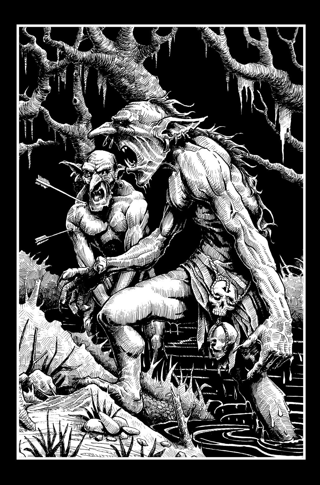

{1}------------------------------------------------

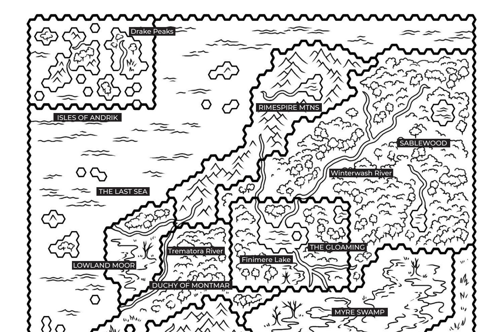

{2}------------------------------------------------

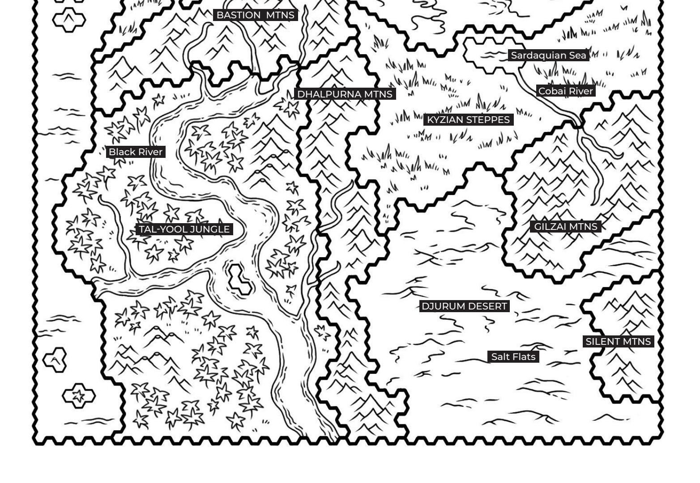

{3}------------------------------------------------

{4}------------------------------------------------

### Game Master's Guide to the

### Western Reaches

#### **Writing, Design, Layout**

Kelsey Dionne. Additional concept and design by Baron de Ropp, Jessee Egan, Katie Krickeberg, and Rachel Mazza. Special thanks to The Arcane Library Discord server for abundant playtesting and feedback!

#### **Art**

**Andrew Beckwith:** Cover, pg. 43. **Brandish Gilhelm:** Trade dress (with elements by Lucas Korte). **Cameron Maas:** Player's map of the Western Reaches, Morzomotha map. **Carlos Castilho:** pgs. 120, 121, 287, 294, 297, 299, 301. **Del Tiegeler:** pgs. 13, 85, 104, 123, 134, 144, 149, 169, 180, 197, 205, 224, 227. **Jessee Egan:** Game Master's map of the Western Reaches, City of Masks map. **Lucas Korte:** pgs. 38, 71, 113. **Mark Lyons:** pg. 46. **Matt Morrow:** pgs. 28, 91, 99, 111, 129, 139, 147, 157, 166, 167, 175, 185, 195, 203, 214, 215, 223, 245, 256, 247, 248, 261. **Yuri Perkowski Domingos:** pgs. 10, 15, 66, 93, 141, 159, 165, 187, 217, 290, 293. **Matt Hilker:** pg. 282. **Jonas Schöps (Raterwaul):** pgs. 288, 298, 305. **Robert Aldape:** pgs. 289, 303, 309.

#### **Fonts**

JSL Blackletter font © 2025 Jeffrey S. Lee. Old Newspaper font © 2025 Martin Steiner. Fullerton font © 2025 Emyself Design. Montserrat fonts © 2025 Julieta Ulanovsky, Sol Matas, Juan Pablo del Peral, Jacques Le Bailly.

#### **Legal Information and Attribution Statement**

Printed in China. Not for resale or redistribution. Permission granted to copy for personal use only. *Game Master's Guide to the Western Reaches*  and *Shadowdark RPG* © 2026 The Arcane Library, LLC. The Arcane Library®, Shadowdark®, and The Western Reaches™ are trademarks of The Arcane Library, LLC. This work includes material taken from the System Reference Document 5.1 ("SRD 5.1") by Wizards of the Coast LLC and available at [https://dnd.wizards.com/resources/systems-reference](https://dnd.wizards.com/resources/systems-reference-document)[document.](https://dnd.wizards.com/resources/systems-reference-document) The SRD 5.1 is licensed under the Creative Commons Attribution 4.0 International License available at [https://creativecommons.](https://creativecommons.org/licenses/by/4.0/legalcode) [org/licenses/by/4.0/legalcode.](https://creativecommons.org/licenses/by/4.0/legalcode)

{5}------------------------------------------------

### Foreword

maginary worlds truly do bring themselves to life over time.

The Western Reaches were a decade or more in the making. This book describes a region I've been tinkering with and adding to (with some forays into other places) since I started writing game material!

Each time I developed an adventure or bit of game lore, it seemed to fit into a larger sense of a place that was snowballing itself into being. The Western Reaches kept growing, putting itself together bit by bit like a jigsaw puzzle.

The perceptive might notice that many of the lore, locations, gods, enemies, and people in this book have appeared elsewhere in my writing. Across game systems and editions, across the years, the Western Reaches have always grown with me.

Idle lists of cool-sounding names eventually became points on a map. These points sprouted people, adventures, legends. As we played the game, they bloomed. They blossomed.

Now I hope the Western Reaches will flourish and grow with *you*.

This place is meant to be explored, changed, built, and destroyed. It is meant to fit your own favorite places and adventures. To become a sandbox for your ideas and inspirations.

### So go forth! The Mestern Keaches are in your hands!

-Kelsey Dionne, Feb. 2026

{6}------------------------------------------------

## Introduction

#### **WHAT IS THIS BOOK?**

The *Game Master's Guide to the Western Reaches* is an official *Shadowdark RPG* setting that unifies *Cursed Scroll* zine*s* 1-6 into a single region meant for broad sandbox adventuring.

The book has all the connective tissue a GM needs to move seamlessly between the *Cursed Scroll* zines and overworld travel.

The Reaches are 444 miles from top to bottom and 384 miles wide. That's slightly bigger than the state of Nevada in the U.S.!

Within the Reaches, you'll find a huge variety of biomes, people, locations, and customs.

This place is meant to feel vast while also being explorable from a practical standpoint using *Shadowdark RPG's* rules.

There is no single plot to follow or thread to unravel. In the Western Reaches, adventurous souls make their own stories!

#### **WHAT DO I NEED TO RUN THIS SETTING?**

*The Game Master's Guide to the Western Reaches* (abbreviated as *GMWR*) supplements and slightly modifies the content in *Cursed Scroll* zines 1-6 (*CS 1-6*).

You can run the Western Reaches without *CS 1-6*, but it's helpful to have the adventures from the zines if you want them.

If you prefer to use *GMWR* as a starting point and build onto it yourself, you will truly be making the setting your own. Onward!

This book's parter tome, *The Player's Guide to the Western Reaches* (*PGWR*), consolidates all the player options from *CS 1-6*  into a single volume.

If you want to limit character options, players can easily toggle specific zine material on and off using **[shadowdarklings.net](https://shadowdarklings.net)**, the official free *Shadowdark RPG*  character builder.

{7}------------------------------------------------

## Contents

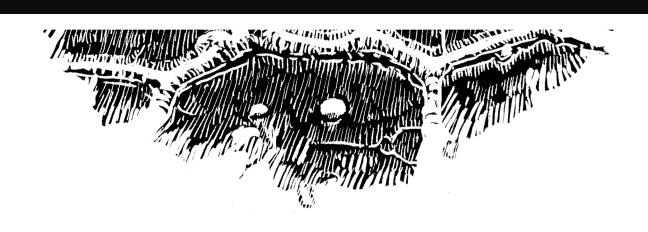

| Map of the Reaches | 3  | West Marches                | 32 |
|--------------------|----|-----------------------------|----|
| Foreword           | 6  | Tracking Time               | 34 |
| Introduction       | 7  | Getting Started             | 36 |
| Contents           | 8  | ADVENTURING                 | 39 |
| OVERVIEW           | 11 | Hex Crawling                | 40 |
| What Nobody Knows  | 12 | Climate                     | 42 |
| Lay of the Land    | 14 | Camping                     | 44 |
| The City-States    | 16 | Fast Travel                 | 45 |
| City of Masks      | 18 | Travel Procedure            | 46 |
| Alkesh             | 20 | Player's Map of the Reaches | 47 |
| Stonehall          | 22 | Fragile Civilizations       | 48 |
| Kyzian Tribes      | 24 | Rumors in the Reaches       | 50 |
| Lydonia            | 26 | Arctic Sea Encounters       | 54 |
| RUNNING THE GAME   | 29 | Canyon Encounters           | 56 |
| Merging the Rules  | 30 | Lake Encounters             | 58 |
| Sandboxes          | 31 | Lava Encounters             | 60 |

{8}------------------------------------------------

| Path Encounters      | 62  | THE CITY OF MASKS             | 249 |
|----------------------|-----|-------------------------------|-----|
| Salt Flat Encounters | 64  | City of Masks Map             | 250 |
| THE REACHES          | 67  | The City of Masks             | 253 |
| Regions              | 68  | City Overview                 | 254 |
| The Shadowdark       | 72  | Major Factions                | 256 |
| Master Hex Key       | 73  | Minor Factions                | 258 |
| Bastion Mountains    | 84  | Law and Order                 | 259 |
| Dhalpurna Mountains  | 92  | Holidays                      | 260 |
| Djurum Desert        | 100 | Rumors in the City            | 262 |
| Duchy of Montmar     | 112 | Gedgarrin District            | 264 |
| Gilzai Mountains     | 122 | Gutterwash District           | 266 |
| Gloaming, The        | 130 | High Harbor District          | 268 |
| Isles of Andrik      | 140 | Montmar Castle District       | 270 |
| Kyzian Steppes       | 148 | Ninestones District           | 272 |
| Last Sea, The        | 158 | Rilken Row District           | 274 |
| Lowland Moor         | 168 | Silvertop District            | 276 |
| Morzomotha           | 176 | The Rooks District            | 278 |
| Myre Swamp           | 186 | Swiftly! I Need               | 280 |
| Rimespire Mountains  | 196 | d40 NPCs in the City of Masks | 281 |
| Sablewood            | 204 | MONSTERS                      | 283 |
| Silent Mountains     | 216 |                               |     |
| Tal-Yool Jungle      | 225 |                               |     |

{9}------------------------------------------------

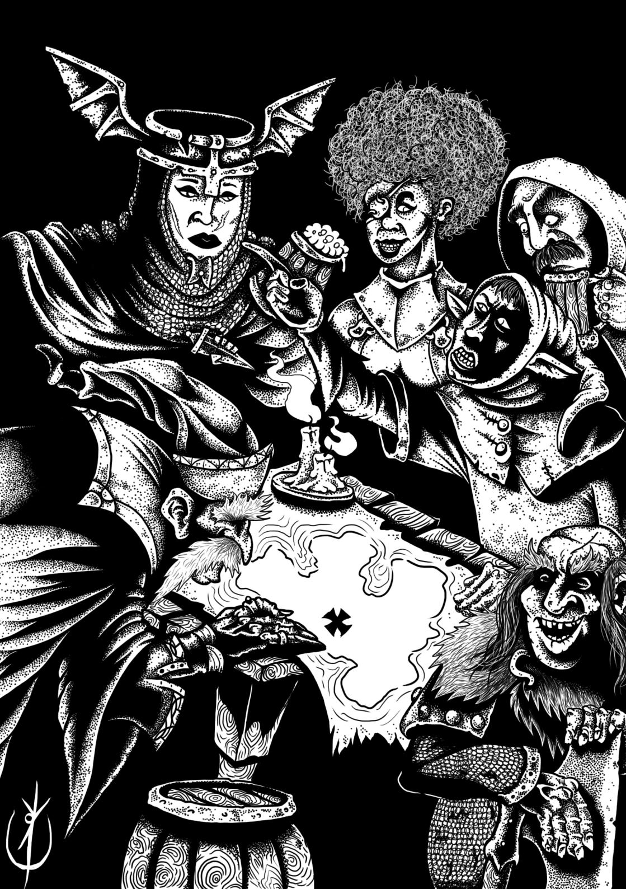

{10}------------------------------------------------

# Overview

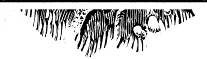

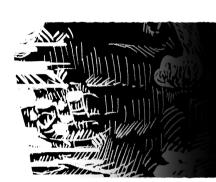

"Maps make ideas. Ideas make plans. And plans make fools of us all." -Horace the Hound, human fighter

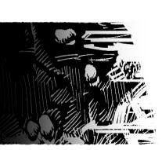

{11}------------------------------------------------

## What Nobody Knows

Ten secrets few people know about the Western Reaches.

- **1. There was much that came before.** In the time of the gods, long before humans, there were sorcerous snake people, alien star things, and eldritch brain eaters. The oceans rose and sank as these civilizations fought for primacy, and they eventually destroyed each other. In their wake, the weaker beings climbed out of barbarism to become the people of today.
- **2. There are lands west of the Last Sea.** The far-sailing nords from the Isles of Andrik have begun to discover lands west of the Last Sea. They jealously guard their knowledge of how to reach these places.
- **3. There is a land underground as big as the realm above.** The Shadowdark is truly vast and filled with horrors from the time before mankind. It is a domain of living evil that stretches like creeping rot down into the dark.

- **4. The gods are not as distant as they seem.** The gods have long since departed the material world, but they do sometimes intervene in its affairs. Shune the Vile is the most frequent visitor, knowing mortals are closest to the precious secrets they keep.
- **5. There are other worlds.** There are many other dimensions, planes, and realms. Several have small doors or pathways that cross into the Reaches. Some of these places are majestic and benevolent. Some are full of horrors and twisted realities that would shatter the minds of common folk. Many realms fall somewhere in between.
- **6. Adventurers have everything to gain.** Most folk will say the Reaches are far too dangerous and huge to explore. Better to live, toil, and die within a few miles of one's birthplace, never to wander. But adventurers are truly capable of shaping the Reaches and becoming like the heroes and villains of legend.

{12}------------------------------------------------

- **7. Seek, and ye shall find.** All rumors have a kernel of truth to them. Almost every thread you pull in the Western Reaches will lead you somewhere interesting.
- **8. Civilization is much more fragile than it seems.** The Reaches are full of the ruins of once-mighty civilizations. The Duke may rule resolutely over the City of Masks, and Shar Yasmila may command the awe and loyalty of her subjects in Alkesh, but their reach barely extends beyond their citystates. One disaster could turn a bastion of law into a ruin, just like those that came before.
- **9. There are mighty artifacts to find.** The Reaches are scattered with legendary items. Some were even made or wielded by the gods themselves. They may not be easy to wrest from the clutches of darkness and peril, but they can be won forth.
- **10. The Lost gods are still out there.** Some are obsessed with finding the outcast gods. They might even succeed. It would not be good for the people of the Reaches if they did.

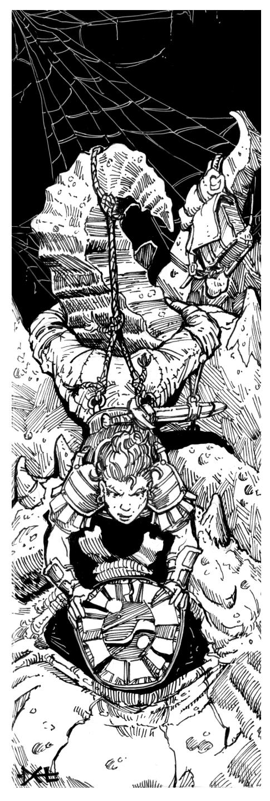

{13}------------------------------------------------

## Lay of the Land

#### **NAMES**

Not everything in the Western Reaches is named. Only major regions and geographical features carry a moniker.

The wilds are still untamed and unknown, and though locals may call a nearby pond "The Jade Pool" (or even just "the pool"), that name may not be widely known to the outside.

This is also to keep the world flexible. You don't have to hunt down every name, and you can easily insert other game material into the Reaches.

#### **HEX MAPS**

All hex locations from *CS 1-4* are consolidated into the hex map and key of the Western Reaches.

*CS 5* is underground and is not shown on the Western Reaches hex map. See [pg. 72](#page-71-1) and [176](#page-175-1).

*CS 6* details the City of Masks. The city's hex is located at 1334.

#### **NORTH REACHES**

To the far north, across the Last Sea, lies the wintry and isolated **Isles of Andrik** (*CS 3*).

South of there, the northern Reaches are covered in the ice-capped Rimespire Peaks and a boreal forest called the Sablewood. The forest's longest river, the Winterwash, flows south toward Finimere Lake.

**The Gloaming** (*CS 1*) is a cursed and haunted sub-region within the Sablewood.

#### **CENTRAL REACHES**

The central Reaches contain the much-avoided Myre Swamp, which turns into a broad expanse of grassland called the Kyzian Steppes.

To the west, the Dhalpurna Mountains and Bastion Mountains hem in a lush rainforest whose many tributary rivers converge into the titanic **Black River** (*CS 4*).

{14}------------------------------------------------

#### **SOUTH REACHES**

The south Reaches hold the **Djurum Desert** to the east (*CS 2*). Water flows away from the Djurum out of the eastern Gilzai Mountains and the western Dhalpurna Mountains, keeping the region bone-dry and hot.

To the west, the mighty **Black River** (*CS 4*) continues its flow to the south and into the main body of the Tal-Yool jungle.

#### **THE SHADOWDARK**

The Shadowdark always lurks beneath the sun-touched lands. One of its main cave systems lies somewhere below the Western Reaches, though few people know its exact location. This place of madness and nightmare is called **Morzomotha** (*CS 5*).

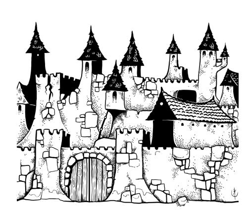

#### **SETTLEMENT SIZES**

| Settlement | Residents     |
|------------|---------------|
| Village    | 1 - 500       |
| Town       | 501 - 1,000   |
| City       | 1,001 - 5,000 |
| City-State | 5,001+        |

#### **CIVILIZATION**

**Villages.** Villages are isolated, insular, and poorly defended. A village elder usually serves as leader. Travelers are rare.

**Towns.** Towns often have better defenses than villages, such as palisade walls. They are led by a reeve or low-ranking noble. Travelers are uncommon.

**Cities.** Cities are led by a highranking noble or council. They are well protected and are accustomed to travelers.

**City-States.** A metropolis with vast resources and excellent defenses. They are cosmopolitan places governed by an absolute ruler called an overlord.

**Paths.** A few roads connect the settlements in the Reaches, but they are not well-protected.

{15}------------------------------------------------

## The City-States

#### **THE OVERLORDS**

The most influential people in the Western Reaches are the overlords of the five city-states. There is no higher power above them, and they have abundant resources. Overlords each keep a **standing army** comprising 25% of their total available military.

**City of Masks.** Also known as Meridia. It is the largest citystate. Its overlord, Duke Loren di Montmar, was a knight general before inheriting the throne. Vast amounts of commerce flow through the city, arriving via sea port or caravan. Meridia is a mighty center of knowledge, culture, and military strength.

**Alkesh.** The oldest city-state. The City of Red Sands grew up around a deep well in the Djurum Desert. The young Shar Yasmila holds power, and she is well loved by her people for her shrewd wisdom. Merchants brave the harsh desert knowing they can be made rich in Alkesh. **Stonehall.** The primary domain of the dwarves, located in the Rimespire Mountains. King Roggen Iverlord, their whitebearded leader, has ruled from The Granite Throne for a century. The reclusive dwarves trade in iron ore and precious metals, but they rarely leave their halls.

**Kyzian Tribes.** The Kyzian Princes rule over a roving tribe of horse riders the size of a citystate. Each prince leads a loose group of several families who wander the Kyzian Steppes. They sometimes war amongst themselves, but they set aside these squabbles in service of Taru the Hawk Queen, their legendary half-elf overlord.

**Lydonia.** In the gloomy northern Sablewood, The Pale Citadel reaches its slender spires up through the trees. This is the stronghold of the King of the Wood, Saren Sindalian. Though his city-state is small, his knights and rangers reach far, and much trade passes through Lydonia.

{16}------------------------------------------------

#### **THE CITY-STATES**

| Name          | Overlord              | Pop. | Ancestries         |
|---------------|-----------------------|------|--------------------|
| City of Masks | Duke Loren di Montmar | 90k  | Humans             |
| Alkesh        | Shar Yasmila          | 70k  | Humans             |
| Stonehall     | King Roggen Iverlord  | 20k  | Dwarves            |
| Kyzian Tribes | Taru the Hawk Queen   | 30k  | Humans, half-elves |
| Lydonia       | King Saren Sindalian  | 10k  | Elves              |

|               | NOTABLE FEATURES                                                                               |
|---------------|------------------------------------------------------------------------------------------------|
| Name          | Known For                                                                                      |
| City of Masks | High culture, fashion, universities, festivals                                                 |
| Alkesh        | Being able to buy anything for the right price, wealthy merchants, ancient customs and laws |
| Stonehall     | Superior metalworkers and builders, reclusiveness                                              |
| Kyzian Tribes | The best horses and archers, fierce warriors                                                   |
| Lydonia       | Legendary knights and rangers, the uncanny and fey nature of The Pale Citadel               |

|               | MAIN PROBLEMS                                                                                         |  |
|---------------|-------------------------------------------------------------------------------------------------------|--|
| Name          | Details                                                                                               |  |
| City of Masks | The Thieves' Guild, the secret cult of evil sorcerers called The Shroud, fears of the Rat Plague   |  |
| Alkesh        | Molek cultists, trained thieves (The Jackals) and assassins (Ras-Godai) who act with near impunity |  |
| Stonehall     | Digging too deep, isolationism, throne succession                                                     |  |
| Kyzian Tribes | Orc and gnoll raiders, ominous shamans (Ashen Ones), infighting and politics between the princes   |  |
| Lydonia       | Old werewolf and spider-kin foes who rebuild their power, marrow tree spreading from The Gloaming  |  |

{17}------------------------------------------------

## City of Masks

#### **OVERVIEW**

High bridges sweep over canals and waterways. Golden sun reflects off white sails and spired rooftops flying the fluttering, red banner of house Montmar.

**People.** 90,000. Majority human, small mix of other ancestries.

**Canals.** The bustling canals unite all districts by water, allowing speedy travel between locations.

#### **HISTORY**

Built up over centuries around the site of nine ancient dolmens called the Ninestones. Sages say the goddess Madeera herself laid the city's first cornerstone.

#### **LEADERSHIP**

**Overlord.** Duke Loren di Montmar, a 45-year-old knight general, who recently inherited the throne from his father. He is a just and practical ruler who is trying to rebuild the city after the Rat Plague took a grim toll.

#### **RESOURCES**

The Duke's standing army includes 400 City Guard, 80 knights, and 12 elite paladins.

A clandestine order of 50 spies and assassins called The Onyx Eye keep the Duke informed about overall threats.

The wizards of Gedgarrin and the bards of the Bard's College also work to advise the Duke and protect his interests.

#### **LAW AND ORDER**

The City Guard patrols all districts (see [pg. 249](#page-248-1) for more).

**Minor Crimes.** Petty theft, murdering a commoner, disruptive public behavior. Punishable by lashings, fines, or short-term forced labor.

**Major Crimes.** Large-scale theft, murdering a noble or guard, treason. Punishable by execution, permanent exile, or a life sentence in the donjon.

{18}------------------------------------------------

#### **FACTIONS**

**The Duke (L).** The Duke wishes to foster prosperity and keep his grip on power. He works to stave off The Shroud's anarchistic efforts and keep the Thieves' Guild's influence in check.

**The Bards (L).** A college of the land's greatest philosophers, poets, and enlightened scholars. Headmaster Yeothin once adventured with the Duke.

**Gedgarrin (N).** An insular and studious wizard's university. Headmaster Ivanculus tests new aspirants for purity of intention in the Trial of the Seven Pillars.

**Thieves' Guild (N).** The House of Seren, led by master assassin Seren, whose charm and subtlety are her greatest weapons. The Guild robs, bullies, and skims its profits off everyone else while following its own code of "ethical theft."

**The Shroud (C).** Secretive, anonymous power brokers who infiltrate all echelons of society. They seek chaos and anarchy. Its members command great combined wealth and influence.

#### **NOTABLE SITES**

**Montmar Castle.** A white-walled castle sitting on the highest hill of the city. The Duke's Donjons and main City Guard garrison are located here.

**Bardic College.** A bright and airy college full of music and art located in Gedgarrin district. Learned philosophers pass down their wisdom to young bards.

**Gedgarrin.** Seven gray towers form a wizard's university in the district named after it. Within, a grand library houses invaluable arcane knowledge for students and visiting scholars to study.

**House of Seren.** Secretly located in a dilapidated manor home in the poor Gutterwash district. Its decadent and sprawling interior houses the Guild's hoard of treasure and provides a place for thieves to train and hatch plots.

**The Rooks.** A open market district by day and a night bazaar after the sun sets. Rare foods, pig racing, specialty shopping, and carousing can all be had at the tents and vendor stalls crowding the district.

{19}------------------------------------------------

## Alkesh

#### **OVERVIEW**

Polished, brass-domed towers shine in the withering sun, and fabulous hanging gardens drape the labyrinthine city streets with precious shade. Alkesh slows to a lull during the peak heat of the day, and comes alive again under the bright desert stars.

**People.** 70,000. Majority human, small mix of other ancestries.

#### **HISTORY**

Alkesh is the oldest city-state, dating back to the era when the Dark Queen first led armies of undead against the scattered barbarian tribes of mankind.

#### **LEADERSHIP**

**Overlord.** Shar Yasmila, a 22-year-old princess of rare beauty and poise. She has held the hereditary throne for 5 years and is wildly popular for keeping Alkesh secure and wealthy. She plays each faction to her needs and believes in mutual gain.

#### **RESOURCES**

The wealthy Shar's standing army includes a fanatical Royal Guard of 300 of the best scimitar fighters in the land, as well as 80 camel riders who keep the city's immediate surroundings safe from banditry.

The 10 handmaidens who attend to Shar Yasmila are viciously capable assassins called Red Vipers. Each one commands another 15 spies around the city.

#### **LAW AND ORDER**

The Royal Guard arrives at the site of any trouble in 2d6 rounds.

**Minor Crimes.** Stealing from or murdering a commoner, insulting the Shar. Punishable by limb severing, whippings, or expulsion from the city.

**Major Crimes.** Stealing from or killing a merchant, interfering in commerce, treason. Punishable by beheading, servitude to the Molek cultists, or life in prison.

{20}------------------------------------------------

#### **FACTIONS**

**The Shar (L).** Shar Yasmila aims to keep everyone warring with each other rather than with her. She makes sure money flows into Alkesh, and she deftly distracts her courtly rivals with petty nonsense and drama.

**Ras-Godai (N).** Ras-Godai assassins act with near impunity in the city, and lately their activity has been circling closer and closer to the Shar. She is intent on discovering who is funding this secretive campaign.

**The Jackals (C).** A guild of 80 capable thieves who perform the riskiest job in Alkesh. Led by Abdani Alar, a cold-hearted escape artist who merchants fearfully refer to as "The Slip."

**Molek Cultists (C).** An ancient order of demon-worshipping death cultists who command superstitious fear (see hex 4371). The Shar regularly turns criminals over to the cult for servitude or sacrifice in exchange for the cult keeping abductions and doom preaching to a necessary minimum.

#### **NOTABLE SITES**

**The Gardens.** A district of the city rife with lush fruit trees, nodding palms, and vines fed by the city's deep cisterns. Home to The Rift, a massive pit fighting arena inside a natural ravine that draws enormous crowds.

**The Suq.** A riotous rampage of colors and smells where anything can be bought and sold. By decree of the Shar, the Guard does not interfere in any commerce. Ras-Godai assassins offer their dark trade, poison vendors lurk in shadowy stalls, and merchants dripping in gems and gold hawk fabulous wares from far-distant lands.

**The Royal Baths.** A sprawling underground maze of marble fountains, jade-tiled pools, and echoing halls where pillars stand in still water. Guards patrol the public areas, but many ancient and dark chambers lie forgotten.

**The Alabaster Citadel.** Shar Yasmila's ancient castle of pale, gold-domed towers. Secret doors and spies lurk behind every pillar and silk tapestry.

{21}------------------------------------------------

## Stonehall

#### **OVERVIEW**

In the snow-capped Rimespire Mountains, behind the colossal Draakendyr doors, a thrumming society of dwarvenkind beats within the heart of Mount Morgrim. The red-glow heat and clangor of forges fills the plunging, geometric depths of this many-tiered city-state cut from the mountain walls itself.

**People.** 20,000. All dwarves. Other ancestries are very rare.

**Tiers.** Stone roads and arched bridges wind down and down through this vast cathedral hall.

#### **HISTORY**

Ancient dverg from the Isles of Andrik settled Mount Morgrim and built a new Dwarvish society within their fortified hold.

#### **LEADERSHIP**

**Overlord.** King Roggen Iverlord, an elderly and humorless dwarf with little trust for outsiders.

#### **RESOURCES**

King Roggen's standing army of 200 dwarf guards are equipped with the finest Dwarvish steel and training. The 12 best among them form his personal retinue.

Dwarves look down upon spying and secrecy, but even so, the king has 8 master assassins who silently serve as his agents.

Stonehall is the main source of rare metals in the Reaches and has a chokehold on the trade.

#### **LAW AND ORDER**

The King's Guard arrives at the site of trouble in 2d4 rounds.

**Minor Crimes.** Theft of mundane goods, brawling while sober, trespassing. Results in time in stocks or service at the temple.

**Major Crimes.** Theft of gems or coins in any amount, illegal entry into the city, murder or undue violence. Results in permanent expulsion or imprisonment.

{22}------------------------------------------------

#### **FACTIONS**

**The Granite Throne (L).** King Roggen Iverlord broods upon Stonehall's ancestral throne. Isolationism has kept his people safe from outside threats, but the mountain's depths stir with long-forgotten dangers.

**The Iron Lords (L).** Twelve heads of noble houses form a council to the king. The Iron Lords must choose the next ruler if childless King Roggen dies with no heir.

**The Seekers (N).** A movement of young dwarves who have grown restless with their king's insular policies. Their leader, Morden (the king's nephew), left with his clan to found the trade city of Galdurin (1341). The dwarves who stayed behind push for change.

**Eyes of the Deep (C).** Before the first forge fires lit the halls of Mount Morgrim, evil and cunning things fouled the depths of the earth below it. These shape-shifters creep out to kidnap and impersonate Dwarvish miners. The dwarves have no idea how many false friends are already among them.

#### **NOTABLE SITES**

**The Forge.** A bustling crafting district with the mighty, multilevel forge of Stonehall at its heart. Hundreds of blacksmiths hammer out timed strikes that mark the passage of seconds, minutes, and hours. One can hear the clang from anywhere.

**Temple of the Maker.** An angular, granite fortress in the Hall of Lords district serves as the high temple to the Dwarvish aspect of Madeera, the Maker. Outside vendors must sell their goods here, and the tax is high.

**The Clanks.** A rumbling district built around a system of steamfed clockwork gears. Every building contains something that moves because it can, not because it should. The Whistling Tinnies, a beloved tavern, has a grand, self-playing pipe organ.

**Morgrim's Mines.** A makeshift shanty-town has built up around the entrances to the city's vast and valuable network of deep mines. Dwarvish miners gear up for days at a time "in the chutes." It is dangerous, noble work.

{23}------------------------------------------------

## Kyzian Tribes

#### **OVERVIEW**

At the primary crossroads of the ancient Bronze Caravan trade route, thousands of tents cluster together in a forest of colorful flags, tinkling bells, and sizzling cookfires. Nomadic Kyzian clans return here each year to rest, trade with passing caravans, and pay homage to their overlord.

**People.** 30,000. Mostly human, numerous half-elves.

#### **HISTORY**

This nomadic encampment grew over two centuries from a convenient trade hub into a massive settlement ruled and protected by the Kyzian Princes.

#### **LEADERSHIP**

**Overlord.** Taru the Hawk Queen, a half-elf archer who drove the fire dragon Smove Magestis from the Kyzian Steppes with an impossible arrow shot to his eye. She is wise for her 40 years and carefully deliberate in all things.

#### **RESOURCES**

The Kyzian people are nomadic horse riders who live in familial clans. Politics between the clans range from rivalry to alliance.

A **prince** (male or female) leads each clan of 20-150 people. There are around 400 in total.

Taru has a standing army of 400 mounted warriors who are experts in Kyzian archery, horse riding, and scimitar fighting.

#### **LAW AND ORDER**

Each prince has slightly different customs in their tents. Enforcers show up in 2d4 rounds.

**Minor Crimes.** Killing another clan's member, insulting the prince, cowardice. Results in lashes, fines, or short servitude.

**Major Crimes.** Horse theft, killing your own clan member, failing to properly bury the dead. Punishable by horse dragging, exile, or permanent servitude.

{24}------------------------------------------------

#### **FACTIONS**

**The Hawk Queen (L).** Taru has earned the respect of all Kyzian Princes; she alone can unite the tribes in times of great need. Her charge is to protect the Kyzian people, but increasing gnoll and orc raids are a growing threat to the nomadic families.

**The Five Winds (N).** Five of the most powerful Kyzian clans have formed a formidable alliance through treaties and marriage. They obey Taru's law for now, but secret ambitions of power grow among some of their princes.

**Sons of Yarrow (C).** An exiled Kyzian clan roams the steppes under the banner of Prince Yarrow the Cloven. They are deeply embittered at being branded opportunistic thieves and cowards by the other clans.

**The Ashen Ones (C).** Salloweyed shamans in black walk among the nomads, their skin as pallid as the dead. This growing cult of necromancers gathers around the grassland's many sacred burial mounds, but none know what they do there.

#### **NOTABLE SITES**

**The Three Corners.** Taru the Hawk Queen's magnificent tent stands at the junction where the three roads of the Bronze Caravan route meet. Here, her blue-robed guards collect trade tax and give cool cups of barley ale to all visitors, as is customary.

**Horse Run.** A broad, dusty range where traders show the finest horses in the Reaches. Dozens of exuberant sellers put on carnival-like displays of their horses' skill and power, each animal brushed to a shine and garbed in gold, silk, and tassels.

**Hill of the Dogs.** A vast midden heap on the outskirts of the main camp attracts wild dogs, vultures, and those who do business by the dark of night.

**The Buried Blade.** A tent-tavern has sprung up around the site of an ancient, untarnished scimitar driven deeply into a pillar of stone. Myth holds that the one who draws the blade forth will become a legendary Kyzian hero. Many have tried, but none have yet claimed the honor.

{25}------------------------------------------------

## Lydonia

#### **OVERVIEW**

The luminous spires of Lydonia reach out of the eldest depths of the Sablewood like ivory blades. Here, an uncanny silence pervades. The radiant city turns even the moon's gentle touch into a wash of cool light that paints the dark trees silver.

**People.** 10,000. Majority elves, very few other ancestries.

#### **HISTORY**

King Saren built The Pale Citadel after driving fell armies of spiderkin and werewolves from the woods centuries ago. Lydonia grew up around this citadel, and to this day its rangers and knights guard the woods from the incursion of foul creatures.

#### **LEADERSHIP**

**Overlord.** King Saren Sindalian is a fey-born elf who has seen many ages come to pass. He appears to be in his prime, yet few in the Reaches could rival his memory of witnessed history.

#### **RESOURCES**

Lydonia's protectors are few, but there are no greater knights and rangers in all the Reaches.

King Saren can call upon 80 exceptional rangers and 60 of the realm's finest knights at a moment's notice. The King himself is an archmage of unsurpassed skill.

A circle of 8 highly trained wizards serve as advisors to the King and magistrates of the law.

#### **LAW AND ORDER**

Patrolling knights arrive at the site of any trouble in 1d4 rounds.

**Minor Crimes.** Public disruption, violence, harm to nature. Results in financial redress to the victims and a limited prison term.

**Major Crimes.** Theft of any sort, murder, spell mishaps in public, conspiracy, treason. Punishable by permanent imprisonment or, rarely, execution by beheading.

{26}------------------------------------------------

#### **FACTIONS**

**King of the Wood (L).** King Saren Sindalian is a cautious ruler, having seen many grand civilizations rise and crumble to dust. He fears the recent spread of marrow trees in the Gloaming and the risk it poses to Lydonia.

**Wolves of Lydonia (L).** A famous order of knights and rangers that has seen many legendary heroes originate from its ranks. The Wolves fiercely protect civilization from chaos and evil.

**Hand of Six (N).** A longstanding cult of Ord comprised of Elvish mages and priests. They debate obscure esoteric points with the patience of the very long-lived. On rare occasion, they make a notable magical discovery. Their symbol is a six-fingered hand.

**Heart of Thorns (C).** A witch has been born with a heart of thorns. Her soul has seen the dark fey, death, the Shining King who drove back her sisters and brothers. She will grow beautiful and powerful. She will grow to draw blood. The Heart of Thorns calls shadows to her even now.

#### **NOTABLE SITES**

**The Pale Citadel.** A castle of moonstone and Mother-of-Pearl, a pillar of soft haze and light. King Saren's home stands on a leyline that reaches into the fey realms of his birth, and it is never quite the same place twice.

**The Court of Mab.** An airy tavern in the Cerulean Quarter run by a witty half-elf couple. They have been known to look the other way during a respectable brawl.

#### **The Emerald Temple.** A

green glass dome encloses the sprawling Temple of Ord. Solemn priests watch the night sky through its ensorcelled glass, noting portents and secrets.

**The Wells.** In the Gossamer Quarter, fey magic bleeds into the wells. Uncanny creatures with sly smiles and voices look back at those who gaze into the water at the wrong time.

**Greenshrine.** A majestic grove built around an elderly female treant named Deru-Daku who grew here from birth. She is wise beyond words but rarely speaks.

{27}------------------------------------------------

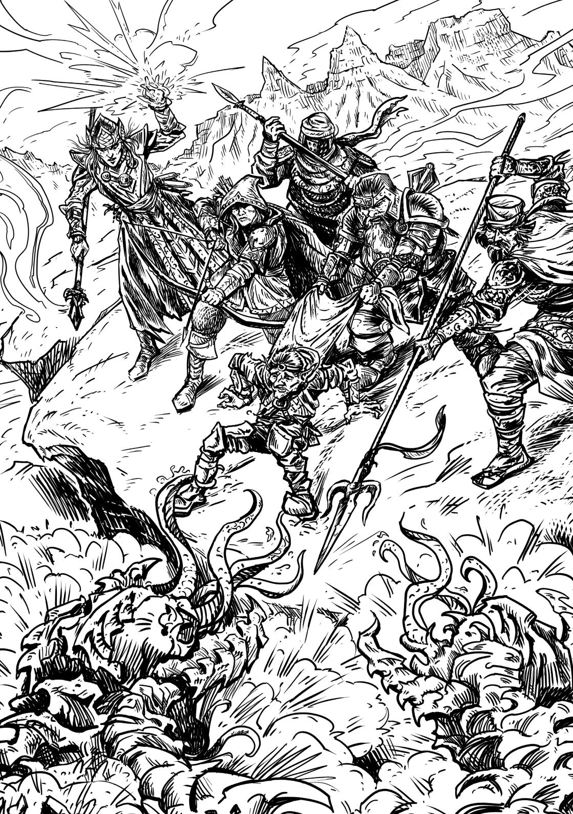

{28}------------------------------------------------

# Running the Game

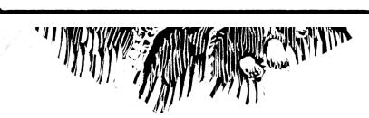

"It really is eat or be eaten out here!" -Mungo Smizz, goblin thief

{29}------------------------------------------------

## Merging the Rules

This book and the *Player's Guide to the Western Reaches* use variations on the core rules in *Shadowdark RPG*, listed here.

Unless otherwise noted, use *Shadowdark RPG*'s core rules.

#### **CAROUSING**

Use the standard carousing rules in *Shadowdark RPG* core or the expanded carousing rules in *PGWR* pg. 236.

There are limits to the size of carousing events PCs can buy based on the settlement.

The PCs' **renown** might impact their carousing results (see *PGWR* pg. 233).

#### **CAROUSING LIMITS**

| Settlement | Limit    |  |
|------------|----------|--|
| Village    | 100 gp   |  |
| Town       | 600 gp   |  |
| City       | 1,200 gp |  |
| City-State | None     |  |

#### **NEW RANDOM ENCOUNTER TABLES**

See the d100 random encounter tables ([pg. 54](#page-53-1) - [pg. 64\)](#page-63-1) for new terrain types in the Reaches.

#### **GAMEPLAY**

**Hex Crawling.** Use the alternate hex crawling rules on [pg. 40.](#page-39-1)

**Climate.** The Reaches have new rules for general weather and harsh climates [\(pg. 42](#page-41-1)).

**Downtime.** PCs have expanded learning options during their downtime (see *PGWR* pg. 234).

#### **BOATS AND MOUNTS**

This setting uses modified rules for boats and mounts (see the Gear chapter in *PGWR*).

#### **HARD LUCK MODE**

PCs can't spend luck tokens on critical failures or effects that generate luck, such as *bless*.

{30}------------------------------------------------

## Sandboxes

#### **OPEN-ENDED**

Sandbox settings have many rumors and threads scattered across a large area rather than an overarching story to follow.

Encourage the players to actively pursue what interests them. The world will grow and respond to their choices, but nothing will happen if they sit idle.

**Wandering Too Far.** Sandbox settings are improvisational and flexible. This creates the illusion that the world is a huge place without limits or ends. But in reality, it's possible for PCs to "wander off the map."

If you want to keep exploring those distant places, use the tables in *Shadowdark RPG* to generate the larger world.

#### **SEEDING RUMORS**

It's better to give your players too many rumors than too few! Be generous with the hooks on the Rumors table [\(pg. 50\)](#page-49-1).

#### **MULTIPLE PCS**

In sandbox campaigns, players are not limited to playing just one character. Instead, they can rotate between multiple PCs with differing goals.

It's normal for groups to have PCs of varying levels as the players mix and match the right team for a given rumor or goal they're pursuing.

It can help group cohesion if the PCs have a shared overall purpose, such as being in the same or allied factions. See *PGWR* pg. 90 for the six most prominent character factions in the Western Reaches.

**Slow Healing.** Using Grinder Mode (*Shadowdark RPG* pg. 111) can encourage players to develop multiple PCs. While one PC is resting or using downtime, another can be out adventuring.

See Tracking Time on [pg. 34](#page-33-1) for related information about handling downtime.

{31}------------------------------------------------

## West Marches

#### **WEST MARCHES**

West Marches is a gameplay style popularized by Ben Robbins in his blog, *Ars Ludi*.

West Marches games use sandbox-style campaign worlds paired with open tables (large groups of players with open invites to play). Players then attend sessions as they wish.

It's an excellent way to manage a campaign set in the Reaches.

#### **SCHEDULING**

Some GMs create availability time slots and then leave scheduling in the players' hands. The players decide who wants to go on what missions based on their own in-game interests. They tell the GM their plans (with some lead time), and off they go.

Other GMs run sessions at the same time on a regular basis, and everyone who shows up plays (sometimes with a necessary cap on group sizes).

#### **OPEN TABLES**

Open table games present special considerations for campaign management.

**Quantum PCs.** To keep things tidy, PCs should always return to safety at the end of their sessions. This ensures one group's PCs don't accidentally cross paths with another group's PCs who visit the same area.

See **Back To Safety** if the PCs get stuck outside of a safe haven at the end of a session.

**Dedication.** Some players are more driven or available than others. They play often, leveling their PCs up in a blitz. Consider requiring players to rotate between characters so no single PC vastly outpaces their peers.

**Communication.** Many West Marches groups favor online chat platforms where players can discuss rumors, plan their next moves, and coordinate scheduling.

{32}------------------------------------------------

#### **PLAYER GROUPS**

West Marches games work best with 12 or more players where it's easy for teams to form up around who is available and what they want to do.

#### **SAFE HAVENS**

PCs who want to continue adventuring together should return to the same settlement or safe haven (such as a shared bastion, see *PGWR* pg. 246), at the end of each session.

Make the safe haven less exciting than the wilds if you want to focus on exploration. Otherwise the safe haven can distract the PCs!

#### **RUMORS**

The players drive the action in a West Marches campaign. They will quickly become the best source of rumors.

Encourage the players to share what they've seen and learned once their PCs are back in safety. All of the PCs should be allies, even if there is some friendly competition between them.

#### **BACK TO SAFETY**

Did the characters take the long way out of the dungeon and get waylaid by a random encounter at the very end of the session?

Escaping an adventuring site is even more important in a game where the PCs must return back to safety after each adventure.

If you want to enforce this style of play, have PCs who get stuck in an adventuring site at the end of a session roll on the below table. Some GMs might decide to skip this and abstract the PCs' return to safety in other ways.

#### **CAUGHT IN DANGER!**

| d6 | Details                                                    |
|----|------------------------------------------------------------|
| 1  | Disaster! DC 12 CON or you perish in the dungeon        |
| 2  | You're lost for a week and return at 1 HP with no gear  |
| 3  | You lose 1d4 pieces of gear in the fight to escape      |
| 4  | You barely make it out alive, returning with 1 HP       |
| 5  | You return safe but rattled; you must rest for 1d4 days |
| 6  | You get back to safety no                                  |

worse for the wear

{33}------------------------------------------------

## Tracking Time

In a West Marches campaign, there are two primary options for how you can track the passage of time. Some methods are better suited for different groups and play styles.

#### **FIXED TIME**

With a fixed time campaign, the GM manually tracks the passage of time as the PCs undertake activities and rests.

This method is how most GMs track time. It works well with 2-7 players who regularly attend each session and who prefer to develop one character each.

In fixed-time play, the game world "freezes" between sessions, and the PCs play out downtime during sessions.

Using fixed time makes it easy to skip forward in time when needed, and many GMs use the standard rest and healing rules in *Shadowdark RPG* core when tracking time this way.

#### **REAL TIME**

A popular technique from the early days of fantasy TTRPGs was to sync the passage of in-game time with the passage of realworld time (known as **1:1 time**).

This method works well for large groups of players (8+) who do not attend every session and who like the idea of developing multiple characters each.

Days, seasons, and even years move along with the outside world. It's simple to track but introduces a few considerations.

**Between Games.** The players can use the real-world time between sessions to undertake downtime events or overland travel. It's important to note how long these activities take. See **Frozen PCs** for more details.

**Healing.** Using a slow healing mode, such as **Grinder Mode** (*Shadowdark RPG* pg. 111) enhances the impact of tracking the game's progress in real time.

{34}------------------------------------------------

**Frozen PCs.** Characters whose game world activities take up long spans of time are "frozen in action" until the real world catches up with them.

For instance, a character who spends a week traveling to, exploring, and returning from a dungeon during a game session becomes unavailable to play for seven days of real-world time.

Likewise, a PC who spends their downtime between sessions carousing for two days becomes unavailable for two days of realworld time. While it's likely this PC will be available again by the next game session, it still places a limit on how much they can do during their downtime.

If an event **disrupts** a character's progress while frozen, such as a random encounter, the GM and player should resolve the event. The player may then resume or revise their PC's actions.

**Multiple PCs.** Because PCs can become frozen in time, it's essential for players to have alternate characters to pilot during sessions and downtime.

#### **1:1 DOWNTIME**

If you are using real time to track your game, you'll need to determine how long downtime activities take.

**Carousing.** As a rule of thumb, PCs should only be permitted to carouse once every two weeks of real time. This prevents PCs from carousing too frequently per Shadowdark's intended rules.

Unless otherwise noted, a carousing session takes as many days at the carousing event bonus (minimum 1 day).

**Learning.** Unless otherwise noted, all learning attempts take 2d6 days to complete.

**Other Activities.** Spell research, rumor mongering, criminal activities, meditation, or getting locked up in the city jail can all last for variable amounts of time given the situation.

There may be an obvious ruling for how long an activity takes, but when in doubt, assume it takes 2d6 days.

{35}------------------------------------------------

## Getting Started

#### **CLASS AVAILABILITY**

The "core four" classes (fighter, thief, priest, and wizard) are the heart of *Shadowdark RPG* and should be available in all regions.

However, you could limit your players' starting class options to those from certain regions. As their characters explore new regions, they discover more classes. This turns class options into a form of treasure, and it encourages players to explore and develop multiple characters.

#### **HOME BASES**

The characters may want to operate out of a settlement or **bastion** they build (*PGWR* pg. 246). Having a safe home base for storing gear, resting, and restocking is very helpful.

High-level members of Player Factions have special bastion abilities. These can become excellent places for players to house multiple characters of varying levels.

#### **WHERE TO BEGIN**

Many campaigns begin in a settlement, small or large, with a few points of interest nearby.

Knowing that, you could start in just about any region! Each has at least one major town or city and several points of interest to explore within a few hexes.

*The Lost Citadel of the Scarlet Minotaur* (the adventure in the free *[Shadowdark RPG](https://www.thearcanelibrary.com/products/shadowdark-rpg-quickstart-set-pdf?srsltid=AfmBOorqd3SCQARIoNbglVkvS4CXJtJVb3b3u7oqeSpTytBtcsWUV6Kw)  [Quickstart Set](https://www.thearcanelibrary.com/products/shadowdark-rpg-quickstart-set-pdf?srsltid=AfmBOorqd3SCQARIoNbglVkvS4CXJtJVb3b3u7oqeSpTytBtcsWUV6Kw)*) is a broadly useful first adventure, located in hex [3952](#page-151-0). The nearest city-state is the Kyzian Tribes (hex [4146](#page-152-0)).

#### **PROMPTING ACTION**

Pay attention to what your players tend to pursue. Are they driven by treasure, glory, exploring, revenge? Find their favorite carrots to dangle.

You can also nudge them into action with a new rumor or a surprise turn of events. A hated rival kicks open the tavern door!

{36}------------------------------------------------

#### **THE GM IS A PLAYER**

Sandbox style gameplay asks you, the GM, to be a player, too.

You'll need to improvise and add detail when you need it. You won't break this setting by making big things happen to it. It's designed for that!

Make kings fall, enemies rise, forests burn, and give the players problems to solve.

#### **ADDING DETAIL**

No setting book could outline every corner of a realm. The hex entries are here to guide and inspire you, and to make sure everything is interconnected so you can easily tie it all together.

Use the *Shadowdark RPG* core rules to fill in any gaps. Its settlement, dungeon, random encounter, and NPC generators are all thematically matched to the Western Reaches.

The Reaches are also designed to have plenty of room for outside material both new and classic. Drop in your favorite adventures and supplements!

#### **MISSION-BASED**

Sandbox campaigns thrive when most of the sessions are playerdriven and mission-based. You know you're on the right track if you can answer "yes" to the following questions:

- Did the players decide on a goal for this session?
- Do they know what they need to do to make meaningful progress toward this goal?
- Are the players choosing their course of action among other options and possibilities?

#### **TAKING NOTES**

When you're juggling lots of open-ended elements, it can feel overwhelming to take notes (see a video for general advice on [The Arcane Library's YouTube](https://www.youtube.com/watch?v=2-uU5FWYYSU)  [channel\)](https://www.youtube.com/watch?v=2-uU5FWYYSU). It can be as simple as keeping a running bullet list of:

- Threads the PCs might pursue
- The PCs' current locations and what they're doing
- Rumors you've shared
- Important NPCs
- Major world developments

{37}------------------------------------------------

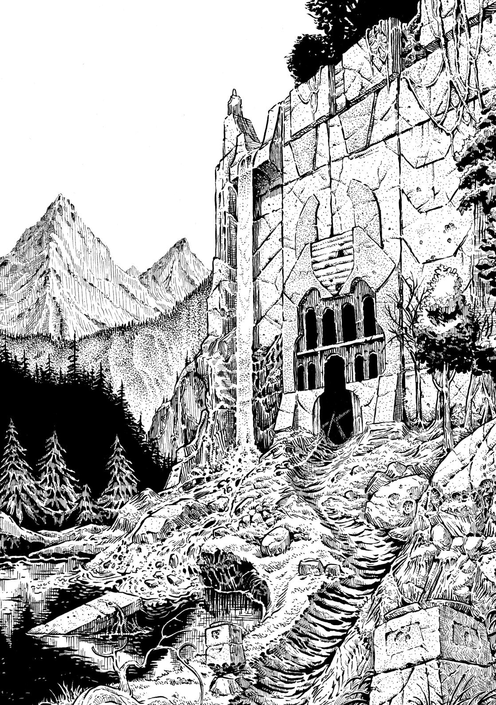

{38}------------------------------------------------

# Adventuring

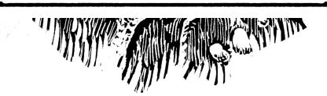

"Travel far, young bard, and return with a story." -Master Yeothin to a bardic college graduate

{39}------------------------------------------------

## Hex Crawling

#### **TRAVEL PER DAY**

Hexes are **6-miles** across. The PCs can enter a number of hexes per day based on travel method.

#### **MOVEMENT**

PCs move from hex to hex as a group while traveling overland. Shift into combat or crawling rounds if an encounter occurs.

Check for a **random encounter** twice a day and twice overnight with a 1:6 chance each time. Roll a d12 to determine what time of day the encounters happen.

#### **WEATHER**

Check the weather each day by rolling a d6.

On a 1, the weather is **stormy**. Normal terrain becomes difficult for one day. In a **harsh climate**, (see [pg. 42](#page-41-1)), terrain becomes impassable for one day instead.

On a 6, the weather is excellent. Roll the next weather with ADV.

#### **ENTERING HEXES**

| Travel Method | Hexes per Day |  |
|---------------|---------------|--|
| Walking       | 4             |  |
| Mounted       | 6             |  |
| Sailing       | 8*            |  |

#### **TERRAIN TYPES**

| Terrain    | Hex Cost to Enter |  |
|------------|-------------------|--|
| Normal     | 1                 |  |
| Difficult  | 2                 |  |
| Impassable | Cannot enter      |  |

#### **FOOD AND WATER**

PCs and mounts must each consume one ration per day, taking 1 CON damage (death at 0) if they do not. A PC can **forage** for 1 ration a day during travel with an INT check.

#### **PUSHING**

At the start of the day, the PCs can choose to **push** to multiply their hexes per day by 1.5 times. Increase the random encounter chance by 1:6 that day. PCs can't **forage** on a day they push.

{40}------------------------------------------------

#### **HEX VISIBILITY**

The PCs can see the terrain and points of interest in all **adjacent hexes.** They can also see major terrain features, such as mountains, from any hex while their visibility is not hindered.

PCs can try to enter an adjacent hex they can't see into, but they bounce off it if they don't have enough available movement.

Some conditions in the PCs' **current hex** can affect the visibility of surrounding hexes:

#### **HEX VISIBILITY**

| Condition         | Hexes |
|-------------------|-------|
| Darkness          | -1    |
| Stormy weather    | -1    |
| Excellent weather | +1    |
| Slight elevation  | +1    |
| High elevation    | +3    |

#### **TERRAIN IN THE REACHES**

| Terrain Type |                         | Hex Cost to Enter |  |
|-----------------|-------------------------|-------------------|--|
| Arctic sea      | Impassable without boat |                   |  |
| Canyon          | Difficult               | 2                 |  |
| Coast           | Normal                  | 1                 |  |
| Deep tunnels    | Normal                  | 1                 |  |
| Desert          | Normal                  | 1                 |  |
| Forest          | Difficult               | 2                 |  |
| Grassland       | Normal                  | 1                 |  |
| Jungle          | Difficult               | 2                 |  |
| Lake            | Impassable without boat | 1 with boat       |  |
| Lava            | Impassable              | -                 |  |
| Mountain        | Difficult               | 2                 |  |
| Ocean           | Impassable without boat | 1 with boat       |  |
| River           | Difficult               | 2 (1 with boat)   |  |
| Path            | Normal                  | 1                 |  |
| Salt Flat       | Normal                  | 1                 |  |
| Swamp           | Difficult               | 2                 |  |

{41}------------------------------------------------

## Climate

The Western Reaches are home to a wide variety of climates that can pose dangers to adventurers.

Most regions have moderate weather in the **spring** and **fall**. The weather is the most severe in the **summer** and **winter**.

#### **HARSH CLIMATE**

Some seasons and regions bring challenging survival conditions.

On the Climate In The Reaches Table, entries with a dagger*†* have a harsh climate **at all times**. Entries with an asterisk\* have a harsh climate only during **stormy weather** (see [pg. 40](#page-39-1)).

In a harsh climate:

- Each PC and mount must consume double rations or be treated as if they consumed none that day.
- Trying to **forage** or **hunt** is DC 18 in normal weather and impossible in stormy weather.

#### **ISLES OF ANDRIK**

This northernmost part of the Western Reaches experiences full seasons of long-term day and night.

**Midnight Sun.** Spring and summer. The sun never fully sets. There is enough light to see clearly outside at all hours.

**Harvest.** Fall. Sunny during the day and dark at night.

**Long Dark.** Winter. Night never ends. Only dark-adapted creatures can see without light.

#### **UNDERGROUND**

In the depths of the earth, there are neither seasons nor weather. Instead, these deep tunnels are humid and cool year round, unchanging in a way that drives creatures of the sun mad.

When the **season changes** on the surface, PCs far underground must pass DC 12 CHA checks or take 1d4 CHA damage.

{42}------------------------------------------------

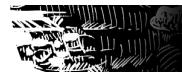

#### **CLIMATE IN THE REACHES**

| Region           | Spring/Fall | Summer      | Winter    |
|------------------|-------------|-------------|-----------|
| Bastion Mtns     | Temperate   | Temperate   | Cold*     |
| Dhalpurna Mtns   | Temperate   | Hot         | Cold*     |
| Djurum Desert    | Hot*        | Scorching†  | Temperate |
| Duchy of Montmar | Temperate   | Hot         | Cold      |
| Gilzai Mtns      | Hot*        | Scorching*  | Temperate |
| Gloaming, The    | Temperate   | Temperate   | Cold*     |
| Isles of Andrik  | Cold*       | Temperate   | Freezing† |
| Kyzian Steppes   | Temperate   | Hot*        | Cold*     |
| Last Sea, The    | Temperate   | Temperate*  | Cold*     |
| Lowland Moor     | Temperate   | Temperate   | Cold*     |
| Myre Swamp       | Temperate   | Sweltering  | Cold*     |
| Rimespire Mtns   | Cold*       | Temperate   | Freezing† |
| Sablewood        | Temperate   | Temperate   | Cold*     |
| Silent Mtns      | Hot*        | Scorching*  | Temperate |
| Tal-Yool Jungle  | Hot*        | Sweltering† | Temperate |
|                  |             |             |           |

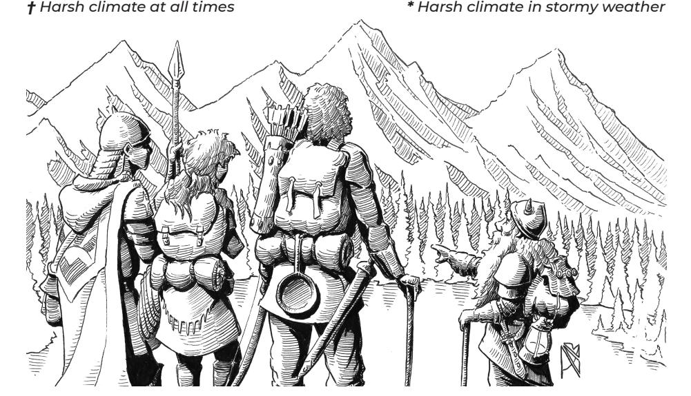

{43}------------------------------------------------

## Camping

Optionally, characters can choose to undertake camping procedures during a rest.

#### **CAMPFIRE**

The PCs can make a **campfire** using 3 torches; it lasts 8 hours while a PC remains near to it and casts light out to a near distance. Without a campfire, the PCs have DISADV on tasks marked with an asterisk\*.

#### **TASKS**

Each PC can do one task while camping and still get a full rest. PCs can do the same task.

The GM determines the DC of each task check based on the situation. Default to **DC 12.**

**Bed Down.\*** WIS or CON. If your sleep is interrupted during this rest, you do not need to pass a CON check to benefit from rest.

**Cook.\*** INT or WIS. Each PC who consumes a ration gains +2 temporary HP that lasts 1 day.

**Craft.\*** DEX. Create 2d4 pieces of mundane weapon ammunition or one torch. Alternatively, repair a broken piece of mundane gear.

**Entertain\*.** CHA. Grant 1 luck token to another PC.

**Firewood.** STR or CON. Make one free campfire this rest without expending torches.

**Hunt.** STR or DEX. Find 1d4 rations. You cannot hunt if you pushed during today's travel.

**Keep Watch.\*** WIS. Your party can't be surprised for half of this rest (you choose which half).

**Predict.** INT or WIS. You may force a re-roll of tomorrow's weather after learning the result.

#### **PROCEDURE**

- **1.** The PCs make task checks in any order they choose.
- **2.** After resolving tasks, the GM follows normal resting and random encounter procedures.

{44}------------------------------------------------

## Fast Travel

#### **OVERVIEW**

The GM may allow the PCs to **fast travel** between two hexes they have previously entered.

The PCs must travel between these points through hexes they have already explored; they can't pass through unexplored hexes.

#### **TIME**

The GM estimates the time needed for the PCs to reach their destination per the table below.

The GM should factor in the travel method (mounted, sailing, etc.), distance, and terrain.

When needing a specific time length, roll 2d6 per estimated week of travel to determine how many days the journey takes.

#### **FAST TRAVEL**

| Time Needed   | Min. Rations |
|---------------|--------------|
| A few days    | 1-3          |
| About a week  | 3            |
| Several weeks | 3/week       |

#### **RATIONS**

The PCs must eat the minimum number of rations required if they have them available.

PCs who cannot eat the required number of rations arrive drained.

**Drained.** You take CON damage equal to half your current CON score (round down). You have DISADV on all checks and attack rolls until you successfully rest.

One PC can make an INT check (GM sets the DC based on region and climate) to **scavenge** during the journey. On a success, the group avoids arriving drained.

#### **PROCEDURE**

- **1.** The GM estimates the time needed for the journey.
- **2.** One PC may make an INT check to **scavenge** for the group.
- **3.** The PCs reach their intended destination. They arrive **drained**, if applicable.

{45}------------------------------------------------

## Travel Procedure

**Step 1: Weather.** Roll a d6 to determine the weather.

**Step 2: Visible Hexes.** Determine which hexes the PCs can see.

**Step 3: Travel Method.** The PCs decide their mode of travel.

**Step 4: Travel Speed.** The PCs decide whether to move at normal speed or **push**.

**Step 5: Traveling.** The PCs move, expending as much available movement as they want. Update the visible hexes as they travel. They can **forage** for rations if they didn't **push**.

**Step 6: Traveling Encounters.** Check for and trigger random encounters while the PCs travel.

**Step 7: Resting.** The PCs may **camp**. They consume rations (2 each in a harsh climate) and rest.

**Step 8: Resting Encounters.** Check for and trigger random encounters while the PCs rest.

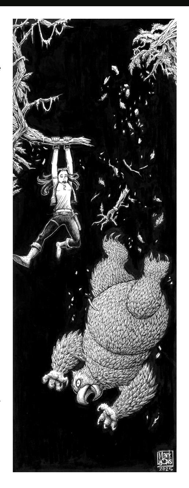

{46}------------------------------------------------

### Player's Map of the Western Reaches

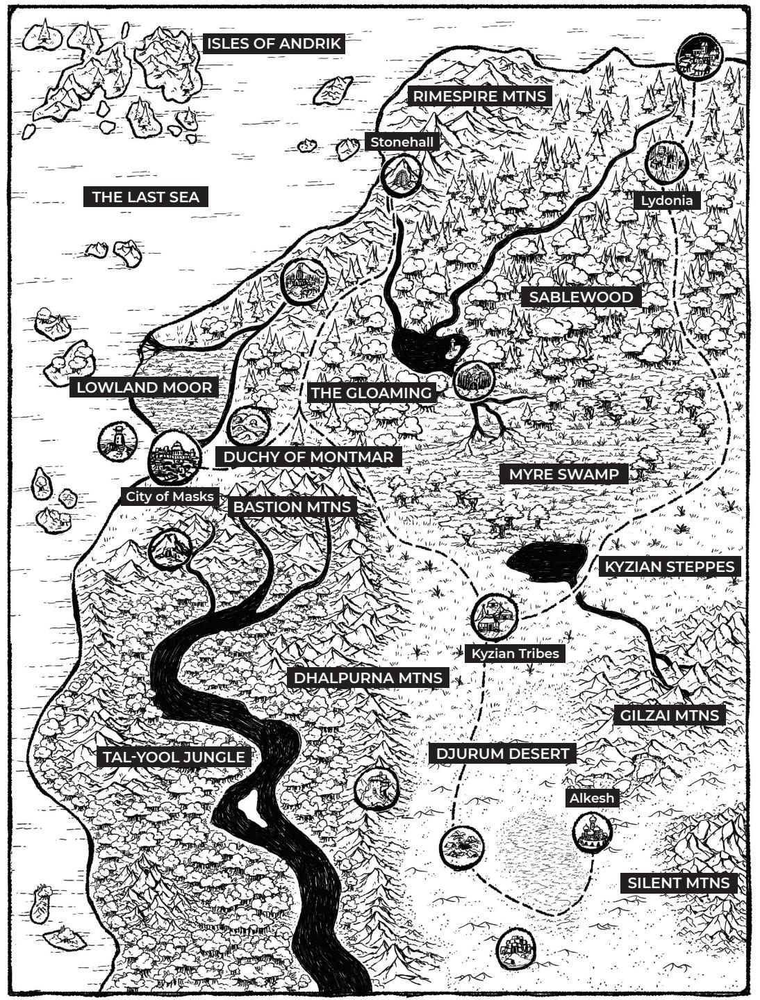

{47}------------------------------------------------

## Fragile Civilizations

#### **ATTACK THE POINTS OF LIGHT**

While the PCs are adventuring, the world continues to change in the background. Civilizations are especially fragile in the Reaches.

**Frequency.** Check for trouble in civilization once a week. There is a cumulative 1:6 chance each week that trouble stirs.

Once it does, use the following tables to determine where the trouble is and its type.

**Discovery.** The PCs hear about the trouble the next time they learn new rumors.

**Development.** As time goes on, the trouble's symptoms become more obvious. For instance, vague rumors precede an orc horde that is 1d4 weeks away. Once it's 1d8 days away, villagers gather supplies and fortify their houses. Once it's only 1d12 hours away, the orc horde is visible, and the villagers flee or hide.

#### **1d20 Region** 1 Bastion Mtns 2 Dhalpurna Mtns 3-4 Djurum Desert 5-6 Duchy of Montmar 7 Gilzai Mtns 8 Gloaming, The 9 Isles of Andrik 10-11 Kyzian Steppes 12 Last Sea, The 13 Lowland Moor 14 Myre Swamp 15-16 Rimespire Mtns 17-18 Sablewood 19 Silent Mtns 20 Tal-Yool Jungle **TROUBLE IN...**

#### **1d4 Settlement** 1 A village 2 A town (reroll if none) 3 A city (reroll if none) 4 A city-state (reroll if none) **LOCATION**

{48}------------------------------------------------

#### **TYPE OF TROUBLE**

| 1d10 | It's a                                                                                                                                                                              |
|------|-------------------------------------------------------------------------------------------------------------------------------------------------------------------------------------|
| 1    | Cult. 1d6: 1. Worship of a harmful being 2. Sacrifices of life or valuables 3. Puritan and dogmatic 4. Aberrant and warped 5. Tyrannical and violent 6. Detached from reality |
| 2    | Monster. 1d6: 1. Hag coven (3 random hags) 2. Purple worm 3. Vampire 4. Aboleth 5. Doppelganger 6. Dragon                                                                        |
| 3    | Monster horde. 1d6: 1. Orcs 2. Undead 3. Bandits 4. Demons 5. Natural creatures 6. Aberrant things                                                                               |
| 4    | Disaster. 1d6: 1. Earthquake 2. Flood 3. Fire/volcano 4. Wind 5. Supernatural 6. Manufactured                                                                                    |
| 5    | Disease. 1d6: 1. Rat Plague 2. Crops destroyed 3. Livestock dead 4. Undead contagion 5. Spores 6. Magical radiation                                                              |
| 6    | External faction. 1d4: 1. Attacked by rivals 2. Trade embargo 3. Besieged by enemies 4. Outside spies fomenting unrest                                                           |
| 7    | Internal faction. 1d6: 1. Criminals 2. Serial killer 3. Religious leader 4. Mob rebellion 5. Corrupt official 6. Military coup                                                   |
| 8    | Supernatural threat. 1d6: 1. Undead haunting 2. Unhinged wizard 3. Dimensional rift 4. Rise of an eldritch being or patron 5. A demon or devil 6. An angered god              |
| 9    | Military threat. 1d6: 1. Skirmish 2. Siege 3. Razings 4. Warlord raising an army 5. Mercenary threat 6. War                                                                      |

|  |       |                  | URGENCY LEVEL                        |
|--|-------|------------------|--------------------------------------|
|  | 2d6   | It's             | Symptoms                             |
|  | 1-6   | 1d4 weeks away   | Discomfort, portents, denial         |
|  | 7-9   | 1d8 days away    | Arguments, speculation, preparations |
|  | 10-11 | 1d12 hours away  | Mass hysteria, overt danger, chaos   |
|  | 12    | Already happened | Devastation, mourning, change        |

10 **Power change.** 1d4: **1.** A good leader falls **2.** A bad leader rises **3.** Multiple heirs vie for power **4.** Leadership vacuum

{49}------------------------------------------------

## Rumors in the Reaches

#### **d100 Details** Devil's Peak in the Rimespires has a mighty spell upon it No road in the Western Reaches is safe from local bandits Deep underground, there is a dark library full of knowledge If you see a suspicious mountain goat, try to capture it In the Steppes, the Iron King guards a castle full of treasure Pit fighting is a common practice in the Djurum Desert There is an inescapable prison-island in the Last Sea Rangers in the Sablewood are first to learn of dangers Portals to other worlds are hidden all throughout the land Demons hatch out of black trees in The Gloaming forest Giant crabs swarm all over a tropical island far to the south A secretive village of halflings hides in the Lowland Moor The founding king of Stonehall was not buried there Atop a cloudy peak, an immortal man dwells in isolation The dwarves in the Bastions are beset by wyvern attacks St. Terragnis fought mighty devils in the Rimespire peaks Black structures in the jungle house otherworldly beings The elf City-State of Lydonia is a surreal place of magic An accursed dragon flies over the desert during storms An ancient tyrant's castle lies abandoned in the Sablewood You might spot a rare blue tiger in the Dhalpurna range Elder dwarves called the dverg explored this land long ago The desert is home to ancient cults and dying traditions **RUMORS**

{50}------------------------------------------------

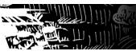

| d100 | Details                                                         |
|------|-----------------------------------------------------------------|
| 24   | The villages in the Isles of Andrik are always in conflict      |
| 25   | A king's pyramid lies buried in the trackless desert sands      |
| 26   | Every devil's contract is pinned to a cursed tree in the bog    |
| 27   | You can find a dragon in almost every region of the Reaches     |
| 28   | Nuns who battle demons live in a priory in the Rimespires       |
| 29   | Beware mountains that spire fire; they have fierce denizens     |
| 30   | Don't try to steal a silver camel from the Siruul elves or else |
| 31   | Powerful dead creatures draw evil necromancers like flies       |
| 32   | The raiders from the northern isles war among themselves        |
| 33   | The archmage Murabi is entombed in the Silent Mountains         |
| 34   | Dwarves are creating a new settlement in the Bastions           |
| 35   | Daryos of Reme is the greatest duelist in all the Reaches       |
| 36   | Countless bandits wait to ambush merchants in the desert        |
| 37   | A rare blue tree frog in the jungle can cure any disease        |
| 38   | Pirates hide out along the rivers and coasts of the jungle      |
| 39   | Every village and town hides a secret if you look carefully     |
| 40   | The dwarves of Stonehall are friendly, if you can get inside    |
| 41   | A terrible plague has beset a small village in The Gloaming     |
| 42   | A pirate with a genius intellect rules a town in the desert     |
| 43   | The most ancient humans in the Reaches live in the jungle       |
| 44   | There's a living mountain called Old Father who speaks          |
| 45   | Elemental powers take human shape in the Kyzian Steppes         |
| 46   | Do not trust ordinary folk who speak in the Dragon tongue       |
| 47   | A crazy blue kobold lives on a dinghy in the south Last Sea     |
| 48   | The lost citadel of an ancient bull god lies in the Steppes     |
| 49   | An old woman in the northern isles can change your fate         |
| 50   | Fire dwarves live on a volcanic island near the Rimespires      |

{51}------------------------------------------------

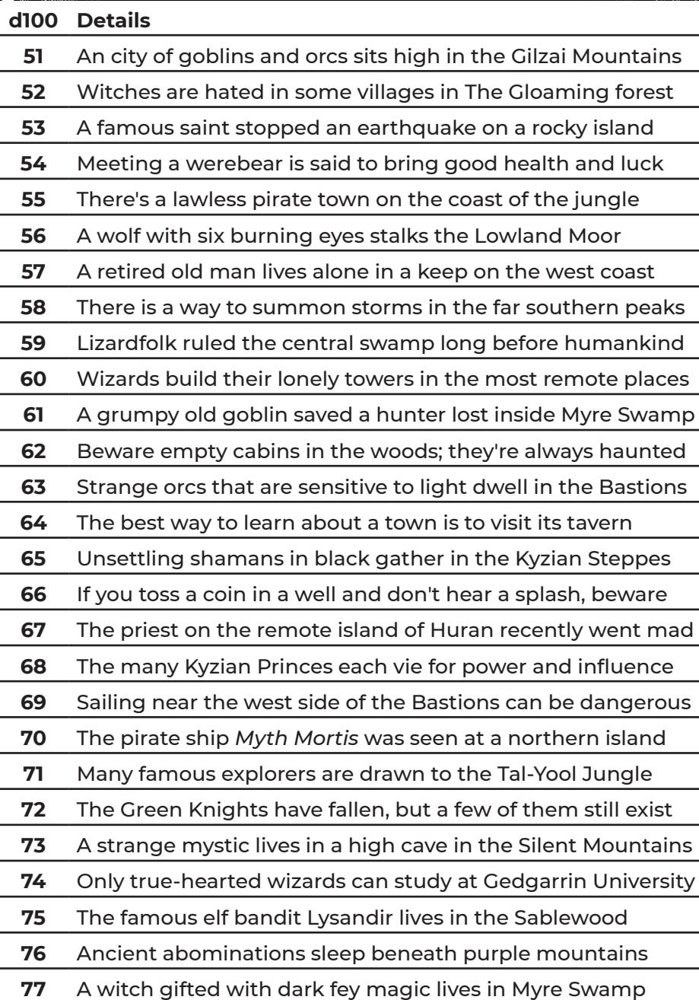

{52}------------------------------------------------

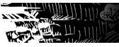

| d100 | Details                                                        |
|------|----------------------------------------------------------------|
| 78   | A giant iceberg in the northern sea has shapes moving in it    |
| 79   | Goblins and orcs always gather in remote box canyons           |
| 80   | Foolish nobles built estates at the edge of Myre Swamp         |
| 81   | The fire dragon the Kyzian Queen drove off is still out there  |
| 82   | The Willowman is real and he haunts The Gloaming forest        |
| 83   | If you see an onyx statue of a twisted human, don't touch it   |
| 84   | Some monks in the Dhalpurnas have transcended death            |
| 85   | If you want to learn witchcraft, find Uncle Grigor in the bogs |
| 86   | Giant spiders have crept back into the Sablewood recently      |
| 87   | Madness lies beyond the lonely gate of metal and lightning     |
| 88   | There are no better horse trainers than the Kyzian people      |
| 89   | Gods walk in the Silent Mountains during the full moon         |
| 90   | Three island mark the site of a city that sank into the sea    |
| 91   | Trolls in the Lowland Moor know magical words of power         |
| 92   | Those on the road west of the swamp often hear yodeling        |
| 93   | Strange lords from the Fey Realms dwell in the Sablewood       |
| 94   | A retired gladiator named Rameer trains aspiring fighters      |
| 95   | Something bad is happening to travelers in Frostfall Pass      |
| 96   | A scary witch lives in the heath of the Duchy of Montmar       |
| 97   | The snake-people of myth still dwell in the remote jungle      |
| 98   | The Duke of the City of Masks and King of Lydonia are allies   |
| 99   | There is no more evil place under the sun than Myre Swamp      |
| 100  | There is an altar on a distant mountain that can restore life  |

{53}------------------------------------------------

## Arctic Sea Encounters

#### **ARCTIC SEA ENCOUNTERS**

| d100  | Details                                                        |
|-------|----------------------------------------------------------------|
| 01    | A kraken rises from the deep and attacks for 1 round           |
| 02-03 | Two swimming polar bears try to board the ship                 |
| 04-05 | A thrashing sea serpent* fights to the death with an orca*     |
| 06-07 | A longboat of 3d6 berserkers led by Gromf the Sly appears      |
| 08-09 | A frost dragon circles overhead, considering an attack         |
| 10-11 | A tired, sea-blown greater drake* tries to land on the ship    |
| 12-13 | A rogue wave surges! DC 15 DEX or thrown overboard             |
| 14-15 | 3d6 pale merfolk demand you leave their hunting territory      |
| 16-17 | A disease-stricken sea serpent* bites blindly at movement      |
| 18-19 | An iceberg careens toward the boat on a fast current           |
| 20-21 | A pod of 2d4 orcas* mistakes the boat for an enemy whale       |
| 22-23 | 1d6 albino sharks circle the ship, considering an attack       |
| 24-25 | A listing longboat appears; 3d8 nords try to make it home      |
| 26-27 | A cloud of 2d20 purple jellyfish boil up to the surface        |
| 28-29 | 1d4 giant manta rays crash toward you, fleeing a lone orca     |
| 30-31 | A small island comes into view, occupied by 2d20 pirates       |
| 32-33 | A galleon appears; it bears 1d6 knights and 2d12 soldiers      |
| 34-35 | A sea hag tries to secretly kill and replace a crew member     |
| 36-37 | 3:6 chance a passing megalodon's wake capsizes the boat        |
| 38-39 | 2d4 cackling frost trolls paw through the waves on a raft      |
| 40-41 | A snow ape crouches on a small ice floe that draws closer      |
| 42-43 | A nord* floats by on a piece of flotsam, half frozen to death  |
| 44-45 | 2d6 bandits on a raft call for help; they're convicted killers |

{54}------------------------------------------------

#### **ARCTIC SEA ENCOUNTERS**

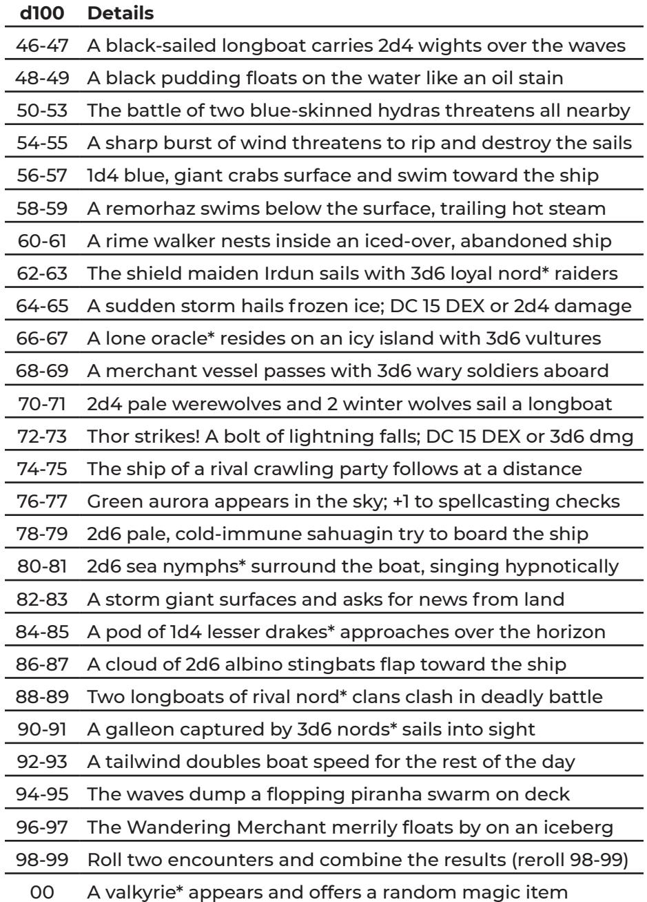

{55}------------------------------------------------

## Canyon Encounters

#### **CANYON ENCOUNTERS**

| d100  | Details                                                     |
|-------|-------------------------------------------------------------|
| 01    | The Netherworld Council (6 dai oni*) silently appears       |
| 02-03 | 1d6 vicious canyon apes* stalk the PCs from the shadows     |
| 04-05 | 2d4 Ras-Godai* fight an encircling group of 3d6 bandits     |
| 06-07 | Riddershim the necromancer* (C) needs a fresh skeleton      |
| 08-09 | A towering dust devil* whirls up in a narrow canyon pass    |
| 10-11 | 1d6 scarecrows dressed like bandits stand on a high ledge   |
| 12-13 | A rock slide breaks loose above (DC 12 DEX or 2d8 damage)   |
| 14-15 | 2d4 scrag* scamper along the walls, looking for fresh meat  |
| 16-17 | A goat giant hurls boulders from above and prances about    |
| 18-19 | A stampede of 2d20 terrified wild horses rushes through     |
| 20-21 | Two griffons flank a narrow pass and wait for prey below    |
| 22-23 | A mighty gladiator (hero*) challenges a PC to a solo duel   |
| 24-25 | 3d6 thugs pour out of a cave entrance and demand gold       |
| 26-27 | A lone canyon ape drops from above onto the rear PC         |
| 28-29 | A ring of 2d4 rookie* pit fighters train brutally at a camp |
| 30-31 | 2d4 duergar guard a rift leading deep into their domain     |
| 32-33 | 1d4 giant scorpions skitter aggressively toward movement    |
| 34-35 | A sphinx judges the PCs based on their riddle knowledge     |
| 36-37 | An isolated rain shower produces sudden, rapid flooding     |
| 38-39 | A mummy breaks out of the clay sculpture encasing it        |
| 40-41 | An angry djinni believes the PCs stole his sapphire ring    |
| 42-43 | An unconscious man sways in the saddle of his donkey*       |
| 44-45 | A snag line fires poisoned needles (DC 12 CON or sleep)     |

{56}------------------------------------------------

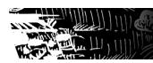

#### **CANYON ENCOUNTERS**

| d100  | Details                                                       |
|-------|---------------------------------------------------------------|
| 46-47 | An arrogant efreeti insults the PCs' capability and bravery   |
| 48-49 | 2d6 startled beastmen peek out from behind boulders           |
| 50-53 | 2d6 kobolds rain rocks down onto a wildly angry ogre          |
| 54-55 | An obvious "gold piece on a line" trap leads behind a rock    |
| 56-57 | A furious cave brute charges out of a bone-strewn den         |
| 58-59 | 1d4 bugbears creep along to ambush unwary travelers           |
| 60-61 | 1d4 Siruul* elves camp with their silver camels* in a cave    |
| 62-63 | The wandering mystic Zoramander (oracle*) approaches          |
| 64-65 | 2d6 hobgoblins on patrol try to take the PCs captive          |
| 66-67 | A harmless baby earth elemental hatches from a boulder        |
| 68-69 | A scarab swarm ruptures out of a crack in the canyon wall     |
| 70-71 | 1d4 giant centipedes devour a recently dead peasant           |
| 72-73 | Two competing mages are locked in a fiery spell duel          |
| 74-75 | The Velvet Knife, an adventuring party of thieves, arrives    |
| 76-77 | 2d4 ankhegs carve new tunnels in the rock with their acid     |
| 78-79 | A meditating naga ignores the PCs unless disturbed            |
| 80-81 | A cloaker swoops in the shadows along the canyon walls        |
| 82-83 | A nuln* lost underground for 20 years staggers from a cave    |
| 84-85 | A desperate bard keeps a cobra hypnotized with his music      |
| 86-87 | A sly manticore challenges the PCs to a game of chance        |
| 88-89 | A human ranger* holds off 2d6 bandits from a high perch       |
| 90-91 | An oni trades his random magic sword for 1d4 HP (perm.)       |
| 92-93 | A jasmine-scented breeze rises; restore all spells lost today |
| 94-95 | A lone, braying donkey* with empty saddlebags appears         |
| 96-97 | The Wandering Merchant swings from climbing ropes             |
| 98-99 | Roll two encounters and combine the results (reroll 98-99)    |
| 00    | Lorence, a camel-riding ranger*, gifts a PC a magic potion    |

{57}------------------------------------------------

## Lake Encounters

#### **LAKE ENCOUNTERS**

| d100  | Details                                                       |
|-------|---------------------------------------------------------------|
| 01    | An enraged, 8-headed hydra bursts out of the water            |
| 02-03 | A giant catfish* threatens to overturn boats from below       |
| 04-05 | Two warring giant octopi threaten all creatures nearby        |
| 06-07 | A merfolk archmage is furious at the annoying intrusion       |
| 08-09 | A plesiosaurus tries to drag a PC into the depths             |
| 10-11 | A giant crab flails its claws into nearby boats and creatures |
| 12-13 | A drifting mass of water weeds entraps all it touches         |
| 14-15 | A canoe with 10 wild-eyed cultists speeds toward the PCs      |
| 16-17 | 2d8 waterlogged zombies bob to the water's surface            |
| 18-19 | A sudden waterspout plows through all in its path             |
| 20-21 | 1d4 hippogriffs swoop in from above in to carry off a victim  |
| 22-23 | A clot of 2d4 lampreys (giant leeches) writhes in the water   |
| 24-25 | Two peasant divers compete to reach a sunken treasure         |
| 26-27 | 2d4 dire condors* swoop in to steal valuable gear and flee    |
| 28-29 | 2d6 sirens draw a hapless boat of fishermen toward them       |
| 30-31 | A wraith hovers over a small, rocky island it can't leave     |
| 32-33 | A freshwater shark circles the PCs, looking for an opening    |
| 34-35 | A roper on an underwater ridge grabs at passing creatures     |
| 36-37 | The ribcage of a dead sea dragon drifts on a colliding path   |
| 38-39 | 2d4 blue-clad elves shoot bows from an agile rowboat          |
| 40-41 | A battered canoe with 2d4 shadows chases down the PCs         |
| 42-43 | A giant frog swims up behind a spear-fishing kobold           |
| 44-45 | Underwater nets with barbs entangle PCs or their vessel       |

{58}------------------------------------------------

#### **LAKE ENCOUNTERS**

| d100  | Details                                                       |
|-------|---------------------------------------------------------------|
| 46-47 | An aquatic giant anaconda slithers through the water          |
| 48-49 | An ogre floats by clinging to the broken mast of a ship       |
| 50-53 | A shell-clad knight on a hippopotamus fights 2d4 merfolk      |
| 54-55 | A cloud of magical, sleep-inducing fog rolls on the water     |
| 56-57 | 1d4 piranha swarms chew at passing boats like termites        |
| 58-59 | A hippopotamus appears with gold rings on its tusks           |
| 60-61 | A patrolling longboat of 2d12 nords* cruises by to observe    |
| 62-63 | A lone, whistling fisherman paddles his boat into view        |
| 64-65 | 2d6 sahuagin trail PCs cautiously, deciding if to attack      |
| 66-67 | Large, soapy bubbles drift up from beneath the water          |
| 68-69 | A bobbing urn pops open, disgorging a scarab swarm            |
| 70-71 | 1d6 rusty animated armors try to clamber out of the water     |
| 72-73 | A boat race has turned into a pileup of brawling peasants     |
| 74-75 | The Silver Strings, a vain group of bards*, sails by smugly   |
| 76-77 | A brass gong hangs over the water on a telescoping pole       |
| 78-79 | A singular, jet-black crocodile named Inktooth swims by       |
| 80-81 | A passing albatross drops an ochre jelly onto the PCs         |
| 82-83 | A chatty, floating skeleton of a pirate has no idea it's dead |
| 84-85 | A sea hag disguised as a drowning woman calls for help        |
| 86-87 | A regal kobold sorcerer riding a giant frog approaches        |
| 88-89 | 2d6 vultures dive bomb a spinning, waterlogged treant         |
| 90-91 | A family of halflings* aboard a small sloop wave cheerfully   |
| 92-93 | A surge of iridescent water heals boats and PCs 3d8 HP        |
| 94-95 | The Seaweed Devil (vrock) drifts on a weed-covered raft       |
| 96-97 | The Wandering Merchant swims by in a lazy backstroke          |
| 98-99 | Roll two encounters and combine the results (reroll 98-99)    |
| 00    | A fiery meteorite hits the water; it's a LV 10+ treasure roll |

{59}------------------------------------------------

## Lava Encounters

**LAVA ENCOUNTERS**

#### **d100 Details** 01 The ancient fire dragon, Talus-Mir, awakens angrily 02-03 The Red Kraken (fire immune) surfaces slowly from lava 04-05 3d6 azers devolve into fighting over a coconut-sized geode 06-07 Sarsa the Pyroclastic (C mage) demands a wizard duel 08-09 A pumice beast (LV 9 earth elemental) rises from the rocks 10-11 1d4 gargoyles dripping with fire swoop at the PCs 12-13 A curtain of lava falls from overhead (DC 12 DEX or 4d6) 14-15 The ghost of a dead explorer flies out of a lava flow 16-17 A fire elemental (LV 9) coalesces from burning debris 18-19 The earth suddenly splits, opening up to a magma flow 20-21 A goblin boss and 2d6 goblins hurl sharp rocks from above 22-23 An iron golem stands healing in a knee-high river of lava

24-25 2d6 injured dwarf\* miners covered in soot limp into view

28-29 A reaver on a nightmare charges at a staggered knight 30-31 An efreeti sits cross-legged inside the shell of a tower

26-27 1d4 prowling hell hounds stalk the PCs like wolves

{60}------------------------------------------------

#### **LAVA ENCOUNTERS**

| d100  | Details                                                     |
|-------|-------------------------------------------------------------|
| 46-47 | 1d4 salamander hunters leap out to capture live victims     |
| 48-49 | 2d4 skandrill* charge at the PCs on a metal object raid     |
| 50-53 | A priest of Ramlaat (C) sacrifices a human on a black altar |
| 54-55 | Shifting rocks accelerate into a dangerous avalanche        |
| 56-57 | A blazing-eyed chimera lands and roars a challenge          |
| 58-59 | 2d6 tar bats* fly out of a narrow crevasse to swarm the PCs |
| 60-61 | 3d6 exhausted soldiers set up camp in a destroyed keep      |
| 62-63 | A cyclops farmer tends to his two pet rust monsters         |
| 64-65 | 2d6 gnolls chip obsidian daggers from cooled lava sheets    |
| 66-67 | Several people-like, obsidian statues stand in a circle     |
| 68-69 | 2d6 red lizardfolk (fire immune) hunt for small game        |
| 70-71 | 1d4 wights in burning clothing prowl into view              |
| 72-73 | A titanic clash between a phoenix and roc erupts overhead   |
| 74-75 | The First Watch, terrified new adventurers, flee danger     |
| 76-77 | Cones of dried lava burp out perfectly smooth, round rocks  |
| 78-79 | 2d4 vultures circle overhead in the shimmering heat         |
| 80-81 | 2d6 patrolling hobgoblins arrest trespassers in their land  |
| 82-83 | A remorseful bandit escaping his gang begs for water        |
| 84-85 | A burning dust devil (LV 6 fire elemental) careens around   |
| 86-87 | A rocky lava crab (giant crab, fire immune) rears up        |
| 88-89 | 1d4 giant dung beetles try to knock a mage off a ledge      |
| 90-91 | A curious sphinx lounges inside a lava-heated cave          |
| 92-93 | Soothing hot springs heal bathers 1d4 HP per hour           |
| 94-95 | An archangel and archdevil debate beneath a burned tree     |
| 96-97 | The Wandering Merchant tiptoes around streams of lava       |
| 98-99 | Roll two encounters and combine the results (reroll 98-99)  |
| 00    | A bursting lava bubble disgorges a random magic potion      |

{61}------------------------------------------------

## Path Encounters

#### **PATH ENCOUNTERS**

| d100  | Details                                                      |
|-------|--------------------------------------------------------------|
| 01    | Peasants try to open a mummy sarcophagus they found          |
| 02-03 | 3d6 bandits emerge from the ditches demanding tolls          |
| 04-05 | Two rival groups of bards* have a vicious poetry fight       |
| 06-07 | A morose traveler latches onto the PCs and follows them      |
| 08-09 | 3d6 soldiers move in advance of their allied warbands        |
| 10-11 | 1d4 goblins sell questionably cooked dung beetle legs        |
| 12-13 | A tenuous rock overhang provides a sheltered campsite        |
| 14-15 | 1d4 rangers* cross the pathway on their patrol route         |
| 16-17 | A traveling mage offers to trade his expertise for shelter   |
| 18-19 | Hanged criminals dangle from nearby posts in warning         |
| 20-21 | Taruk, a gladiator, travels to Alkesh to fight in the arenas |
| 22-23 | 2d4 centaurs hunt for small game just off the path           |
| 24-25 | Two red-faced merchants quarrel over who owns a wagon        |
| 26-27 | A trade caravan of 2d20 peasants and 2d4 guards passes       |
| 28-29 | 2d4 cultists lead a group of 4 nords* bound in chains        |
| 30-31 | 2d6 bandits use a "lost" horse as a lure to rob victims      |
| 32-33 | A drunk leprechaun who think he's invisible dances a jig     |
| 34-35 | A berserker riding a moose hails the PCs and offers ale      |
| 36-37 | A recent campsite lies abandoned and untouched               |
| 38-39 | A royal carriage transports a merfolk king in a tub of water |
| 40-41 | A deposed orc chieftain wants revenge against his clan       |
| 42-43 | A sallow man (vampire) hides in the shade of a dead tree     |
| 44-45 | A precarious rock slide blocks horses and wagons             |

{62}------------------------------------------------

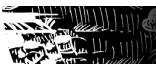

#### **PATH ENCOUNTERS**

| d100  | Details                                                      |
|-------|--------------------------------------------------------------|
| 46-47 | 1d4 halflings* flee after robbing a nearby vegetable garden  |
| 48-49 | A zealous priest of St. Terragnis preaches her holy word     |
| 50-53 | A horse-riding knight and 1d4 squires (guards) trot by       |
| 54-55 | 2d6 hobgoblins forcibly collect tolls from passing travelers |
| 56-57 | A hiding thief throws his voice, pretending to be a troll    |
| 58-59 | A necromancer* (L) hunting a vampire spawn rests nearby      |
| 60-61 | 2d4 Kyzian riders* loudly play dice games at their camp      |
| 62-63 | 2d6 irritable dwarves* plod along in heavy, creaking armor   |
| 64-65 | 2d4 Ras-Godai* on camels stare in judgmental silence         |
| 66-67 | A traveling circus thunders by on brightly painted wagons    |
| 68-69 | A warband of 2d12 orcs and their chieftain march swiftly     |
| 70-71 | 1d6 Knights of St. Ydris* (N) transport a dead demon         |
| 72-73 | A boar chases 2d4 terrified caravan guards in a circle       |
| 74-75 | A camping adventuring party pretends to be the PCs           |
| 76-77 | A sign by the path says in Goblin: "Free Gold! Dig Here!"    |
| 78-79 | A frantic messenger rides with a letter from the Duke        |
| 80-81 | A bedraggled human (werewolf) staggers into sight            |
| 82-83 | 2d6 diplomats (elves) from Lydonia travel to Alkesh          |
| 84-85 | Mordred, a suspicious merchant, sells legitimate potions     |
| 86-87 | A knight leads 1d6 pirates in manacles to the City of Masks  |
| 88-89 | 2d4 kobolds fiercely scold an ogre who did not expect this   |
| 90-91 | An outpost held by the nearest Overlord offers safety        |
| 92-93 | A shrine to Madeera grants a luck token for an offering      |
| 94-95 | A wild-eyed berserker challenges the PCs to arm wrestling    |
| 96-97 | The Wandering Merchant lies hog-tied in the road             |
| 98-99 | Roll two encounters and combine the results (reroll 98-99)   |
| 00    | A witch* (actually Shune the Vile) offers omens and advice   |

{63}------------------------------------------------

## Salt Flat Encounters

#### **SALT FLAT ENCOUNTERS**

| d100  | Details                                                      |
|-------|--------------------------------------------------------------|
| 01    | A raging purple worm bursts through the salt crust           |
| 02-03 | A distracted lich lost in thought ambles along, muttering    |
| 04-05 | 2d4 scrag* surround a manticore protecting its fresh kill    |
| 06-07 | An oni disguised as a Ras-Godai* antagonizes the PCs         |
| 08-09 | 2d8 nomads (guards) on scrag* pick through the wastes        |
| 10-11 | A salt-rimed otyugh digs around in a dead purple worm        |
| 12-13 | A sudden gale whips sharp, blinding salt into the air        |
| 14-15 | A pile of bleached bones shivers together into a bone naga   |
| 16-17 | A black-scaled giant snake weaves through dunes of salt      |
| 18-19 | Fragile salt crust covers deep tunnels left by purple worms  |
| 20-21 | 2d4 giant spiders erupt out of their web-covered dens        |
| 22-23 | A flock of 2d6 passing harpies takes notice of the PCs       |
| 24-25 | 2d6 soldiers on camels hunt for a lost noble from Alkesh     |
| 26-27 | A stone golem made of salt stomps along in a straight line   |
| 28-29 | 3d6 bandits wait to ambush an approaching caravan            |
| 30-31 | A lone hut of piled stone belongs to a cannibalistic witch*  |
| 32-33 | 2d4 hobgoblins on horses trudge through the wastes           |
| 34-35 | 2d4 will-o'-wisps flit toward a cairn haunted by a wraith    |
| 36-37 | Razor-like salt crust cuts the feet of fast-moving creatures |
| 38-39 | A pale roper hides among a cluster of salt pillars           |
| 40-41 | 2d4 Ras-Godai* follow the trail of an assassination target   |
| 42-43 | A sun-mad gladiator swings desperately at imagined foes      |
| 44-45 | Thin tarps cover old murder pits lined with spears           |

{64}------------------------------------------------

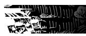

#### **SALT FLAT ENCOUNTERS**

| d100  | Details                                                       |
|-------|---------------------------------------------------------------|
| 46-47 | A manticore lounges atop a mound of hardened salt crust       |
| 48-49 | 2d6 bandits try to capture a silvery desert unicorn           |
| 50-53 | 1d4 giant scorpions scuttle out of a crack in the ground      |
| 54-55 | A magical finger trap springs on anyone who touches it        |
| 56-57 | 2d6 scrag* lounge in the sun on broad slabs of packed salt    |
| 58-59 | A pack of 2d6 savage coyotes (mastiffs) roams around          |
| 60-61 | A camp of 3d6 humans roast giant scorpion meat on spits       |
| 62-63 | 2d6 Siruul* elves on silver camels* approach cautiously       |
| 64-65 | A remorhaz hides just below the surface of the ground         |
| 66-67 | A dead megalodon maw forms a circle of salt-rimed spikes      |
| 68-69 | A stone giant drags a dead manticore carcass behind it        |
| 70-71 | A translucent-white bulette punches through the salt          |
| 72-73 | 2d4 vultures attack a berserker lashed to a wooden pole       |
| 74-75 | The Iron Shield adventuring party digs around a low hill      |
| 76-77 | A principi angel stands praying over a marble gravestone      |
| 78-79 | 1d6 sun-bleached scarecrows wait for people to approach       |
| 80-81 | 2d6 shaggy apes crusted with salt hurl sharp stones           |
| 82-83 | An assassin arrives to warn the PCs his rival hunts for them  |
| 84-85 | 2d4 stingbats poke hungrily at a dessicated scrag* corpse     |
| 86-87 | A lumbering, ancient basilisk clomps along at turtle speed    |
| 88-89 | 2d12 hobgoblins clash with a band of 2d12 human bandits       |
| 90-91 | Monks in a small chapel of Ord have sworn vows of silence     |
| 92-93 | An ever-burning pillar of fire restores one lost priest spell |
| 94-95 | Yisoru the desert dragon lands to chat with the PCs           |
| 96-97 | The Wandering Merchant merrily makes salt "snow men"          |
| 98-99 | Roll two encounters and combine the results (reroll 98-99)    |
| 00    | A purple worm coughs up a LV 10+ treasure and then flees      |

{65}------------------------------------------------

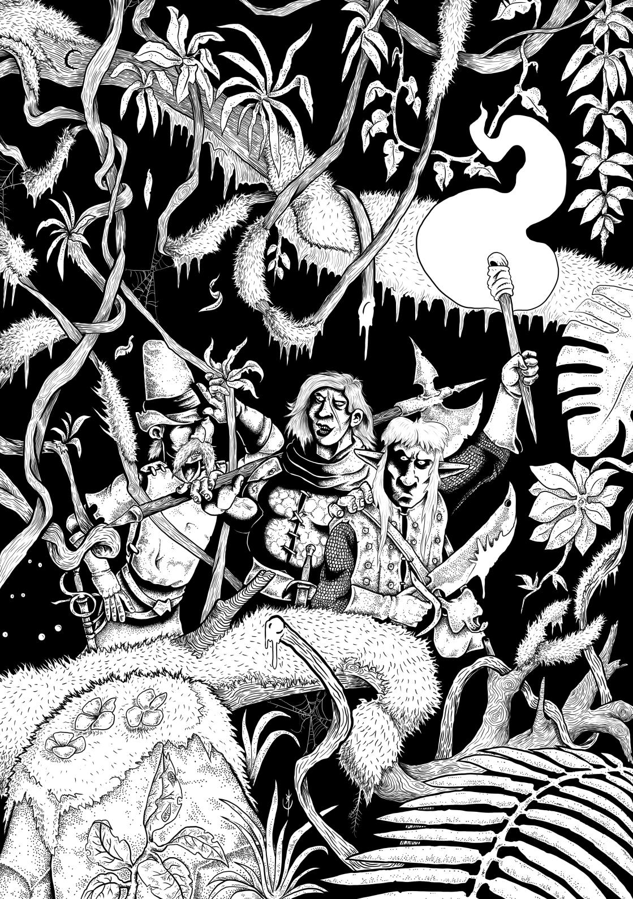

{66}------------------------------------------------

# The Reaches

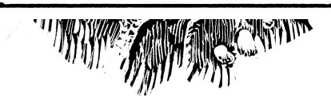

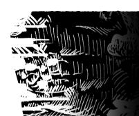

"We'll find our way out of here in no time." -Famous last words

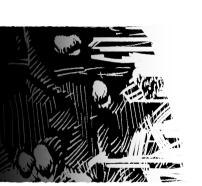

{67}------------------------------------------------

## Regions

The Western Reaches contain 16 distinct **regions** (descriptions listed in alphabetical order starting on the facing page).

Below is a table of the terrain types in each region listed in their order of prominence and importance in that region.

|                  | TERRAIN BY REGION                                        |
|------------------|----------------------------------------------------------|
| Region           | Terrain                                                  |
| Bastion Mtns     | Mountain, river, coast                                   |
| Dhalpurna Mtns   | Mountain, river                                          |
| Djurum Desert    | Desert, salt flat, path                                  |
| Duchy of Montmar | Grassland, forest, coast, path, river                    |
| Gilzai Mtns      | Mountain, canyon, river                                  |
| Gloaming, The    | Forest, swamp, path, lake, river                         |
| Isles of Andrik  | Arctic sea, coast, mountain, forest, grassland, river |
| Kyzian Steppes   | Grassland, path, lake, river                             |
| Last Sea, The    | Ocean, arctic sea, forest, jungle, mountain, lava     |
| Lowland Moor     | Swamp, river, coast, forest                              |
| Morzomotha       | Deep tunnels, river, ocean                               |
| Myre Swamp       | Swamp                                                    |
| Rimespire Mtns   | Mountain, coast, river, lake, path, forest               |
| Sablewood        | Forest, river, lake, path, coast                         |
| Silent Mtns      | Mountain, canyon                                         |
| Tal-Yool Jungle  | Jungle, coast, river, mountain, lava, path               |

{68}------------------------------------------------

#### **BASTION MOUNTAINS**

Towering blue-and-purple peaks that cut across the middle of the Reaches like a wall of armored soldiers. They join the Dhalpurna Mountains where they bend to the south, blocking off the Tal-Yool jungle to the south.

#### **DHALPURNA MOUNTAINS**

These starry mountains race down the center of the Reaches, hemming in the Tal-Yool jungle where they meet the Bastion Mountains to the north. They transform from a snowy blue in the north to a red granite in the south as the desert sun scorches their sides. This is the longest mountain range in the Reaches.

#### **DJURUM DESERT**

A vast, shimmering desert where red mountains stand silent watch over windblown valleys and undulating sand dunes.

**Salt Flats.** The site of an inland sea that boiled away long ago. The white salt pan stretches out flat and endless, taking on a pink hue in the morning sun.

#### **DUCHY OF MONTMAR**

The Duke's domain is a sunny land of rolling meadows and hills chased through by the swiftrunning Trematora River. The City of Masks is a shining jewel of civilization set on the coast where the river and sea merge. The duchy ends where the river touches the Lowland Moor.

**Trematora River.** This glittering river widens into an estuary where it meets the Last Sea.

#### **GILZAI MOUNTAINS**

A thick range of rusty, jagged peaks shot through with mazelike canyons and gorges. They hook toward the south, separating the Djurum Desert from the Kyzian Steppes.

#### **GLOAMING, THE**

A gnarled, misty forest of bogs and standing stones. Demons grow inside the cursed black marrow trees that sprout here.

**Finimere Lake.** The largest lake in the northern Reaches. Its dark, still waters are laced with the curse of The Gloaming.

{69}------------------------------------------------

#### **ISLES OF ANDRIK**

Frozen isles where the Last Sea crashes through sweeping fjords beneath the mighty Drake Peaks. Eternal night settles over these lands in the winter.

**Drake Peaks.** Vicious drakes rule these eternally snowy spires, while the feylike dverg toil at their work deep within them.

#### **KYZIAN STEPPES**

A bright land of tall, bobbing grass and endless skies. These wide grasslands transition the chilly northern Reaches into the scorching hot southern regions.

**Cobai River.** This turgid river snakes down from the Gilzai Mountains across the steppes.

**Sardaquian Sea.** The Cobai River empties into this seafoam-green lake rich with minerals.

#### **LAST SEA, THE**

A crashing ocean of frozen ice and storms to the north and warmer currents to the south. The sea is dotted with island chains and is said to be endless.

#### **LOWLAND MOOR**

Biting flies and mosquitoes swarm inside this fertile marsh. Sharp-toothed piranhas flit through its murky ponds, and antediluvian beasts who crawled out of the sea long ago still linger ere. The swamp's border along the Trematora river marks the northernmost edge of the Duchy of Montmar.

#### **MORZOMOTHA**

A lightless system of caves and tunnels far below the surface of the Western Reaches. Vast cathedral caves are as common as cramped, claustrophobic tunnels. The beings who live here are utterly alien to the surface, and their ways of life are anathema to sunborn creatures.

#### **MYRE SWAMP**

This wide bog leeches over the land south of The Gloaming, carrying some of the forest's curse along with it. Crocodiles, roving orcs, and burning pools of tar threaten the unwary. Trade routes go out of their way to bend around this swamp, giving it the wide berth it has earned.

{70}------------------------------------------------

#### **RIMESPIRE MOUNTAINS**

These broad, dark mountains cluster along the northwestern coast of the Reaches. They capture frigid storms that blow in from the sea, delivering heavy snowfall. Glacial runoff feeds the Trematora river that flows south into the Duchy of Montmar.

#### **SABLEWOOD**

Thick, boreal forest and deep blue ponds cover this wide stretch of the northern Reaches. The woods push all the way to the north coast, finally peeling back at the foot of the Rimespire Mountains along the west coast.

**Winterwash River.** This cold, clear river runs from the northern Sablewood into Finimere Lake. It carries jostling slabs of ice in the spring.

#### **SILENT MOUNTAINS**

The highest peaks in the Reaches. These eerily quiet, pale mountains stand to the southeast of the Djurum Desert. No wind stirs this silent place.

#### **TAL-YOOL JUNGLE**

A dense, isolated valley of tropical rainforest hemmed in by the Dhalpurna and Bastion mountains. The rainfall into these mountains flows down toward the massive river basin, making the region lush with thick jungle and raucous wildlife. The ancient Itzalca and Azarummian tribes dwell here.

**Black River.** The largest river by far in the Western Reaches. Its inky waters charge through the jungle in a violent cascade to the south, reaching distant lands in unknown places.

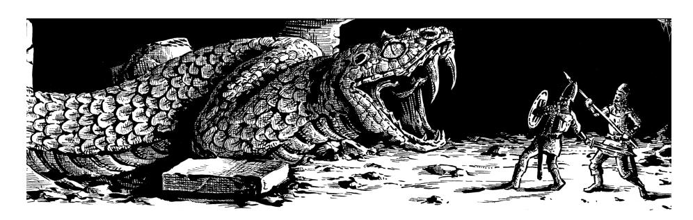

{71}------------------------------------------------

## The Shadowdark

#### **THE UNDERGROUND**

The Shadowdark reaches its inky tendrils into many parts of the Western Reaches. Cursed wells, abandoned castles, and much worse are scattered across the surface of the land.

But there is a place in the Reaches where the Shadowdark is no mere wraith, easily pushed back by torch and spell...

#### **MORZOMOTHA**

There is no more dangerous part of the Reaches than the abyssal caves called Morzomotha (*CS 5*).

This region is not shown on the overland map because it is meant to be placed wherever the PCs first delve too deep.

Possible entrances are marked on the Master Hex Key ([pg.](#page-72-1)  [73\)](#page-72-1) with a dagger*†*. In each of these locations, you could add a floor rift, cave entrance, or pit that is actually the path down into the depths of Morzomotha.

#### **ARRIVAL**

Once the PCs reach Morzomotha for the first time, it becomes fixed in place on the map.

New arrivals enter through the tunnel in **hex M501,** which becomes a path that leads back to the surface.

#### **THE CHITTERING**

Charisma damage does not heal as normal in Morzomotha. A PC must be bathed in full sunlight for their CHA damage to heal.

When a PC goes below 6 CHA, **The Chittering** sets in. Their teeth chatter uncontrollably, and they emit a thin, highpitched whine that draws the Shadowdark's worst denizens.

PCs can suppress the outward effects of The Chittering for 1d4 rounds with a successful DC 12 CON check.

Characters who reach 0 CHA in Morzomotha go irrevocably mad.

{72}------------------------------------------------

## Master Hex Key

|     |                  | MASTER HEX KEY |                     |
|-----|------------------|----------------|---------------------|
| Hex | Region           | Terrain        | Description         |
| 167 | Last Sea, The    | Jungle         | Volcanic Island†    |
| 216 | Last Sea, The    | Arctic sea     | Wise Puffins        |
| 302 | Isles of Andrik  | Forest         | Grove of the Gods   |
| 324 | Last Sea, The    | Forest         | Mad Boar Island     |
| 337 | Last Sea, The    | Ocean          | The Trio            |
| 353 | Tal-Yool Jungle  | Jungle         | Low Town2           |
| 362 | Last Sea, The    | Ocean          | Crokanis*           |
| 407 | Isles of Andrik  | Mountain       | Dvergheim3†         |
| 444 | Last Sea, The    | Ocean          | Sunken Ship         |
| 470 | Last Sea, The    | Jungle         | Krraktanamak        |
| 503 | Isles of Andrik  | Arctic sea     | Sea Nymphs          |
| 507 | Isles of Andrik  | Forest         | Valthis1            |
| 527 | Last Sea, The    | Forest         | Huran1              |
| 602 | Isles of Andrik  | Mountain       | Drakenfjell         |
| 643 | Bastion Mtns     | Mountain       | Rock Eaters         |
| 657 | Tal-Yool Jungle  | Mountain       | Extinct Volcano     |
| 706 | Isles of Andrik  | Arctic sea     | Sea Caves†          |
| 766 | Tal-Yool Jungle  | Jungle         | Reme*3              |
| 804 | Isles of Andrik  | Forest         | Skargat1            |
| 839 | Duchy of Montmar | Grassland      | Old Sea Keep        |
| 905 | Isles of Andrik  | Mountain       | Bear-Man            |
| 909 | Isles of Andrik  | Arctic sea     | Sea Dragon          |
| 918 | Last Sea, The    | Mountain       | Chapel of St. Ignus |

{73}------------------------------------------------

|      |                  | MASTER HEX KEY   |                 |
|------|------------------|------------------|-----------------|
| Hex  | Region           | Terrain          | Description     |
| 933  | Last Sea, The    | Coast            | Old Lighthouse  |
| 1003 | Isles of Andrik  | Arctic sea       | Whirlpool       |
| 1038 | Duchy of Montmar | Grassland        | Fallen Castle   |
| 1041 | Bastion Mtns     | Mountain         | Wyvern Roost    |
| 1047 | Tal-Yool Jungle  | Jungle           | Tecuhan         |
| 1050 | Tal-Yool Jungle  | Jungle           | Giant Fruit Bat |
| 1051 | Tal-Yool Jungle  | Jungle           | Azarummians1†   |
| 1108 | Isles of Andrik  | Forest           | The Norn*       |
| 1126 | Lowland Moor     | Swamp, coast     | Runaway Pirate  |
| 1130 | Lowland Moor     | Swamp, coast     | Slag Trolls     |
| 1148 | Tal-Yool Jungle  | Jungle           | Dig Site A      |
| 1164 | Tal-Yool Jungle  | Jungle           | Lava Tubes      |
| 1166 | Tal-Yool Jungle  | Lava, mountain   | Tsibalba†       |
| 1172 | Tal-Yool Jungle  | Jungle           | Skeleton Ring   |
| 1205 | Isles of Andrik  | Mountain         | Rolug1          |
| 1213 | Last Sea, The    | Arctic sea       | Iceberg         |
| 1246 | Tal-Yool Jungle  | Jungle           | Basilisk Cult   |
| 1254 | Tal-Yool Jungle  | Jungle           | Cursed Pillars  |
| 1258 | Tal-Yool Jungle  | Mountain         | The Black Seed  |
| 1260 | Tal-Yool Jungle  | Coast            | Utzimatu1       |
| 1306 | Isles of Andrik  | Grassland, river | Gandrunne2      |
| 1329 | Lowland Moor     | Swamp            | Ancient Battle  |
| 1331 | Lowland Moor     | Swamp            | Worm Fields     |
| 1334 | Duchy of Montmar | Coast, river     | City of Masks*4 |
| 1337 | Duchy of Montmar | Grassland        | Goat Giants     |
| 1341 | Bastion Mtns     | Mountain         | Galdurin3†      |
| 1355 | Tal-Yool Jungle  | Jungle           | Dig Site B      |
|      |                  |                  |                 |

{74}------------------------------------------------

#### **MASTER HEX KEY**

| Hex  | Region           | Terrain      | Description        |
|------|------------------|--------------|--------------------|
| 1404 | Isles of Andrik  | Grassland    | Runestones         |
| 1436 | Duchy of Montmar | Grassland    | Farmstead          |
| 1508 | Isles of Andrik  | Forest       | Door to Alfheim    |
| 1528 | Lowland Moor     | Swamp        | Warrior's Cairn    |
| 1532 | Lowland Moor     | Swamp        | Moor Hound         |
| 1539 | Bastion Mtns     | Mountain     | Wrecked Craft      |
| 1552 | Tal-Yool Jungle  | River        | Kurimbu            |
| 1558 | Tal-Yool Jungle  | Jungle       | The Black Ziggurat |
| 1564 | Tal-Yool Jungle  | Jungle       | Dig Site C         |
| 1626 | Lowland Moor     | River, swamp | Buried Ruins       |
| 1631 | Lowland Moor     | Swamp        | Hidden Hollows*1   |
| 1637 | Duchy of Montmar | Grassland    | Cursed Caves†      |
| 1648 | Tal-Yool Jungle  | Jungle       | Gorilla Statue     |
| 1661 | Tal-Yool Jungle  | Jungle       | Frog Tree          |
| 1666 | Tal-Yool Jungle  | Jungle       | Viperian Citadel2  |
| 1727 | Lowland Moor     | Swamp        | Swamp Dragon       |
| 1733 | Duchy of Montmar | Grassland    | Horse Traders      |
| 1750 | Tal-Yool Jungle  | Jungle       | Basilisk Cult      |
| 1755 | Tal-Yool Jungle  | Jungle       | Diseased Javelinas |
| 1760 | Tal-Yool Jungle  | Coast        | Tiwara1            |
| 1772 | Tal-Yool Jungle  | Jungle       | Lair of Obe-Ixx*   |
| 1823 | Lowland Moor     | Forest       | Garley's Hut       |
| 1830 | Lowland Moor     | Swamp, river | Boars' Run         |
| 1848 | Tal-Yool Jungle  | Jungle       | Mivvin's Rest1     |
| 1857 | Tal-Yool Jungle  | Jungle       | Abandoned Camp     |
| 1863 | Tal-Yool Jungle  | Jungle       | Cultist Holy Site  |
| 1940 | Bastion Mtns     | Mountain     | Gray Worms1†       |

{75}------------------------------------------------

#### **MASTER HEX KEY**

| Hex  | Region           | Terrain        | Description       |
|------|------------------|----------------|-------------------|
| 1965 | Tal-Yool Jungle  | Jungle         | Zuchotl1          |
| 2025 | Lowland Moor     | River          | The Forks         |
| 2029 | Duchy of Montmar | Grassland      | The Heath Witch*  |
| 2032 | Duchy of Montmar | Grassland      | Meadow Downs1     |
| 2060 | Tal-Yool Jungle  | Jungle         | Flooded Ruins     |
| 2126 | Duchy of Montmar | Forest         | Haunted Cabin     |
| 2134 | Duchy of Montmar | Grassland      | Toll Bandits      |
| 2142 | Bastion Mtns     | Mountain       | The Slumberer†    |
| 2150 | Tal-Yool Jungle  | Jungle         | Star Map Temple   |
| 2153 | Tal-Yool Jungle  | Coast          | Destroyed Village |
| 2265 | Tal-Yool Jungle  | Jungle         | Bloodspears1      |
| 2327 | Duchy of Montmar | Forest         | Duke's Glade      |
| 2329 | Duchy of Montmar | Forest         | Thornhurst2       |
| 2336 | Bastion Mtns     | Mountain       | Clay Jars         |
| 2346 | Tal-Yool Jungle  | Jungle         | Bibolga1          |
| 2348 | Tal-Yool Jungle  | Mountain       | Lord Hedron       |
| 2354 | Tal-Yool Jungle  | River, lava    | The Confluence    |
| 2421 | Rimespire Mtns   | Mountain       | Devil's Peak      |
| 2440 | Bastion Mtns     | Mountain       | Elusive Goat      |
| 2450 | Tal-Yool Jungle  | Lava, mountain | Chanichu†         |
| 2458 | Tal-Yool Jungle  | Jungle         | Old Istril        |
| 2521 | Rimespire Mtns   | Mountain       | Verhold2          |
| 2525 | Duchy of Montmar | Forest         | Ranger Outpost    |
| 2555 | Tal-Yool Jungle  | Coast, jungle  | Pirate Treasure   |
| 2560 | Tal-Yool Jungle  | Jungle         | Oatali's Shrine   |
| 2618 | Rimespire Mtns   | Mountain       | The Armor         |
| 2634 | Bastion Mtns     | Mountain       | Yodeler*          |

{76}------------------------------------------------

| Hex Region Terrain 2638 Bastion Mtns Mountain 2644 Tal-Yool Jungle Jungle, river 2648 Tal-Yool Jungle Mountain Eclipse Dial 2662 Tal-Yool Jungle Jungle Giant Ants 2729 Duchy of Montmar Forest 2811 Last Sea, The Forest Iron Island 2849 Dhalpurna Mtns Mountain The Gate 2865 Tal-Yool Jungle Jungle, river 2869 Tal-Yool Jungle Jungle, coast 2906 Last Sea, The Lava, coast Dur-Aster2 2941 Bastion Mtns Mountain Klagesang 2945 Dhalpurna Mtns Mountain 2950 Dhalpurna Mtns Mountain, river Lone Monk 3023 Gloaming, The Forest 3027 Gloaming, The Forest 3029 Gloaming, The Forest 3124 Gloaming, The Forest 3130 Gloaming, The Forest Troll Cave | Description Woolly Peak Lost Knight Marrow Tree Explorer Camp* Viperian Temple |
|----------------------------------------------------------------------------------------------------------------------------------------------------------------------------------------------------------------------------------------------------------------------------------------------------------------------------------------------------------------------------------------------------------------------------------------------------------------------------------------------------------------------------------------------------------------------------------------------------------------------------------------------------------------------------------------------------------------------------------------------------------------------------------------------------------------------------------------------------------|-----------------------------------------------------------------------------------------------|
|                                                                                                                                                                                                                                                                                                                                                                                                                                                                                                                                                                                                                                                                                                                                                                                                                                                          |                                                                                               |
|                                                                                                                                                                                                                                                                                                                                                                                                                                                                                                                                                                                                                                                                                                                                                                                                                                                          |                                                                                               |
|                                                                                                                                                                                                                                                                                                                                                                                                                                                                                                                                                                                                                                                                                                                                                                                                                                                          |                                                                                               |
|                                                                                                                                                                                                                                                                                                                                                                                                                                                                                                                                                                                                                                                                                                                                                                                                                                                          |                                                                                               |
|                                                                                                                                                                                                                                                                                                                                                                                                                                                                                                                                                                                                                                                                                                                                                                                                                                                          |                                                                                               |
|                                                                                                                                                                                                                                                                                                                                                                                                                                                                                                                                                                                                                                                                                                                                                                                                                                                          |                                                                                               |
|                                                                                                                                                                                                                                                                                                                                                                                                                                                                                                                                                                                                                                                                                                                                                                                                                                                          |                                                                                               |
|                                                                                                                                                                                                                                                                                                                                                                                                                                                                                                                                                                                                                                                                                                                                                                                                                                                          |                                                                                               |
|                                                                                                                                                                                                                                                                                                                                                                                                                                                                                                                                                                                                                                                                                                                                                                                                                                                          |                                                                                               |
|                                                                                                                                                                                                                                                                                                                                                                                                                                                                                                                                                                                                                                                                                                                                                                                                                                                          |                                                                                               |
|                                                                                                                                                                                                                                                                                                                                                                                                                                                                                                                                                                                                                                                                                                                                                                                                                                                          |                                                                                               |
|                                                                                                                                                                                                                                                                                                                                                                                                                                                                                                                                                                                                                                                                                                                                                                                                                                                          |                                                                                               |
|                                                                                                                                                                                                                                                                                                                                                                                                                                                                                                                                                                                                                                                                                                                                                                                                                                                          | Withered Ones                                                                                 |
|                                                                                                                                                                                                                                                                                                                                                                                                                                                                                                                                                                                                                                                                                                                                                                                                                                                          |                                                                                               |
|                                                                                                                                                                                                                                                                                                                                                                                                                                                                                                                                                                                                                                                                                                                                                                                                                                                          | Shattered Tower                                                                               |
|                                                                                                                                                                                                                                                                                                                                                                                                                                                                                                                                                                                                                                                                                                                                                                                                                                                          | Drusilla's Hut                                                                                |
|                                                                                                                                                                                                                                                                                                                                                                                                                                                                                                                                                                                                                                                                                                                                                                                                                                                          | Mossy Menhirs                                                                                 |
|                                                                                                                                                                                                                                                                                                                                                                                                                                                                                                                                                                                                                                                                                                                                                                                                                                                          | Marker Stone                                                                                  |
|                                                                                                                                                                                                                                                                                                                                                                                                                                                                                                                                                                                                                                                                                                                                                                                                                                                          |                                                                                               |
| 3159 Dhalpurna Mtns Mountain, river                                                                                                                                                                                                                                                                                                                                                                                                                                                                                                                                                                                                                                                                                                                                                                                                                | Yag-Kesh Monks*1                                                                              |
| 3164 Dhalpurna Mtns Mountain Jade Valley                                                                                                                                                                                                                                                                                                                                                                                                                                                                                                                                                                                                                                                                                                                                                                                                        |                                                                                               |
| 3171 Dhalpurna Mtns Mountain                                                                                                                                                                                                                                                                                                                                                                                                                                                                                                                                                                                                                                                                                                                                                                                                                       | Pillar of Storms                                                                              |
| 3228 Gloaming, The Forest                                                                                                                                                                                                                                                                                                                                                                                                                                                                                                                                                                                                                                                                                                                                                                                                                          | Wardenwood1                                                                                   |
| 3246 Dhalpurna Mtns Mountain Manahal                                                                                                                                                                                                                                                                                                                                                                                                                                                                                                                                                                                                                                                                                                                                                                                                            |                                                                                               |
| 3254 Dhalpurna Mtns Mountain                                                                                                                                                                                                                                                                                                                                                                                                                                                                                                                                                                                                                                                                                                                                                                                                                       | Roaring Falls                                                                                 |
| 3267 Dhalpurna Mtns Mountain Khadesh3                                                                                                                                                                                                                                                                                                                                                                                                                                                                                                                                                                                                                                                                                                                                                                                                           |                                                                                               |
| 3313 Rimespire Mtns Mountain, path                                                                                                                                                                                                                                                                                                                                                                                                                                                                                                                                                                                                                                                                                                                                                                                                                 | Stonehall*4†                                                                                  |
| 3334 Myre Swamp Swamp Porcelain Dolls                                                                                                                                                                                                                                                                                                                                                                                                                                                                                                                                                                                                                                                                                                                                                                                                           |                                                                                               |

{77}------------------------------------------------

| MASTER HEX KEY |
|----------------|
|                |
|                |

| Hex  | Region         | Terrain        | Description       |
|------|----------------|----------------|-------------------|
| 3341 | Kyzian Steppes | Grassland      | Horse Shrine      |
| 3356 | Dhalpurna Mtns | Mountain       | Bandit Cache      |
| 3430 | Gloaming, The  | Forest         | Outlaw Camp       |
| 3437 | Myre Swamp     | Swamp          | Hestershire1      |
| 3450 | Kyzian Steppes | Grassland      | The Ivory Palace3 |
| 3472 | Dhalpurna Mtns | Mountain       | Old Father        |
| 3504 | Rimespire Mtns | Coast, path    | Rolgenrun1        |
| 3508 | Rimespire Mtns | Mountain, path | Frostfall Pass    |
| 3518 | Sablewood      | Forest         | Wodenshire1       |
| 3560 | Djurum Desert  | Desert         | Outcast Kyzians   |
| 3567 | Djurum Desert  | Desert         | Base Camp         |
| 3623 | Gloaming, The  | Forest         | Bittermold Keep   |
| 3631 | Gloaming, The  | Swamp          | Uncle Grigor*     |
| 3634 | Myre Swamp     | Swamp          | Katria            |
| 3644 | Kyzian Steppes | Grassland      | Wind Temple       |
| 3705 | Rimespire Mtns | Forest         | Thorgol's Thugs   |
| 3728 | Gloaming, The  | Forest         | Stone Circle      |
| 3737 | Myre Swamp     | Swamp          | Fishing Hole†     |
| 3811 | Rimespire Mtns | Mountain       | Rosethorn Priory  |
| 3819 | Sablewood      | Forest         | Court of Morgu    |
| 3826 | Gloaming, The  | Forest, lake   | Haldrin's Tower   |
| 3831 | Gloaming, The  | Swamp          | Barrow Mounds†    |
| 3864 | Djurum Desert  | Desert, path   | Hala's Outpost1   |
| 3923 | Gloaming, The  | Forest         | Mushroom Grove    |
| 3924 | Gloaming, The  | Forest         | Bone Cave         |
| 3952 | Kyzian Steppes | Grassland      | Lost Citadel      |
| 4016 | Sablewood      | Forest         | Spider Nest†      |

{78}------------------------------------------------

|      |                | MASTER HEX KEY  |                    |
|------|----------------|-----------------|--------------------|
| Hex  | Region         | Terrain         | Description        |
| 4029 | Gloaming, The  | Swamp           | Marin's Hold1      |
| 4033 | Myre Swamp     | Swamp           | Swamp Siren        |
| 4039 | Myre Swamp     | Swamp           | Nettlebrook1       |
| 4105 | Rimespire Mtns | Mountain        | Frost Dragon†      |
| 4126 | Gloaming, The  | Forest          | Boot Hill          |
| 4131 | Gloaming, The  | Swamp           | Stilt Orc Village1 |
| 4135 | Myre Swamp     | Swamp           | Lord of Rot        |
| 4146 | Kyzian Steppes | Grassland, path | Kyzian Tribes*4    |
| 4156 | Djurum Desert  | Desert          | Camel Thieves      |
| 4169 | Djurum Desert  | Desert          | Demon Hunters      |
| 4209 | Rimespire Mtns | Mountain        | Cursed Statue      |
| 4229 | Gloaming, The  | Forest          | Myre Castle Ruins  |
| 4243 | Kyzian Steppes | Grassland       | Horse Trainer      |
| 4274 | Djurum Desert  | Desert          | Gehemna1           |
| 4313 | Sablewood      | Forest          | Fairy Hunter       |
| 4322 | Gloaming, The  | Forest          | Ancient Cairn      |
| 4324 | Gloaming, The  | Swamp           | The Mud Pit†       |
| 4327 | Gloaming, The  | Forest          | Greywall Priory    |
| 4330 | Gloaming, The  | Swamp           | The Wolf Cave      |
| 4350 | Kyzian Steppes | Grassland       | Burial Mounds      |
| 4371 | Djurum Desert  | Desert          | Temple of Molek1   |
| 4404 | Rimespire Mtns | Mountain, coast | Morgrim's Tomb     |
| 4418 | Sablewood      | Forest          | Robber Camp*       |
| 4425 | Gloaming, The  | Forest          | Cultist Camp       |
| 4431 | Gloaming, The  | Swamp           | Corrupted Henge    |
| 4437 | Myre Swamp     | Swamp           | Drowning Pool      |
| 4456 | Djurum Desert  | Desert          | Siruul Camp1       |

{79}------------------------------------------------

|      |                | MASTER HEX KEY  |                  |
|------|----------------|-----------------|------------------|
| Hex  | Region         | Terrain         | Description      |
| 4460 | Djurum Desert  | Desert          | Fortress Ruins   |
| 4463 | Djurum Desert  | Salt flat       | Worm Trench†     |
| 4511 | Sablewood      | Forest          | Werewolf Den     |
| 4528 | Gloaming, The  | Swamp           | The Vile Well†   |
| 4541 | Kyzian Steppes | Lake            | Serengal         |
| 4635 | Myre Swamp     | Swamp           | Caverns of Ruin† |
| 4649 | Kyzian Steppes | Grassland       | Prince Laila1    |
| 4658 | Djurum Desert  | Desert          | Shar Oasis*1     |
| 4664 | Djurum Desert  | Salt flat       | Saltstone Tower† |
| 4705 | Rimespire Mtns | Mountain        | Lastwatch Keep†  |
| 4737 | Myre Swamp     | Swamp           | Contract Tree    |
| 4761 | Djurum Desert  | Desert          | The Bones        |
| 4768 | Djurum Desert  | Salt flat, path | Scrag Flats      |
| 4821 | Sablewood      | Forest          | Leprechaun       |
| 4825 | Sablewood      | Forest          | Chained Vampire  |
| 4846 | Kyzian Steppes | Grassland       | Cursed Keep      |
| 4856 | Djurum Desert  | Desert          | The Pyre         |
| 4859 | Gilzai Mtns    | Mountain        | Hawk Bandits     |
| 4865 | Djurum Desert  | Desert          | Hamad Camp1      |
| 4908 | Sablewood      | Forest          | Corvin Castle    |
| 4914 | Sablewood      | Forest, river   | Rimewater2       |
| 4973 | Djurum Desert  | Desert          | Floating Sword   |
| 5032 | Myre Swamp     | Swamp           | Barrister Imp    |
| 5035 | Myre Swamp     | Swamp           | Bazag-Bal2       |
| 5041 | Kyzian Steppes | Grassland, lake | Sasha's Vigil    |
|      |                |                 |                  |

Gilzai Mtns Mountain Howling Caves*†*

Gilzai Mtns Mountain Phoenix

{80}------------------------------------------------

| Hex  | Region         | MASTER HEX KEY Terrain | Description       |
|------|----------------|---------------------------|-------------------|
| 5063 | Djurum Desert  | Desert, path              | Alkesh4           |
| 5101 | Last Sea, The  | Arctic sea                | Dead Whale        |
| 5116 | Sablewood      | Forest                    | Goblin Bandits    |
| 5123 | Sablewood      | Forest                    | Hidden Cache      |
| 5150 | Gilzai Mtns    | Mountain                  | Crag-Fang         |
| 5158 | Gilzai Mtns    | Canyon                    | Canyon Maze       |
| 5208 | Sablewood      | Forest                    | Prince of Snails  |
| 5228 | Myre Swamp     | Swamp                     | Dragon Battle     |
| 5238 | Myre Swamp     | Swamp                     | The Swamp Ape     |
| 5261 | Djurum Desert  | Desert                    | Ring of Glass Men |
| 5320 | Sablewood      | Forest                    | Unicorn Grove     |
| 5334 | Myre Swamp     | Swamp                     | Rognolt*          |
| 5343 | Kyzian Steppes | Grassland                 | Prince Amon1      |
| 5425 | Sablewood      | Forest                    | Skalvin2          |
| 5453 | Gilzai Mtns    | Mountain                  | Nether Tree       |
| 5464 | Djurum Desert  | Desert                    | Magani Oasis      |
| 5471 | Djurum Desert  | Desert                    | Lady Verana       |
| 5506 | Sablewood      | Forest                    | Ettercap Den†     |
| 5516 | Sablewood      | Forest                    | Knight's Tomb     |
| 5531 | Myre Swamp     | Swamp                     | Burning Bog       |
| 5557 | Gilzai Mtns    | Canyon                    | The Ras-Godai*1   |
| 5559 | Gilzai Mtns    | Mountain                  | Manticore Nest    |
| 5562 | Djurum Desert  | Desert                    | Wadim's Thieves   |
|      |                |                           |                   |

 Sablewood Forest, path Lydonia4 Myre Swamp Swamp Grizelda Kyzian Steppes Grassland Gnoll Camp Myre Swamp Swamp Corvin Clan

{81}------------------------------------------------

|      |                | MASTER HEX KEY |                   |
|------|----------------|----------------|-------------------|
| Hex  | Region         | Terrain        | Description       |
| 5755 | Gilzai Mtns    | Mountain       | The Scourge       |
| 5763 | Silent Mtns    | Canyon         | Vale of the Moon  |
| 5767 | Silent Mtns    | Mountain       | Glass Tower       |
| 5770 | Djurum Desert  | Desert         | Scar-Torn2        |
| 5773 | Djurum Desert  | Desert         | Colossus          |
| 5848 | Gilzai Mtns    | Mountain       | Zulara3           |
| 5860 | Djurum Desert  | Desert         | Buried Pyramid    |
| 5863 | Silent Mtns    | Mountain       | The Doors         |
| 5865 | Silent Mtns    | Canyon         | Mardak*           |
| 5904 | Sablewood      | Coast          | Estinn1           |
| 5911 | Sablewood      | Lake           | Lake Spirit       |
| 5922 | Sablewood      | Forest         | Lost Chapel*      |
| 5929 | Myre Swamp     | Swamp          | Moldavia Manor†   |
| 5935 | Myre Swamp     | Swamp          | Headless Knight   |
| 5938 | Kyzian Steppes | Grassland      | Elemental Pillar† |
| 5968 | Silent Mtns    | Mountain       | Shirhan1          |
| 5972 | Djurum Desert  | Desert         | Black Sands       |
| 6016 | Sablewood      | Forest         | Bannerstock       |
| 6045 | Kyzian Steppes | Grassland      | Orc War Camp      |
| 6063 | Silent Mtns    | Mountain       | Lost City-State†  |
| 6119 | Sablewood      | Forest         | Forest Dragon     |
| 6141 | Kyzian Steppes | Grassland      | Eye of Lightning† |
| 6151 | Gilzai Mtns    | Mountain       | Orc Camp2         |
| 6161 | Silent Mtns    | Mountain       | Old Torm          |
| 6167 | Silent Mtns    | Mountain       | Time Tunnel       |
| 6236 | Kyzian Steppes | Grassland      | Prince Yarrow1    |
| 6266 | Silent Mtns    | Mountain       | Altar of Rebirth  |

{82}------------------------------------------------

|       | MASTER HEX KEY |              |                  |
|-------|----------------|--------------|------------------|
| Hex   | Region         | Terrain      | Description      |
| 6270  | Silent Mtns    | Mountain     | Rathgamnon       |
| 6330  | Kyzian Steppes | Grassland    | Tomb of Ashurba  |
| 6361  | Silent Mtns    | Mountain     | Tomb of Murabi   |
| 6363  | Silent Mtns    | Canyon       | Farrow1          |
| M010  | Morzomotha     | Deep tunnels | Wailing Tunnel   |
| M104  | Morzomotha     | Deep tunnels | Drained Basin    |
| M111  | Morzomotha     | Deep tunnels | Morzo Moth Hive  |
| M207  | Morzomotha     | Deep tunnels | The Spiral       |
| M302  | Morzomotha     | Deep tunnels | Miasma           |
| M306  | Morzomotha     | Deep tunnels | The Pillar       |
| M407  | Morzomotha     | Deep tunnels | Pearly Wendels   |
| M501  | Morzomotha     | Deep tunnels | Escape Tunnel    |
| M606  | Morzomotha     | Deep tunnels | Mouth of Yao     |
| M709  | Morzomotha     | Deep tunnels | The Eyes         |
| M802  | Morzomotha     | Deep tunnels | Mad Slavers      |
| M810  | Morzomotha     | Deep tunnels | Oracle Lair      |
| M1004 | Morzomotha     | River        | River            |
| M1005 | Morzomotha     | Deep tunnels | The Abyss        |
| M1010 | Morzomotha     | Deep tunnels | Offering Statues |
| M1105 | Morzomotha     | Deep tunnels | Grizzenghast3    |
| M1109 | Morzomotha     | Ocean        | Nightbound Sea   |
| M1202 | Morzomotha     | Deep tunnels | Ralk's Chimney   |
| M1403 | Morzomotha     | Deep tunnels | Medusa Den       |
| M1404 | Morzomotha     | Deep tunnels | The Claws        |
| M1507 | Morzomotha     | Deep tunnels | Library of Leng* |
| M1510 | Morzomotha     | Deep tunnels | Ancient Altar    |
| M1601 | Morzomotha     | Deep tunnels | Maugrinhold      |
|       |                |              |                  |

{83}------------------------------------------------

## Bastion Mountains

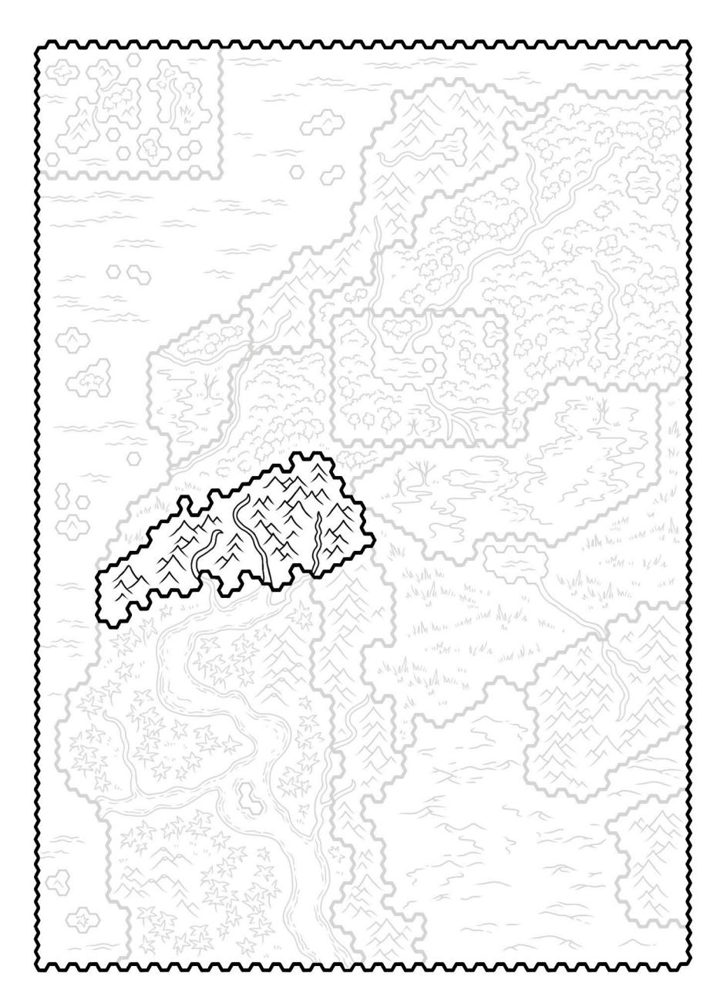

{84}------------------------------------------------

|      |                                       | LOCAL HEXES |                |
|------|---------------------------------------|-------------|----------------|
| Hex  | Region                                | Terrain     | Description    |
| 643  | Bastion Mtns                          | Mountain    | Rock Eaters    |
| 1041 | Bastion Mtns                          | Mountain    | Wyvern Roost   |
| 1341 | Bastion Mtns                          | Mountain    | Galdurin3†     |
| 1539 | Bastion Mtns                          | Mountain    | Wrecked Craft  |
| 1940 | Bastion Mtns                          | Mountain    | Gray Worms1†   |
| 2142 | Bastion Mtns                          | Mountain    | The Slumberer† |
| 2336 | Bastion Mtns Mountain Clay Jars |             |                |
| 2440 | Bastion Mtns                          | Mountain    | Elusive Goat   |
| 2634 | Bastion Mtns                          | Mountain    | Yodeler*       |
| 2638 | Bastion Mtns                          | Mountain    | Woolly Peak    |
| 2941 | Bastion Mtns                          | Mountain    | Klagesang      |

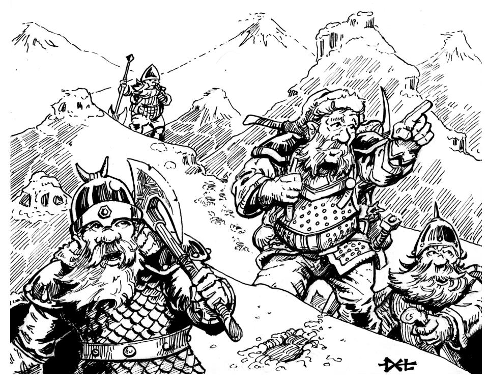

{85}------------------------------------------------

Traversing the rugged peaks of the...

Bastion Pountains

The purple flanks of the Bastion Mountains glow like dark amethysts in the setting sun. The roots of these formidable peaks reach deep into the heart of the earth, wrapping around long-held secrets better kept hidden. Industrious dwarves carve the burgeoning city of Galdurin from the unyielding stone, and the screams of wyverns crack thunderously from windswept aeries. The mountains stand in tight formation, only allowing the headwaters of the mighty Black River to pass through their ranks unhindered.

1Point of Interest if during hex travel

|   | RUMORS                                                      |
|---|-------------------------------------------------------------|
| 1 | A magical, hellish goat haunts the central mountain peaks   |
| 2 | Strange orcs with gray skin dwell between two of the rivers |
| 3 | Dwarves labor to carve out a new city in the southwest      |
| 4 | An uncanny whistling rises from one of the central peaks    |
| 5 | One of the land's best yodelers lives to the northeast      |
| 6 | A massive wyvern nest lies west of the Dwarvish city        |
| 7 | Great mystics sometimes seek solitude in the Bastions       |
| 8 | A fallen dverg city lies lost to the ages in the mountains  |
| 9 | Treat ancient grave sites with care or the dead will rise   |

Terrible horrors live deep inside the lightless mountains

†Can only be rolled **once** (reroll duplicates)

| ENCOUNTER ZONE |                      |                    | ENCOUNTERS           |    |               |              |                  |                |
|----------------|----------------------|--------------------|----------------------|----|---------------|--------------|------------------|----------------|
| d8             | Coast                | Mountain           | Water                | d8 | Aquatic       | Beast        | Monstrosity      | People         |
| 1              | Aquatic 1 | Beast 1 | Aquatic 1 | 1  | 2d6 pirates   | Wyvern       | Void being*      | 2d4 dwarves*   |
| 2              | Aquatic              | Beast              | Aquatic              | 2  | 1d4 gt. leech | Brown bear   | Night hag        | 2d8 goblins    |
| 3              | Aquatic              | Beast              | Aquatic              | 3  | 1d6 stingbats | 1d4 pegasi   | Roper            | Ogre           |
| 4              | Beast                | Beast              | Aquatic              | 4  | 1d4 gt. frogs | Grick        | 1d4 wights       | 2d4 deep orcs* |
| 5              | Beast                | Beast              | Aquatic              | 5  | Ochre jelly   | Owlbear      | Strangler        | Werebear*      |
| 6              | Beast                | Monstrosity        | Beast                | 6  | Crocodile     | 1d4 gt. wasp | 1d4 void spiders | Goat giant     |
| 7              | Monstrosity          | People             | Monstrosity          | 7  | Gt. crab      | 1d4 trolls   | Rime walker      | Witch*         |
| 8              | People               | People             | People               | 8  | Wyvern        | 1d4 wyverns  | Tarrasque†       | 2d6 drow       |

\*New monsters, pg. 283

10

{86}------------------------------------------------

|             | F E E I T I T R T P O N S O N S                                                                                                                                                                                                                                                                                                                                                                                                                           |
|-------------|--------------------------------------------------------------------------------------------------------------------------------------------------------------------------------------------------------------------------------------------------------------------------------------------------------------------------------------------------------------------------------------------------------------------------------------------------------------------------------------------------------|
| d 2 0 | i l D t e a s                                                                                                                                                                                                                                                                                                                                                                                                                                                                        |
| 1           | i h i b d l f b l i b l l d d k d i b l d d f b d i d i i d A t t t c a r n o u s n g a u n e o g o n w a r a n n e r s, a a e r e a n s o a e n o o ; a w a r o y s w r a p p e n s e                                   |
| 2           | i h d h h d h i l l i h h d l i l A 1 6 's t t t t t t t t t w y v e r n n e s w u n a c e e g g s ; e w o p a r e n s w r e u r n s o o n w e a y v e m e a                                                                                                    |
| 3           | i j f f- i i i f i A b d d l k h d h l b l d h k l h b l d l t t t t t t t t n a a n o n e c a s e e e p w a a g g e c r o w n o a u s o n e ; n s e, e s e e o n s o e u e r s s p r a w o u                   |
| 4           | b i l l d b l d i h l i i h i f h i d f l O t t t t t t v o u s y p a c e o u e r r a p s w c o m p e x r g g e r n g m e c a n s m s a s o n e r o m r u s y m e a c o m p o n e n s                                    |
| 5           | i l f i d i i h i f f h k i d l h d h d i A 't t t t t t t, t t t n c e s c u p u r e o a w z a r r a s n g s s a o e s y ; o e s n m e e v e n w e n e x p o s e o e a o r r e c s u n                                  |
| 6           | i i i i i i f i f f i S k d h D h d h b l b d d t t t t t t, t t t t o n e m a r e r s c a r v e w w a r v s r u n e s n c a n g e s e o a n a n c e n a m o u s a e e w e e n w a r a n g a n               |
| 7           | i i h i f h l k l l i f i i i i l i A t t t t t t t t y a w n n g c a v e n e m o u n a n a c e a o o s r e c e n y s p o p e n r o m s e s m c a c v y o r a n e x p o s o n                                                        |
| 8           | b l i d d i d h d k d h i l i l A S 's t t t t t t c o z y e n e o n g n g o a s o o p e a n w z e n e c a r o g r a p e r n a m e a m a n u s ; e m a p p n g a a g a c a p a c e                                             |
| 9           | i i i i A l d d f k d h l d h l d d h t t t t t w g a r e n o r a r e p n r o s e s a n r c a v e n e r a a m y s e r o u s, c o w e w o m a n e n s o o n e a c n e w m o o n                                                       |
| 1 0      | h b f d h d d f b l l h h d i f l A t t t t t t t t t t e o o m o a e e p c r e v a s s e, u n r e s o w y v e r n o n e s c o e c w e r e e y r e r e a o e o n a u r a c a u s e s                                        |
| 1 1      | k i i h i h i f i h l b b i i f i A t t t t t t t c r e a n g p r a e s p s e e s a w s o n e p o n o a m o u n a n ; e c r e w o n y r e m e m e r s e n g n a e r c e s o r m a s e a                               |
| 1 2      | f h f i l l d i h l h i h h d d d i f i d i h A t t t t t t t t e a e r- e p e g a s u s n e s w w o p e a r y w e, u n a c e e g g s a n a m a e p a r o p e g a s g u a r n g e m                                            |
| 1 3      | i h i h i d l d i d l h f h i i b f N D G t t t t t t t t t t t e w w a r v s s g n- s o n e s a p o n o w a r a u r n a n s a e e x a c y o w a r a w a y e c y s y o o                                                                      |
| 1 4      | d h i l l h k h h h i i h b i l i f i l A M T t t t t t t t t w o o e n o p s a c w e r e e c r o c e y a s r o n o m e r a r v u s m o r n a s u a m a g n c e n e e s c o p e                                                   |
| 1 5      | i i i i i l l l d f h d d l h h l h d f l l d A t t t t t t t t t t t n e x r e m e y n y, o c a z e s o r m o u n e r a n g n n g a a c e s o n o m o v e m e n a n o o w s a r o u n                                   |
| 6 1      | i f i d i f h i d i l f h h i l d b d l f d d i f i d i f i f i d A t t t t t t t t p e r e g a n r o m e p r m o r a e r a o e e a r ; w o u e e e p y c o n u s e a n e r r e u n- p e r e                    |
| 1 7      | i f l k f i h d h i l i b f i i l l d l l l d d A t t t t t t t t t r o v n g o c o m o u n a n g o a s ; e y r e s p o n o w s n g y o r m n g u p n o a e r a n a e r g o a a e r s                                    |
| 1 8      | d l i f f l d i h i f d l i d i h f f i f k l l d b k b l d A R t t t t t t t t t e e p r e e s a u e o a m a a c a r v e n o e m o u n a n a c e a n e r e w o e r n g s o s u s a n r o e n a e s |
| 9 1      | i l f h d h k f i d i d h l l l i k i d h i i A t t t t t t t t p e o s e o e r s s r o m o s p e r s ; e c a r a p a c e s s m e e a m m o n a a n a r a c o e r m o n s r o s e s u u v                          |

A swiftly scuttled goblin camp with the fire still burning and a hog-tied dwarf kicking and sputtering on a spit

**20**

{87}------------------------------------------------

#### **643. ROCK EATERS**

Dozens of holes high up along the mountain face lead to a warren of 40 wild **goblins** called the Rock Eaters. They hang off the cliffs on makeshift tethers and sling stones at ships passing below. Occasionally, their **ogre** leader Bort awakens from his well-fed stupor to join in hurling boulders and hapless goblins who stray too close to his reach. Within the twisty warrens, the **goblin shaman** Jargal has laboriously crafted a hidden stash of 3 *Goblin Bombs* (*SD* pg. 303) that he will use to ambush Bort and usurp leadership.

#### **1041. WYVERN ROOST**

12 **wyverns** roost atop this peak in enormous nests made of bone and guano. They have a full view of anything approaching for miles. The wyverns have become more bold in the past few years, attacking travelers to Galdurin ([1341](#page-87-2)) in small packs. Lord Morden would grant almost anything to see these beasts eradicated. Their roost houses 2,000 gp and a *Greataxe of the Horde* (*SD* pg. 304) taken from the Gray Worms ([1940\)](#page-88-1).

#### **1341. GALDURIN**

A new Dwarvish city of 1,200 souls has carved out an underground fastness in the heart of the Bastion Mountains. Though still humble in size, its arched bridges and pillared halls plunge boldly into the purple stone of the mountains. **Lord Morden Iverlord**, the nephew of King Roggen Iverlord of the City-State of Stonehall ([3313](#page-199-3)), brought his four vassal clans to the Bastion Mountains to start anew after a severe falling out with his uncle; Lord Morden is far younger and far less isolationist than the King of Stonehall. Recently, Morden has ordered the construction of a trade route through the mountains so Galdurin may bring its iron ore and purple granite to the City of Masks [\(1334](#page-115-2)). The project has been plagued by roving orcs, goblins, and wyverns, as well as winter storms. Worse still, the new mines beneath the fledgling city have revealed deep caverns that echo with distant, ominous drums. Lord Morden would hire adventurers to investigate this in secret to avoid alarming his subjects.

{88}------------------------------------------------

#### **1539. WRECKED CRAFT**

A black, glistening oval the size of a whale protrudes from the mountain face as if punched straight into the rock. A barely audible, disorienting whine issues from it, causing birds to dash themselves to death on the cliff face. Inside the object, a sluggish **void being** writhes in a half-cracked tube of glass. A *Helm of Mind Reading* (*SD* pg. 304) rests on a pedestal before it.

#### **1940. GRAY WORMS**

60 **deep orcs** called the Gray Worms lurk within lightless mountain caves cut by swift underground rivers. Their gray skin and neck gills bely a thread of ancestry from the primordial **deep ones** who dwell in the distant, midnight depths of the mountain. The orcs worship these deep ones as cruel gods who they hate and fear. The leader of the Gray Worms, an apocalyptic orc priestess called **Izmolda**, seeks to reclaim the clan's lost *Greataxe of the Horde* (currently with the wyverns in hex [1041\)](#page-87-1) before the deep ones discover this weapon of utmost ceremonial importance is gone.

#### **2142. THE SLUMBERER**

A vast network of river-worn tunnels and caves peppers the base of the Bastion Mountains where the Black River thunders past. Prior expeditions into the Tal-Yool jungle from the north have used these caves as a staging ground; the bones attest to how they underestimated this harsh landscape. Traveling deeper into the tunnels reveals a webwork of caverns seemingly without end. They eventually converge onto a vast ravine where a mighty **abomination** from the time of the star-things slumbers, dreaming inhuman nightmares into reality.

#### **2336. CLAY JARS**

A narrow mountain field clusters with 12 stone poles that jut from the ground at all angles. Each bears weathered carvings of ancient animals and star patterns. A sealed clay jar lies buried in the earth beneath each pole; inside are the ashes of a hero buried in ages long forgotten. Each jar has a 1:6 chance of holding a 120 gp ruby. The ash, if not blessed, rises to form a **wight** when the sun sets.

{89}------------------------------------------------

#### **2440. ELUSIVE GOAT**

A black mountain goat with a lazy, golden eye watches travelers judgmentally from the most precarious mountain ledge in sight. The goat glows orange from within as if a fire burns beneath its shaggy hair. Treat it as a **hell hound** with a movement of near (climb). The goat flees from attacks or attempts to capture it, but it always returns to its treacherous perch the next day. Its pelt can make one cloak that grants immunity to cold and fire.

#### **2634. YODELER\***

**Clementine**, a fair-haired human in her 30s, lives with her clumsy husband **Lenik** in a farmstead overlooking the lowland roads east of the Bastion Mountains. Each evening, Clementine stands on her porch and yodels with unmatched skill and volume. All creatures within 2 hexes hear her and regain a luck token if they've spent one today. Unknown to Clementine, a jealous **night hag** lurking in the mountains plans to steal her gifted voice while she sleeps so she can never yodel again.

#### **2638. WOOLLY PEAK**

The tallest mountain in the Bastions is named for the eternal mist cloaking its summit. At the very top, a small temple to Madeera stands; a quiet old man lives inside who tends it. This man is **Argan Amphoros**, a humble monk who attained immortal enlightenment so long ago that he forgot how he did it. Spellcasters who wish train with Argan can spend a week here studying his unique breathing and meditative techniques. On a successful DC 15 Intelligence check, the spellcaster learns the Mind's Eye technique.

**Mind's Eye.** Once per day, when you fail a spellcasting check, you may reroll the check with ADV.

#### **2941. KLAGESANG**

Long forgotten, long abandoned, this ancient **dverg** city was once a grand bastion of industry and artifice until the unfathomable horrors in the deep stirred to wakefulness. Now Klagesang is a place of mourning and ominous silence, a lost name spoken only in the oldest songs, a grand jewel of the elder dverg buried forever in dust and darkness.

{90}------------------------------------------------

### Clementine Yodeling Training With

Clementine radiates the warmth of the sun itself from her bright smile and golden braided hair.

She is a masterful yodeler whose voice carries like a bell out over the mountains each evening.

Yodeling is no easy task; those who wish to learn the art from her must prove their determination and musical skill.

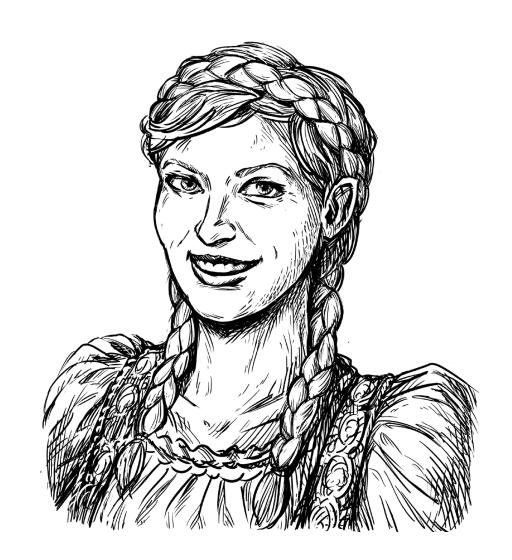

#### **TASKS**

- 1. Keep a large sip of spring water in your mouth while you run to the top of the mountain.
- 2. Protect Clementine's very clumsy husband Lenik from danger while he delivers his sheep fleece to the City of Masks.
- 3. Learn to play a new musical instrument to hone your ear.
- 4. Start an avalanche away from where people could be hurt with just the power of your voice.

#### **BENEFITS**

If you complete a task, Clementine teaches you a new technique. You gain one of the following benefits (once each):

#### **BENEFITS**

- 1 Yodel to gain ADV on a CHA check once per day
- 2 Gain +5 renown
- 3 Gain immunity to soundbased attacks or ill effects
- 4 +2 to CHA stat or +1 to your reaction rolls

{91}------------------------------------------------

## Dhalpurna Mountains

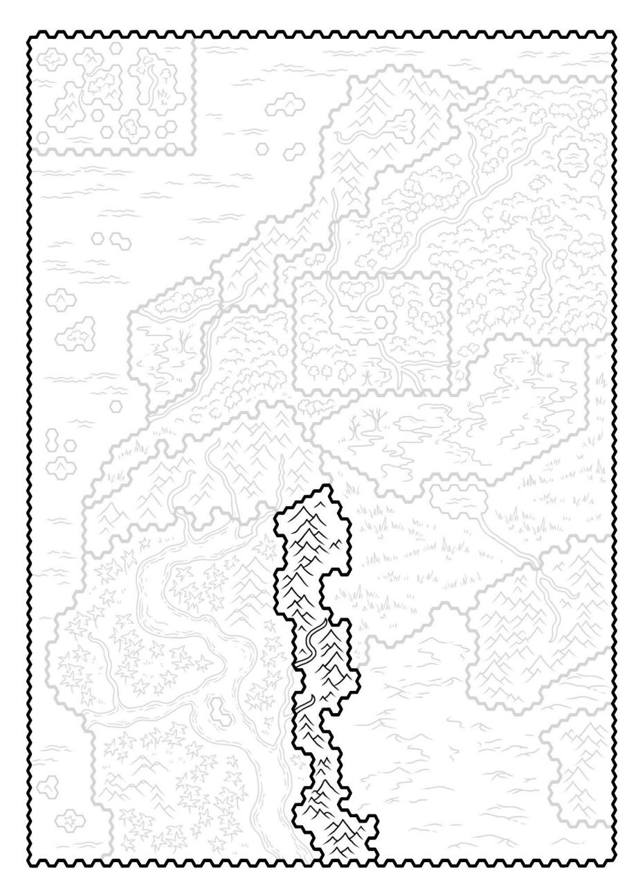

{92}------------------------------------------------

|      | LOCAL HEXES    |                 |                  |
|------|----------------|-----------------|------------------|
| Hex  | Region         | Terrain         | Description      |
| 2849 | Dhalpurna Mtns | Mountain        | The Gate         |
| 2945 | Dhalpurna Mtns | Mountain        | Withered Ones    |
| 2950 | Dhalpurna Mtns | Mountain, river | Lone Monk        |
| 3159 | Dhalpurna Mtns | Mountain, river | Yag-Kesh Monks*1 |
| 3164 | Dhalpurna Mtns | Mountain        | Jade Valley      |
| 3171 | Dhalpurna Mtns | Mountain        | Pillar of Storms |
| 3246 | Dhalpurna Mtns | Mountain        | Manahal          |
| 3254 | Dhalpurna Mtns | Mountain        | Roaring Falls    |
| 3267 | Dhalpurna Mtns | Mountain        | Khadesh3         |
| 3356 | Dhalpurna Mtns | Mountain        | Bandit Cache     |
| 3472 | Dhalpurna Mtns | Mountain        | Old Father       |

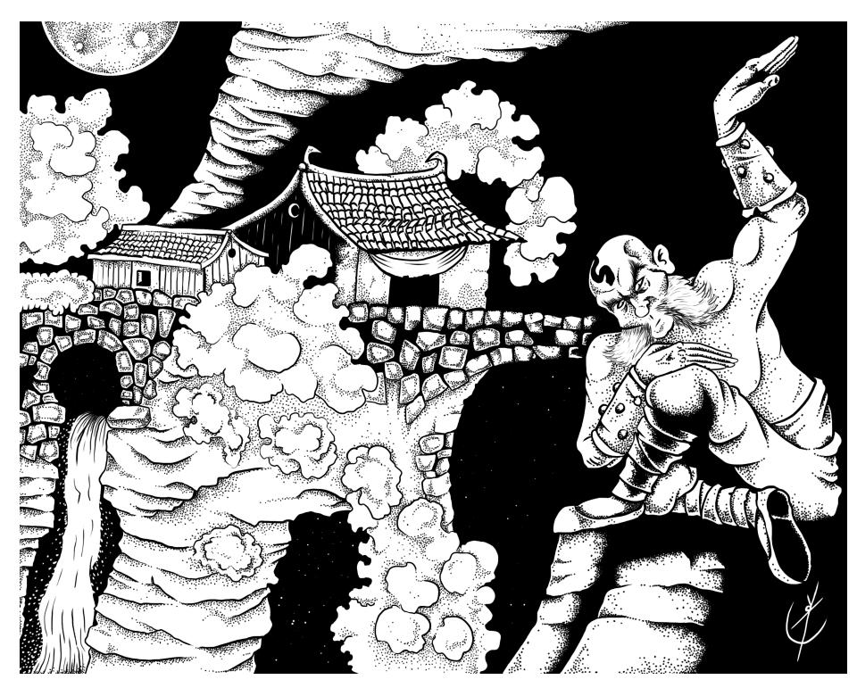

Village **3**CityAccess to Morzomotha **\***Special NPC

{93}------------------------------------------------

### Dhalpurna Mountains Scaling the windswept heights of the...

This titanic spine of the Western Reaches snakes from the frozen north to the blistering south, towering over nodding grasslands, lush jungles, and crimson deserts alike. Here, the **Monks of Yag-Kesh** meditate in their tranquil mountaintop monastery, and eagles the size of galleons blot out the sun with their passing. In these remote lands, isolated **valleys** hide overgrown temples and age-old mystics that exist from time out of time. The stars turn, the rivers run, and the mountains keep silent vigil.

**1***Point of Interest if during hex travel \*New monsters, [pg. 283](#page-282-2)*

| 1 | l k f l i h h d f i A t t t o n e m o n o g r e a p r o w e s s v e s a e e a o a r v e r |
|---|-------------------------------------------------------------------------------------------------------------------------------------------------------------------------------------------------------------------------------|

**2**In a northwestern field, a strange gate to nowhere stands

RUMORS

- **3**A secret order of monks has meditated for 80 years straight
- **4**Bandits hid their cache of loot in the eastern mountains
- **5**A magical pillar to summon storms lies in a remote pass
- **6**The Monks of Yag-Kesh revere a wise but inhuman being
- **7**Once you enter the hidden city, you cannot leave it again
- Seeing a blue tiger at the grand waterfalls brings good luck
- **9**A grand, golden roc nests in the northeastern mountains
- **10**The Old Father is a living mountain who knows all secrets

*†North Mountains: above hex row 55*

| E E E N C O U N T R O N Z |                                                |                                           |                                      | E E N C O U N T R S |                                                          |                                                          |                                                                    |                                                          |
|---------------------------------------------------------------|------------------------------------------------|-------------------------------------------|--------------------------------------|------------------------------------------------|----------------------------------------------------------|----------------------------------------------------------|--------------------------------------------------------------------|----------------------------------------------------------|
| d 8                                                        | i N M t † o u n a n | i S M t o u n a n | W t a e r                | d 8                                         | i A t q u a c                          | B t e a s                                    | i l F e r                                              | l P e o p e                               |
| 1                                                             | l i F 1 e r                     | l i F 1 e r                | i A t 1 q u a c | 1                                              | d f l k 1 4 m e r o           | i l i k B a s s                     | d i 1 4 p e g a s                          | j i i D n n                               |
| 2                                                             | i l F e r                          | i l F e r                     | i A t q u a c      | 2                                              | d i l C r o c o e                | i l l G o r a                          | d h i i f f 1 4 p p o g r s | d h b b l i 2 6 o g o n |
| 3                                                             | l i F e r                          | B t e a s                     | i A t q a c u      | 3                                              | i S r e n                                    | i T g e r                                    | d 6 b 1 t. t g a s                         | d k * 1 4 m o n s                |
| 4                                                             | l i F e r                          | B t e a s                     | i A t q u a c      | 4                                              | G t. t o c o p s u               | N a g a                                         | i d * D r e c o n o r                | d l i 2 6 t t c s s u      |
| 5                                                             | l i F e r                          | B t e a s                     | i A t q u a c      | 5                                              | d f 1 4 t. g r o g               | d 2 4 a p e s                          | d i b 2 4 t t s n g a s           | d b d i 2 6 t a n s           |
| 6                                                             | B t e a s                          | B t e a s                     | i F l e r                | 6                                              | S h e a a g                               | d i l * D t u s e v           | i l l. 6 A L V t r e m n          | 2 d b l i 4 g o n s           |
| 7                                                             | B t e a s                          | l P e o p e                | B t e a s                | 7                                              | d j l l f i h 2 4 e y s | d b 1 4 o a r s                     | l C t o a u                                         | i O n                                              |
| 8                                                             | l P e o p e                     | l P e o p e                | l P e o p e           | 8                                              | d S e a r a g o n                | d D t e s e r r a g o n | R o c                                                        | f i E t r e e                          |

{94}------------------------------------------------

|             | F E R E P O I N T S O I N T S T                                                                                                                                                                                                                                                                                                                                                                                                                                 |
|-------------|--------------------------------------------------------------------------------------------------------------------------------------------------------------------------------------------------------------------------------------------------------------------------------------------------------------------------------------------------------------------------------------------------------------------------------------------------------------------------------------------------------------|
| d 2 0 | i D l t e a s                                                                                                                                                                                                                                                                                                                                                                                                                                                                              |
| 1           | f i f j i i i i i i A d d h l h h d d h h l h d h d t t- t t t t t o u n a n c a r v e r o m a e s o w n g a n e e p a n e a e m a n s n g n o u g ; w a e r p o o s n s c u p p e a n s                                    |
| 2           | b d d f i l l d i h l d h d f h l h i h k A A D V t t t t t n a a n o n e r o c n e s e w g o e n- u e e a e r s a s o n g a s a u m a n a r m ; c a m p n g e r e g r a n s o n a s s                                         |
| 3           | i d h l l k h h h l f h k d h f f f k d i A C t t t t t t t t t n y p o n w e r e p a e u r e s s a e r o u g e w a e r ; s e v e r a o e m s p e a o m m o n a n e y o e r r a n a v c e                                |
| 4           | i i i f i f i i i A h h b k d M l l l d l h l d h d t t t u w e r e a e r s e r e r n a m e u g o y o v e s a s m p e e a n r a n s e r o c o u s y n e w e r n e s s e a c a y                                                         |
| 5           | i h l l d i i d h d i f d l i h l l h k i l l A t t n a r r o w r a v n e w e r e a s o u n s n s e e c o a n m a g n y a n g e r o u s y, c a u s n g e w a s o s a e p e r o u s y                                              |
| 6           | i i f i i i i f i i i h l f l d l k d b d h d h h k, h d A R t t t t a n g -s z e g u r e n a c o a a n r o a a g u a r s a n y s r n e ; e g u r e s a m o o e c u n n n g r a c c o o n g o                         |
| 7           | i i i i i i i i j A l l l d h h k d l l h h d l h d h t t t t t t t t t t t m e e o r e s s z z e s a n p o p s w w e s p a r s n s e a s m a c r a e r w e r e u s u n e r o u s y c r a s e o e a r  |
| 8           | d h i k f b b i h i f i i d i i h i b i d i h i i d f h A t t t t t t t e n s e c e o a m o o s o m e o s p y n g a r e s a n n y, c u r o u s u m m n g r s w r e s c e n e a e r s                                              |
| 9           | l d i h i f i f l i i d i h i f d h i d d i i i h A 1 6 t t t t t t n o o w e r w a s a g g n g r o o ; a n y o n e s e e p s n s e, s s e x e s n a r a n o m r e c o n o v e r n g                                              |
| 1 0      | i i A h d h l f l f l l h d k f l l d ( ) -t t t t t a r o- r e a c p o o o s u u r o u s, y e o w w a e r ; a n y o n e w o r n s r o m r e r o s a r a n o m s a o n c e p e r p e r s o n                             |
| 1 1      | i i l l f l i i d b l i ( l l l f l ) h l b l h h i f i d i b h i A t t t t t t n y v a g e o p a e, m g o n s a a w u w o o n y e a v e g e a e s ; e y a r e o r r e a c a r n v o r o u s e a v o r |
| 1 2      | h k h i f d b i l d i f i l h h i h i h i i l d h h f d T t t t t t t e m a e s w o o e n u n g s o a g r o w n g c u w o w o r s p e r c a r s m a c e a e r a s e p r o p e o a n e w g o                           |
| 1 3      | i i i i i i i i i i f l l h f h f A t t t t t t t t t t t g a n s o n e c a r v n g o a r a n g e r e s s p r e c a r o u s y o n o n e p o n ; o u c n g m p a r s s r a n g e v s o n s o e u u r e  |
| 1 4      | l h d h i k i i d i h k f d i i h i f k A C M t t t t t t t t o s m e r c a n a n s c a r a v a n a r e s u c n s e a n a r r o w m o u n a n p a s s ; e a s s o r r e c o n s o e y o a s s                      |
| 1 5      | d f d d l d h k l i i d f l i i i i f i f i i A t t t t e n s e g r o v e o e a g n a r e r e e s w e r e a c a c n g o n e m o n s ; a n s w e r s o n e q u e s o n g v e n n e w n e ,                                |
| 1 6      | b d d i l d i h h d k d i i h d b h A 's t t t t t t t t n a a n o n e m n e p u n g e s e e p n o e e a r a n g r a v e m a r e r s c r o w s e n r a n c e ; a u n e y a g o s                                                        |
| 1 7      | f l f f f l d l i h i k h i f h f l l f i h i h h d i h i h k f h l A t t t t t t u y, e g n g r o c c c e s z e o a c o w a s a e n r o m s n e s g o v e r e a ; c r p s o e s y o r e p                               |
| 1 8      | l l i l l f h i h i d h l h i l l, b h l h l h h d A 6 0 t t t t t s m a v a g e o u m a n s s o m e o a w z e n e e a e r w o c a n c u r e a n y u s e o n y e a s e r u e- e a r e                                             |

A narrow path leads to a crumbling, abandoned monastery overgrown with moss and vines; something lurks within

A dingy hut with a bead curtain over the door (it's actually human teeth); an ancient, blind fortune-teller lives inside

**19**

**20**

{95}------------------------------------------------

#### **2849. THE GATE**

A square, metallic **gate** crackling with blue lighting stands in a lonely mountain field. Stepping through it teleports PCs to a jungle moon swarming with intelligent giant spiders and astronomer-wizards who have one eye inside their glass skulls.

#### **2945. WITHERED ONES**

In a narrow, verdant valley, a timeworn temple of stone stands wrapped in vines and moss. Inside, a cult of 24 ascetic monks has spent the last 80 years in unbroken meditation and self-deprivation so harsh they have died while sitting upright and become benevolent **ghouls** (L alignment).

#### **2950. LONE MONK**

**Yi Shu Liu**, a peerless warrior, left the Yag-Kesh Monks ([3159](#page-95-3)) to spare her rival and secret love, **Saida Mu Bo**, from having to challenge her for succession as headmaster. She can teach PCs with a d8 HP die the **Wheel of Petals:** DC 18 INT to learn. When you hit with a melee attack, also deal the attack's damage to all enemies within close of you.

#### **3159. YAG-KESH MONKS\***

A mountain monastery sits along the precarious edges of a sheer cliff face. Arched stone bridges connect its gabled roofs and plazas, reaching out over deep ravines and rushing rivers. Rain clouds often roll over the monastery, keeping it cool and rife with greenery. A quiet calm pervades this place. The shouts of the 120 Monks of Yag-Kesh break the peace at midday when they practice their spiritual form of martial arts in the main plaza. **Saida Mu Bo**, the monastery's headmaster, oversees their training. He hides his deep sorrow that his rival and secret love, **Yi Shu Liu** ([2950\)](#page-95-2), left the order to pursue her own destiny. Inside the monastery's candlelit temple, an elephantlike man called **Yag-Kesh** sits in meditation upon a gold altar. This otherworldly being exists in a time continuum outside this dimension. He slowly whispers revelations that take 100 years to utter; the monks record these sacred syllables. Yag-Kesh is about to complete a revelation, and his final syllable will convey either great doom or hope.

{96}------------------------------------------------

#### **3164. JADE VALLEY**

A deep and narrow valley bristles with lush jungle trees and birds the color of polished jewels. This steep canyon is the most direct route between the Djurum Desert to the east and the Tal-Yool Jungle to the west, but a fierce clan of 80 **hobgoblins** called the Eye of Ramlaat guards a castle whose titanic stone ramparts stretch from wall-towall of the valley, blocking all unwanted passage. They have lived in the castle for centuries and have plumbed the arcane secrets of its former owners; 10 hobgoblins are **mages**, and one of them possesses a *Sphere of Annihilation* (*SD* pg. 315).

#### **3171. PILLAR OF STORMS**

Far to the south, a 60-foot high **pillar** of blackened stone juts from the lip of a mountain. Storm clouds swirl malevolently overhead. Leaving an offering worth 500 gp at its base allows one to summon a violent storm anywhere they choose in the Reaches (once per month). It covers 6 hexes per side and lasts 2d4 days. A booming lightning strike obliterates the offering.

#### **3246. MANAHAL**

A massive golden **roc** called Manahal nests in one of the highest peaks in the Dhalpurna range. There's a 3:6 chance Manahal will attack creatures who enter the hex. It arrives in 1d4 rounds and retreats if brought below 50 hit points. Inside Manahal's house-sized nest are two golden roc eggs (200 gp each), a suit of *+1 mithral chainmail*, and a whalebone *Wand of Fixed Object* that is constantly slippery with blubber (DC 12 DEX each use or drop it). Hiding in the nest is also a bubbly halfling named **Virgil Moonstone** who the roc carried back to eat but forgot. He's escaped notice for two weeks and is starting to like it here.

#### **3254. ROARING FALLS**

A breathtaking, misty waterfall shears down the mountain in a broad curtain of foaming, sapphire water. Rare blue **tigers** stalk along the water's edge and roar at the moon each night. Glimpsing one of these tigers (1:6 chance per day) grants 3 XP (once only). The **sea dragon** Yori lives in a cave behind the falls.

{97}------------------------------------------------

#### **3267. KHADESH**

The Hidden City of Khadesh sits in the shadows of the high mountains, its jade walls piercing the surrounding cloak of mist. A forgotten society dwells here among lantern-lit streets and fragrant jasmine trees. A powerful **enchantment** brings the city unnatural abundance from within; silk, wine, and the petty intrigue of lives without meaning. The source of this magic is their empress, a regal woman in gold robes (actually an immortal **fire dragon**) called the Undying Flame. The 2,000 people of Khadesh speak only Draconic, and they follow a complex code of laws meant to guard their secret existence. Only one citizen may leave the city every 100 years, and no visitor who enters may ever leave again in their lifetime. Their trained **wizardassassins** are as formidable as the Ras-Godai ([5557\)](#page-126-2), and any who try to defy Khadesh's laws will soon meet these ghostly killers. This dreamlike city is a place of secrecy, danger, and mournful opulence to those forever trapped inside.

#### **3356. BANDIT CACHE**

A cramped cave holds a skeleton with its arms wrapped around a brittle wooden **treasure chest**. The chests contain 300 gp, a bolt of fine red silk (100 gp), and a bottle of 30-year old wine from Orzano Pike, a famous vintner from the City of Masks (500 gp to a collector). Under the skeleton is a *+2 scimitar* called *Greed*. Its wielder cannot resist the pursuit of fine luxury goods.

#### **3472. OLD FATHER**

The sleeping face of an old man is carved into the base of this deep red mountain, stretching as wide as the peak itself. With a proper offering, **Old Father's** eyes slowly grind open, revealing a warm countenance. Old Father only accepts gifts that prove the great worthiness of his petitioner, such as the permanent sacrifice of a mighty magical sword won by a truehearted warrior. He will answer one question to the best of his knowledge and memory, which is as ancient as the land itself. Old Father's voice shakes the earth; when he speaks, everyone within 6 hexes hears his words.

{98}------------------------------------------------

### Saida Mu Bo Moon Fist Training With

Saida Mu Bo is a clean-shaven monk in his late 40s who moves with effortless grace. He bears the Eye of Yag-Kesh on his forehead, a symbol denoting his mastery of Yag-Kesh's teachings.

Saida is the headmaster of the monastery where the Monks of Yag-Kesh train in the spiritual and combat arts. He is fair, demanding, and calm with every student who seeks to learn.

#### **TASKS**

- 1. Gain the respect of a wild **roc** and fly on its back to the monastery to prove your bond.
- 2. Defeat a worthy foe wearing no armor and using no weapon other than your hands and feet.
- 3. Seize a stick from Saida's hand in one move (one attempt per week), a DC 20 DEX check.
- 4. Learn your *True Name* and entrust it to a dragon who you swear never to harm. Yag-Kesh will sense when this is done.

#### **BENEFITS**

If you complete a task, Saida Mu Bo teaches you a new moon fist technique. You gain one of the following benefits (once each):

#### **BENEFITS**

- 1 +1 to hit with strikes
- 2 Your strikes damage die increases 1 step (d12 max)
- 3 +1 to damage with strikes
  - Your strikes gain a random
- 4 magic weapon benefit and become magical

{99}------------------------------------------------

## Djurum Desert

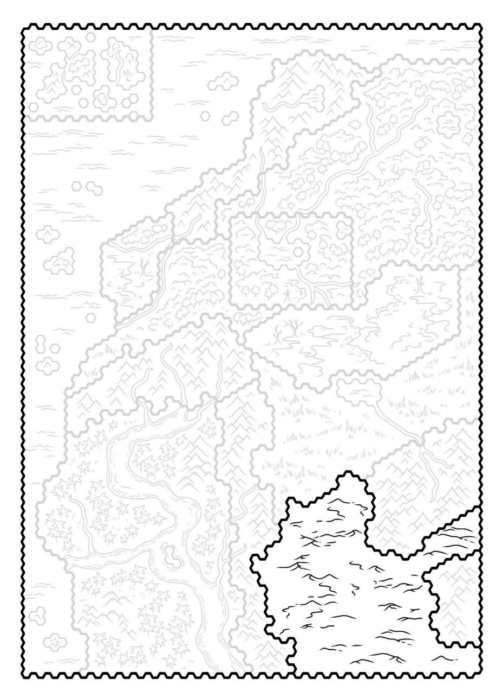

{100}------------------------------------------------

|      |               | LOCAL HEXES     |                   |
|------|---------------|-----------------|-------------------|
| Hex  | Region        | Terrain         | Description       |
| 3560 | Djurum Desert | Desert          | Outcast Kyzians   |
| 3567 | Djurum Desert | Desert          | Base Camp         |
| 3864 | Djurum Desert | Desert, path    | Hala's Outpost1   |
| 4156 | Djurum Desert | Desert          | Camel Thieves     |
| 4169 | Djurum Desert | Desert          | Demon Hunters     |
| 4274 | Djurum Desert | Desert          | Gehemna1          |
| 4371 | Djurum Desert | Desert          | Temple of Molek1  |
| 4456 | Djurum Desert | Desert          | Siruul Camp1      |
| 4460 | Djurum Desert | Desert          | Fortress Ruins    |
| 4463 | Djurum Desert | Salt flat       | Worm Trench†      |
| 4658 | Djurum Desert | Desert          | Shar Oasis*1      |
| 4664 | Djurum Desert | Salt flat       | Saltstone Tower†  |
| 4761 | Djurum Desert | Desert          | The Bones         |
| 4768 | Djurum Desert | Salt flat, path | Scrag Flats       |
| 4856 | Djurum Desert | Desert          | The Pyre          |
| 4865 | Djurum Desert | Desert          | Hamad Camp1       |
| 4973 | Djurum Desert | Desert          | Floating Sword    |
| 5063 | Djurum Desert | Desert, path    | Alkesh4           |
| 5261 | Djurum Desert | Desert          | Ring of Glass Men |
| 5464 | Djurum Desert | Desert          | Magani Oasis      |
| 5471 | Djurum Desert | Desert          | Lady Verana       |
| 5562 | Djurum Desert | Desert          | Wadim's Thieves   |
| 5770 | Djurum Desert | Desert          | Scar-Torn2        |
| 5773 | Djurum Desert | Desert          | Colossus          |
| 5860 | Djurum Desert | Desert          | Buried Pyramid    |
| 5972 | Djurum Desert | Desert          | Black Sands       |
|      |               |                 |                   |

{101}------------------------------------------------

# Conquering the deadly wastes of the... EDjurum EDesert

1Point of Interest if during hex travel

A vast, shimmering desert where red mountains stand fierce watch over windblown valleys and undulating sand dunes. Merchant caravans pick their way between fragile oases that dot the wastes, hoping to miss the path of mountain bandits, a howling sandstorm, or the skyborne death of **The Scourge**. Here, the ancient City-State of Alkesh stands as an alabaster **oasis** in the deadly wastes, and priceless secrets lie buried beneath a veil of silent sand, waiting for the winds to shift in their favor once again...

#### RUMORS

- A giant eagle of pure fire flies down from the mountains
- 2 A fabled magical library hides in plain sight in the desert
- 3 An ancient temple to a powerful demon lies to the south
- 4 Opportunistic bandits lie in wait near oases and campsites
- 5 The top of a buried pyramid rises from the sands to the east
- 6 An ancient dragon called The Scourge terrorizes the skies
- 7 An unrelenting cloud of black sand spins in the southeast
- 8 Purple worms have a spawning ground in the west salt flats
- 9 Elves raise prized silver camels in a camp to the northwest
- 10 Outcasts gather at a fallen city in the far south of the desert

†2d20 peasants (L), 1:6 disguised rakshasa (C)

| ENCOUNTER ZONE |         |                    |           |    | ENCOUNTERS   |              |                |                  |  |
|----------------|---------|--------------------|-----------|----|--------------|--------------|----------------|------------------|--|
| d8             | Desert  | Path               | Salt Flat | d8 | Digger       | Flier        | People         | Walker           |  |
| 1              | Digger¹ | Flier 1 | Digger¹   | 1  | Purple worm  | The Scourge* | 1d8 Ras-Godai* | Rakshasa         |  |
| 2              | Digger  | Flier              | Digger    | 2  | 2d4 ankheg   | Efreeti      | 3d6 bandit     | Naga             |  |
| 3              | Digger  | Digger             | Digger    | 3  | Bulette      | Manticore    | Peasant        | 2d4 gt. scorpion |  |
| 4              | Walker  | Walker             | Digger    | 4  | Bone naga    | 2d12 vulture | 2d4 Siruul*    | 1d8 dunefiend*   |  |
| 5              | Walker  | Walker             | Walker    | 5  | 2d4 scorpion | Dust devil*  | Mage           | 1d6 cobra        |  |
| 6              | Flier   | People             | Walker    | 6  | 3d6 skeleton | Djinni       | 2d4 thief      | Oni, 1d6 bandit  |  |
| 7              | People  | People             | Flier     | 7  | Mummy        | Ghost        | Gladiator      | Canyon ape*      |  |
| 8              | People  | People             | People    | 8  | Mirage*      | Phoenix      | Caravan†       | Mirage*          |  |

\*New monsters, pg. 283

{102}------------------------------------------------

| F | E |
|---|---|
| I | E |
| T | I |
| P | T |
| O | R |
| N | T |
| S | N |
| O | S |
|   |   |

| d 2 0 | i D l t e a s                                                                                                                                                                                                                                                                                                                                                                                                                                                                              |
|-------------|--------------------------------------------------------------------------------------------------------------------------------------------------------------------------------------------------------------------------------------------------------------------------------------------------------------------------------------------------------------------------------------------------------------------------------------------------------------------------------------------------------------|
| 1           | h d i h "d i f h d d b h l d b l h d k l A " t t t t t t e a e r e s g n a s a s g o r a e r e r e s r r o n e r s s o e s a n s n- e a c e s e e o n s w y w u u y u y v u                                                                      |
| 2           | i l l f f l k d k d d b i i ( d i i ) d d h A I I M X I I I t t t t t p a r o p e r e c y s a c e r o c s g u a r e y a c o m p e v e a n c o n n v n g m p n a m e c a r u s a n u s e                                     |
| 3           | i l h i l l i d h l f i k i d i d k l i l l A t t t t t t t t t t t m a s s v e, o n e c a c u s a s a c u a y a r a r e r e a n v a r e y a n e a s o s n ; m o v e s a n s p e a s g a c a y                     |
| 4           | h i d i f j d d i f h d h b h f k f b i d i d A 's t t t t t t t t t m a n- s e s p r e o a e p r o r n g r o m e s a n a r n s o o e e r o o p e a o a r e a r o e r u z u u u u w z w                                        |
| 5           | l l i l f i b l d h f l l h h i l i i d b l h h l A P C t t t t t t t t t t r o n g c u s e r o s e n e n u m e w e e s a o o w s e s w e r y n g o a p p e a r w n o w n ; e y a r e a r m e s s            |
| 6           | d i d h b d i d j k b k h d b l b l A t t t t t t t t t t t u m p n g g r o u n w e r e a n s o s s u n w a n e u n ; r o e n w a g o n s, s a e r e o e s, o r n e n s, e m p y a r r e s                                  |
| 7           | f i i i i i f i i f i i A l h h d l h P C l d h l t t t t t t t t p e a c e u o a s s w n o o e r v s o r s a n a c e a r s p r n g o w a e r ; o n c e e s e a v e, s a p p e a r s r o m s o c a o n |
| 8           | h d f d i l d l h i l h i l i d h l b i l A 1 1 0 0 t t t t t t t t e r o w c a m e s u s e s s p a c e a s e r r e g u a r s o m p n g r o u n s ; e y o e r a e u n o r u s v e r a v e e r s                 |
| 9           | d f b d i i f k b h h i l d d i d d h h h A T S t t t t t t t r a g g e c a m p o a n s r e c o v e r n g r o m a n a a c y e c o u r g e ; e r e a e r e a n e y m u s c o o s e a n o e r                           |
| 0 1      | h i d d d i f l d f f d h i l i i h i h A M P C t t t t t t s o n e s r n e o a e e r a r a p e n p r a y e r a g s ; s o n o s u e r r a n o m e n c o u n e r s w e r e s n g n s e x                                     |
| 1 1      | l- i k b h i ( f i b l h ) h f l l- h d A M S t t t t t t t s e c r e c a m e r a c n g r a c r u n y e a r e e m s e r s v e c a p a e u g s w e r e u c o n a c r a c e s o c c u r e a c a y                    |
| 1 2      | i l l i d d l d i d i h i i d d d b l i A t t t t t t t t t v a g e s u a e a r o u n a r e c e n y s c o v e r e s p r n g ; e w a e r s n g e r e a n c a u s e s s u e m u a o n s                                          |
| 1 3      | i i i i i i i i A d h d f l l h d h h h b d b f l h k t t t t t t t w a r v s e a m g s n a c a r e u y s o r e -u p e x c a v a o n s e ; e r m a p s o w s e u r e o m o a w e a y n g                                    |
| 1 4      | f f d d b l k f i l h d i h d h b i h i h A 1 6 t t t t t t o r e s o e a a c r e e s a n n n g o u o w o v e r e a ; n c r e a s e e r a n o m e n c o u n e r c a n c e y : n s e x ,                                     |
| 1 5      | h i l i k h l f l i d l i l i l h i i l h 2 0 0 h i h A t- t t t t t t t t e r m e a n g a e n s o v n g y o a s n g e, r v n g p a m r e e a s p r o u s a g p s a p p r e e a c s e a s o n                         |
| 1 6      | i i l h f h f d b l d i d d i f i b l h i i h S t t t t t t t u s p c o u s v u u r e s w a c r o m e o p s o a o z e n o o -s a n e w o o e n c r u c x e s e a c n g o u n e s u n ,                                         |
| 1 7      | h d k i l i d d d l l i l d d b h d i d A t t t t t t t s a e r e e e p s s a o p a o w m e s a, s w o o e n o o r s a n p o r c u s o n g a g o e v o u r e y e e r o n g s a n s                                                   |
| 1 8      | i l l i l l i f i h d d l l i h l l d i d d d A t t t t t t n e m p y v a g e s n o w a c o e c o n o s a g g n g s o n e u s a n a r y w e w a u n n e e a n g e e p e r u n e r g r o u n                           |
| 1 9      | i i i i i i i h d h d h b d l h d h l d d A t t t t t t t t c r a e r w e r e a m e e o r e u r n e e s a n n o r a z o r- s a r p o s a n g a s s n a u g e p a r o u n w e r e a n e                                         |
| 2 0      | i d l b d d h k l d d d i i d j d f h l A t t p r s o n e r w a g o n s a n s r e c e n y a a n o n e ; a s a c e a n g a g g e m a g e n s e u m p s u p a n w a v e s o r e p                                                         |

{103}------------------------------------------------

#### **3560. OUTCAST KYZIANS**

A group of 15 horse-riding **bandits** ekes out a meager existence in the harsh desert. They were exiled from their tribes in the Kyzian Steppes for criminal behavior, and now they subsist by kidnapping small groups of travelers on the path to Alkesh sell to the priestesses at the Temple of Molek [\(4371](#page-104-2)). Their victims are bound for ritual sacrifice or forced labor.

#### **3567. BASE CAMP**

A group of adventurers called the **Ivory Sparrows** maintains a permanent camp here to stage expeditions over the mountains into the Tal-Yool jungle. They're affiliated with the Torchbearers faction (see *PGWR* pg. 100) and welcome fellow members. The six adventurers anxiously await the return of five other members who traveled into the jungle to investigate a mossy temple they spotted along the river during their last foray (see [2869](#page-243-3)); they're now a week overdue.

#### **3864. HALA'S OUTPOST**

A wide circle of white tents encircles a pale blue oasis shaded by a handful of palm trees. A sharp-witted half-elf named **Hala** runs a well-stocked caravanserai here along the trade route to Alkesh. She doesn't permit fighting of any sort, and so groups who are normally at odds keep a tense ceasefire here or risk being kicked out by Hala's personal bodyguards, the fearsome human warrior twins Balthor and Ivanov (who each vie unsuccessfully for her heart).

#### **4156. CAMEL THIEVES**

Six ragtag thieves hide their tent in the shadow of a tall sand dune. They are plotting to raid the Siruul Camp [\(4456](#page-105-0)) to steal as many silver camel calves as they can get away with. A surly Siruul elf among them called **Ziladien** holds a bitter grudge against Nuariel, the Siruul tribe's leader, for killing his brother in an honor duel two years ago.

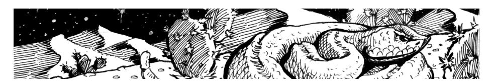

{104}------------------------------------------------

#### **4169. DEMON HUNTERS**

Two Sisters of St. Sofia ([3811\)](#page-200-3) camp here on their way to scout the Temple of Molek [\(4371](#page-104-2)) for demonic activity. Sister Philomena (**little sister**) anxiously helps Sister Sara (**elder sister**) with a bad arrow wound.

#### **4274. GEHEMNA**

The fabled Arcane Library where the first knowledge of wizardly magic began. The Library is only visible to those who are dying within this or the surrounding hexes; from that moment on, they can see the Library's lofty ivory towers and bronze gate carved with an eye on the horizon. Inside, 200 students learn from 8 Master Arcanists. Their leader, Rynne Siruul, is a half-elf **archmage** who evaluates new students for their talent and, more importantly, their motives. Only Rynne knows that **Mordanticus the Flayed** resides within her study; he has lived there for centuries to provide secret counsel to the current Head Arcanist. While at Gehemna, wizards have ADV on Magical Research and checks to learn spells from spell scrolls.

#### **4371. TEMPLE OF MOLEK**

A half-fallen temple of colossal, pale blocks rises out of the empty desert. Leaning rows of date palms and a freeroaming herd of black goats are the only signs of life. This temple is dedicated to the ancient demon **Molek**, who is said to be entombed alive in a lightless chamber deep beneath the temple. His cult was once mighty, but it has faded into obscurity; now only 30 priestesses, their 60 servants, and 40 guards dwell here. Their high priestess is chosen from the female children born in the Djurum the day the prior high priestess dies. Cultists find and take this child, and they raise her as **Adhiya the Endless**. No one opposes this tradition out of ancient fear of Molek's wrath. The current Adhiya is a curious and impatient young woman who secretly loathes her duties. She is the only person allowed into the labyrinthine darkness beneath the temple to commune with Molek's spirit. Ancient treasures are hidden in this maze, given in tribute long ago when the cult was revered.

{105}------------------------------------------------

#### **4456. SIRUUL CAMP**

The **Siruul**, a nomadic tribe of desert elves, maintains a secret camp here to rear and train their prized silver camels. 2d20 silky, pale-haired calves and their mothers range the flat scrubland under 40 elves' vigilant eyes. Anything that threatens the camels is met with swift, unforgiving violence. The rest of the 120 wandering elves, led by **Nuariel Siruul**, return here regularly with supplies. **Ziladien** [\(4156](#page-103-3)), an embittered former tribe member, would like nothing more than to ambush and assassinate Nauriel.

#### **4460. FORTRESS RUINS**

The shell of a once-mighty sandstone fortress lists in the dunes like a sunken ship. Blast marks mar its walls, and shards of blue-tinged glass pepper the sand around it. Twenty **ghosts** of its former guards materialize inside its broken halls each full moon, whispering curses upon a beast called **The Scourge** [\(5755](#page-127-1)). Only The Scourge's skull will bring them rest; they gift its bearer the *Scimitar of the Ash Moon*.

#### **4463. WORM TRENCH**

3d6 **purple worms** flock to these spawning grounds once every month. Four mothers remain to protect the webby nests filled with hatchling eggs (3d12) inside the 30' deep, 100' long trench. Scattered within the webs are a giant ruby (400 gp), a ragged *Flying Carpet*, and a *+2 razor chain* called *Skinlasher* whose wielder is immune to poison. The **Ras-Godai** ([5557\)](#page-126-2) view *Skinlasher* as a holy relic and would trade nearly anything for its return.

#### **4658. SHAR OASIS\***

The most plentiful pond of fresh spring water in The Djurum is a fragrant, palm-ringed hub bustling with travelers, merchant caravans, mercenaries, and outlaws. Its 60 permanent residents look to steely-eyed **Rameer the Lion**, a 50-year old former gladiator, for unofficial leadership. The famed **Thraxis Arena** draws rowdy crowds each night to bet, drink sweet palm wine, and fight for glory. Fights are not usually to the death, though on rare nights, the crowd thirsts for blood. Rameer grimly allows fate to fall as it must.

{106}------------------------------------------------

#### **4664. SALTSTONE TOWER**

A lonely, salt-encrusted tower of gray stone thrusts like a needle out of the empty mineral flats. A grizzled, sharp-toothed **archmage** called The Wolf of Yarin (N) inhabits its drafty halls, digging endless, meandering tunnels beneath it with his trained purple worm, **Tajora**. The Wolf claims to hunt for a fissure that leads to the burning heart of the earth itself; after 50 years, he has found many strange things, but not that.

#### **4761. THE BONES**

The bleached bones and skull of a titanic, prehistoric beast lie in the sand. Travelers sometimes take shelter under its towering ribs, stretching colorful cloths across the gaps to block the sun. At night, the wind humming through its skull seems to form soft words. The bones mark the halfway point on the caravan route between the **Shar Oasis** [\(4658](#page-105-3)) and the City-State of **Alkesh** ([5063\)](#page-107-2). Travelers who dare to journey north of the bones risk being spotted by the **Hawk Bandits** [\(4859\)](#page-125-0) in the southwestern Gilzai Mountains.

#### **4768. SCRAG FLATS**

Several dozen orange **scrag lizards** the size of horses sun themselves here on wide plates of hardened salt. Though they sometimes try to pick off sickly camels, they typically leave large groups of travelers alone and wait for their preferred meal, the packs of **ankhegs** that often stalk these caravans from a distance. Caravans typically route through this area to shake off these ankhegs, leaving them to the scrag to devour.

#### **4856. THE PYRE**

The Pyre is a round altar of crimson marble engraved with dancing flames and set with ten fist-sized rubies (250 gp each). Each solstice, the nomadic **Siruul** elves [\(4456\)](#page-105-0) pile it with magnificent jewelry, art, and food in symbolic rejection of material goods. At midnight, the **phoenix** [\(5056\)](#page-125-1) erupts from the Gilzai Mountains and swoops down, touching The Pyre and turning all upon it to ash. The Siruul elves hunt anyone who tampers with The Pyre or attempts to disturb the sacred phoenix's nest.

{107}------------------------------------------------

#### **4865. HAMAD CAMP**

A tribe of 200 human desertdwellers called the Hamad live near a natural spring at the edge of the salt flats. There, they hunt and tame wild scrag lizards; they're the only folk in The Djurum who do so. They hate and fear the sorcerer in **Saltstone Tower** [\(4664](#page-106-0)) believing he is the source of recent bad luck causing foul water, illness, and stillbirth (the real source is a disguised rakshasa living among them). The tribe's leaders, twin sisters **Murjana** and **Delila**, are at odds about whether to attack the sorcerer or offer him a tribute tax. Murjana's eldest son, **Omid**, went missing in the salt flats a few weeks ago (see [5559](#page-127-0)); she's certain the wizard is to blame.

#### **4973. FLOATING SWORD**

A glinting sword floats a few feet off the ground, tip pointed downward. Even up close, it is difficult to detect that it is encased in a pillar of glass. Shattering it releases the *+2 longsword* called *Krosos*, which once a day can stop time for all but the wielder for 1d4 rounds.

#### **5063. ALKESH**

The gleam of Alkesh's white walls and brass-plated domes can be seen for leagues. Natural springs and clever aqueducts feed its magnificent hanging gardens and orange trees. Young **Shar Yasmila** (and her scheming court) rule this citystate of 70,000 souls. Anything can be bought and sold here, and any throat cut for a price. The City of Red Sands has seven **districts**: The Alabaster Citadel (castle), The Spires (temple), The Gardens (high), The Suq (market), Silver Street (artisan), The Forgotten Quarter (low), and The Old Quarter (slum).

**The Jewel of Borak.** A tavern in the twisting back alleys of The Forgotten Quarter. Melted candles flicker in alcoves, and adventurers fill the cool air with spiced smoke and wild rumors.

**Tower of the Lion.** In The Spires district, a reclusive sorcerer called **Afarim Zarad** (archmage) lurks in his windowless tower of white marble. His pack of pet lions stalk the lush gardens below it. Afarim secretly leads The Jeweled Eye, an adventurer's faction (*PGWR* pg. 94).

{108}------------------------------------------------

#### **5261. RING OF GLASS MEN**

Eight statues of humans made of blue-white glass stand in a circle with their arms thrown up protectively. They are a long-lost adventuring party called the **The Flying Tigers**, turned to glass by an ill-worded wish to a djinn. The *restoration* spell returns them to flesh. They gift their saviors an *Alabaster Destrier* and a **golden key** (see The Doors, [5863](#page-219-2)).

#### **5464. MAGANI OASIS**

Bull frogs croak in the reeds of the Magani Oasis, a blue-green pool 20 feet across. A mean **hippopotamus** called The Boss attacks anyone who enters the water. At the bottom of the pond, a *+1 scimitar* named *Sunscorch* lies half-buried in the sand. Once per day, it can emit a flash of white-hot light that blinds all who see it for 1 round.

There are always 2d12 travelers coming or going from **Alkesh** [\(5063\)](#page-107-2). There's a 3:6 chance some of these travelers have just been robbed and beaten by **Wadim's Thieves** ([5562](#page-108-3)) and are recuperating from injury. They offer a cut of their cargo if the characters help them recover it.

#### **5471. LADY VERANA**

**Lady Verana di Crask**, an exiled young noblewoman from The City of Masks ([1334\)](#page-115-2), doggedly leads two disgruntled camels through the scorching desert. One camel hauls a tightly wrapped burial shroud containing her deceased love, **Tristaine di Felgrad**. She was wrongly convicted of his murder and now hunts for the fabled mountain that can restore his life ([6266](#page-221-0)) described in a sheaf of wizard's notes she clutches. She pledges eternal loyalty to anyone who helps her restore Tristaine's life and her honor.

#### **5562. WADIM'S THIEVES**

An upstart group of 20 thugs. They're led by a thief named **Wadim the Crooked** who is on the run after betraying the Thieves' Guild in **Alkesh** [\(5063](#page-107-2)). The thugs are unused to harsh desert life, and Wadim's lieutenant, **Malchor**, is planning a mutiny. They have broken the banditry code of honor by robbing everyone, including lone travelers; 2d8 thugs assail anyone in an adjacent hex. Everyone wants them gone.

{109}------------------------------------------------

#### **5770. SCAR-TORN**

600 outcasts, thugs, and bandits gamble away their pillaged riches in the windswept ruins of a forgotten city, now shattered and mostly buried by centuries of whipping sand. Their leader, a swaggering, bushy-bearded (former) pirate called **Saltdog**, found a gold-trimmed fez (a *Hat of Intellect*, *SD* pg. 304) in the ruins that he declared was a sign from the gods he should be the town's king. Saltdog, now more wily than ever, threatens and extorts the nearby village of **Shirhan** [\(5968\)](#page-220-0) in the Silent Mountains for food and supplies.

#### **5773. COLOSSUS**

At the edge of the world where gales of sand permanently blur what lies beyond, a sandstone **colossus** of a grim, sandaled warrior stands like a titan. His intricately jointed armor and a crested helm are in a style not seen anywhere else in the Reaches. He hand thrusts out, finger pointing north, away from the maelstrom behind him. Anyone who touches the statue and thinks of another place is instantly teleported there.

#### **5860. BURIED PYRAMID**

A crumbling triangle of cut granite reaches five feet above the sand; the rest of the 80-foot tall pyramid looms beneath the surface. During sandstorms, the entire pyramid emerges in a nimbus of lacerating grit, and a pair of heavy, snakeinscribed doors in its side become accessible. As soon as the sandstorm abates, the desert once again swallows the pyramid beneath tons of earth.

#### **5972. BLACK SANDS**

The red sands of the Djurum give way to sharp, black grains here that crunch underfoot. An unrelenting sandstorm cloaks the area in a lightless cloud that reduces visibility to arm's reach. In the eye of the storm lies a colossal temple of sandstone carved as a snarling lion with four eyes that burn with eternal flames. This is the fabled tomb of **King Rahm-Hotep**, a fearsome sorcerer who lived long ago and is said to have warred with the gods of Law themselves. Inside, a malevolent, midnight blue **sphinx** called **Venoximandon** guards his mummified body.

{110}------------------------------------------------

#### Gladiator Training With

### Rameer the Lion

Rameer is a quiet, retired gladiator with an intense stare. He won the highest laurels in the Alkeshi fighting pits before leaving it all behind to spend the rest of his days in simplicity.

Rameer can assess a warrior's capability with only a few brief moments of observation. He'll reluctantly teach those who show promise — if they can survive without coddling, that is.

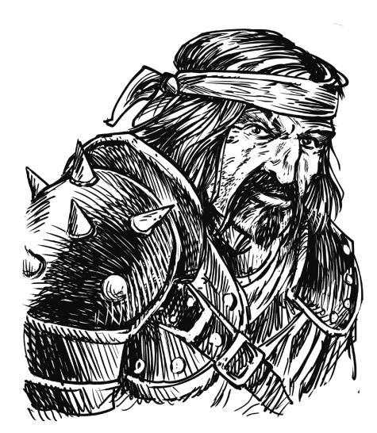

#### **TASKS**

- 1. Win at a night of pit fighting in the Thraxis Arena at the Shar Oasis [\(4658](#page-105-3)) without any help.
- 2. Defeat a well-known gladiator in Alkesh, but do not slay this gladiator if given a choice.
- 3. Leave your best weapon with Rameer for one month. You can't use it (or anything similar) until you learn not to rely on it.
- 4. Defeat Rameer in a staring contest (DC 20 CON). You can try once per week.

#### **BENEFITS**

If you complete a task, Rameer teaches you a new gladiatorial technique. You gain one of the following benefits (once each):

#### **BENEFITS**

- 1 +1 to your death timer rolls
- 2 +1 to melee attacks and damage
- 3 Increase your HP die by one step for your next roll
- 4 +1 on your checks to roll for initiative in combat

{111}------------------------------------------------

## Duchy of Montmar

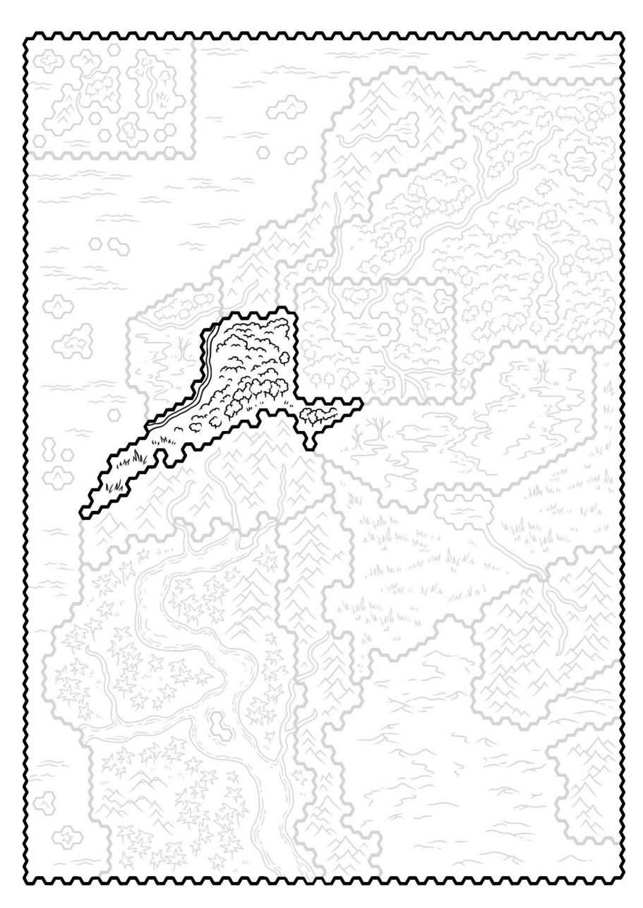

{112}------------------------------------------------

|      |                  | LOCAL HEXES  |                  |
|------|------------------|--------------|------------------|
| Hex  | Region           | Terrain      | Description      |
| 839  | Duchy of Montmar | Grassland    | Old Sea Keep     |
| 1038 | Duchy of Montmar | Grassland    | Fallen Castle    |
| 1334 | Duchy of Montmar | Coast, river | City of Masks*4  |
| 1337 | Duchy of Montmar | Grassland    | Goat Giants      |
| 1436 | Duchy of Montmar | Grassland    | Farmstead        |
| 1637 | Duchy of Montmar | Grassland    | Cursed Caves†    |
| 1733 | Duchy of Montmar | Grassland    | Horse Traders    |
| 2029 | Duchy of Montmar | Grassland    | The Heath Witch* |
| 2032 | Duchy of Montmar | Grassland    | Meadow Downs1    |
| 2126 | Duchy of Montmar | Forest       | Haunted Cabin    |
| 2134 | Duchy of Montmar | Grassland    | Toll Bandits     |
| 2327 | Duchy of Montmar | Forest       | Duke's Glade     |
| 2329 | Duchy of Montmar | Forest       | Thornhurst2      |
| 2525 | Duchy of Montmar | Forest       | Ranger Outpost   |

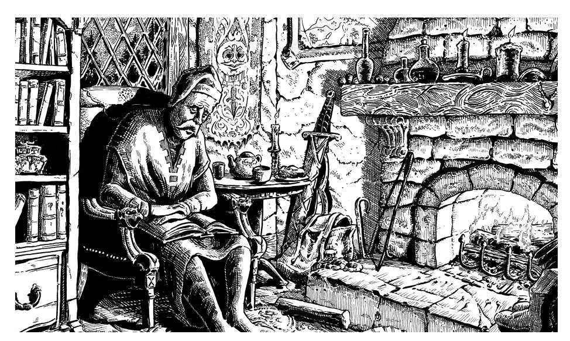

Duchy of Montmar Forest Marrow Tree

{113}------------------------------------------------

# Roaming the majestic domain of the... EDuchy of Apontmar

A sunlit land of rolling fields and rustling forests. The Duke rules from his ancestral castle in the shining **City of Masks**, and his red knights patrol the Duchy's holdings. A verdant forest grows to the east; the **rangers** who protect it have noticed the woodland's tranquil groves deepening with writhing shadows like those of the cursed Gloaming nearby. Bandits have grown bold in recent years, and foul creatures take up camp in old ruins. Rot and darkness fester at the edges of civilization, and they will grow if left unchecked.

1Point of Interest if during hex travel

#### **RUMORS** Agile, goat-legged giants have been spotted to the south 2 The City of Masks is home to a prestigious wizard's college 3 Rangers in the forest have been going missing on patrol 4 The Kyzian horse traders by the road sell the finest steeds 5 A powerful wizard is camping at a box canyon near the City 6 Sailors have seen a huge serpent near a keep on the coast 7 A cold wind blows out of a shattered castle in the southwest 8 A frightening witch lives out on the heath near the forest 9 Bandits on the road to the City have been growing bold

Clever dwarves from long ago built the town of Thornhurst

†3:6 led by one of the Duke's red knights\*

| ENCOUNTER ZONE |                    |                       |                    |                      | ENCOUNTERS |               |                |             |                |
|----------------|--------------------|-----------------------|--------------------|----------------------|------------|---------------|----------------|-------------|----------------|
| d8             | Fields             | Forest                | Path               | Water                | d8         | Aquatic       | Beast          | Wildling    | People         |
| 1              | Beast 1 | Wildling 1 | Beast 1 | Aquatic 1 | 1          | 1d6 gt. leech | Wyvern         | Goat giant  | 1d4 halflings* |
| 2              | Beast              | Wildling              | Beast              | Aquatic              | 2          | Sea hag       | Griffon        | Troll       | 2d4 orcs       |
| 3              | Beast              | Wildling              | Wildling           | Aquatic              | 3          | 1d4 gt. frogs | 1d6 gt. rats   | Swamp hag   | 2d6 soldiers†  |
| 4              | Beast              | Wildling              | People             | Aquatic              | 4          | 1d6 merfolk   | 1d4 scarecrows | 2d6 goblins | Bard*          |
| 5              | Wildling           | Beast                 | People             | Aquatic              | 5          | 1d4 willowisp | 1d6 badgers    | 1d4 fairies | 1d6 rangers*   |
| 6              | Wildling           | Beast                 | People             | Beast                | 6          | Rat swarm     | 1d4 gt. wasps  | Ogre        | 1d4 knights†   |
| 7              | People             | Beast                 | People             | Wildling             | 7          | 1d4 zombies   | Otyugh         | Leprechaun  | 1d4 goblins    |
| 8              | People             | People                | People             | People               | 8          | Hydra (LV 6)  | Unicorn        | Grimlow     | 2d4 bandits    |

\*New monsters, pg. 283

10

{114}------------------------------------------------

| I T P O N S | F O | I T E R E T N S |
|----------------------------|--------|--------------------------------------|
|                            |        |                                      |

| d 2 0 | i l D t e a s                                                                                                                                                                                                                                                                                                                                                                                                                                                                             |
|-------------|-------------------------------------------------------------------------------------------------------------------------------------------------------------------------------------------------------------------------------------------------------------------------------------------------------------------------------------------------------------------------------------------------------------------------------------------------------------------------------------------------------------|
| 1           | i i i i i i A l f b h d f f l b l h h l h d h t t t t t t t t t t t t t r a v e n g c r c u s o r g e n s a n e y p e r o r m a n c e s y s r a n g e g ; e y e a v e e n e x a y w o u a r a c e           |
| 2           | h b d i f i d i h k l l i l l i i k i d h k l d i T "T D 's L H F " t t t t e u r n e r u n s o a n o r c r a e r c a m p w o r c s u s s r o n g o n p e s ; a s g n r e a s e u e a w o s r m                   |
| 3           | d i d k d i f l i i l l i i h i i A t t t t t t t r o u n m a n- s z e r o c s a n n g p e r e c y o n o n e n a r r o w p o n ; u r n s s o w y o n s a x s w e n a s o r m s c o m n g ,                              |
| 4           | i i i A b d d h d h b l d d l d f l h d k t t t t t n a a n o n e o m e s e a w a n o v e r g r o w n v e g e a e g a r e n a n w o w -r o a m n g p e r e c y a p p y o n e y s ,                                                  |
| 5           | f d i d i f l i d b l h f h d i h A ' t t t t t t t t t c o p s e o e c a y n g r e e s c o v e r e n e s a n e e e s ; a s o n e s a r c o p a g u s e m e r g e s r o m e r a e r e e s r o o s           |
| 6           | f i l d f f d i h h d i f f h i i h f h l i h A t, t t t t t t t t t t e o r a g r a n r e p o p p e s a a v e a s e a v e e e c ; n o n g c a n n e r r u p e r e s o o s e s e e p n g e r e                    |
| 7           | i i i i i f l l h d d b d ( l l b ) d b h l f h A t t t t t s e r e s o c e v e r y e n e a r r a p s ; a n a g o n z e m a n a c u a y a w e r e e a r s r a p p e y e e g n o n e o e m                               |
| 8           | f i h d i i d l l i h d h h l h h i l h i i A K 's t t t t t t t t t t c a m p o y z a n o r s e r a e r s p u r s u n g a p r z e s a o n a e s c a p e e m ; e y o s e o r s e r a s m o r n n g          |
| 9           | i f i d k i h k l i i h h i d h l d i f i f f i h i l l l l l h i f i h i A t t t t t p e r e n g n e e n g w s s w o r e o u a s n o e r n g ; e w o y a y s e r v e a n y o n e w o u n p e r e s m |
| 1 0      | i i i i i i i i i i i h l d l l d l h d f h d h l d A t t t t t t t t t t t t s o n e c o a g e w a g e n y u r n n g w n m ; a r e r e a s s a s s n r e s o v e o u e e n o s a y s e r e n s o u e |
| 1 1      | h d l h i l l l i b f i h h l d f i l d b l h h k T M D t t t t t t t t t t t e m a a c e m s a o o r a e n g o o a e e e c a r o a s a n o e s ; e a n s o m e e e e v v y w w v w u                                         |
| 1 2      | d b d i h i f l l f d d h i l d i d i d A "M M 's J B S " t t t t t t n e x e c u e a n a n g n g r o m a g a o w s ; a a e p a r c m e n n a e o s a y s a y a e e r a u s c e e e r v e                                  |
| 1 3      | l l d h h b k b h l i i l k b A "t R P "; t t t t t t t s m a g r a v e y a r w e r e e o m s o n e s s a y a e n y e a a g u e a n o p p o r u n s c n e c r o m a n c e r u r s n e a r y                             |
| 1 4      | i f i f f f A b d d l l h l d h l l l l l d k b l d h h t t t t t t n a a n o n e e o e r g r o n c s e r s o r e m o s s ; e e s o s r o s, a r o o r a e r a n a e r w v w w u w u u u u w                         |
| 1 5      | h f h h i l b i l l d h i h f d d T R W 1 X P t t t t t t t t e c o a g e o e c r o n c e r o e y a n e r ; e g r a n s n e x c a n g e o r a n a v e n u r o u s s o r y o o c u m e n                                    |
| 1 6      | j d i f i h h i i d k l i l d f h l d i h f i i d A t t t t t t a g g e r n e e a r ; n s e, s p a r n g c r y s a s a n a m u s r o o m s c u s e r a r o u n a r v e r w e r e a r e s a n c e               |
| 1 7      | i i i i i i i i f i i i i W h d d h D h d h d S h l l h R M t t t t t t t t t t e a e r e r u n e s o n e s c a r v e w w a r v s s c r p n c a n g e r e c o n o o n e a n e m e s p r e o u n a n s |
| 1 8      | d i h d b b i f f h b h i d h l i h k f h l A 1 4 t t t t t t t t t t t g r o u n -n e s w a y g r o n s ; e w o p a r e n s a r e n e a r y u n n g a n r e u r n a e s g e s s q u e a o r e p               |
| 1 9      | i b l i d k i d b l f d i h b h l f f d i i i A S G U t t t m a r n e- u e w z a r e e p o c c u p e y y n e s r a, a n e m a g e c o n u c n g r e s e a r c o n e a o e g a r r n n v e r s y                   |
| 2 0      | i f i i f i A l l h l d d d M d d d d b h b d k h h h k h l t t t t t t t s m a c a p e e c a e o a e e r a a n e n e y o u r w e- r o e n g s w o a v e a e n a n o a o s e n c e                                                  |

{115}------------------------------------------------

#### **839. OLD SEA KEEP**

A salt-scarred keep with a green roof looks out over the Last Sea from a sandy clifftop. An elderly **sea dragon** called Verdimar lairs here, often taking on the illusory guise of an old man enjoying his seaside retirement (he's elusive about his former job, but says it involved a great deal of travel). Verdimar keeps his hoard in the cellar: 5,000 gp, 12 emeralds worth 120 gp each, an *Amulet of Vitality* (*SD* pg. 298), and the fabled *Trident of the Seas* (*SD*  pg. 319). He saves the *Trident of the Seas* for a genuinely worthy hero, but he parcels out other treasures to those who run elaborate "errands" (quests to do good in the world) for him.

#### **1038. FALLEN CASTLE**

Broken and ugly, this destroyed castle stares like a skull at all who pass. Stinging vines climb its water-stained walls, and the air grows unnaturally cold as one approaches its rusted gates. **Rot flowers** cluster in its brambled courtyard. In the wet dungeons below, a fledgling necromancer (**adept**) named Hebrak is raising warbands of skeletons.

#### **1334. CITY OF MASKS\***

The City of Masks, known also as Meridia, is the largest citystate in the Western Reaches with 90,000 residents. It sits over the estuary at the mouth of the **Trematora River** where its waters flow into the Last Sea. The 45-year-old **Duke Loren di Montmar** rules it, having served his father as a knight general before reluctantly ascending the throne. The city's bridges arch high over its many walkways and canals, and its numerous festivals and masques are famous throughout the Reaches. The grandest of these masques is the **Duke's Ball** in high summer, where anyone dressed in a fine enough costume may enter Montmar Castle to revel with the Duke and high society. The city is home to a Thieves' Guild, Bardic College, and the ancient wizard university of Gedgarrin. It has eight **districts**: Montmar Castle (castle), Gedgarrin (university), Ninestones (temple), High Harbor (high), The Rooks (market), Silvertop (artisan), Gutterwash (low), and Rilken Row (slum). See [pg. 249.](#page-248-1)

{116}------------------------------------------------

#### **1337. GOAT GIANTS**

Two dim-witted **goat giants** named Nort and Nag camp in the shadows of the Bastion Mountains. This couple decided to adopt a pet goat, but they found the native species of the mountains aesthetically lacking. Instead, they snuck onto the Freyer farmstead (1436) by night and stole their handsome red goat, Charger. The goat is tethered by a rope to Nort's belt.

#### **1436. FARMSTEAD**

The Freyer family lives on a farm with a lazily turning windmill, rows of golden wheat, and stacked stone fences enclosing a herd of silky-haired goats. Recently, a pair of **goat giants** (1337) from the nearby Bastion Mountains crept onto the farm by night and stole their prized billy goat, a rare red-haired buck named Charger. Farmer Argen and his wife Tilina are distraught at the loss; unknown to them, their 9-year old son **Martim** is planning to borrow the longsword off the mantle, march off in the direction of the enormous goat giant hoof prints, and take Charger back by force.

#### **1637. CURSED CAVES**

A steep box canyon riddled with caves plunges into the foothills of the Bastion Mountains. This ravine is home to small tribes of goblins, kobolds, and orcs who feud for dominance over the caves and the ancient treasures deep within them. Recently, a group of 20 bandits led by a sly charlatan named **Orlin** has taken up camp at the mouth of the ravine. Orlin is a wanted criminal in the City of Masks (1334) and is here to trick his way into ruling the caves. He has convinced the goblin tribes that he is a great and powerful wizard who must be obeyed at all costs.

#### **1733. HORSE TRADERS**

Four human brothers from the Kyzian Steppes have set up a yurt and tent along the Duke's Road to sell the finest **steeds** coin can buy. They sell all horses, donkeys, and ponies. Depending on who is on shift that day, they will (d4): **1. Itak:** Overcharge by 50%, **2. Targol:** Undercharge by 10%, **3. Gormuz:** Refuse to sell anything but donkeys and ponies, **4. Heliod:** Only sell to archers who can out-shoot him.

{117}------------------------------------------------

#### **2029. THE HEATH WITCH\***

A scraggly-haired elf woman named **Thimbleweed** (witch) shuffles around her small hut and garden each day, muttering to herself and plucking herbs. She is a gentle healer and sage, but the superstitious halflings of Meadow Downs (2032) fear her and call her The Heath Witch.

#### **2032. MEADOW DOWNS**

This village of 300 halflings sits in the rolling meadows east of the City of Masks. Emerald grass grows over the cozy hill houses, and ponies graze in well-tended fields. The village enjoys a long history of peace and quiet thanks to the presence of the Duke's Knights in these lands. The village's alderman, **Timbsy Brooks**, is a jovial old halfling with bushy sideburns. He's leery of adventurers; they always disturb the peace with nonsense and noise. Especially wizards.

**Mary's Mugs.** A flush-faced halfling named Mary Mable runs the favorite inn and tavern in the village. It has every sort of cheese, crisp summer beers, rump roast, and a famous stew called Ribstick Pottage.

#### **2126. HAUNTED CABIN**

An empty cabin with a rotting thatched roof sags beneath the trees. Whenever the wind rises, a harshly whispering **voice** carries unintelligible words to all within earshot. Anyone who camps nearby has their gear tossed about and rearranged while they sleep. Inside the cabin, a trapdoor under a threadbare rug leads to a dungeon full of chained skeletons and creaking torture racks that move slightly on their own. A **wraith** guards the *Knife of Silence*, a +2 dagger that can mute all sound out to a near distance from it for 3 rounds (once per day).

#### **2134. TOLL BANDITS**

A group of 20 **bandits** led by a confident half-elf **scout** named **Miria** watches the Duke's Road from the edge of the forest. They intercept anyone who looks like they could be intimidated into paying a "toll" of 10 gp per head. Miria is kind and even jovial with anyone who turns out to be too genuinely cash-poor to pay; the tides turn as soon as these same victims cross paths with her again carrying anything of value.

{118}------------------------------------------------

#### **2327. DUKE'S GLADE**

A peaceful stone pavilion stands in a hazy glade dappled by the sun and moon. Four **red knights** loyal to the Duke of the City of Masks (1334) guard it at all times. In the pavilion, a **glass ball** enveloped in a sculptural pillar of marble allows anyone who touches it to speak telepathically with Saren Sindalian, the King of Lydonia (5612). This is an honor reserved for when the Duke wishes to consult with his ally and fellow overlord; using the glass ball without his permission is a grave breach of decorum.

#### **2329. THORNHURST**

Mossy stone walls surround this well-fortified citadel of 600 humans. The town is of ancient dverg build, and its masterful architecture hides many secrets. Travelers frequent the **Thistle**, a tavern run by a conspiratorial and dramatic man named Vinni. The town's reeve, the astute and white-haired Persephone Dyers, is a self-taught **adept**. She couldn't resist her secret interest in necromancy once she discovered the forgotten dverg tomb hidden beneath the keep.

#### **2525. RANGER OUTPOST**

Orange hearth fires light the tall windows of a wooden longhouse nestled amid dense pine trees. Here, 20 of the Duke's **rangers** recuperate between weeks-long stints patrolling the borderlands. Their leader, a calm and serious human named **Renhold**, has sworn to prevent demons from The Gloaming from crossing into the Duke's lands. Nervous chatter stirs in the lodge; three of their best scouts are several days late to return from investigating reports of an unnatural-looking tree growing two day's patrol to the south (2729). Renhold fears it is one of the accursed, black **marrow trees** that infest The Gloaming.

#### **2729. MARROW TREE**

The first **marrow tree** to spread outside The Gloaming took root here and grew unchecked. It was already too late by the time the three rangers from the Outpost (2525) arrived; their bodies lie beheaded at the tree's base. A mighty **dralech** called Argovaz erupted from the trunk a few weeks ago, and he now stalks the area with bloodthirsty glee.

{119}------------------------------------------------

#### Wizardly Arts Training With

Ivanculus

Ivanculus is the Headmaster of Gedgarrin University in the City of Masks (1334), the most prestigious and widely known wizards' college in the Reaches.

Though he is gray-robed and gray-bearded, Ivanculus has a secret mischievous streak that belies his appearance and high station. He delights in guiding sharp minds to new knowledge in unconventional ways.

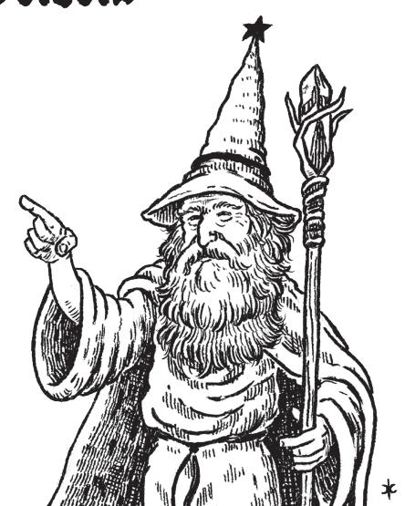

#### **TASKS**

- 1. Find a dragon and have a polite conversation in Draconic. Learn the dragon's favorite color. Do not use magic to aid you.
- 2. Pass the Trial of the Seven Pillars, a grueling mental test of your integrity and courage.
- 3. Win a wizard's duel against an opponent of greater standing. Do not kill your opponent.
- 4. Donate a rare magic item to the university. Don't be stingy. This is for educational purposes.

#### **BENEFITS**

If you complete a task, Ivanculus teaches you a new wizardly arts technique. You gain one of the following benefits (once each):

#### **BENEFITS**

- 1 1/day, regain a spell you lost from normal failure
- 2 Roll your wizard mishaps with advantage
- 3 +1 to INT spellcasting
- 4 1/day, reroll a normal failure on a spellcasting check

{120}------------------------------------------------

#### Healer Training With

### The Heath Witch

Thimbleweed is an eccentric elf woman who lives alone in a hut on the wild heath. Her scraggly hair and robes make her look like a weed, and some call her The Heath Witch assuming she is a wicked and evil crone.

In reality, Thimbleweed is a gentle healer who treats kindness in turn. She gladly teaches her restorative skills of herbalism and potion-making.

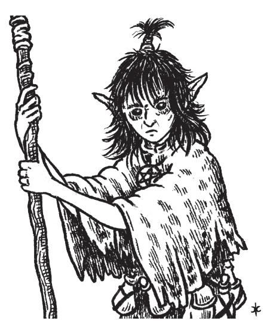

#### **TASKS**

- 1. Roll a critical success to stabilize someone who is dying.
- 2. Mix two magic potions (see *SD* pg. 286) and notate the effects it has on a willing subject.
- 3. Bring Thimbleweed the root of a marrow tree from The Gloaming for medicinal study.
- 4. Acquire a dose of the rare (and highly illegal) poison Vapor of Leng (*PGWR* pg. 113). Bring it to Thimbleweed so she can reverse engineer its antitoxin.

#### **BENEFITS**

If you complete a task, The Heath Witch teaches you a new technique. You gain one of the following benefits (once each):

#### **BENEFITS**

- 1 Your INT checks to stabilize dying creatures are DC 12
- 2 +1d4 HP to any effects you administer that restore HP
- 3 Gain immunity to all forms of snake venom
- 4 +2 to your CON stat

{121}------------------------------------------------

## Gilzai Mountains

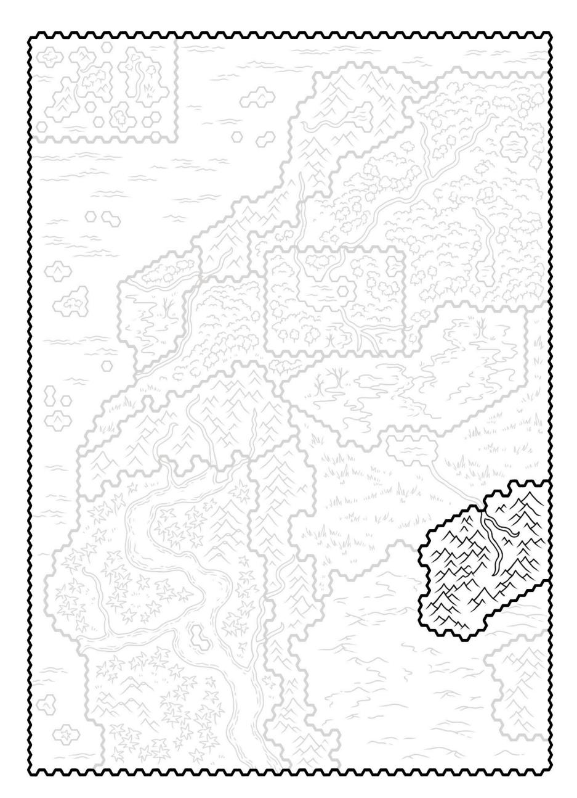

{122}------------------------------------------------

|      |                         | LOCAL HEXES |                 |  |
|------|-------------------------|-------------|-----------------|--|
| Hex  | Region                  | Terrain     | Description     |  |
| 4859 | Gilzai Mtns             | Mountain    | Hawk Bandits    |  |
| 5056 | Gilzai Mtns             | Mountain    | Phoenix         |  |
| 5060 | Gilzai Mtns Mountain |             | Howling Caves†  |  |
| 5150 | Gilzai Mtns             | Mountain    | Crag-Fang       |  |
| 5158 | Gilzai Mtns             | Canyon      | Canyon Maze     |  |
| 5453 | Gilzai Mtns             | Mountain    | Nether Tree     |  |
| 5557 | Gilzai Mtns             | Canyon      | The Ras-Godai*1 |  |
| 5559 | Gilzai Mtns             | Mountain    | Manticore Nest  |  |
| 5755 | Gilzai Mtns             | Mountain    | The Scourge     |  |
| 5848 | Gilzai Mtns             | Mountain    | Zulara3         |  |
| 6151 | Gilzai Mtns             | Mountain    | Orc Camp2       |  |

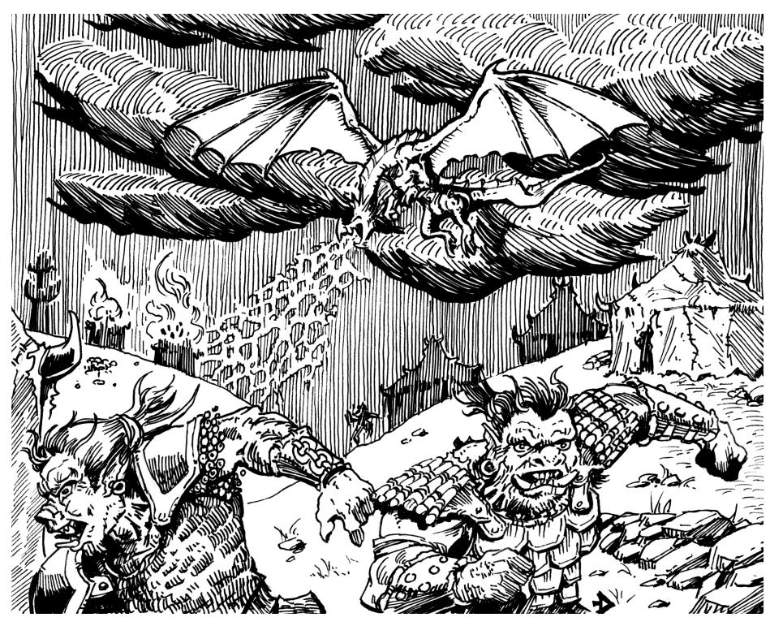

{123}------------------------------------------------

### Gilzai Mountains Traversing the lawless lands of the...

Stark and unforgiving. A land bathed in blood. Here, efreet-haunted canyons hide the ancient redoubt of the **Ras-Godai** assassins, killers trained from birth to wield poisons and dark sorcery. Masked demons lurk beneath black trees, The Scourge carries thundering death on dragon wings, and the mountains shake with the war drums of Orcish warlords. The hanging **City of Zulara** rises bold and lawless, a place where no thief can be called a criminal and where fortune finds the hand that can hold it.

#### RUMORS**1** A black tree grows with fruit that transports you elsewhere **2** A hidden monastery of assassins lies in the canyonlands **3** A wicked, accursed dragon lairs in the remote mountains **4** An Orcish warlord occupies a keep overlooking the Steppes **5** Thieves' Guilds run the City of Zulara; be vigilant while there **6** Spirits and flesh-eating apes haunt the twisting canyons **7** Disaster recently befell a large orc camp to the southeast Bandits to the southwest watch the desert for caravans **9**Manticores carrying people were spotted toward the south

A mighty phoenix dwells in the southwest range of peaks

| E C E R E N O U N T Z O N                                                                                                 |                            |                                      |                                      |                            | E C E R N O U N T S           |                                                                                                                                                                                       |                                                |                                                           |  |
|---------------------------------------------------------------------------------------------------------------------------------------------------------------|----------------------------|--------------------------------------|--------------------------------------|----------------------------|----------------------------------------------------------|---------------------------------------------------------------------------------------------------------------------------------------------------------------------------------------|------------------------------------------------|-----------------------------------------------------------|--|
| d 8                                                                                                                                                        | C a n o n y | i M t o n a n u | W t a e r                | d 8                     | i A t q a c u                          | B t e a s                                                                                                                                                                 | D e m o n                          | l P e o p e                                |  |
| 1                                                                                                                                                             | B t 1 e a s | B t 1 e a s           | i A t 1 q u a c | 1                          | B o n e n a g a                     | i M t a n c o r e                                                                                                                                             | i i D * a o n                | i 1 d 6 R G d * a s- o a |  |
| 2                                                                                                                                                             | B t e a s      | B t e a s                | i A t q u a c      | 2                          | j i i D n n                               | * C a n y o n a p e                                                                                                                                        | h G t o s                          | d 2 6 o r c s                           |  |
| 3                                                                                                                                                             | B t e a s      | B t e a s                | i A t q u a c      | 3                          | d l h 1 4 t. g e e c          | d l 2 8 t v u u r e s                                                                                                                                   | i O † n                               | d h l f- * 1 4 a o r c s |  |
| 4                                                                                                                                                             | B t e a s      | B t e a s                | i A t q u a c      | 4                          | S h e a a g                               | i 1 d 4 t. g s c o r p o n                                                                                                                        | R k h † a s a s a      | 1 d 4 t p e a s a n s       |  |
| 5                                                                                                                                                             | D e m o n      | D e m o n                | i A t q u a c      | 5                          | i k G r c                                    | b C o r a                                                                                                                                                                 | f i E t r e e                | d b l i 2 6 g o n s            |  |
| 6                                                                                                                                                             | D e m o n      | D e m o n                | i A t q u a c      | 6                          | d i l C r o c o e                | d 1 4 w o r g s                                                                                                                                                  | N a g a                               | d b d i 2 8 t a n s            |  |
| 7                                                                                                                                                             | D e m o n      | P l e o p e           | B t e a s                | 7                          | 2 d 6 k l t s e e o n s | S k n a e s w a r m                                                                                                                                        | i h h N t † g a g      | i d S l * 1 4 r u u            |  |
| 8                                                                                                                                                             | l P e o p e | l P e o p e           | l P e o p e           | 8                          | G r a y o o z e                     | h * T S e c o u r g e                                                                                                                                   | d h i 2 4 a r p e s | P t e a s a n                           |  |
| i f i f d i h l 1P I t t t t o n o n e r e s u r n g e x r a v e |                            |                                      | *N e w m                    | t o n s e r | 2 8 3 s, p g                              | / i i d h i d l † D t t s g u s e a s a p e a s a n u m a n o r a v e e r |                                                |                                                           |  |

**10**

{124}------------------------------------------------

| I T P O N S O | F E E I T R T N S |
|---------------------------------|-------------------------------------------|
|---------------------------------|-------------------------------------------|

| d 2 0 | i D l t e a s                                                                                                                                                                                                                                                                                                                                                                                                                                                                         |
|-------------|---------------------------------------------------------------------------------------------------------------------------------------------------------------------------------------------------------------------------------------------------------------------------------------------------------------------------------------------------------------------------------------------------------------------------------------------------------------------------------------------------------|
| 1           | f d h h i d d b l k l h i h d f l i b h A t t t t t t t t t t t t g r o v e o s u n e r e e s a a v e g r o w n w s e a n a c ; s r a n g e, a u g n g s a o w s e w e e n e r e e s                                         |
| 2           | i h l h h i d h l i h f h f l l h i i i h b A t t t t t t t t t t m o u n a n a o n y a p p e a r s o n e o r z o n u n e r e g o e u m o o n ; o e r w s e, s n o w e r e o e s e e n                                    |
| 3           | i f i h i h d i d i b f l k i l h k i h i d k i i C O t t t t t t t t t t t a r n s o r r c s w a r r o r s w o e n c o m a ; o e m s o r a e s n a e a s s a e n e w n o e e p s p r s a r e s            |
| 4           | i i i i i f i f f i i i i A l d d l l h l l k h h l b h t t t t t g a s s y p o n c o v e r e n w a e r e s ; a m s c e v o u s a m y o a r e s p a y s r c s o n o s e w o n g e r y e w a e r            |
| 5           | h k h f i i d i i h h h l d i h d i i T R R G t t t e s m o e y u o o g a, a n o n n s g u s e a s a u m a n ; e a s a p e r s o n a g r u g e a g a n s e a s- o a a s s a s s n s                                             |
| 6           | i h i b l i d h i d k h l h b i i d i l k f f A 2 0 Z t t t t t c a r a v a n s e r a o s n g g o n s a n e r o n e y s o n e w a y o u a r a ; e y r n g o r e, w n e, a n s s r o m a a r                         |
| 7           | i i i i i i i i i S f d l h l f f f f k h f d l h f h t t t t t t o n e c a r v n g s o w n g e o n s n e c a c e s ; s p o e n o, o n e a n m a e s a s a c a y, r e n y s p n x o r o n e o u r          |
| 8           | i f i i d d f d h f d i h h A 2 4 t t t- t t t t t t t t n e m p y c a m p s e o g a n s z e e n s a n o o ; e o w n e r s, a g r o u p o g o a g a n s, r e u r n w e n e s u n s e s                                       |
| 9           | i b f h f l d f d h i d h k k l h i h i k A Z t t t t t t m n e r u n y a p r e s s g a n g o u g s r o m u a r a ; u n e r e c a n e p e a s a n s a c w e a y a e s o n e w p c a x e s ,                      |
| 1 0      | i l, l l f i l d f d d i l l i f l d i l i d f l l i d A t t t t t r a n q u s m a e o n o n g y e o w m o u n a n o w e r s ; n o a n g e r o r e v c a n e n e r a n r e s u s e e p s a s s u r e |
| 1 1      | i l h f i l l d i h b i h h l d b f l i h f l l i A t t t t t t t c a v e o p e n s u p n o a u s g r o v e e w r g m u s r o o m s, c e a r s r e a m s, a n a e a m o g a n g o n a s a u e                    |
| 1 2      | h d b i i l l h d i d f l l b l k d d h k W t t t t t t t t a a p p e a r e o e a m o u n a n s a c u a y a w e a e r e p y r a m o c o o s s a s o n e o c s a n a o o r a e p e a                                          |
| 1 3      | i i i i i i h d f b l h l l d h f l l h h h h h h h D t t t t t t t t t e n s e e r s o e a n g g y c u s e r e m o u n a n s e e p o o w e c a r a c e r s e v e r y w e r e e y g o w n s e x ,       |
| 1 4      | l i h l l d i i f i b j l f i d i b d f h d l i i A t t t t t t t t t t n a a r n a s a o c a e c o e r e n p a r s o e m s ; a n o e c e o n n s r e o r a m o n p c a e s n o o w v v y u u u w       |
| 1 5      | i d h i l h h l l i i h f i f i d l l f k d i l d b i d d i l i d W t t t t t t t t t t n w s e s r o u g a c o a p s n g o u p o s w o r e w a s o s a c e s o n e ; c o u e r e p a r e a n u z e  |
| 1 6      | h i f b l b b d f d f h b d i l i b l h T t t t t t t t t e s e o a r e c e n a e e w e e n a a n o o r c s a n g r o u p o u m a n a n s ; s a n c o m a a n s s p r a w e v e r y w e r e                      |
| 1 7      | f l j d d i b i h f i d i i i f h d d l l l A 1 6 H P t, t t t t t t t a a e a s g e n o u g o r o n e p e r s o n o s o n ; m e a n g u p o n o r a n o u r r e s o r e s a n o n e o s s p e                |
| 1 8      | h h f h l f- h h d d h f l d f i l l i f f i d d b i l T T Z t t t e c o z y, s o n e o u s e o a a o r c s e p e r n a m e a r g u s w o e r o m a v o e n e o c r m e a n e n u a r a                                   |
| 1 9      | i i h h h i i i k i h l d i l i h i b l h A T 't t t t t t t t t t t m a n c o r e n e s w r e e m e a n, s s n g m a n c o r e s w o g r o w r u e n s u s n a n a n u w o n e a v e e n e s                    |
| 2 0      | f i i i A D C 1 5 I N T h k ( ) h d t t t t t t m a z e o c a n y o n s o r m o u n a n p a s s e s ; r e q u r e s c e c o n e p e r s o n o e x e x, c a n a e m p o n c e p e r a y                                    |

{125}------------------------------------------------

#### **4859. HAWK BANDITS**

40 bandits dwell in a network of caves high in the southern Gilzai ridges. Their leader, a principled and magnetic young man named **Kadim** (N thief), has trained a dozen hawks to keep watch over the stretch of desert between the **Shar Oasis** [\(4658](#page-105-3)) and **Alkesh** [\(5063](#page-107-2)). The hawks signal the bandits when travelers stray into their reach. 3:6 chance 2d20 bandits guide their horses down hidden mountain passes to intercept anyone in an adjacent sand hex.

#### **5056. PHOENIX**

A **phoenix** roosts in the highest peak of the western mountains. She makes a flight over the desert at midnight on each solstice to assert dominion over her territory and immolate the offerings left on her **altar** [\(4856\)](#page-106-3) by the nomadic Siruul elves. During this breathtaking display, her nest is unguarded for an hour; within it are 2,000 gp, a *Ring of Fireballs*, three phoenix eggs (worth 500 gp each), and a *Genie Lamp*. A blaze of fiery death awaits anyone she catches trying to rob her nest.

#### **5060. HOWLING CAVES**

Wind blows over the craggy faces of the Howling Caves, filling the silent desert with thrumming, hypnotic tones. Legend holds that a mad prince's treasure lies buried inside the caves, along with him.

#### **5150. CRAG-FANG**

Fraying, blood-soaked flags snap in the relentless wind over the looming fortress of Crag-Fang. Its flint-gray ramparts back up against a deep mountain gorge that gives way to the rolling grasslands of the Kyzian Steppes. Inside this long-empty castle, orange cookfires now glow, throaty voices bellow orders in Orcish, and the warlord **Garzuun Bloodbane** sits on the throne with the keen patience of a hunting hawk. 200 orc warriors serve him, and their increasingly aggressive raids into the Kyzian Steppes have filled Crag-Fang's stores with silks, weapons, gold, and prisoners. Garzuun will soon ransom the two Kyzian Princes in his dungeon back to Taru the Hawk Queen ([4146\)](#page-152-0), and she will thirst for vengeance. Garzuun is ready for her to make her move.

{126}------------------------------------------------

#### **5158. CANYON MAZE**

Within The Echoes canyonlands, a network of narrow ravines and gulches forms a disorienting maze. A navigator must pass a DC 18 Intelligence check to find an exit to the hex. Nomads tell tales of a flesh-eating efreeti who stalks the maze, tearing travelers apart in nighttime attacks. In truth, the creature haunting the maze is a vengeful canyon ape named **Gori-Mannu** who a long-dead sorcerer cursed with dim intelligence and the lifespan of ten men. Gori-Mannu has a cumulative 1:6 chance each day of finding creatures lost in the maze. He waits until night to attack, green eyes flashing like a mountain lion in the darkness.

#### **5453. NETHER TREE**

A mighty **dai oni** sits beneath a wretched, black tree growing from soil stained rusty umber. Its scarlet fruit hangs from thin branches like bulbous spiders. The dai oni allows a single fruit to be plucked; eating it causes one walk in the Netherworld for an hour, a ghostly and perilous reflection of the Material world full of demons and magic.

#### **5557. THE RAS-GODAI\***

Behind a secret door deep within The Echoes, a hidden monastery lurks in a sheltered ravine. Its tiered roofs of black wood are bathed in the dim glow of red paper lanterns. Six **Ras-Godai** watch the ravine from spy holes; they each carry blowguns with three nuzule oil darts (Poisons, *PGWR* pg. 113).

Inside the monastery, 80 Ras-Godai assassins train from childhood under the half-demon **Manazusa** and his circle of five loyal oni. Aspirants are tested, often for many years, in brutal trials of pain and self-mastery (see [pg. 129](#page-128-0)). Survivors are fed one petal of the legendary **black lotus** flower that grows deep within the complex. Ras-Godai who endure the lotus's wracking magic earn the right to leave the monastery, but they must return yearly with an offering (or when called upon).

Once a decade, the monastery travels for a night to another plane so the cyclical black lotus can bathe in the light of the blood moon from its origin world. On this night, it grants one *wish* when its petals open.

{127}------------------------------------------------

#### **5559. MANTICORE NEST**

A pride of six adult **manticores** and three kits dwell in a high mountain cave. Creatures who enter an adjacent hex have a 3:6 chance of being noticed during the day. 1d4 adults attack anything edible. In their nest, are the bodies of runaway **Omid** ([4865\)](#page-107-0), his bride Zaina (an Alkeshi dancer), and his loyal war scrag. Omid wears a silver ring — a cursed band that causes the wearer's WIS to drop 1d8 points, removable only by *restoration*. His bag holds a dowry of 80 gp.

#### **5755. THE SCOURGE**

An ancient **desert dragon** makes its lair in the most desolate crag of the Gilzai. An unknown calamity corrupted its soul, and now it is a wicked force of chaos and destruction. It wings out over the desert at unpredictable intervals, throwing down lightning bolts at creatures it passes. Caravan trains would rather see all the bandits in Reaches charging at them than spot The Scourge on the horizon. At the bottom of its labyrinthine lair, *The Staff of Ord* juts from a hill of 3,000 gp.

#### **5848. ZULARA**

Mud-brick dwellings cling to the mountain ledges and stack into the hanging City of Zulara. A mix of 2,000 goblins, orcs, and halforcs live here among smoking chimneys, rope bridges, and fluttering roof canopies. Six Priests of Ramlaat and their 100 warrior-acolytes rule from afar, resolving major disputes with trials by combat. Here, theft is not a crime; failing to protect one's goods is the misdeed. Thus, several Thieves' Guilds (the two largest being The Sickle and The Claws of Yorg) compete for territory. A rowdy adventurers' tavern, **Brak's Bones**, claims to have the skeleton of Zulara's most famous goblin wizard on display. Sometimes, it speaks.

#### **6151. ORC CAMP**

A camp of 700 yurt-dwelling orcs dots the mountains and narrow fields at the lofty wellspring of the Cobai River. Recently, an attack by The Scourge ([5755\)](#page-127-1) left 40 orc villagers burned to ash. Their new warlord, a reaver called **Margol**, believes raids into the Kyzian Steppes will appease this avatar of Ramlaat's rage.

{128}------------------------------------------------

### Manazusa Assassin Training With

The leader of the Ras-Godai assassins, an immortal man born of human and oni who stands 8 feet tall and wears a snarling demon mask. None living have seen the face beneath it.

Manazusa is a philosopher, a sorcerer, and a killer. He walks in the Netherworld; he teaches the gifts of his dark birthright to the worthy. He alone can turn humans into demons.

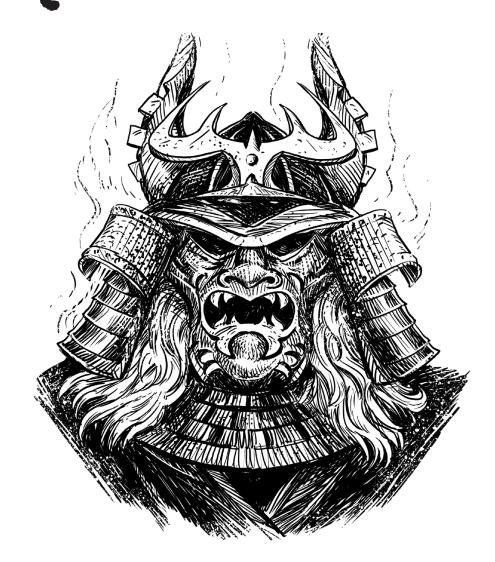

#### **TASKS**

- 1. Survive three rounds of solo combat against Janu, a **dai oni** (new monsters, [pg. 283](#page-282-1)) who serves Manazusa.
- 2. Complete the Trial of the Mirror: Overcome the shadow duplicate of yourself.
- 3. Complete the Trial of Fire: Cross a deadly gauntlet of lava and statues that shoot flames.
- 4. Complete the Trial of Shadow: Navigate a danger-filled trap dungeon in total darkness.

#### **BENEFITS**

If you complete a task, Manazusa teaches you a new assassin technique. You gain one of the following benefits (once each):

#### **BENEFITS**

- 1 You can wield sais; they deal a d8 damage
- 2 +1 to hit and damage with sais, scimitar, & razor chain
- 3 ADV on damage with sais, scimitar, or razor chain
- 4 You can Smoke Step 1/day\*

{129}------------------------------------------------

# Gloaming, The

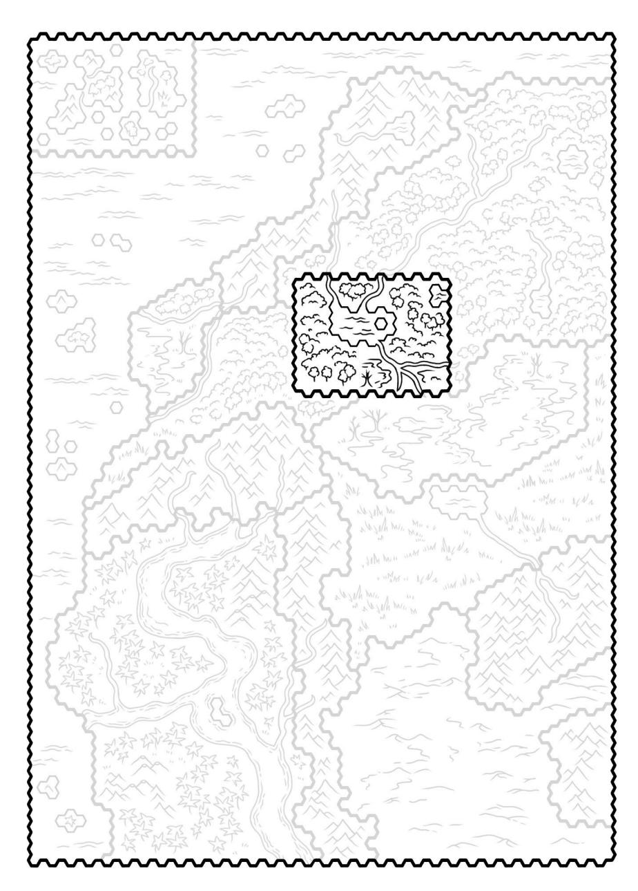

{130}------------------------------------------------

|      |                         | LOCAL HEXES  |                    |  |
|------|-------------------------|--------------|--------------------|--|
| Hex  | Region                  | Terrain      | Description        |  |
| 3023 | Gloaming, The           | Forest       | Shattered Tower    |  |
| 3027 | Gloaming, The           | Forest       | Drusilla's Hut     |  |
| 3029 | Gloaming, The           | Forest       | Mossy Menhirs      |  |
| 3124 | Gloaming, The           | Forest       | Marker Stone       |  |
| 3130 | Gloaming, The           | Forest       | Troll Cave         |  |
| 3228 | Gloaming, The           | Forest       | Wardenwood1        |  |
| 3430 | Gloaming, The           | Forest       | Outlaw Camp        |  |
| 3623 | Gloaming, The           | Forest       | Bittermold Keep    |  |
| 3631 | Gloaming, The           | Swamp        | Uncle Grigor*      |  |
| 3728 | Gloaming, The           | Forest       | Stone Circle       |  |
| 3826 | Gloaming, The           | Forest, lake | Haldrin's Tower    |  |
| 3831 | Gloaming, The           | Swamp        | Barrow Mounds†     |  |
| 3923 | Gloaming, The Forest |              | Mushroom Grove     |  |
| 3924 | Gloaming, The           | Forest       | Bone Cave          |  |
| 4029 | Gloaming, The           | Swamp        | Marin's Hold1      |  |
| 4126 | Gloaming, The           | Forest       | Boot Hill          |  |
| 4131 | Gloaming, The           | Swamp        | Stilt Orc Village1 |  |
| 4229 | Gloaming, The           | Forest       | Myre Castle Ruins  |  |
| 4322 | Gloaming, The           | Forest       | Ancient Cairn      |  |
| 4324 | Gloaming, The           | Swamp        | The Mud Pit†       |  |
| 4327 | Gloaming, The           | Forest       | Greywall Priory    |  |
| 4330 | Gloaming, The           | Swamp        | The Wolf Cave      |  |
| 4425 | Gloaming, The           | Forest       | Cultist Camp       |  |
| 4431 | Gloaming, The           | Swamp        | Corrupted Henge    |  |
| 4528 | Gloaming, The           | Swamp        | The Vile Well†     |  |

{131}------------------------------------------------

The Gloaming Exploring the cursed woods of...

An ancient forest where black trees tower over mossy standing stones and mist-addled bogs. Here, fragile bastions of mankind cluster behind torchlit palisades and pray for deliverance from the demons that hatch from the forest's cursed **marrow trees**. The **Knights of St. Ydris** range out of their deepwood conclave to wage a losing war against these demons and their servants. The knights' leader, **Inquisitor Justinia Morvin**, suspects a traitor in their ranks.

**1***Point of Interest if during hex travel \*New monsters, [pg. 283](#page-282-2)*

|   | R U M O R S                                                                                                                                                                                                                             |
|---|--------------------------------------------------------------------------------------------------------------------------------------------------------------------------------------------------------------------------------------------------------|
| 1 | h f i l d l l l i l i k T B K t t t t e s o n e s o e r m o e e p a r e s o w y m e n g e w a x           |
| 2 | h d f i b f f f i h i l i i T L T t e o r o m e g r a n s o o n s o r o e r n g s s a n e n e m e s |
| 3 | h f h i h d f l l W t t t a c o r s r a n g e a p p e n n g s o n e n e a n m o o n s w u                          |
| 4 | h i f l h d h l d f k i h T M C t t e r u n s o y r e a s e o n c e o u s e a o y o r e r o n g s      |
| 5 | i d l f b i h h h A t s x- e y e w o a s g a s a o r s e r o a m s e m a r s e s                                                  |
| 6 | i i i i f C l h b l T d P d t t t t t s s a e e e n o s s n g p e o p e n o a r n e a r o a o n u v |
|   |                                                                                                                                                                                                                                                        |

Three witches were burned on Boot Hill near Marin's Hold

Bandits camp by a huge marrow tree near Wardenwood

There is a priory of secretive, cursed knights in the forest

Walk the woods enough and The Willowman will find you

*†Knights of St. Ydris (L), 1:6 secret traitor (C reaver)*

| E C E R E N O U N T Z O N |                                 |                                 |                                 |                                      | E C E R N O U N T S |                                                               |                                            |                                                               |                                                          |
|---------------------------------------------------------------|---------------------------------|---------------------------------|---------------------------------|--------------------------------------|------------------------------------------------|---------------------------------------------------------------|--------------------------------------------|---------------------------------------------------------------|----------------------------------------------------------|
| d 8                                                        | F t o r e s      | S a m p w           | h P t a                | W t a e r                | d 8                                         | i A t q a c u                               | i l A n m a                 | D e m o n                                         | l P e o p e                               |
| 1                                                             | i A l 1 n m a | i A l 1 n m a | i A l 1 n m a | i A t 1 q u a c | 1                                              | i 3 d 6 b t t s n g a s      | 2 d 6 l w o v e s  | i 2 d 6 h l * e x n g s      | i i 1 d 6 f a r e s           |
| 2                                                             | i l A n m a      | i l A n m a      | l P e o p e      | i A t q u a c      | 2                                              | d d i l 1 4 c r o c o e s | b B r o w n e a r  | h * I c o r o o z e                | l f W e r e w o                     |
| 3                                                             | i l A n m a      | i A t q u a c | l P e o p e      | i A t q u a c      | 3                                              | i k G t a n s n a e                | l l T r o                      | d b * 2 4 t t a r a s           | d b d i 3 6 t a n s           |
| 4                                                             | i A l n m a      | i A t q u a c | P l e o p e      | i A t q u a c      | 4                                              | i i 1 d 6 l l w o w s p s | 2 d 6 t. t g r a s | 2 d 6 k l l * s r e                | 2 d 4 o r c s                          |
| 5                                                             | D e m o n           | i A t q u a c | i l A n m a      | i A t q u a c      | 5                                              | d l h 2 6 t. g e e c e s     | d b 2 4 o a r s       | d b h * 2 4 t o g o r n s | d k i h 2 6 t † n g s      |
| 6                                                             | D e m o n           | D e m o n           | i l A n m a      | i l A n m a           | 6                                              | d i h 1 4 t w g s                     | i U n c o r n            | f i d * M a r r o w e n      | d 1 4 r e a v e r s           |
| 7                                                             | l P e o p e      | D e m o n           | i l A n m a      | D e m o n                | 7                                              | 2 d 6 b h * t o g o r n s | i G d t. s p e r      | l h * D r a e c                          | i 2 d 6 l t t c u s s      |
| 8                                                             | l P e o p e      | l P e o p e      | D e m o n           | l P e o p e           | 8                                              | d 3 6 o r c s                               | d 1 6 m o o s e       | h i l l * T W e o w m a n | d i l l 2 4 v a g e r s |

**7**

**8**

**9**

**10**

{132}------------------------------------------------

| I T P O N S | F O | I T E R E T N S |
|----------------------------|--------|--------------------------------------|
|                            |        |                                      |

| d 2 0 | i l D t e a s                                                                                                                                                                                                                                                                                                                                                                                                                                                                    |
|-------------|----------------------------------------------------------------------------------------------------------------------------------------------------------------------------------------------------------------------------------------------------------------------------------------------------------------------------------------------------------------------------------------------------------------------------------------------------------------------------------------------------|
| 1           | i i i i i i k b l k h d k b l h d d d A t t t t t t t t n n y a c m a r r o w r e e o w e r s o v e r e a s r u n u g n g a s e e m o n n s e g r o w s s r o n g e r a n s r o n g e r ,                      |
| 2           | d i b d i l h h d d i i i d i l l k i l b S t t t t t t t o n e s a r r a n g e n o a r o a s p r a s a p e o n e g r o u n ; s a n n g n s e a o w s o n e o s p e a o a n m a s n e a r y                 |
| 3           | i l d h k h i f f i i i d i f h d b f i j i b i l A t t t, t t t t s e a m n g c a u r o n a n g s o v e r a m a e s r e ; n s e a s o u p o e e a n o n e s o s u s c o m n g o a o                                    |
| 4           | i i i i i i i i i l f k h b l b l l h f l d A t t t t t c u s e r o a n c e n g r a v e m a r e r s w w o r n- a w a y n s c r p o n s e c o m e e g e n m o o n g a s n e w y c a r v e                          |
| 5           | l b i h i h i j i i i h f k i f h i f l l A P C t t t t t t t t t t t t t r a r e, a n o m o o s e r o a m s s e x ; o n s n p r o e c n g e s r o m m o n s e r a a c s e y r e a r e s p e c u y |
| 6           | f i l f k i i h, d h l f l i l i i f l d h h k i l b h l l A t t t t t t a m y o s s m o o n- e y e a n g s v e s n a c a m o u a g e r e e o u s e ; e y s p o o e a s y u e p r a v e e r s               |
| 7           | f d k i h i l l d h k i h f h l d d l i k d l A 's t t t t t t t s a u e o a p r o u n g r s e s o v e r a s m a p o n ; e n g e a u r e s a v e m e e a n r u n e c a n e w a x                                              |
| 8           | k i i f l l i h f b l k i h h l i h i A t t t t t t t t t t t t s m o n g p e c e o s a r m e a g n s a e c e n e r o a a c c r a e r n e e a r ; p a n s n e e r g r o n e c r a e r a g a n v w  |
| 9           | i l l b i i f l d d i i f i ( d l i b ) A t t t t t t, t s e n y u r n n g r e e ; s a m e s c a n n o s p r e a a n n e v e r g o e s o u s e r v n g a s a c a m p r e r e m o v e m s g o o u      |
| 1 0      | i l f i l k i d h i i h d l k l i b A t t t t t t c r c e o n y, s e r n- o o n g g a r e n g n o m e s ; e y a n m a e a n g a n p a y p r a n s o n a n y o n e s e e p n g n e a r y                              |
| 1 1      | i i f i i f i A d k l b b h l h d h d d l l l l d t t t t t t t s o r s c n o a s o n e a e a m o a s n g ; r e m o e e s o r s c r e a m s e n e s s n r e p a c e w u y z y u v w y u ,                      |
| 1 2      | l d k i l l i h i k l h i f d i h i h i b A t t t t t t t t n o c r e a n g g a o w s w a g a p n g s e e o n a n g n g r o m a a e r e n o o s e ; w s p e r s o o s e p a s s n g y ,                           |
| 1 3      | i f i i i h k h f l d b l d h d l d h h h h b f l l l b T H t t t t t e s m o y u o a n o n s e r m a n n a m e e r a ; e c a n e a r e e a r e a s o a v n g c r e a u r e s n e a r y ,                      |
| 1 4      | d l b l b f l i f l l h h h i h i h d l f h h A P C t t t t t t t o z e n p a e u e u e r e s o o w e s e v e r y w e r e e y g o n s e x, r e g a r e s s o e s e a s o n o r w e a e r                          |
| 1 5      | i d k h h b i h l f f b l i k l d b d l i i l d i A t t t t t t t t t t t r u n e e e p a a s e e n c u n a r o m o p o o o m e a p e e e a n a n a s a n s s p n o w o c u r e p e c e s                      |
| 1 6      | i l f h d f i b l d i l l d l h f i h f l h h i i A S T 's 3 X P t t. t t t s n g e, p e r e c r o s e g r o w s w e r e a r o p o e r r a g n s o o s p e o n g a g o ; e r a u w o o u c g a n         |
| 1 7      | i i i i i i i A d l k d E l d l l d T h P d d l f h f 's d t t t t t t o a e m a n n a m e v r r u n s a m e w n g n n c a e e u e ; o r s o m e r e a s o n, e o r e s e m o n s g n o r e -               |
| 1 8      | b l k, d h d h l l d i h i h d k f h l i A T G t t t t t t t a c r u p u r e m a r r o w r e e a o n c e g r e w a e m o n a s e x p e e s c a r g e n o e a r o e o a m n g                                                        |
| 1 9      | k d l i h i d i h k d i h b b l d h l i i l k k A M t t t t t t c r a c e e a n n g s r n e o a e e r a s c o e w o v e r g r o w n r a m e s a n o r n s ; c e a r n g g r a n s a u c o e n ,       |
| 2 0      | f l f i d d l i h f f l l l i h l i l k i i d h M t t t t t t o r n e m s c e c o e s o o a a e n o g ; c a n g e s o g s a n m e a c r e a r e o o s n s e e c r r e n o n e u u u u y u u                 |

{133}------------------------------------------------

#### **3023. SHATTERED TOWER**

A crumbling keep in a clearing choked with thorns and nettles. A heavy trapdoor in the ruins leads down to an old **cistern** where a dark shape slithers beneath the putrid algae.

#### **3027. DRUSILLA'S HUT**

A cozy, thatched hut strung with drying flowers and herbs. Inside lives **Drusilla**, a weald hag, who impersonates a shy medicine woman. She is gaining the trust of the residents of nearby **Wardenwood** village [\(3228](#page-134-0)) by "nursing" villagers back to health whom she has secretly poisoned. Drusilla is forming a plot with the werewolf **Victoria** ([3924\)](#page-135-3) to begin turning the village's children into werewolf cubs.

#### **3029. MOSSY MENHIRS**

Mossy standing stones form a circle inside a gulch. Each new moon, the earth inside sprouts d10 dandelions of silver (10 gp) that **Drusilla** ([3027\)](#page-133-1) harvests.

#### **3124. MARKER STONE**

A tall, pointed stone bears an ancient mark in a spiral shape. In the earth beneath it, four **wights** lie in stone coffins. Each has a different gemstone in its sewnshut mouth; a pearl (40 gp), an emerald (120 gp), a ruby (200 gp), and a sapphire (280 gp). Slotting these gems into four worn grooves at each cardinal point on the marker stone opens a magical portal to the fey realm.

#### **3130. TROLL CAVE**

Black marrow tree roots that have been gnawed to a pulp lie scattered around this cave entrance. A warty, lank-haired troll named **Barbarog** lairs inside. He's addicted to the toxic oil in the marrow tree roots that grants him temporary immunity to fire (his greatest fear). His cave houses a suit of greenhued mithral plate mail etched with leaves and a *+1 longsword* named *Rot-Ruin* that can rust one door-sized piece of metal it touches into powder once a day.

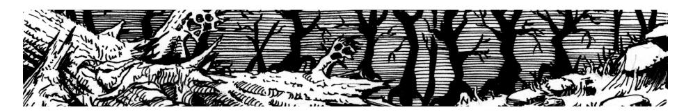

{134}------------------------------------------------

#### **3228. WARDENWOOD**

A woodland village of a few dozen sagging, thatched huts surrounds a stone well. 80 woodcutters and trappers live here with their families. **Mathilde Bower** is the superstitious village elder who believes the "medicine woman" Drusilla ([3027\)](#page-133-1) has been helping sick villagers. In reality, Drusilla has been causing the rash of illnesses by poisoning the well.

**Gede's Hearth.** The village's inn and tavern run by Elana, a cheerful-but-tired woman with young, triplet boys (Zeke, Herbert, and Lantin). Her husband, Carlin, is bedridden with Drusilla's "rot fever."

#### **3430. OUTLAW CAMP**

30 bandits camp here led by **Greaves Redthorne**, an outcast Knight of St. Ydris. Greaves, a cunning liar, serves the marrow fiend **Unduluk**, who is only a few moons away from erupting from the marrow tree at the center of camp. Unduluk needs protection from the **Knights of St. Ydris** [\(4327](#page-137-0)) for now, and human flesh after its apotheosis. The bandits do not realize they serve as both.

#### **3623. BITTERMOLD KEEP**

An abandoned castle keep with tattered, crimson banners that flap atop its collapsing battlements. Droplets of foul slime bead out of its slowly dissolving masonry. In the caves and catacombs beneath the keep, servants of **Mugdulblub** war for their patron's favor.

#### **3631. UNCLE GRIGOR\***

Crazy **Uncle Grigor** lives in a ramshackle hut on the edge of the marsh. He wades through the bog in bare feet, nattering to himself and collecting leeches to pickle inside cloudy jars that crowd every corner of his home. Within one of these jars is *Brak's Cube of Perfection*. Grigor is a powerful witch, and he might take on an apprentice who proves their worth and/or taste for leeches (see [pg. 139](#page-138-0)).

#### **3728. STONE CIRCLE**

One minute of time that passes inside this low circle of stones is actually an hour on the outside. **Kytheros** grants a random patron boon to those who lay the slain six-eyed wolf [\(4330\)](#page-137-1) inside the circle.

{135}------------------------------------------------

#### **3826. HALDRIN'S TOWER**

This ivory tower with a red roof dominates a sandy island on **Finimere Lake**. The elf sorcerer **Haldrin** once lived here and used the laboratory inside to study the infernal properties of the forest's marrow trees. Haldrin has been trapped within the Vile Well [\(4528\)](#page-137-4) for the last century, leaving his volatile experiments untended for far too long.

#### **3831. BARROW MOUNDS**

Dozens of low, rolling hills mark the tombs of ancient denizens of the forest. Mist from the bogs roils over these burial sites, and strange lights dance in the fog.

#### **3923. MUSHROOM GROVE**

Fat, dewy mushrooms sprout inside this sunlit grove, forming a faerie ring the size of a house. On the full moon, **Titania**, Queen of the Fey, appears inside the circle with a troupe of actors who put on a whimsical theatrical performance. They disappear instantly if they learn mortal eyes watch. Any person who sees the entire play gains a random boon from Titania (once/person, *PGWR* pg. 221).

#### **3924. BONE CAVE**

A werewolf named **Victoria** resides in this cave. It stinks of wet fur and rancid meat. Piles of cracked bones and skulls are arranged in spiral patterns sacred to her ancient tribe, long dead. Victoria recently lost her two cubs to the swamp dragon **Ixidian** [\(4324](#page-136-4)). **Drusilla** ([3027\)](#page-133-1) coaxed the grieving Victoria into a plot to turn children from **Wardenwood** village [\(3228\)](#page-134-0) into her new pack of werewolf cubs.

#### **4029. MARIN'S HOLD**

300 fisherfolk live in a motteand-bailey hold where the river meets the bog. A palisade surrounds the village, and Reeve **Tarley Winters** resides in the keep atop a hill with 30 guards. The village is still recovering from an attack by six skrell demons who breached the palisade and slew 20 souls. Winters believes sorcery attracts the demons, and he recently had three women burned alive on **Boot Hill** ([4126\)](#page-136-0) for suspected witchcraft. Villagers eye each other warily, and the gossips at **The Crayfish Tavern** wonder who will be accused next.

{136}------------------------------------------------

#### **4126. BOOT HILL**

Three charred skeletons are tied to poles atop a hill overlooking the forest. These women from **Marin's Hold** ([4029](#page-135-4)) were accused of witchcraft.

#### **4131. STILT ORC VILLAGE**

80 reclusive orcs live in peat huts on raised platforms in the deep swamp. Snakes and crocodiles weave between the tall stilts they wear to spearfish in the murky waters. Their leader, **Haruuk**, knows demons prefer human flesh, and he will offer it to buy his tribe's safety.

#### **4229. MYRE CASTLE RUINS**

The soaring stronghold of the **Green Knights** now sits deserted, hazy light filtering through its shattered, stained glass windows. Slain warriors still roam its halls in an unending battle between the Green Knights and its surviving offshoot, the **Knights of St. Ydris**  [\(4327](#page-137-0)). A weapon both sides claim, the *Emerald Blade*, stands in a stone pedestal surrounded by the living dead. It's a *+2 bastard sword* that allows its wielder to speak to wild animals.

#### **4322. ANCIENT CAIRN**

An overgrown path leads to a cairn of piled stones. A worn inscription on the largest stone says, "Here rests Cyrinia, Mother of the Circle." **Cyrinia** was a mighty druid in ancient times. Her bones lie buried beneath the cairn, fingers wrapped around a *+1 staff* of knotted oak called *Ynnith*. Once a day, the wielder can summon an obedient giant owl for 5 rounds. Druids who see the staff will try to lay claim to it.

#### **4324. THE MUD PIT**

A muddy ravine as big as a galleon gapes in the wet earth. Deep within, the swamp dragon **Ixidian** slithers in the dark morass and devours the living sacrifices his cultists ([4425](#page-137-2)) hurl inside. Ixidian has grown large and arrogant; if not fed for a day, he bursts angrily from the pit to gulp down the nearest creatures. Inside the dragon's belly are 1,200 gp, a giant ruby (400 gp), a suit of mithral chainmail, and a *Wand of Moonbeam* that any spellcaster can wield. The wand begins twitching whenever a lycanthrope is within near distance of it.

{137}------------------------------------------------

#### **4327. GREYWALL PRIORY**

In the deepest part of the woods lurks a gray-stoned priory with a pointed roof and arched, stained glass windows. 40 **Knights of St. Ydris** live here led by grim **Inquisitor Justinia Morvin**. Few know 160-year-old **St. Ydris** is still alive deep within the priory's catacombs, bound painfully (and willingly) in a magic circle to trap the mighty demon lord who possesses him. Initiates into the order gain their fell powers by drinking of his cursed blood and surviving. These knights swear to use their fiendish abilities to hunt demons, never losing control or embracing evil. Thus their oath: "I will walk the path between darkness and dawn, ever vigilant, sword drawn." They are sorely outnumbered.

#### **4330. WOLF CAVE**

A pack of 16 wolves lairs here. One wolf is favored by the demon prince **Almazzat**; it stands as tall as a horse and has six eyes (x2 level and damage). Anyone who leaves a worthy offering of flesh for it gains a random boon from Almazzat (once/person, *PGWR* pg. 207).

#### **4425. CULTIST CAMP**

20 cultists led by the charismatic firebrand **Torak Bain** (cultist) have recently set up camp here to make offerings to the dragon **Ixidian** [\(4324](#page-136-4)). The cultists stage ambushes on the path to Marin's Hold ([4029](#page-135-4)) to capture sacrificial victims. Current captives are **Regina Pence**, a merchant from Marin's Hold, and her 3 guards.

#### **4431. CORRUPTED HENGE**

A henge of standing stones has been shifted out of alignment by the roots of a massive marrow tree. Spells are hard to cast within near distance of it. Inside the tree trunk rests **Taigolar**, a conjoined-twin dralech (treat as two combined) that erupts forth when it smells nearby prey.

#### **4528. THE VILE WELL**

The stench of rot gusts out of this mold-encrusted, lightless well. Inside, **Haldrin** the sorcerer [\(3826](#page-135-0)) is entangled in a nest of veins and tendrils that keep him alive, of sorts. Any creature who enters risks the same fate. 1,000 gp and a *Kytherian Cog* (*SD* pg. 305) rest on the well's fleshy, damp floor.

{138}------------------------------------------------

### Uncle Grigor Witch Training With

Uncle Grigor is a masterful witch who will impart eldritch secrets to apprentices who impress him.

While he seems entirely crazy (he is), his madcap tests are also to teach fledgling witches fortitude, perseverance, and wit.

He relishes a good trick or unexpected solution and counts such mischief as a success.

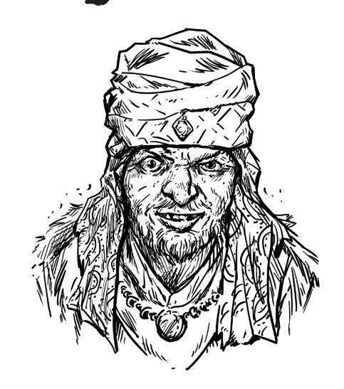

#### **TASKS**

- 1. Eat six pronged leeches in one hour, no healing. Each time you eat one, you take 1d4 damage.
- 2. Bring Uncle Grigor a robe of the finest Alkeshi silk. It must be red. Not crimson, red. And blue.
- 3. Cast a witch spell Uncle Grigor has never seen before. It's a trick. You can't. He actually wants to see a diabolical mishap occur.
- 4. Take a **giant leech** around with you for one week without letting it die. It's a precious baby.

#### **BENEFITS**

If you complete a task, Uncle Grigor teaches you a witch secret. You gain one of the following benefits (once each):

#### **BENEFITS**

- 1 Your dead familiars revive on their own after 1 week
- 2 Gain +1 to witch spellcasting checks
- 3 Your *broomstick* spell lasts 1 hour of real time
- 4 Gain 1d4 HP

{139}------------------------------------------------

## Isles of Andrik

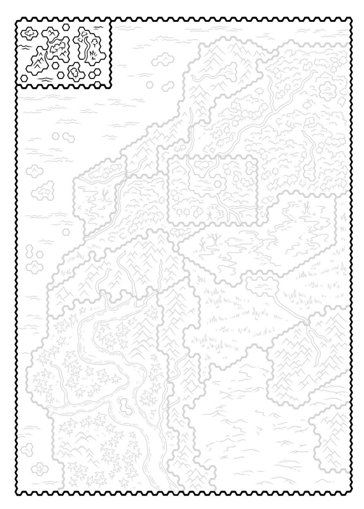

{140}------------------------------------------------

|      |                 | LOCAL HEXES      |                   |
|------|-----------------|------------------|-------------------|
| Hex  | Region          | Terrain          | Description       |
| 302  | Isles of Andrik | Forest           | Grove of the Gods |
| 407  | Isles of Andrik | Mountain         | Dvergheim3†       |
| 503  | Isles of Andrik | Arctic sea       | Sea Nymphs        |
| 507  | Isles of Andrik | Forest           | Valthis1          |
| 602  | Isles of Andrik | Mountain         | Drakenfjell       |
| 706  | Isles of Andrik | Arctic sea       | Sea Caves†        |
| 804  | Isles of Andrik | Forest           | Skargat1          |
| 905  | Isles of Andrik | Mountain         | Bear-Man          |
| 909  | Isles of Andrik | Arctic sea       | Sea Dragon        |
| 1003 | Isles of Andrik | Arctic sea       | Whirlpool         |
| 1108 | Isles of Andrik | Forest           | The Norn*         |
| 1205 | Isles of Andrik | Mountain         | Rolug1            |
| 1306 | Isles of Andrik | Grassland, river | Gandrunne2        |
| 1404 | Isles of Andrik | Grassland        | Runestones        |
| 1508 | Isles of Andrik | Forest           | Door to Alfheim   |

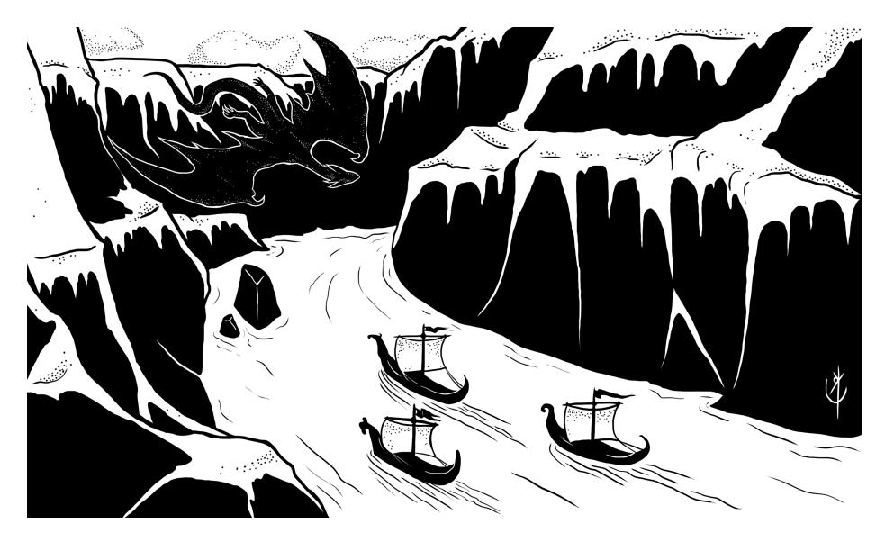

{141}------------------------------------------------

Raiding beneath the midnight sun of the...

3sles of Andrik

Ice-rimed isles with plunging fjords and towering peaks. Drakes nestle high in these foreboding mountains, and the mythical dverg toil deep within their roots. Hard-scrabble fishers and farmers gather in smoky longhouses during the arctic Long Dark, consulting with their fareyed **seers** about what the fates and the Old Gods plan for them. When the spring brings the midnight sun, they transform into howling sea wolves, sailing to distant shores in dragon-

headed longboats to raid for gold and glory.

|          | E                   | NCOUNTE  | R ZONE  |          |
|----------|---------------------|----------|---------|----------|
| d8       | Forest              | Mountain | Sea     | River    |
| 1        | Walker 1 | Flier¹   | Aquatic | Aquatic¹ |
| 2        | Walker              | Flier    | Aquatic | Aquatic  |
| 3        | Walker              | Flier    | Aquatic | Aquatic  |
| 4        | Walker              | Flier    | Aquatic | Walker   |
| 5        | Walker              | Walker   | Aquatic | Walker   |
| 6        | Flier               | Walker   | Flier   | Flier    |
| 7        | People              | Walker   | Flier   | People   |
| <u> </u> | People              | People   | People  | People   |

1Point of Interest if during hex travel

### RUMORS

- 1 A wise old woman lives on a large, forested isle to the south
- 2 The gods have imparted a dire omen to the seer of Valthis
- 3 A sea wolf king lies in repose somewhere inside the sea caves
- A sea serpent with silver scales lurks in the waters to the south
- 5 Secretive dwarves build incredible cities inside the mountains
- 6 The nymphs of the sea will not harm a talented musician
- 7 Magical places are hidden in the lost forests of the isles
- **8** Freya's spirits protect the graves of warriors who fell in battle
- **9** An intelligent bear roves the foothills to the south of Skargat
- **O** There are two doors to Alfheim; one is green, one is blue

| ENCOUNTERS |  |
|------------|--|

| d8 | Aquatic       | Flier          | People       | Walker      |
|----|---------------|----------------|--------------|-------------|
| 1  | Storm giant   | Greater drake* | Raiders†     | Winter wolf |
| 2  | Sea serpent*  | Lesser drake*  | 1d4 dverg*   | 2d4 wolves  |
| 3  | 1d4 sharks    | Ghost          | 1d4 elves    | 1d4 draugr* |
| 4  | Hydra (LV 10) | 1d6 willowisps | 2d6 bandits  | Weald hag   |
| 5  | 1d4 orcas*    | 2d4 stingbats  | 1d8 peasants | Troll       |

7 1d6 sea nymph\* 1d4 fairies 1d4 oracles\* Treant
 8 2d6 merfolk 2d4 vultures Valkyrie\* Dryad

1d6 gt. bats

Sea hag

\*New monsters, pg. 283 †3d6 nords\* in a longboat

2d6 nords\*

Brown bear

{142}------------------------------------------------

| F E E I T I T R T P O N S O N S |
|------------------------------------------------------------------------------|
|------------------------------------------------------------------------------|

| d 2 0 | i l D t e a s                                                                                                                                                                                                                                                                                                                                                                                                                                                                         |
|-------------|---------------------------------------------------------------------------------------------------------------------------------------------------------------------------------------------------------------------------------------------------------------------------------------------------------------------------------------------------------------------------------------------------------------------------------------------------------------------------------------------------------|
| 1           | f i i f i T h k l d ( b d ) d V h l l, d l l h k l k k t t t t t t e c o a g e o a s a a r n a m e o r g e n ; e n v e s r a v e e r s o r a m e a a n a w o p a r a e g a n a u c o e n                               |
| 2           | h f h d h d h i h h h l l l h l h i d A R t t t t t t t t t t s e e p a r m a p r o u c e s e m o s c o v e e c e e s e n e e a c e s ; e y o n y s e o n e w e e a m o n o o u s e r s                                |
| 3           | i i i f i l d h b d l k l l h O l d G d h l l l d A t t t t t t t t s o n e a a r a r r a n g e w o n e s a n a n m a s u s ; a s a c r c e o e o s e r e r e s o r e s a s p e o s o a y                           |
| 4           | h l f- f i i h d b l k l b i k l b l k h i h h k l f h b i h i k i A t t t, t t t t t t t a n s e a c o n g o a s s o n e e o c s ; e a c n g e s e e o n s o e o a r g s r s e o o r o n w w ,               |
| 5           | h i b l h d k l f h l l i h h h b h d f i i i d T t, t t t e g a n e a c e s e e o n o a w a e e s e r e ; o s e w o c a m p n e a r y a v e r e a m s o s w m m n g n e e p w a e r                                         |
| 6           | i f i h h i h i i i d i h i l l l f d i k h i l k i A t t t t t t t t t r n e e a r o p e n s n o a s m m e r n g c e c a v e ; e e p e r w n, a s m a c a n o v e r g n e r a e r m e a w o r n g      |
| 7           | l d f i h d i l i d h i l l h h h h h d f h f l h A H t t t t t n o s e r m a n n a m e e g r n m p s a r o u n s o n e y u ; e a s s a r p o r c a e e a n a a s e o r u m a n e s                                          |
| 8           | d i i l i h h l i i d d k i l R L 's t t t t t t t t u n e s o n e s s a n n a c r c u a r a r r a n g e m e n ; o n e n g a y e a r, e s a r s a g n o v e r a n a o o r o p e n s o o r e a m               |
| 9           | i l l- b i f l i l b l k f i f k h k i f h b d i d i b d i i d A t t t t t t t s u r n n g u n e r a p y r e r a s a a c n g e r o s m o e u p o e s y ; e o y s s u r e r s e s a s a r a u g r ,      |
| 1 0      | / i i i i i f O d l l- h d h l l l h f f f h l 2 d 6 ( d ) A A F H P t t t t t t t t o w e r n g s a u e o n a e r s a n s a o p a ; e a v n g a w o r y o e r n g o r e a s u r e e a s o n c e a y |
| 1 1      | b d h d i i l i i h l i d f l b i h i i d d i f i h i A t t t t t t t u r n e -o u o m e s e a s e e r y q u e n e o w w n ; v e n g e u z o m e s c r o u c n s e a n w a o r n g o a r r v e                |
| 1 2      | b d d d k h i l d l d i h h i h h i l d k i d d A 2 6 t t t t t t n a a n o n e r a e n e s w e r e a s n g e r e e g g s m o u e r s w e a ; a c e s n o a e s s e r r a e n a y s                                          |
| 1 3      | i i i f i i i f i A l d 8 h l ( b k ) l k l l d l F h d d l t t t t n o r a c e a n o y w a r r o r s e r s e r e r s v e n a s m o e- e e m p e o r e y a ; e y m a y e m a n a r u a s a c r c e      |
| 1 4      | i d b l i i h f i d l l i i h d d i h I Y t t t t t t t t n s e a c r m n g r n, e r o s g a n g r a s e e p s p o n a n n m e n g c e r o n e e o a n e n r n g e n c a n m e n u u u u u u                     |
| 1 5      | h d d b b h k i b h i l d d i E t t t t t t t a r e n m o u n s c o n n e c e y s u e r r a n e a n p a s m a e u p a n a n c e n a r r o w w e r e c e n u r e s- o r a u g r s r                                              |
| 1 6      | l f h l h f h i l l b l i h f l l h i h h d d f d i P H 3 t t t t t t t t e a s o r e p e c o r o m a c y c a v e e o n g n g o e r o s r o r o m r ; e a s c a p u r e n o r s o e a o r n n e r       |
| 1 7      | i f i f i i f i i i A l h d d h h d h l l l d h t t t t t t m a s s v e o n g o u s e a n e n c e n m a m m o a r m c o m p r s e s e s e a n g o a g a n c a n a n e r o r c s e r v a n s -                 |
| 1 8      | d i i l i i d h h l l f d l b d d d d b d i O t t t t t t t t u c a s n o r c r m n a s c a m p n s e e u o a n o v e r u r n e o n g o a a n c o n u c w a n o n m u r e r a n a n r y                                |
| 1 9      | i l f d d i i l i d i h d h f h h h l d b l i A t t t t t t t t t c r c e o r u n e s o n e s s a n a r o u n a s a r c a s e s p r a n g o w n n o e e p s o e e a r w e r e o o m s e                                |
| 2 0      | i f i i f f i i i M d h l l l h O d l d h h d h d t t t t, t t u s c a n c e e r s e m a n a e r o m a w a r m y o n g o u s e ; n e a s a e a s e r e o r o n e n g a n e n s a p p e a r s                     |

{143}------------------------------------------------

#### **302. GROVE OF THE GODS**

A peaceful grove where the only sound is distant birdsong and a gentle breeze. Spending three days here in quiet meditation grants the effects of an *augury* spell about one course of action.

#### **407. DVERGHEIM**

A stark mountain dusted with snow. The forgotten door to Dvergheim lies at its roots, opened only by the touch of a worthy hero's blade. Inside, a city of isolated, industrious **dverg** forge astonishing treasures and plumb ever deeper into the mountain. Their king, Snorgin Thrain, has recently seen signs of the fearsome **deep trolls** stirring in the depths once again.

#### **503. SEA NYMPHS**

Twelve **sea nymphs** play fluting music in the bay at high tide. They reward a *Jelly Orb* to a musician who accompanies them well (breathe water, 1 day). They try to drown all others.

#### **507. VALTHIS**

The village is home to 300 farmers who send their best warriors out in five red-sailed longboats during the raiding season. Their jarl, a scar-faced shieldmaiden named **Signe**, holds a vendetta against Jarl Karsgald ([1306](#page-145-1)) for fleeing from a joint raid with most of the loot two years ago. The village's seer, **Egrid**, had a vision that Signe must exact revenge on Karsgald before the next Long Night, or the gods will bring punishment down on the village for her weakness.

#### **602. DRAKENFJELL**

Every seven years, delegations from each of the villages [\(507](#page-143-3), [804,](#page-144-1) [1205,](#page-145-0) [1306\)](#page-145-1) ascend to the longhouses atop this pinecloaked mountain for a week of revelry and **blood sacrifice** to the Old Gods. The Seers of Rolug ([1205\)](#page-145-0) direct these rituals. Quarrels are supposed to be set aside, but intrigue and sabotage often replace open violence.

{144}------------------------------------------------

#### **706. SEA CAVES**

Craggy, mist-choked caves reach far into the stone beneath the southern coast of the Isles. Legend holds that the great sea wolf king, **Skorgald**, led his longboats through these pitchblack, draugr-infested tunnels from the south shore to the north, catching an enemy fleet in a devastating surprise attack. Skorgald's bones now rest here in his longboat, buried with his vast treasure hoard.

#### **804. SKARGAT**

A village of 400, hard-scrabble farmers. Their leader, old Jarl **Olaf**, is under the sway of a vile **sea hag**, Brugatha, posing as a Seer of Rolug ([1205\)](#page-145-0). Brugatha whispers of the "corruption" that infests the Seers of Rolug; soon, Olaf will move to attack them. Skargat has seven longboats with green-striped sails.

#### **905. BEAR-MAN**

Rogden the **werebear** has lived alone in a warm longhouse at the foot of the mountains for 80 years. He is gruff, awkward, and gentle. He won't participate in conflict between the villages.

#### **909. SEA DRAGON**

**Mithrandraak** the sea dragon lairs in the cold depths off the southern coast of the Isles. His scales are silvery blue, and his beard a nest of jade-green tendrils. He has spent many years searching the sea floor for *Jotunblad*, a mythical sword from the Age of Giants that was knocked from Loki's hands in battle. *Jotunblad* is a greenhued, +2 greatsword. A human killed by it rises as a draugr in 1d4 days. Mithrandraak fears its misuse in the hands of mortals.

#### **1003. WHIRLPOOL**

A rush of currents merge as they crash through a narrow fjord, turning into a **whirlpool**. Any ship passing through it has a 2:6 chance of capsizing. A capsized ship has a 1:6 chance of being safely ejected into the seas of Alfheim (the Fey Realms).

#### **1108. THE NORN\***

An old woman lives in a mossy hut among the trees, spinning golden thread and humming to herself. Each thread is a life and its destiny. She is a **Norn**, an Old God of fate. Mortals annoy her.

{145}------------------------------------------------

#### **1205. ROLUG**

A tiny village in the highlands of the Drake Peaks. Here, the 80 **Seers of Rolug** dwell in a mighty, multi-tiered longhouse. Inside the vast hall, towering stone and wood carvings of the gods stand like silent titans. The seers' imposing leader, **Torbald the Bloodless**, travels to villages to perform sacred rites for jarls and their families. The seers also supply one of their own as an advisor to the jarl of each village. To kill one of these seers is a crime against the gods. They remain neutral in all conflicts.

#### **1306. GANDRUNNE**

Thatched cottages nestle into the rolling river lands of Gandrunne, a prosperous town where 800 fishers and farmers reside. Its leader, **Jarl Karsgald**, aspires to depose the leaders of Skargat ([804\)](#page-144-1) and Valthis [\(507\)](#page-143-3) and **unite** the Isles under his banner. Two years ago, he betrayed Jarl Signe of Valthis [\(507](#page-143-3)) and fled from a mutual raid with nearly all the loot. The fierce sea wolves of Gandrunne boast 15 longboats with blueand-white striped sails.

#### **1404. RUNESTONES**

Dozens of leaning, carved **stones** stand like crooked teeth in a grassy field. Each one bears knotlike carvings and runes that tell the story of a worthy sea wolf killed in battle. The oldest stones are cracked with moss and age. There's a 3:6 chance that a gold burial treasure lies in the earth beneath each stone; taking one has a cumulative 1:20 chance of summoning a furious **valkyrie** to punish the grave-robber.

#### **1508. DOOR TO ALFHEIM**

On an island where the woods grow wild and tangled, a stone **door** rests in the trunk of a wide oak tree. Curling, Elvish script declares it the Door to Alfheim. This door opens to the Fey Realm at the touch of a perfectly formed leaf. Passing through it allows characters to follow a mossy, forested path cloaked in mist. If the characters stray off the path into the mist, they become lost in Titania's realm. The path's one-way journey exits into the **Mushroom Grove** ([3923](#page-135-2)) in The Gloaming. 1d4 days have passed, even though the walk seemed to take only an hour.

{146}------------------------------------------------

#### Altering Fate With

### The orn

An elderly, sour-faced woman sits at a spinning wheel and hums ancient nord ballads. Each golden thread she holds is a strand of mortal life that she weaves into the greater whole.

The Norn is quietly immortal and purposefully reclusive. She is an Old God who finds people irritating, but she will re-weave strands of their destiny if they prove themselves worthy.

#### **TASKS**

- 1. Sail a longboat beyond these shores, pillage the treasures of a false god, and return with proof.
- 2. Claim the *Axe of the Nine Eyes* from King Skorgald's tomb ([706](#page-144-0)) and return with it in hand.
- 3. Resolve the feud between two warring nord tribes before the end of the next Long Dark.
- 4. Find Loki's lost greatsword, *Jotunblad,* ([909\)](#page-144-3) and destroy it by hurling it into a volcano.

#### **BENEFITS**

If you complete a task, The Norn re-weaves a strand of your fate. You gain one of the following benefits (once each):

#### **BENEFITS**

- 1 Add +1d4 to your rolls when you use a luck token
- 2 Reroll a talent with ADV
- 3 +2 WIS stat or +1 to WIS spellcasting checks
- 4 Reroll an HP die with ADV

{147}------------------------------------------------

## Kyzian Steppes

{148}------------------------------------------------

|      |                | LOCAL HEXES     |                   |
|------|----------------|-----------------|-------------------|
| Hex  | Region         | Terrain         | Description       |
| 3341 | Kyzian Steppes | Grassland       | Horse Shrine      |
| 3450 | Kyzian Steppes | Grassland       | The Ivory Palace3 |
| 3644 | Kyzian Steppes | Grassland       | Wind Temple       |
| 3952 | Kyzian Steppes | Grassland       | Lost Citadel      |
| 4146 | Kyzian Steppes | Grassland, path | Kyzian Tribes*4   |
| 4243 | Kyzian Steppes | Grassland       | Horse Trainer     |
| 4350 | Kyzian Steppes | Grassland       | Burial Mounds     |
| 4541 | Kyzian Steppes | Lake            | Serengal          |
| 4649 | Kyzian Steppes | Grassland       | Prince Laila1     |
| 4846 | Kyzian Steppes | Grassland       | Cursed Keep       |
| 5041 | Kyzian Steppes | Grassland, lake | Sasha's Vigil     |
| 5343 | Kyzian Steppes | Grassland       | Prince Amon1      |
| 5640 | Kyzian Steppes | Grassland       | Gnoll Camp        |
| 5938 | Kyzian Steppes | Grassland       | Elemental Pillar† |
| 6045 | Kyzian Steppes | Grassland       | Orc War Camp      |
| 6141 | Kyzian Steppes | Grassland       | Eye of Lightning† |
| 6236 | Kyzian Steppes | Grassland       | Prince Yarrow1    |
| 6330 | Kyzian Steppes | Grassland       | Tomb of Ashurba   |

{149}------------------------------------------------

Roaming the endless plains of the...

Ryzian Steppes

The billowing grasslands of the Kyzian Steppes stretch across the horizon like a whispering ocean. In this place of boundless elemental power, the wind, sun, and rain are living forces, just as alive as the horses thundering across the earth. The nomadic **Kyzian people** rule this land from atop their steeds, and they send deadly arrows after the marauding orcs and gnolls who would threaten them. Meanwhile, black-clad shamans called the **Ashen Ones** gather around the old burial mounds, their purpose unclear...

1Point of Interest if during hex travel

|   | RUMORS                                                          |
|---|-----------------------------------------------------------------|
| 1 | A war camp of orcs is mustering near the Gilzai Mountains       |
| 2 | The burial mound of Overlord Ashurba lies to the north          |
| 3 | The princess in the city of The Ivory Palace is missing         |
| 4 | An elemental spirit of water lives in the Sardaquian Sea        |
| 5 | Old Yorin can train any horse into the best version of itself   |
| 6 | Gnolls have been attacking travelers on the eastern road        |
| 7 | Lightning repeatedly strikes a pit in the earth to the far east |
| 8 | Capturing a horse on the open Steppes raises your notoriety     |

A cult of black-clad shamans is growing more numerous

Bull-worshipping cultists once ruled the southern Steppes

†2d20 peasants (L) with 3d4 guards

| ENCOUNTER ZONE |                    |                    | ENCOUNTERS |    |               |               |              |              |
|----------------|--------------------|--------------------|------------|----|---------------|---------------|--------------|--------------|
| d8             | Grass              | Path               | Water      | d8 | Aquatic       | Beast         | Elemental    | People       |
| 1              | Beast 1 | Beast 1 | Aquatic¹   | 1  | Hippo         | Elephant      | Air (LV 6)   | 2d4 Kyzians* |
| 2              | Beast              | Beast              | Aquatic    | 2  | Hydra (LV 8)  | 1d6 smilodons | Air (LV 9)   | 2d6 gnolls   |
| 3              | Beast              | Beast              | Aquatic    | 3  | Gt. anaconda* | 2d4 horses    | Earth (LV 6) | Hero*        |
| 4              | Beast              | Elemental          | Aquatic    | 4  | Dire condor*  | 1d6 lions     | Earth (LV 9) | 3d6 orcs     |
| 5              | Beast              | People             | Aquatic    | 5  | Crocodile     | 2d4 wolves    | Fire (LV 6)  | 1d4 adepts*  |
| 6              | Elemental          | People             | Beast      | 6  | Plesiosaurus  | 1d4 scrag*    | Fire (LV 9)  | 2d4 peasants |
| 7              | People             | People             | Elemental  | 7  | Piranha swarm | Desert dragon | Water (LV 6) | 1d4 Siruul*  |
| 8              | People             | People             | People     | 8  | Clay golem    | Thunderbird*  | Water (LV 9) | Caravan†     |

\*New monsters, pg. 283

10

{150}------------------------------------------------

#### POINTS OF INTEREST

| d 2 0 | i l D t e a s                                                                                                                                                                                                                                                                                                                                                                                                                                                                                  |
|-------------|------------------------------------------------------------------------------------------------------------------------------------------------------------------------------------------------------------------------------------------------------------------------------------------------------------------------------------------------------------------------------------------------------------------------------------------------------------------------------------------------------------------|
| 1           | f i i i l l d b i i i i d i b l b k A K t t t t t t t t t g r o u p o o u c a s y z a n s r u n s a g a n m s o n e u r n e y c a p v e p e a s a n s ; o n e c a p v e s a n n o m a e e r s e r e r      |
| 2           | i i f i i i i i i l d h h l d f d d C 2 S f k d b k F D 1 W I t t t t t t t t o o w a e r u r n s s e x n o a e o e e p m u ; c r o s s n g o r m o u n s s n n o a n e c o m e s u c                                              |
| 3           | i i A h h S k M h f G d h 1 d 6 k d h b h l l t t t t t t t s r n e o e y o e r, a n a s p e c o e e, a s n o e r o p e s ; e a c o n e c a n a n s a n e e m e n a o n c e                                                                          |
| 4           | h d f i l d h f h i h h i ( k ) A D C 1 5 D E X 1 t t t t t t t e r o w o r s e s r e q u e n s s e x ; c a c n g o n e o n e a e m p p e r w e e g r a n s + r e n o w n o n c e ,                                                   |
| 5           | l i h d f h k k l l k d i d b d b i i i d d i A K P t t t t t t t p o e s r u n g w o z e n s o a w s u s m a r s a s p u e o r e r e w e e n w o y z a n r n c e s ; w o r e r s g u a r                                    |
| 6           | i i i A l d d l f b l d h h l b l k- l d l b t t t t n o w o m a n e n s o a c u s e r o s x g r a s s y u r a m o u n s ; s e a s s e e n p a e, a c c a p e o p e s n o o p n g a o u                                            |
| 7           | i l i i h h b h i d i h h h h k i l l b T K P 1 0 0 t t t t t t t t w o r v a y z a n r n c e s a v e e a c r o u g r e r s o w n e s s e m r a c e ; e y a r g u e o v e r w a e s a e s w e                          |
| 8           | d d l d h k l h i d i h d i f l l h d i f h d d A P C 1 4 t t t t t t t t t t s a e o r s e s e e o n g r a z e s o n n o n g a n o s s e s s e a ; o o w s e s a a s a n c e o r e n e x a y s                     |
| 9           | i i i i i i i l l f h f k l d l l h d l f h f A t t t t t t t t t t v a g e o w e a a r m e r s e e o u a v n g ; r a n g o r c s r e c e n y s o e e r e n r e c r o p a n e e a r m e r s o s a r v e |
| 0 1      | f i l d f h h i l b h i d h i d l l h h l i h l l h A t t t t t t t e o s q u a s o n e s e a c a v e a r a e n e m ; s r o n g w n s s o w y p u s e m a o n g c a r v n g s a o w p a s ,                               |
| 1 1      | f h d h d b i l d h f i d i l A A O t t t t t t g r o u p o s e n n e a e p s g a e r a r o u n a u r a m o u n ; e y r e u s e o a n s w e r q u e s o n s a n s a r e o m n o u s y                                              |
| 1 2      | f i i i f f i i i f f l f f i f 4 d l k b d d l l h b l d h l l h l t t t t t t t e r e e n r e s r o e s a n c e a r o u n a p a r o r e ; s s a e s s e o n g u e o a m e a e r o m e s u n s e                |
| 1 3      | i l f b d i h i l l h l l h i l d l i i i f d h A t t t t m a s s e c o o n o m a r m o s s c a m p e r e e e n r s ; e a s c r e e c n n s o n a n g e r a p p r o a c e s v y w y w y u                                    |
| 1 4      | f l l k i h i h h f d d h ( ) A 4 0 2 0 1 4 t t t t t g r o u p o g n o s m a e s c a m p n s e x ; p u r s u e a n y o n e e y s p o o r a y s o n w a r y e n a s r e a a s w o r g s                                         |
| 1 5      | i i l l f i d h h k l i f i d i d d b i i i i d l ( 8 8 ) A Z 5 4 t t t t t t t t r o a r n g p a r o w n r e a c e s u p o e s y, n g r a n e r s ; s e p p n g n s e r a n s p o r s y o u o u a r a     |
| 6 1      | f f i i i f i i A l b l d h b k d h l h b k d l d d d t t t c s e r o o r r a m o n s a s e e n r a n s a c e ; e r s e a s a n g r o e n, a n a c o n e m a n a e s r o m n s e u u u u w                                   |
| 1 7      | i l i k h h b l d f l l i i i f l f b i d h d d i b i C K t t t t t t t a w n g v u u r e s p c r o u g a a e g r o u n o r e c e n y s a n y z a n s ; e u n u r e e e a s o o n r s e a s z o m e s , |
| 1 8      | i b b d b d d l d b l l i i f i l k k b l i f f i R O t t t t t o n s a n p r a y e r e a s r a p e o v e r a g o e n u s a u e ; p e o n e r s o r o s g a n a u c o e n y e a v n g a n o e r n g           |
| 9 1      | b d d i l i h i k f i i l l h d f d h d h f l i d f h h i A 's t t t t t t t t t t n a a n o n e y u r s s a o n e w s c o o r e s o a n o o u n o u c e ; e y u r e s m a e o u m a n a r                                   |
| 2 0      | h i f i d l l h l i l l i i i f i l f i h i h h i i l l l T P W H P t t t t t e r n c e o n s g a o p s e r e, a g o r o u s s a o n s p r o s v e r r e ; m o u n s w o r u n w m r e g a n a o s               |

{151}------------------------------------------------

#### **3341. HORSE SHRINE**

Kyzian priests wearing colorful felt robes and necklaces of bells tend to a peaceful shrine where life-sized statues of bronze horses are adorned in leather saddles and ribbons of fine red silk. Riders can bring a captured wild horse here and pay 50 gp for a **ceremony** to anoint the horse in spiced oils and blessed water. Doing so permanently grants the horse +2 HP and the rider +1 renown (once per horse).

#### **3450. THE IVORY PALACE**

The Iron King rules over the walled City of The Ivory Palace where 2,000 humans live among winged lion statues and serene reflecting pools. Ancient and forbidden treasures are locked in The Ivory Palace's dungeons, including a cursed mirror said to show other worlds. The royal princess, **Yarina Tesura**, recently went missing after sneaking into these dungeons. The King awards his family's heirloom sword, *White Snow*, for her safe return. *White Snow* is an alabaster *+1 falchion* that can turn one human-sized object it touches into ice once per day.

#### **3644. WIND TEMPLE**

A gentle breeze rises as one draws closer to this roundwalled **temple** atop a grassy hill. Worn carvings of soaring eagles cover the stone. By the time visitors reach the entrance, the breeze has become a crashing gale. Inside, it suddenly quiets to a whisper. The curving interior paths circle toward a central chamber where offerings can be burned in a hammered brass bowl. Each offering has a 1:100 chance of summoning the mighty snake-headed griffon, **Ushu**, a god of the winds.

#### **3952. LOST CITADEL**

A dynasty of warlords who worshipped the bull god Oros (*PGWR* pg. 217) reigned from this labyrinthine citadel of sandstone and marble. Their line fell long ago after an unknown calamity from within their own walls. To this day, legends tell of a scarlet-furred **minotaur** that roams the citadel's twisting halls in an insatiable rage. The magical weapons of the fallen warlords still lie inside, waiting to be claimed by those who can survive the ruin's denizens.

{152}------------------------------------------------

#### **4146. KYZIAN TRIBES\***

A legion of brightly colored tents and yurts gather together into

a vast, meandering campsite at the central crossroads of the Bronze Caravan trading route. Every Kyzian Prince and their tribe visits this central hub at least once per year to trade, share news, and pay homage to their overlord, **Taru the Hawk Queen**. Taru's closest advisor, **Imrak Talik**, is secretly a member of The Jeweled Eye (*PGWR* pg. 94). Imrak has watched the dark shamans called the Ashen Ones long enough to know they are pursuing lost artifacts for some purpose, and he would like to find these treasures first. Among the Hawk Queen's inner circle is also **Jalia Tyr**, a half-elf woman unrivaled in horsemanship who trains the Queen's best warriors. There are 30,000 Kyzians between the hundreds of clans; 15,000 are at the Kyzian Tribes camp at any given time. It has five **districts**: The Three Corners (castle), Hawk's Roost (high), The Caravanserai (market), Horse Run (market), and Tent Town (low). See [pg. 24.](#page-23-1)

#### **4243. HORSE TRAINER**

Yorin Tyr lives in a humble yurt amid his small herd of freeroaming horses. Each morning, he goes outside and whispers greetings to each one. Gentle old Yorin will **train** a horse for 50 gp, which takes one week and allows the horse to reroll its demeanor with a +2 bonus (see *PGWR* pg. 115). A second week of training grants the horse a permanent +1d4 HP (once only). Yorin's daughter Jalia ([4146](#page-152-0)) is fiercely protective of him and worries about him living alone.

#### **4350. BURIAL MOUNDS**

A ring of five burial mounds looms overhead, casting long shadows. The sealed stone entrance on one of them is broken open, and the scorched body of a black-clad, pale shaman lies beside the door. Within, the tomb has been left untouched except for the looted **sarcophagus** in the main burial chamber. Its lid says: "Here Rests Prince Gerhul, Keeper of the Jewel of the Eight Waters." The fingers of the silk-garbed skeleton entombed within wrap possessively around empty air.

{153}------------------------------------------------

#### **4541. SERENGAL**

In the seafoam-green waters of the Sardaquian Sea, a spirit called **Serengal** makes his home. He appears as a mirthful blue man wearing a silvery fish as a cloak to those who tread in his waters. He loves a good conversation, and he sometimes gifts a pearl or omen to those who entertain him. He is best friends with The Wandering Merchant (*SD* pg. 258) and will summon him on rare occasion.

#### **4649. PRINCE LAILA**

The blue yurts of **Prince Laila** of the Endless Sky clan gather at the site of their ancestral meeting ground. Laila recently inherited leadership from her elderly mother, who prepared her well to uphold the honor of their name. The 500 Kyzians of her family roam the Steppes, returning here periodically to share in ceremonies and rest. Laila is one of The Five Winds (see [pg. 24](#page-23-1)), and she is loyal to Taru the Hawk Queen. Still, she allows Prince Amon (5343) to court her so she can gather information; she suspects he plans to betray their Overlord.

#### **4846. CURSED KEEP**

Legends say that this keep broke the horizon of the Steppes with too much pride, and so the gods struck it down. The lonely tower is a blackened ruin charred by fire and lightning. A chipped and scorched **stone golem** stands motionless in the rubble within, animating to attack those who come too close. A trapdoor leads below to a dungeon full of eerie, half-built mechanical men.

#### **5041. SASHA'S VIGIL**

12 solemn Kyzians camps here in the green tents of the Charging Horse clan. **Prince Baru** and his wife Mani are here, their faces clouded by grief. Their daughter, Sasha, wandered north into the swamp a year ago, and they have stayed here to search for her ever since. Though hope has long since fled, they continue their vigil. Unknown to them, Sasha somehow survived the great perils of Myre Swamp and The Gloaming, wandering all the way to Wodenshire [\(3518\)](#page-207-0), where a family took her in. The Prince and his wife would be indebted beyond measure to anyone who brought their daughter home.

{154}------------------------------------------------

#### **5343. PRINCE AMON**

The main camp of **Prince Amon** serves as a meeting ground for the 600 roaming Kyzians of the Golden Lion clan. Amon is a dashing young warlord and one of the members of The Five Winds (see [pg. 24](#page-23-1)). He quietly prepares his people for war; he plans to unseat Taru the Hawk Queen in a surprise coup. Amon courts Prince Laila [\(4649\)](#page-153-1) for her hand to consolidate his power, but so far she has demurred.

#### **5640. GNOLL CAMP**

A sprawling camp of 80 **gnolls** twists through a cluster of 6 Kyzian burial mounds. The sly creatures know the Kyzians will not attack them on this sacred ground, and so they gleefully desecrate this holy site. Their leader, a brutal female gnoll called **Magralak**, has instructed her minions to break the stone seals of the burial mounds so they can plunder them. Among the tombs is that of Prince Rala, a heroic warrior of old who bears a relic called the *Teardrop of the Setting Sun*, a necklace that allows its wearer to walk unharmed through fire.

#### **5938. ELEMENTAL PILLAR**

A bright needle pierces the horizon of the flat grasslands. This shimmering **pillar** stands 40' high; a spiraling mosaic of colorful tiles covers its every surface. 60 **adepts** in dark robes (Ashen Ones) crawl around it like ants, probing with shovels and wheeling away cartloads of dirt. Their leader, a secretive **lich** named Naram-itana, walks among them disguised as an ordinary cultist. The pillar they excavate is the highest spire of the Temple of the Elements, a lost monument to Memnon. The Ashen Ones will soon uncover an entrance, and then they will delve into the temple's forgotten depths. They plan to use the Kyzian relics they have stolen from burial mounds around the Steppes to unlock the sealed chamber at the heart of the complex; this will release "the great Wyrm trapped beyond time." So far, the Ashen Ones have the *Jewel of the Eight Waters* [\(4350\)](#page-152-2) and the *Eye of Roiling Storms*. They need other relics, including the *Bell of Howling Winds* ([6330\)](#page-155-3), but they do not yet know where they lie.

{155}------------------------------------------------

#### **6045. ORC WAR CAMP**

A war camp of 40 **orcs** gather here, raiders who have crept down from the Gilzai Mountains to harry small groups of Kyzian nomads who wander too close. Their leader, a craven **orc chieftain** called Skalrag Backlasher, never attacks any group of more than 10 people with his 20-orc raiding party. Skalrag's orcs are trained at throwing bolas (*PGWR* pg. 107), and they employ these viciously against their mounted victims.

#### **6141. EYE OF LIGHTNING**

Blue bolts of lighting repeatedly strike into the center of a narrow pit, even from clear blue skies. A burned and blasted circle of earth around the pit creates the eye-like appearance of the site. Lightning strikes once every 3 rounds, dealing 4d6 damage to anything inside the 60' deep pit. At the bottom, a stone archway opens into the palace of the long-dead wizard **Rebannak.** This vast dungeon is haunted by blue-armored knights, wraiths, and a captive **Thunderbird** that wears a *Genie Lamp* (*SD* pg. 303) on a gold chain around its neck.

#### **6236. PRINCE YARROW**

The gray yurts of the Moonlit Hawk clan gather their gray yurts around this remote place of dishonor. Their leader, **Prince Yarrow the Cloven**, presides over his 400 family members. He carries the long grudge and bad reputation of his father, a raider and slaver who died three years ago. Yarrow has set those practices aside, but his people still engage in robbery from time to time; they have little choice in order to survive as starved exiles from the main camp of the Kyzian Tribes [\(4146](#page-152-0)). Prince Yarrow holds no loyalty to any other clan, but he would listen to those who can set aside the misdeeds of his father.

#### **6330. TOMB OF ASHURBA**

The grand burial mound of **Overlord Ashurba** stands here, the first and greatest Kyzian Prince to unite all the tribes. Even the wind dares not disturb this ancient place of great honor. Ashurba's tomb holds many traps and fierce guardians. He rests with the *Bell of Howling Winds*, a mighty relic that can summon violent storms.

{156}------------------------------------------------

#### Kyzian Riding Training With

### Jalia Tyr

Jalia Tyr is an unflinching halfelf with black braided hair. She is the best Kyzian horse rider in memory, able to coax any steed to impossible feats of strength and agility with just a whisper.

She teaches the best Kyzian warriors her craft, including Taru the Hawk Queen herself [\(4146\)](#page-152-0). Jalia will train riders if they can meet her strict standards for brave and honorable conduct.

#### **TASKS**

- 1. Check on Jalia's father, Yorin, [\(4243\)](#page-152-1) and make sure he is well.
- 2. Capture a wild horse, give it the blessings of the Horse Shrine [\(3341\)](#page-151-1), and then release it again.
- 3. Live with the Siruul elves of the desert [\(4456](#page-105-0)) for a week, learning how they care for and bond with their silver camels.
- 4. Ride a horse along the Bronze Caravan route from the golden gates of Alkesh [\(5063\)](#page-107-2) to the pale spires of Lydonia [\(5612](#page-211-0)).

#### **BENEFITS**

If you complete a task, Jalia teaches you a new Kyzian riding technique. You gain one of the following benefits (once each):

#### **BENEFITS**

- 1 Increase the demeanor of your mount by one step
- 2 You gain +1 AC while riding
- 3 Your mount gains +4 HP
  - Increase the damage die
- 4 of your bows by 1 step (max d12) while riding

{157}------------------------------------------------

## Last Sea, The

{158}------------------------------------------------

|      |               | LOCAL HEXES |                     |
|------|---------------|-------------|---------------------|
| Hex  | Region        | Terrain     | Description         |
| 167  | Last Sea, The | Jungle      | Volcanic Island†    |
| 216  | Last Sea, The | Arctic sea  | Wise Puffins        |
| 324  | Last Sea, The | Forest      | Mad Boar Island*    |
| 337  | Last Sea, The | Ocean       | The Trio            |
| 362  | Last Sea, The | Ocean       | Crokanis*           |
| 444  | Last Sea, The | Ocean       | Sunken Ship         |
| 470  | Last Sea, The | Jungle      | Krraktanamak        |
| 527  | Last Sea, The | Forest      | Huran1              |
| 918  | Last Sea, The | Mountain    | Chapel of St. Ignus |
| 933  | Last Sea, The | Coast       | Old Lighthouse      |
| 1213 | Last Sea, The | Arctic sea  | Iceberg             |
| 2811 | Last Sea, The | Forest      | Iron Island         |
| 2906 | Last Sea, The | Lava, coast | Dur-Aster2          |
| 5101 | Last Sea, The | Arctic sea  | Dead Whale          |

{159}------------------------------------------------

Sailing the treacherous waters of...

1Point of Interest if during hex travel

## The Last Sea

A boundless mantle of sapphire stretches over the world's end where only water remains. The Last Sea churns in icy pools of midnight to the north, dark and deep, before melting away into turquoise waves and white sands to the south. Myriad **islands** dot its broad tapestry, each home to fell beasts or isolated societies who rule their tiny fiefdoms with impunity. **Pirate** ships cut black silhouettes on the horizon, stabbing fear into the guts of their prey; in this wild expanse, survival runs on the edge of the wind.

|   | RUMURS                                                        |
|---|---------------------------------------------------------------|
| 1 | A burning island is home to a town of reclusive fire dwarves  |
| 2 | A lone kobold lives in a dinghy off the jungle's west coast   |
| 3 | Sailors saw the pirate ship Myth Mortis near Lowland Moor     |
| 4 | A giant octopus called Greed's Folly guards a sunken ship     |
| 5 | The priest in the island village of Huran recently went crazy |
| 6 | Something riles up the giant crabs on the southernmost isle   |
| 7 | A colossal, pockmarked iceberg floats in the northern sea     |
| 8 | Numerous inmates escaped from the prison on Iron Island       |
| 9 | Years ago, a wounded dragon flew to an island to the south    |
|   |                                                               |

A massive, dead whale is floating along the northern coast

**†North Ocean:** above hex row 21

| ENCOUNTER ZONE |        |                     |                       |    | ENCOUNTERS (humanoids in water have ships) |               |               |               |  |
|----------------|--------|---------------------|-----------------------|----|--------------------------------------------|---------------|---------------|---------------|--|
| d8             | Land   | N. Ocean†           | S. Ocean              | d8 | Arctic                                     | Beast         | Tropical      | People        |  |
| 1              | Beast  | Arctic¹             | Tropical 1 | 1  | Polar bear                                 | 1d4 boars     | 2d20 pirates  | 2d4 merfolk   |  |
| 2              | Beast  | Arctic 1 | Tropical 1 | 2  | 1d4 orcas*                                 | Gt. crab      | Gt. octopus   | 2d4 pirates   |  |
| 3              | Beast  | Arctic              | Tropical              | 3  | 2d12 nords*                                | Hydra (LV 12) | 2d4 sharks    | 2d6 kobolds   |  |
| 4              | Beast  | Arctic              | Tropical              | 4  | Greater drake                              | Remorhaz      | 1d4 sirens    | 2d6 nords*    |  |
| 5              | Beast  | Arctic              | Tropical              | 5  | Sea nymph*                                 | Wyvern        | Gt. manta ray | Captain*      |  |
| 6              | People | Arctic              | Tropical              | 6  | Megalodon                                  | Troll         | Plesiosaurus  | 3d20 soldiers |  |
| 7              | People | Beast               | Beast                 | 7  | Sea serpent*                               | Pegasus       | Gt. crab      | 2d6 sahuagin  |  |
| 8              | People | People              | People                | 8  | Kraken                                     | Sea dragon    | Sea serpent*  | 1d6 deep ones |  |

\*New monsters, pg. 283

10

{160}------------------------------------------------

#### POINTS OF INTEREST

| d 2 0 | i l D t e a s                                                                                                                                                                                                                                                                                                                                                                                                                                                                                                      |
|-------------|--------------------------------------------------------------------------------------------------------------------------------------------------------------------------------------------------------------------------------------------------------------------------------------------------------------------------------------------------------------------------------------------------------------------------------------------------------------------------------------------------------------------------------------|
| 1           | l d i b h l l l l k d ( ) h h f i l i d i A 2 0 1 t t t t t t t + n o w o m a n r o w s n a c o p p e r u ; s e s e s s m a n o e r o p e s g p a g r a n e x o s a n g s p e e o n e m e                                                        |
| 2           | l l i f f i l l h i h h f h f l h h i f l l i k h i d d h d R 1 4 t t t t t t t o n g o g s s e ; e n o e m e r g e r o m e o g a o g e e a s o r m e, a s a e p a s s e x w y u u y v ,                                                            |
| 3           | h f i h d f i k i h i i l l d f h l l b h i l h f T t t t t t t t t t e g u r e e a o a s n n g s p s p r o r u e s r o m e w a e r a s a v a s g a e o n r e a e s s a s o n e s u r a c e                                                   |
| 4           | l d f i d f l d ( ) d d l l f l i f h i l l h A I I 2 8 1 1 t t t t t t m a n a c e g r o u p o c o n v c s e s c a p e r o m r o n s a n p a e a o n g o n a m s y r a a w s o o n s a e r                                                   |
| 5           | i i i i i i i i d f f l k l d b h C l h b l l h b l h h h A K 's t t t t t t t t t t n u n e r w a e r c y o m e r o r u e y e o r a n g ; e c y o u m n e s c e n g s a r e v s e r o u g e w a e r                              |
| 6           | f i i h i d d l i l l f k i i f i d i d i h A 's H t t t t t t t t t t t t s a u e o a g a n m a n w a r e n s a n s a o p a o n e p a r o r o c ; a p e r e s o r m g a n n a m e p p a r c u s                                        |
| 7           | h l l f f h b l h l i i h d i f f h T D 5 t t t t t t t t t e v e r y o p e v e o a n u n a o m a y u g e, m e s o n e z g g u r a o e s e a e m o n a g o n r s e s e e o u o e o c e a n                                                       |
| 8           | i i i i i i d b f h h f l l d b h l A t t t t t n a r r o w s a n a r r s e s o u o e w a e r ; s o m e o a u n q u e s p e c e s o p u r p e, p a m -s z e c r a s s e e n n o w e r e e s e                                                 |
| 9           | d i f i b h d d b l i i d i h i h i j k h l d h l f h A "I T " t t t t t t t t t t t r n g r o w o a a s a e a n o e n s e w a r e a s u r e m a p s e w n n o s a c e a e a s o e s e o e e                                                  |
| 1 0      | l f f l i k l i i h h f l h l i b d i f A t t t t t t t t t t v a s a n g e o o a n g e p s p r o u n g w s o r r e e s o a s e r e ; g e a n o u s c u e s m o w a r o u n o n s s u r a c e                                              |
| 1 1      | l l d b k l l i h h l b l b l h i d h i l b l h A t t t t t t t t a g o o n e n c o s e y a r o c y a o s o m e o e o n y e n e v o e n a o e ; c a n u n o e m a g c a a o e c u r s e                                                             |
| 2 1      | h h i f i i h l l i d d b i l h d i k l h i l d T 't t t t t t e s p s o o a r r n g p r a e c r e s a e c o e ; a m r a c e, e o n s n a s o n g a s e r e m a n e n a n g e w w w v y y y                                                      |
| 1 3      | i f l f k i d d i f i h k i h h i P 2 6 t t t t t t e g a s u s e a a o u c r o p o r o c a s a r o o s n g g r o u n ; p a r s o p e g a s n e s e r e, e e p n g w a c o v e r e r e g g s                                                  |
| 1 4      | i i l d h i l i h f l k h l l h i h l d l h h i h k A t t t t t t t n y s a n o u s e s a p a v o n w e r e m e r o m e r c a n s s e e r o e r w o r y w a r e s o o s e w o a r e n e n o w                                              |
| 1 5      | i l f b l k l l d h f h h f l i h i f l h f i b h i A T E M t t t t t t c r c e o a c w a e r c a e e y e o e m n o n c u r n s e r e ; e v e r y s o o e n, g n g a s e s o u o a n e a r y s p s                                   |
| 1 6      | l l b i d i l h d l i k l i i l f b l h i d d l l i i d i A 1 0 t t t t t t t c o o s s a o s a n v e s s e s a p e e a n o v a s s m o o n e s s e e e o w e w a e r ; v o c r e a u r e s w e n s e                          |
| 1 7      | h l h i h f d i h l i h d h l ( ) W 1 4 t t t t t t t t t t t a e s u s e s s r e c o w a e r o m e e a n m g r a e ; e n c o u n e r s e r e a r e a w a y s w w a e s r e a a s o r c a s                                                   |
| 8 1      | f i l d f h l l f h h i f h h i h i k d d A D C 1 5 D E X 3 2 0 t t t t t t e o s a r p, p u r p e c o r a s p e a r s o u o e o c e a n ; e n a v g a o r o e s p o r s p a e s a m a g e                                                       |
| 1 9      | l d i f l h d h h l ( h l f l i ) l i i b d h i f l i i l l S S P t t t t t t t t t t e v e r a o z e n s a o n a r y r a s a r e a s e o g e e r ; e e a e o p e a n g s v e n e n s a o a r s o a n g v a g e |
| 2 0      | h i h f k f h d l i i f h b l 1 2 L V 1 0 t t t t t t + s e a n y m p s n a p n e s u n o n a s p u r o r o c ; o n e o e m c r a e s a m a g c e m r o m e r e a s u r e a e                                                                                      |

{161}------------------------------------------------

#### **167. VOLCANIC ISLAND**

This island's active volcano spits sizzling gouts of lava up into sky; the orange glow is visible on the horizon off the coast of the Tal-Yool jungle at night. A ferocious tribe of red-scaled kobolds runs through the jungle below the volcano. The infamous fire dragon **Smove Magestis** lairs inside the volcano with a collection of charred pirate ships he lifted straight off the water (Taru the Hawk Queen blinded him in one eye, see [pg.](#page-23-1)  [24](#page-23-1)). The ships' broken husks spill out blackened pirate bones and a treasure hoard containing 4,000 gp, *Gauntlets of Might* (*SD* pg. 303), and the lost *Blade of Vengeance* (*SD* pg. 300).

#### **216. WISE PUFFINS**

On a tall spur of rock, hundreds of cawing puffins stand in every nook and crevice. They can speak Common, though each puffin can only say a few words at a time. They are powerful **diviners.** If given a precious gem worth at least 100 gp, the puffins collaborate to convey a brief answer to any question as per the *prophecy* spell (*SD* pg. 68).

#### **324. MAD BOAR ISLAND\***

*Myth Mortis*, the legendary pirate ship of **The Brothers** (both **captains**) docks just off the sandy shoreline of this forested island. 40 of their **pirate** crew remain on board, while 20 more camp on shore. The Brothers' trusted boatswain, the wayward noble **Kevaar di Irven**, recently left with a small scouting party to explore the route of a treasure map The Brothers won in a highstakes game of black tar dice. It's been several days, and Kevaar has not yet returned. Packs of crazed, cannibalistic **boars** haunt the island's woods; the crew is starting to fear the worst.

#### **337. THE TRIO**

A sea-worn statue of an angelic woman stands on a sandbar that connects three islands called The Trio. Her appearance changes during the day: at dawn she faces east and is youthful, at noon she faces north and is middle-aged, and at dusk she faces west and is elderly. This statue is all that remains of the grand City of **Kytheria**; now it is a pale marble ruin of magical wonders buried beneath the sea.

{162}------------------------------------------------

#### **362. CROKANIS\***

An anchored rowboat covered in pine pitch, resin, and strings of sea shells bobs on the open sea. This is the home of **Crokanis** the kobold, a blue-scaled warlock of the crab god Krraktanamak (see *PGWR* pg. 209 and hex [470](#page-162-2)). Crokanis is a prankster who slips wriggling sea shrimp into armor and boots, but he is also a highly skilled pearl diver (he usually eats the resulting pearls as a snack). He has functioning gills and can survive on the fish he catches in his cage traps, but he does have a secret weakness for fresh bread. Crokanis feels bad for those who will not survive the coming Final Tide; his solution is to aggressively teach his friends how to swim properly.

#### **444. SUNKEN SHIP**

The bones of a sunken ship hang on the edge of a steep ocean shelf 100 feet below the surface that drops off into a blue-black abyss. A **giant octopus** mariners have named "Greed's Folly" dwells inside its hull and keeps watch over a hoard of 600 gp, three 120 gp emeralds, and a *Pearl of Power* (*SD* pg. 309).

#### **470. KRRAKTANAMAK**

**Giant crabs** scuttle along the white-sand beach of this sweltering tropical island. On rare occasion, the crab god **Krraktanamak** (*PGWR* pg. 209) surfaces in all his enormous, kelp-and-barnacle encrusted glory to plow onto shore and wave his mighty claws at the accursed surface world. When this happens, 2d6 giant crabs gather and massacre each other in a savage battle to the last. Any being caught in the gory crossfire is doomed. Rare **black pearls** worth 120 gp form in the oysters along the island's shore.

#### **527. HURAN**

400 fisherfolk live in this seaside village where brightly painted rowboats bob in the busy docks. Just a few days ago, the mildmannered **priest** who tends the chapel of Gede went into a strange fit and began howling apocalyptic prophesies about the Final Tide approaching. Father Tory is now barricaded in the chapel wearing nothing but a loincloth and demanding steamed crab with butter. The reeve, Patril Harbin, is at a loss.

{163}------------------------------------------------

#### **918. CHAPEL OF ST. IGNUS**

A mountaintop monastery of sun-bleached stone is the only sign of civilization on the steep cliffs of this island. Abbot Renly (**priest**) and 20 **acolytes** of St. Terragnis dwell here. Inside the monastery's chapel, the body of **St. Ignus** sits in a praying pose; he is cloaked in white robes and a gold halo (actually a *Circlet of Wisdom*, SD pg. 301). When a cataclysmic earthquake struck the island, St. Ignus remained in place for days holding back the wrath of the earth with prayer alone; the monastery was spared any damage, but St. Ignus died from the strain of his efforts.

#### **933. OLD LIGHTHOUSE**

A square-walled lighthouse stands on a flat spur of rock; it guards the harbor of the City of Masks ([1334](#page-115-2)). Its keeper, elderly **Lucien Skyhorn**, is a **bard** and the last of his family line. The sea caves beneath the lighthouse are home to a Skyhorn family heirloom, a magical bowl that can summon and control water elementals; a clan of **sahuagin** have learned about it and are now planning a raid to steal it.

#### **1213. ICEBERG**

A towering, electric blue spur of ice rears from the ocean like a breaching whale. Cave mouths pock the write crust of rime on its surface; they lead to a twisting series of tunnels and natural caverns within the iceberg. Prehistoric fish swim in the ponds welling inside these caves, and a clan of vicious **snow apes** clash with the **orcas** that sometimes plunge through the floor to snatch them up. A **vampire** called Nerok flits through this groaning castle of ice and rock. All language and human mannerisms are lost to him after centuries of isolation.

#### **2811. IRON ISLAND**

A fortified **prison** has stood on this tree-cloaked island for so long that nobody remembers who built it. When the Rat Plague struck, the few guards who didn't perish fled on the only boats, leaving the prisoners (and Warden Holstoff, who refused to leave), to fend for themselves. The prisoners broke free, slew the warden (who rose as a **wight**), and now run amok on the island in rival groups.

{164}------------------------------------------------

#### **2906. DUR-ASTER**

Sailors can feel the alarming heat of Dur-Aster even before its smoldering magma seams and black sand beaches appear on the horizon. Here, 800 **azers** have built an onyx stronghold around a steaming river of lava that flows into the sea. PCs cannot find rest in Dur-Aster due to the blinding heat, but here alone, they can pay 600 gp to have a flame priest enchant one weapon with fire runes that cause it to become magical and deal +1d4 damage. The Lord of Dur-Aster, **Magnus Dorn**, holds a bitter grudge against King Iverlord of Stonehall [\(3313\)](#page-199-3) for refusing to send aid when salamanders emerged from the volcano to besiege the town.

#### **5101. DEAD WHALE**

A massive, dead orca bobs in the icy sea. Hruther Sunbane, a half-orc **necromancer**, stands on its bloated corpse examining it. The 12 **pirates** he hired nervously keep pace in a sloop nearby. Hruther will begin a ritual to raise this monstrosity from the dead at nightfall. With such a weapon, he will be unstoppable.

{165}------------------------------------------------

#### Sea Diving Training With

### Crokanis

Crokanis is a blue-scaled kobold adorned in various crab shells. He is a warlock of the crab-god Krraktanamak (*PGWR* pg. 209), and he has sworn to set foot on dry land only once per year.

Crokanis views land creatures as lesser beings, though he knows it's not their fault. He will teach them how to be less bad at living in the water as long as they tolerate his constant pranks.

#### **TASKS**

- 1. Find a rare black pearl (see hex 470) and give it to Crokanis.
- 2. Swim from the mouth of the Black River (hex 661 or 662) to the Village of Tiwara ([1760](#page-238-1)) while Crokanis follows you in his rowboat and berates you.
- 3. Survive actively drowning for a minimum of three consecutive rounds without dying.
- 4. Punch a shark in the nose. You must swear upon Krraktanamak that you did it (he hates liars).

#### **BENEFITS**

If you complete a task, Crokanis teaches you a new sea diving technique. You gain one of the following benefits (once each):

#### **BENEFITS**

- 1 You move at your normal speed while swimming
- 2 +5 rounds to how long you can hold your breath
- 3 You can swim without penalty in all armor
- 4 Gain +2 XP from pearls

{166}------------------------------------------------

### The Brothers Piracy Training With

Lukahz Grimlight and Trivor Sawplanks are sworn brothers who lead The Scarlet Bones (*PGWR* pg. 96). They captain the incomparable *Myth Mortis,* a black-bannered galleon they won in a game of dice from a nameless, cloaked woman.

The Brothers are legendary pirates, beloved by their crew and always one step ahead of the law wherever they go.

#### **TASKS**

- 1. Find The Brother's rival pirate captain, Red Maria (see [353](#page-233-0)), and deliver her a sealed message (it's a cleverly insulting poem).
- 2. Liberate a pirate sentenced to death or imprisonment. Don't get caught yourself.
- 3. Acquire a fabulous magical treasure as a result of carousing.
- 4. Beat one of The Brothers in a rum drinking contest (DC 18 CON check). You can attempt it once per week.

#### **BENEFITS**

If you complete a task, The Brothers teach you a new piracy technique. You gain one of the following benefits (once each):

#### **BENEFITS**

- 1 Gain +1 XP from treasure
- 2 Add +1 to your carousing event rolls
- 3 Gain ADV on CON checks to avoid becoming drunk
- 4 Once per level, escape from imprisonment

{167}------------------------------------------------

## Lowland Moor

{168}------------------------------------------------

|      | LOCAL HEXES  |              |                  |  |
|------|--------------|--------------|------------------|--|
| Hex  | Region       | Terrain      | Description      |  |
| 1126 | Lowland Moor | Swamp, coast | Runaway Pirate   |  |
| 1130 | Lowland Moor | Swamp, coast | Slag Trolls      |  |
| 1329 | Lowland Moor | Swamp        | Ancient Battle   |  |
| 1331 | Lowland Moor | Swamp        | Worm Fields      |  |
| 1528 | Lowland Moor | Swamp        | Warrior's Cairn  |  |
| 1532 | Lowland Moor | Swamp        | Moor Hound       |  |
| 1626 | Lowland Moor | River, swamp | Buried Ruins     |  |
| 1631 | Lowland Moor | Swamp        | Hidden Hollows*1 |  |
| 1727 | Lowland Moor | Swamp        | Swamp Dragon†    |  |
| 1823 | Lowland Moor | Forest       | Garley's Hut     |  |
| 1830 | Lowland Moor | Swamp, river | Boars' Run       |  |
| 2025 | Lowland Moor | River        | The Forks        |  |

{169}------------------------------------------------

Wading through the eerie bogs of...

### Lowland Moor

A primordial estuary of hanging mangroves and sucking mud. Here, alien creatures that crawled from the sea long ago still squirm through this estuary's shallow, dark waters. The bones of seaborne invaders mix with those of eldritch beings older yet, and hungry worms writhe around them with ravenous impunity. Mutated **trolls** have unwittingly absorbed great magical gifts from the enchanted relics they devour, and reclusive **halflings** who have learned to survive by disappearing haunt every hidden hollow.

|   | R M R U O S                                                                                                                                                                                                                                  |
|---|-------------------------------------------------------------------------------------------------------------------------------------------------------------------------------------------------------------------------------------------------------------|
| 1 | i l l f h l f l i h i d h i l i i h A t t s e c r e v a g e o a n g s e s s o m e w e r e n p a n s g |
| 2 | h b h i f d l b l f f l B t t t t o a r s r o a m e o g u n n g o r r a r e, e e c a e r u e s                    |
| 3 | i i i l l d f h h l A t t t t e n m o n s r o s e s c r a w e o u o e s e a e r e o n g a g o                     |
| 4 | h h h b i l f h l l A t t t t t s r a n g e m a n o e n o r n s o s e s s e o r a s e a s e u v y           |
| 5 | i i h i i h i d h P t t t t t r a e s r y n g o e s c a p e e r c r e w s s o m e m e s e e r e                |
| 6 | i d d h d l k h b h d A 's t t t n e e r e, r e -e y e o u n s a s e o g s o u e r n e g e                                 |
| 7 | i i i i I d d l h d h b h t t n a n g n o r s c a s e n c a n n e n g s n e s a m p v w u y w                     |
| 8 | k d l h f T t t t t t a e c a r e n o o s p e n o o o n g a m o n g e n e s s o w o r m s                               |
| 9 | h h i f k h d b i d b l k i T t t e n o r e r n r v e r o r a s e x p o s e a u r e a c z g g u r a      |

Many magical items have been lost in the moor's waters

| E C E R E N O U N T Z O N                                                                                                                 |                                      |                                      |                                                                |                                      | E C E R N O U N T S                                                                                                                         |                                                          |                                                 |                                                                    |                                                               |
|-------------------------------------------------------------------------------------------------------------------------------------------------------------------------------|--------------------------------------|--------------------------------------|----------------------------------------------------------------|--------------------------------------|------------------------------------------------------------------------------------------------------------------------------------------------------------------------|----------------------------------------------------------|-------------------------------------------------|--------------------------------------------------------------------|---------------------------------------------------------------|
| d 8                                                                                                                                                                        | F t o r e s           | C t o a s                | i R e r v                                          | S a m p w                | d 8                                                                                                                                                                 | i A t q a c u                          | B t e a s                           | i l d h E t r c                               | l P e o p e                                    |
| 1                                                                                                                                                                             | B t 1 e a s           | i A t 1 q u a c | i A t 1 q u a c                           | B t 1 e a s           | 1                                                                                                                                                                      | A b l h t † o e                     | 1 d 4 l h t. g e e c | 1 d 4 d e e p o n e s                | d h l f l i * 1 4 a n g s |
| 2                                                                                                                                                                             | B t e a s                | i A t q u a c      | i A t q u a c                                | B t e a s                | 2                                                                                                                                                                      | d i b 1 4 t t s n g a s | B t a s w a r m            | d i l f i 2 4 t v o e u n g | d b d i 1 4 t a n s                |
| 3                                                                                                                                                                             | B t e a s                | i A t q u a c      | i A t q u a c                                | B t e a s                | 3                                                                                                                                                                      | f i G h * t. t c a s          | i l l i W o w s p       | l S t r a n g e r                          | d * 1 4 r a n g e r s           |
| 4                                                                                                                                                                             | B t e a s                | i A t q u a c      | B t e a s                                          | i A t q u a c      | 4                                                                                                                                                                      | i 1 d 4 t p r a e s           | 1 d 4 l w o v e s       | D l o p p e g a n g e r           | W t e r e r a                               |
| 5                                                                                                                                                                             | B t e a s                | i A t q u a c      | B t e a s                                          | i A t q u a c      | 5                                                                                                                                                                      | b G t. c r a                              | B o a r                                | h * D t e a w o r m                     | d d * 1 4 n o r s                     |
| 6                                                                                                                                                                             | l d i h E t r c | B t e a s                | B t e a s                                          | l d i h E t r c | 6                                                                                                                                                                      | d i l C r o c o e                | d 1 4 t. t g r a s      | l k C o a e r                                    | d * A t e p                                    |
| 7                                                                                                                                                                             | P l e o p e           | i E l d h t r c | i E l d h t r c                           | i E l d h t r c | 7                                                                                                                                                                      | G k t. s n a e                         | C b o r a                           | i W d * e n g o                               | S * t c o u                                    |
| 8                                                                                                                                                                             | l P e o p e           | l P e o p e           | l P e o p e                                     | l P e o p e           | 8                                                                                                                                                                      | d b i 1 6 z o m e s           | l l T r o                           | i B t † r a n e a e r                | i d D r u                                         |
| i f i f d i h l 1P I t t t t *N o n o n e r e s r n g e r a e u x v e w |                                      |                                      | 2 8 3 t m o n s e r s, p g |                                      | k l h i l l f f † S P C t t t p e a s e e p a c a y o s r o m a a r |                                                          |                                                 |                                                                    |                                                               |

**10**

{170}------------------------------------------------

|             | F E E I T I T R T P O N S O N S                                                                                                                                                                                                                                                                                                                                                                                                                                |
|-------------|-------------------------------------------------------------------------------------------------------------------------------------------------------------------------------------------------------------------------------------------------------------------------------------------------------------------------------------------------------------------------------------------------------------------------------------------------------------------------------------------------------------|
| d 2 0 | i l D t e a s                                                                                                                                                                                                                                                                                                                                                                                                                                                                             |
| 1           | l l i i b d i h i l i b l l h i h i k d h d i A t t t t t t t t a s o n e n s c r e w r u n e s n a n u e r y u n r e c o g n z a e a n g u a g e ; e a r s e e m s c a n a z y a r o u n                               |
| 2           | i i i i f i i i A l l h l l h P C d d h h b 1 6 t t t t t t t n a g g r e s s v e o o n c a m s s a r e a ; o o w s e s a a s a n c e a n o o s, n c r e a s n g e n c o u n e r c a n c e y :                    |
| 3           | f i l d f b b f l i k h h l i k i l i l l i d i i l h i h l A t t t t t e o r u e r y, o a n g m o s s m a e s e m a r s e a g a n r a m p o n e, a o w n g e x r a o r n a r y g e a p s                                  |
| 4           | l l i h i f f l l k f h h h i d i i l i l A L V 1 0 t t t t t t t t t t c o o s s a a m m o n e e s z e o a a e n r e e p e e s o u o e w e e a r ; a r e a s u r e e s n s c e n r a s p r a                     |
| 5           | i i i C l l k d h f f b l b l k d h h d f t t t t t t o u n e s s w a e r- w a n g s p e r s c o v e r e s u r a c e o a u e- a c p o n ; e y m o v e a s o n e o e s o u n o m u s c                                            |
| 6           | l i f i ( ) h i d i h h l l f d h i l i l i k l i h i d i l k A C P C ' t t t t t t t t n u n s e e e a r y e s n e o o w o a r o e r e e ; e q u e y e s s e e p n g s a n e s w s r o n g s p e r s |
| 7           | i f i i h f f f l h f h d b h f l l d h h A R t t t t t t t t m a g n c e n c a c e o r u e s s p r o u o n e r o o s o m o s s y r e e s ; e y a r e p r z e y c e s a a r o u n e e a c e s                     |
| 8           | i i i T h Q f B l h d f k d b h f b l t t t t t t t t e u e e n o o a r s s e e p s n a m o s s y c a v e ; s e s a r o u n o u r- u s e e a s w o s a s o a n g e r u s o w o g e u p ,                                   |
| 9           | l f l d d h i f h l i k d i i d l l i k h d i f d A t t t t t t t c u s e r o r a n s u c e n r e p o s e s z e o u m a n s s p r o u e w e e s ; n s e, p e o p e- e s a p e s r a n u r n                             |
| 1 0      | h i i d b i i k i l l b i l f h S 's t t t t t t t t t t t t t w a m p w a e r r u s e s n o a p c r e a e y a r e c e n m e e o r e s r e ; o x c y e o w s m o g o s o u o e c r a e r c e n e r          |
| 1 1      | h i l i j f h d d h h i d i i i h f h i h h d i i i l A t t t t t t t t, t t t t n, p u r p e s p r e u s r o m e m u y e a r ; e a r a r o u n r n g s w a s o g o n e a s o r e n s a n m a s                   |
| 2 1      | i f i f i i f f f D h C M k h h d d l h 's h l b 2 t t t t t t a r v n, a s u r v e y o r r o m e y o a s s, r e s o m a p e m a r s ; m a e n n g y, e s o m e o w a w a y s o y e e                                               |
| 1 3      | b l l i h h b l- l i k h b j l d i i d h b l i d h A t, t t t t t t t t t a s a s q u a r e p n a s a o w e g r o o v e a e o p ; a n y o e c p a c e n s e e o w u r n s n o a e a w o r m                             |
| 1 4      | l f l l l d l l d h i h f i l d i i f i A 4 0 t t t t t t t t t t t c u s e r o r e e s a e a n a r o u n a s m a m o u n a e r c e n e r ; e r e e s o r m a s p r a p a e r n r a a n g r o m                |
| 1 5      | i d l i f h l i k f i i h i d h d d i l d i d i h k h i h A t t t t t t t t t t t t p e m e s o n e s a e o a m a n- e g r e a s q e a s a n s e o o n e s e n e n e e- g a e r u u u w u w ,                        |
| 6 1      | h l k l i k b i b h i i f i l l i k l l f h i f f i h A t t, t t t t m a n w o o o s e a z o m e u w o s, n a c e n r e y a v e, s a e s a o n g o n a p o e r a u n n g o r c r a y s                                           |
| 1 7      | h l l i l i h h h l f- i l i h i i h, d b h i f l A t t t t t t t t t t t u o n a s s r s e s o v e r e m a r s ; w o a o r c s s e r s v e e r e, o n e a w a r r o r, o n e a w c a n o m s r u s u       |
| 1 8      | i i i i i i i i j i h l f d 0 f h h d h f b b d A 1 t t t t t t t g e y s e r s o o s s u u r c m u e e u p n o e a r ; e m u s v e r y s o o n g o r u g e s a n m n o r n u r e s                                              |

Several empty, child-sized hammocks hang from the tree boughs, so recently abandoned they still swing lightly

A black ziggurat shrouded in mist rises from the swamp; countless fossils of antediluvian bug-fish dot its basalt sides

**19**

**20**

{171}------------------------------------------------

#### **1126. RUNAWAY PIRATE**

**Natty Gilstrom**, a sly and greedy pirate, lurks here inside the hull of an overturned rowboat. She fled from her crew in the night with 200 gp, a violin made of pure silver (80 gp), and a magic potion in a golden phial she claims makes the drinker immortal (it's actually a *Potion of Polymorph*, *SD* pg. 311). Natty is bug-eaten, hungry, and nursing a wicked rat bite on her arm that unknowingly inflicted her with lycanthropy (**wererat**).

#### **1130. SLAG TROLLS**

Five **trolls** mill around this area, each claiming it as their sole territory. They sustain themselves by scavenging and eating the armor and weapons found in abundance on the submerged bodies of invading warriors who died in battle here. The trolls all hate each other. Somehow, after ingesting the occasional magical sword or helm, they have become able to learn the *True Name* of any creature at a glance. They do not realize how formidable this is and primarily use this gift to needle and harass each other.

#### **1329. ANCIENT BATTLE**

A relatively open stretch of bog covered in knee-deep water has dozens of swamp-pickled bodies lying just below the surface. These are a mixture of nords arrayed for combat and green, bloated fish-people with bulbous eyes and spears. Each hour spent picking the battlefield has a 1:6 chance of producing a roll on the LV 6 treasure table (up to 6 finds total). Likewise, each hour has a cumulative 1:6 chance of disturbing the sing-songy **aboleth** named **Yurkulmak** skulking in the pools nearby.

#### **1331. WORM FIELDS**

A field of soft sludge where salt rime streaks the mud and knots of worms boil up in every footprint. Desperate fishermen plying the Last Sea sometimes come here for easy bait (1:6 chance of a **peasant** hastily filling worm buckets) knowing lethal **death slugs** hide in the mud. The dead body of a recent victim lies sprawled by the shore; his rowboat, *The Summer Peach*, and a bag with two pearls (40 gp each) wait nearby.

{172}------------------------------------------------

#### **1528. WARRIOR'S CAIRN**

A leaning, beehive-shaped pillar of stacked stones rises out of the bog. This is the ancient tomb of a warrior who died in a lost duel. Disturbing the cairn causes the warrior, now a **wight**, to rise and demand an honor duel. Fighting honorably and then yielding allows him to claim his final rest. His cairn holds a *+1 shield* of blackened oak carved with a wolf. Wolves will never attack its wielder except in self-defense.

#### **1532. MOOR HOUND**

A **dire wolf** with six flaming red eyes watches from the edge of the swamp. This creature is a spawn of the wolf-demon **Almazzat** (*PGWR* pg. 207) and can speak on his behalf in a halting, hissing voice. The wolf emerges to stalk people and boats following the river (sometimes trailing them for hours), but it never crosses the water. Seeing the wolf is viewed as an ill omen; hunters have tried and failed to capture it. Inside its lair is *Mezzomane*, a ruby-studded *+1 chakram* that allows its wielder to turn into a lion for 5 rounds once per day.

#### **1626. BURIED RUINS**

The rushing northern fork of the Trematora River has cut away at the earth to reveal the flanks of a black basalt **ziggurat** buried beneath the muck. Its jade door is nearly exposed. Inside, a **brain eater** has spent millennia conversing with eldritch starthings via a swirling portal.

#### **1631. HIDDEN HOLLOWS\***

A village of 100 extremely elusive halflings have built their hollows beneath what look like totally ordinary stacks of mossy tree deadfall and rocks. They can disappear in a blink, leaving no trace. They fear the newly hatched **swamp dragon** to the north (1727), and they debate whether they should try to defeat the beast themselves or if they should send an emissary to the City of Masks (1334) to plead for help. A youthful halfling called **Wendry Hogsfoot** is their champion truffle hunter. He's a supreme swamp survival expert who goes days at a time living undetected among wild boars. He studies the boars' foraging methods and follows them to choice truffle patches.

{173}------------------------------------------------

#### **1727. SWAMP DRAGON**

A year ago, a **swamp dragon** named Zastrik hatched from his egg and slithered into the bog. Soon after, eviscerated boars and people started appearing all over the swamp. Zastrik (LV 8, 40 HP) has grown to the size of a horse, though being juvenile, he can only attack with one rend per round and utilize his smog breath once per hour. His cave lair plunges deep into the earth, farther than even he has delved. His main concern is sniffing out the delicious but elusive halfings of Hidden Hollows (1631).

#### **1823. GARLEY'S HUT**

A young man named **Garley Bolt** lives in a raised thatched hut amid the mangroves that grow here. All of his cooking pots and water jars are overflowing with shells and fossils. Each day, rain or shine, he takes his rowboat out to the shallows and digs in the mud. He secretly feels madly driven to keep digging until he finds the **jet black shell** that calls to him in his dreams. Once he finds the shell, he becomes murderously and paranoiacally possessive of it.

#### **1830. BOARS' RUN**

A herd of 30 bristly, longsnouted **boars** trundle through the vine-draped trees of this hex. They root for truffles and chase any other foragers out of the area with angry squeals and snorts. All random encounters here are with 1d6 boars. The boars sometimes whip up into a frenzy, causing them to stampede through the swamp in an unholy clamor. During this **Boars' Run**, they leave their sleeping grounds empty for an hour. Hidden in their nests is a porcelain doll painted with staring blue eyes. It was created by the witch Katria [\(3634\)](#page-189-2) and holds the spirit of Bria, a powerful seer from Rolug ([1205\)](#page-145-0). Katria fiercely wants it back.

#### **2025. THE FORKS**

The Trematora River splits here into threads that create a broad estuary throughout the rest of Lowland Moor. At the point where the main river forks, a rare **golden truffle** worth 200 gp sprouts once a year. The halflings of Hidden Hollows (1631) view the golden truffle as the most legendary find.

{174}------------------------------------------------

#### Survival Training With

### Wendry Hogsfoot

Wendry is a cheerful young halfling with brown, curly hair and sparkly blue eyes. He has an immense talent for stealth and survival, even among his naturally stealthy kin.

Characters who earn his trust may be able to learn survival skills from him. The hard part is noticing when Wendry is nearby in the first place.

#### **TASKS**

- 1. Sneak up on a sleeping **boar** and balance a wheel of cheese on its head without waking it. Wendry must witness it happen.
- 2. Trick a slag troll (1130) into telling you its *True Name*. Wendry will know if it's legit.
- 3. Survive three days and nights in the swamp without anything but your clothes and a stick.
- 4. Capture a swamp adder (**cobra**) alive and bring it to Wendry tied up in a burlap bag.

#### **BENEFITS**

If you complete a task, Wendry teaches you one of the following survival techniques (once each):

### **BENEFITS**

- 1 Your movement is not slowed by boggy terrain
- 2 1/day, become invisible for one round
- 3 Find 2 rations when you successfully forage
- 4 Detect edible poisons by smell within close range

{175}------------------------------------------------

## Morzomotha

|       |            | LOCAL HEXES  |                  |
|-------|------------|--------------|------------------|
| Hex   | Region     | Terrain      | Description      |
| M010  | Morzomotha | Deep tunnels | Wailing Tunnel   |
| M104  | Morzomotha | Deep tunnels | Drained Basin    |
| M111  | Morzomotha | Deep tunnels | Morzo Moth Hive  |
| M207  | Morzomotha | Deep tunnels | The Spiral       |
| M302  | Morzomotha | Deep tunnels | Miasma           |
| M306  | Morzomotha | Deep tunnels | The Pillar       |
| M407  | Morzomotha | Deep tunnels | Pearly Wendels   |
| M501  | Morzomotha | Deep tunnels | Escape Tunnel†   |
| M606  | Morzomotha | Deep tunnels | Mouth of Yao     |
| M709  | Morzomotha | Deep tunnels | The Eyes         |
| M802  | Morzomotha | Deep tunnels | Mad Slavers      |
| M810  | Morzomotha | Deep tunnels | Oracle Lair      |
| M1004 | Morzomotha | River        | River            |
| M1005 | Morzomotha | Deep tunnels | The Abyss        |
| M1010 | Morzomotha | Deep tunnels | Offering Statues |
| M1105 | Morzomotha | Deep tunnels | Grizzenghast3    |
| M1109 | Morzomotha | Ocean        | Nightbound Sea   |
| M1202 | Morzomotha | Deep tunnels | Ralk's Chimney†  |
| M1403 | Morzomotha | Deep tunnels | Medusa Den       |
| M1404 | Morzomotha | Deep tunnels | The Claws        |
| M1507 | Morzomotha | Deep tunnels | Library of Leng* |
| M1510 | Morzomotha | Deep tunnels | Ancient Altar    |
| M1601 | Morzomotha | Deep tunnels | Maugrinhold      |

{176}------------------------------------------------

{177}------------------------------------------------

Morzomotha Delving the maddening depths of...

Endless stone, eternal night! Morzomotha crawls on and on into a bleak darkness that promises only death and madness. This labyrinthine abyss hides inhuman **societies**, forbidden **knowledge**, and banished **gods** cast down from the sunlit world. Few who enter here ever escape, and fewer still are left sound of body and mind. Explorers who succumb to madness become the **nuln**, lost souls left to roam the depths. Yet the darkness calls to some, and these adventurers cannot resist seeking out Morzomotha's secrets...

**1***Point of Interest if during hex travel \*New monsters, [pg. 283](#page-282-2)*

#### RUMORS

- **1**A mighty sword of ice and hate was sealed away by dwarves
- **2**An oracle of the Lost Gods hides in a remote cave to the south
- **3**A sinkhole called Ralk's Chimney offers a perilous climb out
- **4**Do not linger more than three days among the gray sorcerers
- **5**Cosmic forces stir beneath the waves of a nightbound sea
- Inhuman beings dwell inside a grand library of eldritch power
- **7** Lost people called the nuln spread madness like a plague
  - **8**Cast a dead body into the black pit at the heart of the forest
  - **9**White slugs the size of horses are docile; all others are vicious
  - **10**Morzo moth silk is invaluable, but giant moths are always near

*†Amphibious if encountered on land*

|        | E N C                                              |                                                               |                            |        |                                                                    |                                                               |                                                                                                  |
|--------|----------------------------------------------------------|---------------------------------------------------------------|----------------------------|--------|--------------------------------------------------------------------|---------------------------------------------------------------|--------------------------------------------------------------------------------------------------|
|        |                                                          | E E U N T R N O Z O                |                            |        | E                                                                  | E C U T R N O N S                     |                                                                                                  |
| d 8 | C a e s v                                    | l T n n e s u                               | W t a e r      | d 8 | B t e a s                                              | H o r r o r                                    | l P e o p e                                                                       |
| 1      | B t 1 e a s                               | H 1 o r r o r                               | H o r r o r | 1      | d i b 2 8 t t s n g a s           | b l h A t † o e                          | d l * 2 6 n u n                                                             |
| 2      | B t e a s                                    | H o r r o r                                    | H o r r o r | 2      | 1 d 4 d l * w e n e s                | 2 d 4 l t s r a n g e r s | i C l ( ) y c o p s n s a n e                          |
| 3      | B t e a s                                    | H o r r o r                                    | B t e a s      | 3      | d d k l 1 6 t a r m a n e s | i l k R m e w a e r                | d d 2 8 e e p o n e s                                              |
| 4      | H o r r o r                               | B t e a s                                         | B t e a s      | 4      | d i b 1 4 t g a n c r a s      | d h 2 4 t g a s s                     | d d i * 2 4 r e m r                                                   |
| 5      | H o r r o r                               | B t e a s                                         | B t e a s      | 5      | i 1 d 6 k g r c s                          | 1 d 4 r o p e r s                     | 1 d 4 l g a r g o y e s                                         |
| 6      | B H t + e a s o r r o r | B B t t + e a s e a s           | B t e a s      | 6      | G o r g o n                                         | d k l 3 1 2 t s e e o n s | d d 3 6 u e r g a r                                                   |
| 7      | l P e o p e                               | l P e o p e                                    | l P e o p e | 7      | l P u r p e w o r m                     | l k * B e z e a                          | d i b i f * 1 4 L L r a r a n s o e n g |
| 8      | l P B t e o p e + e a s | l h P e o p e + o r r o r | l P e o p e | 8      | 1 d 4 h * t m o r z o m o s | R h e m o r a z                          | i 1 d 4 b t r a n e a e r s                               |

**6**

{178}------------------------------------------------

#### POINTS OF INTEREST

| d 2 0 | i l D t e a s                                                                                                                                                                                                                                                                                                                                                                                                                                                                                   |
|-------------|-------------------------------------------------------------------------------------------------------------------------------------------------------------------------------------------------------------------------------------------------------------------------------------------------------------------------------------------------------------------------------------------------------------------------------------------------------------------------------------------------------------------|
| 1           | h f i d i h i h l i f i h i d l h l i i b l i A t t t t t t t c a v e w e r e e v e r y s u r a c e s c a r v e n g r e e w w n g e g a r g o y e s ; e y a r e r e a s c s a u e s, u n o a v e                     |
| 2           | i f i f i f f f i f i T h d l l h h d h l l h t t t t t t t t t e c a m p s e o a e r r e o s g r o u p o e x p o r e r s r o m e s u r a c e ; e y a r e o w n o e r a s s o u r c e o g ,                                |
| 3           | l d f l l i i d h d l b l b ( ) i h i h l i l l A M P G W R 2 1 3 t t t t t t a r g e p o n o s a r r y, p u r p e q u ; e p a r o n u g u u p g c a n a p p e a r w n e p o o a w                                                        |
| 4           | h f i l h ( ) h l l i h l b h i d i f h i l k T M 1 1 1 2 0 0 t t t t t e n e s o a s n g e m o r z o m o q u e e n s e e ; s e s e e p s g y e n a g p c u r a n o m o r z o m o s                                                    |
| 5           | i i i i i i i i d h d h l b b l k l l k f h h A t t t t t t t t t t t t o m e- s a p e c r a e r n e c e n g a o v e a a c p ; o c c a s o n a y, m e e o r e s r o c e o u o e p n o e c r a e r                    |
| 6           | f l i f l i h k i l i d d i d l h l d l h i l i i A 2, 0 0 0 t t t t t t t t u o r e s c e n c y o e v s m a e n a u r a n w s e s y e ; e r e, c r u e r o w p a y o u e r c o m p e x n r g u e s               |
| 7           | f i h i i l i i h i l l ( ) l k i h i i A W P G W R 2 2 2 t t t t t t t t s r a n g e g r o v e o p n e r e e s c u r n n g n p e r p e u a m s ; s o m e m e s, e o w m a n p g w a s w n                                    |
| 8           | d i d i d f l h i l i d i l f l f l l i i d i f A t t r e m r u m p n g g r o u n o a c e m c a o x n s ; o o z e s a n m u a g e n c p o o s o c o o r u q u q u v e r o n e v e r y s u r a c e                 |
| 9           | d d d d i l i h i f b l b i h i b h d l A 's T T E O t t t t t t t m a s c r e e c a r e r e c n o e s o n e a s a a s e r e a m ; a p r o p e c r e n e e n- e r a c e v y y y w y y                                                  |
| 1 0      | f l l i f i d f d d i h i d i b i l h f l i h i i i A t t t t t t t t t t u y p e r e g r o u p o a v e n u r e r s a r r a n g e n o a e a m p o s e a s s u r n g y c e e r u g v e n e r s u a o n       |
| 1 1      | i i l l f l h h i f l f h i h i d d k i i f i l i A t t t t t t t n y v a g e o n u n w o w o r s p a a c e e s s s a u e o a c r o u c n g g a u n u m a n o a n s p e a o a s w e r e a v e ,                      |
| 2 1      | f f i f i i i i A l l d d b l l b d d d h k h t t t t t t t t r a n s u c e n g r e e n p o o o w a e r s u r r o u n e y o s s s o r o e s, o g -s z e a m m o n e s, a n m e g a s a r e e                                  |
| 1 3      | f h i l i l i b h h l l i d i l k d h i d k b i i d D t t t t t t t t t o z e n s o w e s a a c e s c u s e r n u n c e s ; e y a r e a c u a y s p e r- s w r a p p e u m a n o s e p y g a n s p e r s |
| 1 4      | d i i f i l i l d h h d i i l l f h i i h i i d d l l b R t t t e c a v e p a n n g s o s m p e a n m a s a n u m a n a n p r n s ; a v a g e o p r e s o r c c a v e o m n s w e s n e a r y                           |
| 1 5      | i i f i i i i f i i i f i f A h k l l b l l h h h d h l d b l ! A d h t t t t t s r n n g p o r a o s w r n g u e g ; o n e o e r s e, e s u r a c e w o r s v s e a n g c a n c e o r e s c a p e.            |
| 1 6      | f f i d h d f i f l l f h l k- h l l d b h l f i d l i h A t t t t t t o r e s o v a r e m u s r o o m s a n u n g u o a r m e s s, r o c s e e c r a s a s c u e a w a y r o m n o s e a n g                              |
| 1 7      | i i i i i i i i d b d h h l h f h h h l d h l l f l k d f h A t t t t t t t t t t t t r y s e a e w e r e e p a e g o s s o e p r e s o r c c r e a u r e s a v e n e w a e r s c e r n a n o u o s g       |
| 1 8      | i i l b i h f i h f i d l h b h d l k l i ( A M P G W R 2 1 2 ) t t t t t t t t s n g a r n o r m s a a s m a e ; n e c o n n e c e n r a c a m e r, e e m o n o e s e n s w y v z p g                                              |
| 1 9      | k l h i h l l i i h l l f i d d l l l l i i d i l S 2 t t t t t t t t t e e o n s a n g n e r u s y m a n a c e s n n g e w a s o a e r e c a v e ; e e p r o s c o e c n e w v c m s o s p a y                      |
| 2 0      | i k l i i h k i h l f d h i l f l i f d f b i d d h A t t t t t t t t t n r o n e e p p u n g n g u p n o e r o c s o m e o a c a n o v e r g ; s o w e s o o r s o r g o e n a n o r e n o e m                      |

{179}------------------------------------------------

#### **M010. WAILING TUNNEL**

Cold wind rushes through this tunnel from its end point, creating a grating, high-pitched **wailing** (treat each rest here as if it has been interrupted once). A massive collapse blocks the end of the passage and creates a wind tunnel of air passing through its thin cracks. At the edge of the debris, a crushed body holds a *+1 shortbow* called *Nightjar* that allows the wielder to turn invisible for up to 3 rounds per day (can break up).

#### **M104. DRAINED BASIN**

This bowl-like cavern is covered in a carpet of fish skeletons, petrified seaweed, and spiraling seashells that pop underfoot. The humid air still smells of longgone salt water. **Giant crabs** with strobing, neon eye stalks scavenge the seabed (3:6 chance encounters here are with 1d4 giant crabs). A shattered **galleon** lies at the basin's center; here, a psychic **giant crab** (INT 18) called Krikmak rules as a greedy tyrant.

#### **M111. MORZO MOTH HIVE**

Curtains of opaline silk cover the entire rear wall of the cavern, punctuated by black tunnels where dozens of **morzo moths** nest. Six dragon-sized queens (LV 15, 68 HP, 3 bite +9, 3d6 + grab) rule over all others here, though their cannibalistic nature keeps them isolated from each other. Excess noise or light has a 2:6 chance of disturbing a queen, who erupts from a tunnel in unbridled rage. An hour of meticulous silk harvesting along the wall produces 1 pound of morzo moth silk worth 200 gp.

#### **M207. THE SPIRAL**

This maddening spiral confuses all who enter it. A navigator must succeed on a DC 12 INT check when exiting the hex or the party gets stuck for a day. At the end of the spiral's path, a black **statue** of a faceless, crouching figure clutches *The Malediction Infernal* (*SD* pg. 317). Touching either teleports the party to hex [M1403](#page-183-0).

{180}------------------------------------------------

#### **M302. MIASMA**

A cloud of irritating, green **vapor** spins in a broad cyclone around a *Well of Many Worlds* (*SD* pg. 321) that lies open to a dimension of toxic air and howling, translucent spirits. The vapor corrodes uncovered metal (1:6 chance per exposure that a metal object is destroyed).

#### **M306. THE PILLAR**

An hourglass-shaped pillar of rock as wide as a castle rises from floor to distant ceiling. 40 **nuln** lurk in the honeycomb of caves and tunnels inside it. Each seeks to slay the others in a desperate, unending game they call "The Trial." The nuln present severed heads to a being called **Mordak** that lives in the bowels of the pillar; it grants gifts to its most ruthless champions.

#### **M407. PEARLY WENDELS**

2d6 docile **pearly wendels** mow through a dense layer of pale cave moss on the ground. A disturbingly gleeful nuln named **Wortim** (possibly once a dwarf) guards them; he only gets upset if someone tries to take a wendel from the cave.

#### **M501. ESCAPE TUNNEL**

The passage angles upwards for miles, eventually opening to an area on the surface. A screaming cloud of 3d12 **stingbats** rips through the tunnel at the same time each night.

#### **M606. MOUTH OF YAO**

Glazed, red stalagmites grow from tiny spikes into tree-like colossi overhead. At the center of this forest lies a narrow pit of uttermost black. A dead humanoid body dropped into this pit has a 3:6 chance of crawling back out possessed by **Yao the Endless** (C archmage) for a week. Yao is irritable, and most tasks are beneath his mighty infinitude, but he is a grudging ally to his summoners. If Yao doesn't emerge, a hostile **rime walker** does instead.

#### **M709. THE EYES**

Thousands and thousands of eyes are carved into the walls of this passage. While here, a being can choose to see through the eyes of another creature they name (regardless of location) in a brief **vision**. The viewer takes 1d4 CHA damage each time.

{181}------------------------------------------------

#### **M802. MAD SLAVERS**

A party of 15 **duergar** slavers from Maugrinhold ([M1601](#page-183-4)) camp here, using makeshift mining equipment to excavate into the cave floor. They say they have been summoned to free a god entombed in the stone, and they work obsessively at their task. They became aware of this summons after capturing the 8 **nuln** prisoners who now toil in chains beside them. Perhaps it is all contagious madness, or perhaps a massive form really is taking shape within the rock...

#### **M810. ORACLE LAIR**

A mad nest of endless, smooth tunnels twists through the solid stone. Some are sheer climbs or drops navigable only by flight or the most daring climbers. The walls feature circles of blue light that look out upon other subterranean locations; some act as two-way portals. The **Ten-Eyed Oracle** drifts through this warren, gibbering prophecies or disgorging its latest "trinkets" into slimy piles (anything from junk to artifacts). The Oracle is the only being that can hear the direct thoughts of The Lost gods.

#### **M1004. RIVER**

A broad wash of translucent, green water surges through the cave. A floating island of rafts made of river weed, fish bone, and packed mud bobs on the tide, lashed together by precarious rope bridges. 50 **deep ones** who call themselves the Thurm live among the rafts; they allow passage in exchange for living captives or large quantities of food. Once a year, the Thurm descend the Abyss [\(M1005](#page-181-3)) on treacherous rope ladders to leave live sacrifices at the threshold of the ziggurat.

#### **M1005. THE ABYSS**

A thundering waterfall blasts out over the edge of a broad sinkhole filled with hazy mist. 500 feet below, the shallow water laps sluggishly around a three-tiered, basalt ziggurat crusted with trilobite fossils. Reclusive **brain eaters** dwell within and worship the Nautiloid Mother, an antediluvian goddess from time before time. They offer living humanoids to the goddess for "evolution." A rare few survive this grotesque ritual and transform into brain eaters.

{182}------------------------------------------------

#### **M1010. OFFERING STATUES**

Six leering, bat-faced statues (**gargoyles**) perch at the point where the tunnel splits into two major arteries. Clay bowls of dried blood, bound skeletal remains, and four rubies (200 gp each) lie at their feet. An offering of living flesh or 200 gp sates the gargoyles, allowing safe passage.

#### **M1105. GRIZZENGHAST**

A lightless city rises above the Abyss ([M1005\)](#page-181-3), clinging to its precipice like a roosting harpy. Its stone towers snake drunkenly upward, twisted and precarious, lashed together by cords of morzo moth silk. Here, 3,000 gray-skinned fiends called the **dremir** make their home. The streets are wet and serpentine, and a grim quiet prevails, for the eyeless dremir are sensitive to noise and flame. They silently crowd visitors, grinning painfully, but always keeping at arm's length as required by their laws. They are a people wealthy in sorcerous knowledge, crafting, and culture. A visitor is safe for three days total in a month; the moment this expires, the ravenous dremir fall upon them.

#### **M1109. NIGHTBOUND SEA**

Churning waves break against the black pebble beach of this underground **sea**. The reek of algae and decay boils off its surface. Monolithic basalt pillars thrust from the foul water like towers, each carved with spiraling glyphs. Deep below the surface, one of The Lost gods rests on the seafloor, bound in ever-burning chains forged by Madeera and Memnon together in their only act of unity. Wretched **aboleths** and aquatic **brain eaters** attend to this titanic god as it lies in silent repose, neither dead nor alive.

#### **M1202. RALK'S CHIMNEY**

A faint, gray glow at the top of this vast cavern hints at an **exit** to the sunlit surface. This miles-long, narrowing chimney is named after the legendary thief Ralk, the only person to ever survive its treacherous climb. Scaling the chimney takes four days and requires pinning oneself to the wall to sleep, often alongside the rope-bound corpses of other failed climbers. Giant spiders and morzo moths nest all along its perilous walls.

{183}------------------------------------------------

#### **M1403. MEDUSA DEN**

Odd clusters of stalagmites are actually petrified humanoids and beasts that have been artfully posed by Kalithia, a **medusa**. She specializes in depicting the moment of terror before a violent death. Kalithia is practical and lucid; she might part with her *Staff of the Cobra* (*SD* pg. 317) in exchange for rare creatures or bodies to petrify.

#### **M1404. THE CLAWS**

In a forgotten corner of the tunnel, the **statue** of a black, crouching figure cradles a book to its chest. This is the legendary *Tome Mordanticus* (*SD* pg. 318); touching it or the statue teleports the group to hex [M709.](#page-180-5)

#### **M1507. LIBRARY OF LENG\***

A spired castle of glistening, green-black stone rises high over a moat-like ravine. Deep carvings of titanic, winged horrors cover its walls. Here, the ghoulish **Librarians of Leng** greedily collect rare tomes and forbidden lore. The librarians study and document the fears of all living beings, and they value this knowledge highest of all.

#### **M1510. ANCIENT ALTAR**

A shallow, circular amphitheater plunges into the stone floor of this cave. At its center, a round **altar** of rune-carved malachite has been cracked in two. Any who approach hear a whispered voice in Primordial: "Return our names. Return our power." Placing the books from hex [M207](#page-179-3) and [M1404](#page-183-1) on the altar releases a subsonic pulse felt by all beings. The two Lost deities regain their *True Names* and a shred of their former strength; their return has begun, and the world starts to remember them.

#### **M1601. MAUGRINHOLD**

A squat fortress of crude stone blocks. 30 **duergar** slavers lair here, but their leader has been mentally dominated by an imperious magical sword named *Ivernicaste, Eternal Winter*. The duergar are now the sword's fearful playthings. *Ivernicaste* is a chaotic *+2 greatsword* that deals 2d10 damage and seeks a worthy wielder. It has +7 CHA and tries daily to dominate a wielder it deems weak. Once a month, it can turn into an icerimed **archdevil** for 10 rounds.

{184}------------------------------------------------

#### Sorcerous Training With

### The Librarians of Leng

Inhuman and undying, the lorecollecting Librarians of Leng are otherworldly demons who study the fears of all mortal creatures. Their mastery of alchemy and sorcery knows no equal.

These willowy, purple-skinned beings dwell in a library deep in Morzomotha. They mask their sensitive eyes and ears, speaking only in ragged whispers to those brave enough to seek them out.

#### **TASKS**

- 1. Extract a bezoar from the gut of a wild **bezelak** and give it to the Librarians for study.
- 2. Return the escaped *Tome Mordanticus* (see hex [M1404](#page-183-1)) to the Librarians of Leng.
- 3. Deliver a sealed scroll to the Head Arcanist of Gehemna [\(4274\)](#page-104-1). It is cursed to kill those whose eyes are not meant for it.
- 4. Find a sentient tome the Librarians of Leng do not have and donate it to the Library.

#### **BENEFITS**

If you complete a task, the Librarians teach you a new technique. You gain one of the following benefits (once each):

#### **BENEFITS**

- 1 You have ADV on checks to make potions in downtime
- 2 Gain a morzo silk robe that grants its wearer +1 AC
- 3 ADV on casting a sorcerer spell you know
- 4 Learn a chosen *True Name*

{185}------------------------------------------------

## Myre Swamp

{186}------------------------------------------------

|      |            | LOCAL HEXES |                  |
|------|------------|-------------|------------------|
| Hex  | Region     | Terrain     | Description      |
| 3334 | Myre Swamp | Swamp       | Porcelain Dolls  |
| 3437 | Myre Swamp | Swamp       | Hestershire1     |
| 3634 | Myre Swamp | Swamp       | Katria           |
| 3737 | Myre Swamp | Swamp       | Fishing Hole†    |
| 4033 | Myre Swamp | Swamp       | Swamp Siren      |
| 4039 | Myre Swamp | Swamp       | Nettlebrook1     |
| 4135 | Myre Swamp | Swamp       | Lord of Rot      |
| 4437 | Myre Swamp | Swamp       | Drowning Pool    |
| 4635 | Myre Swamp | Swamp       | Caverns of Ruin† |
| 4737 | Myre Swamp | Swamp       | Contract Tree    |
| 5032 | Myre Swamp | Swamp       | Barrister Imp    |
| 5035 | Myre Swamp | Swamp       | Bazag-Bal2       |
| 5228 | Myre Swamp | Swamp       | Dragon Battle    |
| 5238 | Myre Swamp | Swamp       | The Swamp Ape    |
| 5334 | Myre Swamp | Swamp       | Rognolt*         |
| 5531 | Myre Swamp | Swamp       | Burning Bog      |
| 5629 | Myre Swamp | Swamp       | Grizelda         |
| 5733 | Myre Swamp | Swamp       | Corvin Clan      |
| 5929 | Myre Swamp | Swamp       | Moldavia Manor†  |
| 5935 | Myre Swamp | Swamp       | Headless Knight  |

{187}------------------------------------------------

# Slogging through the hellish marsh of... Pyre Swamp

The weak light of day never fully cuts through the gray miasma shrouding Myre Swamp. The humid air reeks of brimstone; the mud churns with the march of bones and decaying flesh. The **dead** do not rest here, and fiendish creatures are drawn to the bog's fetid embrace. Beings of law and light do not dare this treacherous place, for they are woefully outmatched. Cruel **witches** steal the souls of the living, and **necromancers** poach the bodies left behind. In the dark murk of the swamp, wickedness is the path to power.

|   | RUMORS                                                       |
|---|--------------------------------------------------------------|
| 1 | Avoid the swamp on moonless nights if you value your life    |
| 2 | Witches steal the souls of people who wander too far in      |
| 3 | A weird old goblin lives alone near the central marsh        |
| 4 | A lost hunter said he saw a silent, black castle in the west |
| 5 | Sorcerous lizardfolk once lived in the heart of the swamp    |
| 6 | A headless knight chases travelers on the southeast road     |
| 7 | The human villagers are all obsessed with going fishing      |
| 8 | Two dragons had a deadly clash in the north of the swamp     |
| 9 | Be careful near willow trees; devils sometimes guard them    |

Old noble families tried to settle and build in the marshes

| ENCOUNTER ZONE                                      |                    |                    |                        |    | ENCOUNTERS                                |               |             |                |
|-----------------------------------------------------|--------------------|--------------------|------------------------|----|-------------------------------------------|---------------|-------------|----------------|
| d8                                                  | Swamp, Day         | Swamp, Night       | New Moon†              | d8 | Beast                                     | Cursed        | Devil       | People         |
| 1                                                   | Beast 1 | Beast 1 | Devil                  | 1  | 1d4 hell toads*                           | Ghost         | Marsh fog*  | 2d6 lizardfolk |
| 2                                                   | Beast              | Beast              | Devil                  | 2  | 2d4 tar bats*                             | 3d8 zombies   | Nightmare   | 1d4 adepts*    |
| 3                                                   | Beast              | Beast              | Devil                  | 3  | 2d4 gt. frog                              | 2d6 wights    | Hell hound  | 2d8 goblins    |
| 4                                                   | Beast              | Cursed             | Cursed                 | 4  | 1d4 cobras                                | 2d20 skeleton | Cubi        | 1d4 werewolf   |
| 5                                                   | Cursed             | Cursed             | Cursed                 | 5  | 2d8 bogthorn*                             | Wraith        | Swamp hag*  | 1d4 rangers*   |
| 6                                                   | Devil              | Devil              | Cursed                 | 6  | 2d4 gt. spider                            | 2d4 draugr*   | 2d4 harpies | Witch*         |
| 7                                                   | People             | Devil              | Cursed                 | 7  | 2d6 stingbats                             | Treant (C)    | lmp         | Necromancer*   |
| 8                                                   | People             | People             | Cursed                 | 8  | Chimera                                   | Willowman*    | Archdevil   | Peasant        |
| 1 Point of Interest if during hex travel |                    | el *New n          | *New monsters, pg. 283 |    | †During new moon: all zones use this list |               |             |                |

10

{188}------------------------------------------------

### POINTS OF INTEREST

| d 2 0 | i l D t e a s                                                                                                                                                                                                                                                                                                                                                                                                                                                                             |
|-------------|-------------------------------------------------------------------------------------------------------------------------------------------------------------------------------------------------------------------------------------------------------------------------------------------------------------------------------------------------------------------------------------------------------------------------------------------------------------------------------------------------------------|
| 1           | i f i i i i S l l d d d l h l k l k C h h k N P t t t t t x s r a w e s c a r e c r o w s s a n o n p o s s a r r a n g e n a c r c e ; e a c o n e o o s e a n e c a r a c e r s n o w -                               |
| 2           | i i i i P f l d b d l b d h h h l L V 1 l l ( 1 0 l l ) t t t t t t t t e r e c y p r e s e r v e o e s e e n o m e n e p e a ; e a c o u r s p e n o o n g g r a n s a r e a s u r e r o m a x r o s |
| 3           | d d l d f b f h i d d h i h l d b l h i A t t t t t s u e n c o u o a s p o u r s o u o a e n c a v e c m n e y ; e u n n e s a n c a v e r n s e o w a r e o m e o a v a m p r e                                                   |
| 4           | b l i h h h l l i l l d f h h i l l h h d f A "s " 1 t t t t g o n r u n s a u w e r e s e s e s g r e w a m p s a u s a g e o r s p e a c ; s e w n o s a y w a e y a r e m a e o                                                  |
| 5           | i i i i i i A l k d d W h P C h h h "f l " d d h h t t t t t t n o v e r y n m a n n a m e e n o n n v e s e s o s o m e ; s a m y a r e u n e a c r e a u r e s w o a c u m a n                                                       |
| 6           | k f b i k i h i l f b i l d i d b i k l h i i A 2 0 t t t t t t t t p a c o z o m e s w o r s w s n g u a r o c u s o n u n g a m u r c c a s e ; e y g n o r e a n y a e m p s o n e r v e n e                |
| 7           | i h l f i i l i d i h i i k d f h l R F R t t t t t t, t t t t o n g m u s r o o m s c r e a e a n u g y a r y r n g ; a e x a c y m n g o p e n s o a w c e p a r o e e y e a m s                                                  |
| 8           | i i i i i l f l d h b d d d b l d h h l f h k C A t t t t t t w e r e w o a r s n s e a c a v e s r e w n w o n e s a n r e o o ; e a s a m o s o r g o e n o w o s p e a o m m o n                                              |
| 9           | i i l l i i h d f l d d i h i i f d d A t t t- t t t t t t w e e p n g w o w s s r u n g w o z e n s o s a c u r e o a s o n s r n g s ; a a g v s s e v e r y s o o e n o a a n o r n a m e n                    |
| 1 0      | i f d i l d i i l i h i h d b i k d d d l i A t t t t t t t t g a n r e e g r o w s o u o a n o r n a r y c a u r o n ; s g w e g a n c a n e p c e u p a n m o v e o a n e w o c a o n                                    |
| 1 1      | i i i i i h b f h k h h h h k d d h l h h k l T t t t t t t t t t e o n e s o a m a m m o p e e r o u g e c m u ; g g n g n s a r e a r e v e a s w o o e r m a m m o s e e o n s                                                   |
| 2 1      | l d i l l f b l i l i h h i f h d d l f- k i d b f h i h i l f i A E "T K W " t t t s e n e r p a r o m a r e s a s n s : e n g o e o o r o e o n e o r e m o s p a c e o r n y v v w u                                       |
| 1 3      | k i i d i i f l k, l l i h i h i h i f l f A t t t t t t t t t t m o n s s n m e a o n o n a a r o c a o w n g e m o s q u o s o s w a r m m ; e s g r a e u o r a n e x c u s e o s o p                                   |
| 1 4      | h i f i h d d l d f b l i i h d f d h A M t t t t t t o r r y n g a g n a m e a g a r u n s a c e a n a n c o m o r a e n n w g o o o o ; e u n e a s y p a r o n s s u s p e c a r a p                                    |
| 1 5      | f b l b l k f l b h d l l h h i i i h d i l A t t t t t o n g u e o u e- a c a m e u r n s o n e g r o u n a s a a s a u m a n ; o u c n g s u m m o n s a c u r o u s a r c e v                                                       |
| 1 6      | d d i h b h i h d h b f h l i f h k i d i h A t t t t t t t e a m a n w a a g o v e r s e a a n g s y a n o o s e r o m a r e e ; e s a s a n g a r m a n p o n s o e w e s                                                                  |
| 1 7      | f d l d i l l f h 'l l h d l h d A P C 8 t t t t t s o u r- a c e o m a n c r u s e s a o n g o n a p o e r a ; e r a n s p o r s o n c e a m o n a n c a n r a v e e x e s p e r a y                                            |
| 8 1      | f i i f S l h d d l d h h h h t t t t t t t t t o y o o n g m o u r n n g o v e s c r o w a o n g e v e r y e a v e o a r o e -o u m a n o r o m e ; a g o s a u n s e p r o p e r y                                             |
| 1 9      | h l l i l l f d l i b d i h b d i h d h h b d T P t t t t e s m a v a g e o e n e o n s a u r n e r u n ; e r e a r e n o o e s a n y w e r e, a n e c e m e e r y a s e e n u g u p                                             |
| 2 0      | d f i h f h b h f f i i d h f h i i l d l l d i h B t t t t t t e a r s o r m e a n g r o m e r a n c e s o r g s r e c o e s w a m p ; s a w a y s a n g e r o u s y c o w n e r e r e                                    |

{189}------------------------------------------------

#### **3334. PORCELAIN DOLLS**

At the border of the forest and the swamp, nine **porcelain dolls** skewered on reed stakes stand in the water as if to guard the bog from intrusion. Katria [\(3634\)](#page-189-2), the **witch** who created them, can see through their eyes and speak through their mouths. Touching a doll requires a DC 12 CHA check or that person's soul is sucked into the toy (their body remains alive but unconscious). Only powerful curse-removing magic can undo this effect.

#### **3437. HESTERSHIRE**

Dozens of mud-caked huts cluster along rows of rotting wood walkways. The 80 peasants of Hestershire are quietly going mad. They clutch at their robes, hiding the glint of gold (each wears 20 gp of fine jewelry). In **The Bogwater** tavern, villagers whisper about "going to the fishing hole" ([3737](#page-189-3)). They draw straws once a month to decide who will be offered to Urmalk; a young woman named Penelope is up next. The villagers have a bitter rivalry with the people of Nettlebrook [\(4039\)](#page-190-1) over who gets to pay homage to Urmalk.

#### **3634. KATRIA**

Katria, a cruel and clever 25 year old human **witch** (C), lives in a dour thatched hut ringed in a thick briar hedge. Thorns erupt through her skin when she casts potent spells. Katria is a master of soul-stealing, one of the many arts she learned from the unseelie fey Morgu [\(3819](#page-207-1)) who plucked her from her crib. A secret order of cultists in Lydonia [\(5612](#page-211-0)) revere dark fey, and they seek Katria, believing she is the Heart of Thorns (see [pg. 27\)](#page-26-0).

#### **3737. FISHING HOLE**

A wide pond covered in lily pads and green algae that stinks faintly of dead fish. The toaddemon **Urmalk** lairs here (treat as a hell hound that swims near). The blisters covering its rotund, slimy body weep droplets of fire. Once a month, throwing a fresh corpse into the pond for Urmalk causes the beast to surface and disgorge a LV 7-9 treasure; those involved in the offering permanently lose 1d4 CHA (go mad at 0 CHA). Hestershire [\(3437](#page-189-1)) and Nettlebrook [\(4039](#page-190-1)) have a violent rivalry over who gets to perform the offering.

{190}------------------------------------------------

#### **4033. SWAMP SIREN**

An ethereal, singing woman wanders the swamp in bare feet and a pale dress that glows in the moonlight. This figure is **Caliope**, a cubi who serves the archdevil **Talzebul** and must collect souls for him. She herself is not unkind, only business-like, and she is wistful about her loss of personal freedom. The only way to change her fate is to add an exit clause to her contract with Talzebul, which is pinned to the Contract Tree ([4737](#page-191-1)).

#### **4039. NETTLEBROOK**

The villagers of Nettlebrook (100 humans) are barely clinging to sanity, being the more successful worshippers of Urmalk (see [3737\)](#page-189-3). The veneer of normalcy is strained; many simply act out their daily tasks with empty hands, all while stuffing fumbled treasures back into their pockets (each has 30 gp of fine jewelry). They launch themselves at villagers from rival Hestershire [\(3437](#page-189-1)) on sight. The former mayor, **Randal Dent**, is the only holdout and is locked in the **Jolly Dog** tavern's cellar; he's up next for sacrifice to Urmalk.

#### **4135. LORD OF ROT**

The Lord of Rot is an ageless elf **necromancer** from long ago, once the sworn brotherin-arms to King Saren Sindalian of Lydonia [\(5612](#page-211-0)). He has spent long centuries gathering the swamp's most foul denizens to his banner. His black castle, **Mistmoor**, is shrouded in eternal dusk. It houses his five **adept** disciples and 10 warbands: 100 skeletons, 60 zombies, and 40 wights. The Lord of Rot recently sent an adept to seize control of the vampire spawn [\(4825\)](#page-208-3) in the Sablewood. Next, he will complete a fell ritual to raise the dead dragon in [5228](#page-192-0) to serve him. With such powerful undead under his command, The Lord of Rot will then be ready to make a surprise strike against Lydonia.

#### **4437. DROWNING POOL**

Heavy stones line a pool of 60' deep, inky water. Ghostly faces sometimes swim to the surface before fading away. The Lord of Rot [\(4135\)](#page-190-2) drowns living captives here, and the bodies emerge as loyal **wights**. A *Wand of Unlife* (SD pg. 319) powering the pool sticks in the mud at the bottom.

{191}------------------------------------------------

#### **4635. CAVERNS OF RUIN**

Leaning monoliths of mossy stone rise like crooked fangs around a cave entrance. These are the Caverns of Ruin, the seat of an ancient **lizardfolk** empire that rose and fell in the times before the first people. Barbaric lizardfolk clans still occupy the caves, unaware of their past, and the artifacts of their oncemighty ancestors lie abandoned. In the deepest chamber, the *Tooth of Torak* sits at the feet of the last sorcerer-lich on his throne. It is a *+2 falchion* that allow the wielder to fly up to double near per round for 5 rounds total each day.

#### **4737. CONTRACT TREE**

An enormous willow tree hangs heavily, its curtain of branches obscuring the view inside. Every infernal contract signed on this plane is nailed to its trunk. There are thousands. The archdevil who guards it, **Iziriel**, is a quiet woman in a funeral veil. She must kill anyone tampering with a contract, though it saddens her. She can permit one change to any document: signing one's own name in place of another's.

#### **5032. BARRISTER IMP**

The smugly intelligent imp **Hezekad** lives in the second story library of a rotting manor home abandoned long ago. He grumbles to himself beneath his white powder wig and flicks through damp legal texts all day. Hezekad is the greatest infernal barrister in a thousand years and recently had to flee Hell after a stunning victory against a Prince of The Ninth Circle; he now grows bored in exile. He can find a loophole in any contract or win any legal dispute for 2,000 gp.

#### **5035. BAZAG-BAL**

A town of 600 goblin residents floats atop the marsh on a drifting barge of hundreds of tar-sealed barrels roped together. Precarious shacks and huts stack one atop each other, creating a cobbled-together warren rising high into the mist. The goblins are terrified of the undead and accuse anyone with a sickly look of being a zombie. **The Plucky Hare** is a questionable barber-surgeon shop and rabbit-themed tavern of great popularity run by an old goblin everyone calls Mama.

{192}------------------------------------------------

#### **5228. DRAGON BATTLE**

The swamp dragon **Putrivor's**  mangled body lies dead in a muddy gully. He laired here until a nearby forest dragon [\(6119](#page-212-2)) launched a surprise attack against him. The forest dragon eventually slayed Putrivor after a thunderous battle, and there is a 3:6 chance she is here looting his treasure hoard. His treasures include 3,000 gp, a *Cloak of Elvenkind* (*SD* pg. 302), and a *+1 whip* called *Soulbreaker* that deals a critical hit on a natural 18-20 attack roll. The Lord of Rot ([4135](#page-190-2)) now plans to enact a ritual to raise Putrivor as an undead servant (treat as a swamp dragon with a vampire's Supreme Undead talent).

#### **5238. THE SWAMP APE**

A shaggy **canyon ape** covered in brambles and clumps of mud has wandered far from its desert homeland into the dank swamp. It watches creatures from a distance, its green eyes glinting in the dim light. It has a *Goblin Bomb* (*SD* pg. 303) that it lobs into the cookfire of anyone camping in its territory, and it tries to filch their gear at night.

#### **5334. ROGNOLT\***

Rognolt Rattletrap is an elderly goblin **necromancer** who prefers solitude rather than the bustle of his hometown, Bazag-Bal [\(5035\)](#page-191-3). He reaches his tree hut with a bucket and pulley system, and his home is surrounded by cleverly hidden tripwires, falling nets, and ankle noose traps. He is stern, wise, and unbothered, continuing on with his routines regardless of what is happening around him. Rognolt believes the dead should rest, and so he spends his days wandering the swamp collecting berries and banishing the undead. He fears no creature dead or alive, but he holds a special contempt for the Lord of Rot ([4135](#page-190-2)) for enslaving the souls of the departed.

#### **5531. BURNING BOG**

Here, the murky surface of the swamp burns with an undying hellfire. All random encounters in this hex are with 1d4 **hell hounds** or **nightmares**. A full day spent searching the bog turns up the black-barbed *Helm of the Headless Knight* (see [5935\)](#page-193-2) which grants its wearer +1 AC and immunity to fire.

{193}------------------------------------------------

#### **5629. GRIZELDA**

The elderly crone **Grizelda** is nearing death. She was once a mighty daughter of the night, feared and sought by those of wicked inclination, but her witch-magic has waned and the passage of years weighs heavily on her bones. She asks the PCs to deliver a sealed note to **Grigor Wolfbane** (Uncle Grigor, see hex [3631](#page-134-3)) before her foreseen death in two week's time. The note simply reads: "I was right, you smelly old carp." If the PCs do so, they each gain 5 XP and +1 HP.

#### **5733. CORVIN CLAN**

The 20 remaining **werewolves** of the once-mighty Corvin Clan live in a gloomy, desecrated cathedral to St. Terragnis. These fallen nobles remain in human form, believing this restraint sets them apart from their barbaric cousins. They wear torn silk finery and drink stale wine from the nearly empty larder. Their leader, **Lady Brisbane di Corvin**, is brokering a reluctant alliance of necessity with the Lord of Rot [\(4135\)](#page-190-2). She switches allegiance to anyone bearing the sword *Howl* found in Corvin Castle ([4908\)](#page-209-0).

#### **5929. MOLDAVIA MANOR**

Just over the border of the swamp, the walled estate of the **Moldavia** family broods under an eternally gray sky. They brought the tradition of masquerades from their homeland in the City of Masks ([1334\)](#page-115-2), and now young **Count Lebrim di Moldavia** is throwing a fete to celebrate his inheritance of title from his recently deceased father. Many nearby nobles have been invited; those who attend will discover as the night goes on that Lebrim is quite mad, and something unspeakable lurks in the cellar.

#### **5935. HEADLESS KNIGHT**

A headless **reaver** riding a **nightmare** haunts this area. Travelers refer to him as the Headless Knight. There's a 1:6 chance that the Headless Knight appears to pursue anyone passing through an adjacent hex (he always appears to those who enter his hex). He chases and fights anyone he can catch for 10 rounds before retreating back into the swamp. Returning his helm to him (see [5531\)](#page-192-3) ends his reign of terror — he disappears, never to be seen again.

{194}------------------------------------------------

#### Necromancy Training With

### Rognolt Rattletrap

Rognolt Rattletrap is a stern **necromancer** who guides the souls of the restless dead back to the River of Death. He carries out his losing battle in the swamp every day, knowing he is only making a small difference.

Rognolt will teach his skills to those who understand there is balance between life and death, and that no spirit should be denied its final rest for too long.

#### **TASKS**

- 1. Destroy a total of 20 undead using the *turn undead* spell.
- 2. Find a vampire and cure it if it wishes to be cured, or else send it to its final rest if it does not.
- 3. Figure out a way to destroy the Lord of Rot's drowning pool [\(4437](#page-190-3)) and do so.
- 4. Travel to the town of Bazag-Bal [\(5035](#page-191-3)) on Rognolt's behalf and deal with the nest of goblin zombies they found locked inside an abandoned house.

#### **BENEFITS**

If you complete a task, Rognolt teaches you a new necromancy technique. You gain one of the following benefits (once each):

#### **BENEFITS**

- 1 Learn a necromancer spell of a tier you can cast
- 2 Regain 1d4 HP when you destroy an undead being
- 3 Gain +1 to necromancer spellcasting checks
- 4 1/day, regain a lost spell

{195}------------------------------------------------

## Rimespire Mountains

{196}------------------------------------------------

|      | LOCAL HEXES    |                 |                  |  |
|------|----------------|-----------------|------------------|--|
| Hex  | Region         | Terrain         | Description      |  |
| 2421 | Rimespire Mtns | Mountain        | Devil's Peak     |  |
| 2521 | Rimespire Mtns | Mountain        | Verhold2         |  |
| 2618 | Rimespire Mtns | Mountain        | The Armor        |  |
| 3313 | Rimespire Mtns | Mountain, path  | Stonehall*4†     |  |
| 3504 | Rimespire Mtns | Coast, path     | Rolgenrun1       |  |
| 3508 | Rimespire Mtns | Mountain, path  | Frostfall Pass   |  |
| 3705 | Rimespire Mtns | Forest          | Thorgol's Thugs  |  |
| 3811 | Rimespire Mtns | Mountain        | Rosethorn Priory |  |
| 4105 | Rimespire Mtns | Mountain        | Frost Dragon†    |  |
| 4209 | Rimespire Mtns | Mountain        | Cursed Statue    |  |
| 4404 | Rimespire Mtns | Mountain, coast | Morgrim's Tomb   |  |
| 4705 | Rimespire Mtns | Mountain        | Lastwatch Keep†  |  |

{197}------------------------------------------------

Braving the frozen peaks of the... Kimespire Mountains

Devils dwell in the snowy craas of the menacina Rimespire Mountains, ancient fiends who linger from a time long ago. In this cruel land, storms sweep over the mountains with sudden ferocity. choking off safe passage without warning. The mighty bastion of Stonehall drums inside the heart of Mount Morgrim, their king as uncaring to the outside world as the mountain itself. Dark eyes watch from above and below as civilization clings tenuously to life in this frozen frontier; there is no shortage of peril in the Rimespires.

#### The founding king of Stonehall is buried on the north coast

2 Icy dragons used to torment the settlements in these lands

**RUMORS** 

- 3 There is a strange spell on the mountain called Devil's Peak
- Ancient dwarves and nords landed here to explore long ago 4
- 5 A convent of demon-hunting nuns stands south of the lake
- 6 The dwarves of Stonehall do not have an heir to their throne
- 7 An outcast dwarf is building a mercenary army in the woods
  - 8
  - Something has been attacking travelers in Frostfall Pass 9 The Harbormaster at Rolgenrun needs competent explorers
- 10 Goblins lurk around the abandoned keep on the north coast

| ENCOUNTER ZONE |                    |                    |                    |         | ENCOUNTERS |                |             |             |              |
|----------------|--------------------|--------------------|--------------------|---------|------------|----------------|-------------|-------------|--------------|
| d8             | Forest             | Mountain           | Path               | Water   | d8         | Aquatic        | Beast       | Fiend       | People       |
| 1              | Beast 1 | Beast 1 | Beast 1 | Aquatic | 1          | Black pudding  | Polar bear  | 1d4 draugr* | 2d4 drow     |
| 2              | Beast              | Beast              | Beast              | Aquatic | 2          | 2d4 stingbats  | Ogre        | Flesh golem | 2d8 goblins  |
| 3              | Beast              | Beast              | Beast              | Aquatic | 3          | Frost troll    | Owlbear     | 2d4 harpies | 1d4 dverg*   |
| 4              | Beast              | Beast              | Beast              | Aquatic | 4          | 1d4 gt. leech  | Snow ape    | Ghost       | 2d6 dwarves* |
| 5              | Beast              | Fiend†             | Fiend†             | Aquatic | 5          | 2d4 tar bats*  | Remorhaz    | Cubi        | Ranger*      |
| 6              | Fiend†             | Fiend†             | People             | Beast   | 6          | 1d4 hell toad* | Frost troll | Deep troll* | 1d4 scouts*  |
| 7              | People             | Fiend†             | People             | Fiend†  | 7          | Bat swarm      | 1d4 worgs   | Wendigo*    | 2d4 orcs     |

8 8 People People People People Sea hag Winter wolf+ Rakshasa 2d6 duergar+ 1Point of Interest if during hex travel \*New monsters, pg. 283 †Immediately reroll the **weather** with DISADV

{198}------------------------------------------------

|             | F E E P O I N T S O I N T R S T                                                                                                                                                                                                                                                                                                                                                                                                                                |
|-------------|-------------------------------------------------------------------------------------------------------------------------------------------------------------------------------------------------------------------------------------------------------------------------------------------------------------------------------------------------------------------------------------------------------------------------------------------------------------------------------------------------------------|
| d 2 0 | i l D t e a s                                                                                                                                                                                                                                                                                                                                                                                                                                                                             |
| 1           | / i i i i i i i i i b d b d f d f l h h P t t t t t t t t r e c a r o u s r o p e r g e s s w n g e w e e n e e p r s c r e v a s s e s ; r e q u r e s a n e n r e a y o r a v e o n a v g a e s e x |
| 2           | l h i i i i b l i l l i l f i k i h i i i h f i B D t t t t t t a s p e m o s r n g n a o c s o c a r e s s e n o a n r o c n s a r e a ; c o e r s e e r n c o m o n a n p a s s u w w y v y v v y u |
| 3           | f b l i h b l i d i i f l i h i h i f l f i l l h i i d d A t t t t c a m p o g o n s w o e e v e a o m n e e r n g e m a e o g r e s e r m o e r s r v e o u e r c a p r c o u s e m a n s                          |
| 4           | h l l d i i l i h h f i k h d b h T t t t t t t t t t t t r e e r o s a u e s s a n n a c r c e w e a p p e a r a n c e o a r g u n g ; a c o o p o r u s s o n e g r o u n e w e e n e m                               |
| 5           | i i i A b l d d l k d D l 's P k ( 2 4 2 1 ) h b h l d t, t t t t t t t t e n g n a r e c r o n e s a n s a o p a n o c r o p o o n g o a r e e a ; s e r n s o o e a s r e e r e e u w v u u v                   |
| 6           | h i f l b h k l i h i f d l b h h h i d A 1 4 3 t t t t t t c a v e o u s e s a p a r o o w e a r s w o a e u r n s s e e p n g o n e r n e s o o w e a r e g g s ; e e g g s a c n a y s                               |
| 7           | h i d k d f k d h h i l l i h l h i i h i h i A t t t t t t t t t t t n, a r o r n a o o s m o e a n a s a s p n s e e r n a y n e s a m e p a c e ; o u c n g r o w s y o u n o e a r                                        |
| 8           | f- i i i f f i i i f A l h d k d l h h h l d h d t- t t t t t t t t t t n o u o p a c e n n p e r c e a w w a r y n e e r r a n ; e s a s a r e s w s r a n g e s m e s a n e r e s n o o o o e a              |
| 9           | i l l i h l f h l h l d h h l k i h i h A "F B V T A " t t t t t t t t t n a n c e n g r a v e s o n e s a y s : a e n n e a e o e a e, w e r e e r e s a- g n e s e e r o y n g s o r u m p                            |
| 1 0      | d f k i l b l l i i l i h h b i l d h i b f i i d d A t t t t t t t w a r m o n w e a r n g p o a r e a r p e s v e s s m p y n a u e u a r o u n e r c a g e o a a n c, e a c r e a u r e                              |
| 1 1      | i f i i i i i f i i A d l l l l l D h- l d h k t t t t t t t t r e c e n g w a o m y s e r o u s y m e n g c e r e v e a s a n a n c e n p a r o w a r v s s y e s o n e o o r s c u n o e r o c               |
| 1 2      | i h k i d i h d i i d d i h l l ( ) f f i i i b l i l f h D S 3 3 1 3 G t t t t t t t t w a r v s m a r e r s n c a e e r e c o n a n s a n c e o o n e a ; g r a n o n c o v e r s s e v e r a o e m |
| 1 3      | f f l l f l b l i d d i i f h i d i i d h l f A t t t r o z e n w a e r a o c e a r u e c e c a s c a e s o w n a s e e p p r e c p c e ; a r o z e n u m a n s r a p p e n s e a w a y u p                          |
| 1 4      | i i i i i i i A l l l k h k ( D C 1 5 D E X ) d 1 0 l b d b l D h h d k t t t t t t t t s m a o c e r s c u n o e r o c o o p e n ; n s e a r e v e r y s a e u e e w a r v s a r a c r a o n s                |
| 1 5      | h d i h h d l i f l i h i d i i d d i b l l d i b A t t t t t t t t t t s o n e u s a n s e m p y w e o o r s a m m n g s o y n e w n ; n o e s n s e e s c r e a o s g o m n e n e a r y                               |
| 1 6      | i l d l d k f i i h l d i i d i O O S i i l A "D N T A D D A L T " t t t n r o n c a u r o n r e s s o v e r a c o c o o r e w a r r y s u g e n s e ; a s g n s a y s n s x a n g u a g e s                         |

A ring of 12 flower-like, pale mushrooms grows; eating one cures lycanthropy but causes 1 permanent CON loss

A family of underfed halflings ekes out an existence by wearing imp costumes and extorting terrified travelers

A wizard in a floppy hat stands before a door in the mountain face puzzling at the Dwarvish riddle written upon it

A black-haired mountain goat bleats at the PCs; if followed, it leads them to a deep, whistling well and disappears

**17**

**18**

**19**

**20**

{199}------------------------------------------------

#### **2421. DEVIL'S PEAK**

This sharp, darkly shadowed mountain is actually the titanic demon **Tchernabog** sleeping inside the cloak of his infernal wings. He cannot wake as long as the holy binding by St. Sofia [\(2521](#page-199-1)) holds, but he can rise for one night each century when the light of the cursed Witch's Moon pours down into the vale.

#### **2521. VERHOLD**

A charming mountain town of 600 people situated in a vale beneath Devil's Peak ([2421\)](#page-199-0), which is actually the sleeping demon Tchernabog. A soaring church to **St. Sofia**, an archangel of St. Terragnis, dominates the central plaza. St. Sofia sacrificed her divine spark to magically bind Tchernabog into eternal slumber. Unbeknownst to the townsfolk, the glorious statue of her outside the church is actually her petrified body.

#### **2618. THE ARMOR**

At the holy site of St. Terragnis's ascension, the **archangel** Ramiel offers the herculean Test of the Rose. Passing grants the *Armor of St. Terragnis* (*SD* pg. 298).

#### **3313. STONEHALL\***

This ancient city-state of 20,000 dwarves plunges deep into the roots of snow-cloaked Mount Morgrim. The entrance is marked by the rarely open Draakendyr, a 200-foot high set of granite doors carved with weaving drakes. Within, hundreds of dwarves hammer on anvils at all hours and chant dolorous hymns, keeping their strikes in unison to mark the passage of seconds, minutes, and hours. Elderly **King Roggen Iverlord** rules over this ancestral redoubt, and his many nieces and nephews serve as lesser lords. Roggen is extremely isolationist, only allowing the rare trade caravan into the halls. He has no direct heir, and rumblings have begun about who will succeed him to the Granite Throne. The city's vast cathedral halls hold six **districts:** Granitewall (castle), The Hall of Lords (high), The Clanks (artisan), The Forge (artisan), and Morgrim's Mines (deep tunnels). **Hedrick Ironbones**, the Master Trainer of the king's army, works in the Granitewall barracks. He'll train any ally of dwarvenkind.

{200}------------------------------------------------

#### **3504. ROLGENRUN**

150 dwarves from Stonehall [\(3313](#page-199-3)) occupy this high-walled port and outpost. Rolgenrun is a punishment or a career-ender for Stonehall's worst soldiers, and efficient Harbormaster **Gurda Fireaxe** is at her wit's end with the morons she oversees. Merchants have been harried by nighttime attacks in the crucial Frostfall Pass ([3508](#page-200-1)), and she means to uncover the source.

#### **3508. FROSTFALL PASS**

This narrow pass is the fastest route through the icy mountains as long as the infamously bad weather holds. Each time the PCs enter this hex, there's a 2:6 chance of a **blizzard** (treat as a 1 on the weather roll). Recently, a halfling curio merchant named **Nim Bragos** paid an adventuring party called The Red Drakes to transport a *Potion of Extirpation* (*SD* pg. 310) to an awaiting ship at Rolgenrun ([3504\)](#page-200-0). The Red Drakes are two days late to arrive; unfortunately, **Karina Tsolka**, a deranged flesh golem creator who hides in the caves of the pass, has made the Drakes her latest victims.

#### **3705. THORGOL'S THUGS**

A gold-toothed dwarf named **Thorgol** gathers a hidden camp of lawbreakers and outcasts to serve as his warbands-for-hire (40 **thugs**). Thorgol was exiled from Stonehall ([3313](#page-199-3)) for pushing a bossy prospector down a mine shaft, which he feels was unfair.

#### **3811. ROSETHORN PRIORY**

Canes of blood-red roses twist up the stone walls of this priory. Weeping cherub statues cluster around its arched windows and the bell tower's severe spire, waiting to leap into animate form if an infernal creature draws too near. An order of 60 demon hunters called the **Sisters of St. Sofia** uses this fortified convent as their base of operations. The grim and eyepatch-wearing **Sister Marjory** leads with a strict hand. She insists that no crying be done in public, but she comforts new sisters who are still adjusting to the horrors of their task with matronly tutting during weekly confessions. The Sisters often visit Verhold [\(2521](#page-199-1)) to monitor Devil's Peak [\(2421\)](#page-199-0); they suspect and fear that Tchernabog stirs.

{201}------------------------------------------------

#### **4105. FROST DRAGON**

In ice-lined caves where the air cracks with murderous cold, the prehistoric frost dragon **Hrimathrax** makes her lair. Light in the caves shimmers with refracting prisms, and the freezing temperatures are so intense that living beings take 1 point of CON damage each hour they spend inside (death at 0). Numerous **draugr** serve the dragon, and she rests among her hoard of 5,000 gp, a ghostly white longboat called *Frost-Wulf*, a *Wand of Unlife* (*SD* pg. 319), and suit of *+2 mithral chainmail* that allows its wielder to move through solid stone for one round per day as if moving through water.

#### **4209. CURSED STATUE**

At the edge of a glassy lake, an onyx **stone statue** in the vague shape of a crouching human peers into the water. Its knobby spine and elongated limbs defy typical anatomy. Beneath its gaze, the shallow water churns in an inky whirlpool. The whirlpool teleports creatures one-way to the Nether Tree [\(5453](#page-126-1)) in the Gilzai Mountains.

#### **4404. MORGRIM'S TOMB**

The founder of Stonehall, a dverg king of legend named **Morgrim**, rests in a magnificent tomb built between two mountain-sized statues of armored dverg standing guard. The vault-like entrance plunges deep into a crypt guarded by brass clockwork golems whose construction is long lost to time. King Morgrim rests in the lowest chamber, his gauntleted hands holding the *Warhammer of the Dwarf Lords* (*SD* pg. 320).

#### **4705. LASTWATCH KEEP**

The craggy remains of a longabandoned keep peer out over the Last Sea. An earthquake destroyed most of this stout Dwarvish fortress long ago, and its purpose as a dragon-watch went forgotten. Recently, an advanced force of 20 **drow** led by the ambitious **drow priestess** Gulaira crept up from the dark depths to explore how the drow empire can establish a foothold. Inconveniently, an old **chimera** known as Redclaw nests in the ruins. He has already devoured a dozen of the drows' **goblin** toadies between lengthy naps.

{202}------------------------------------------------

### Dwarvish Combat Training With

### Hedrick Ironbones

Hedrick is the Master Trainer for the Dwarvish Army of Stonehall (3313). This blond-bearded drill sergeant is a genius teacher (and young for his high station).

Hedrick puts new recruits through arduous training with good humor, often joining in the drills with high energy. He secretly gets misty-eyed when his proud new graduates line up in formation for the first time.

#### **TASKS**

- 1. Endure the Dwarvish gauntlet. Five **dwarves** try to knock you out (no killing allowed) for three rounds in a circular arena.
- 2. Carry a granite block from the dangerous Morgrim's Mines to the barracks without dropping it.
- 3. Trek from Stonehall [\(3313](#page-199-3)) to Lastwatch Keep ([4705](#page-201-3)) and back with only what you can carry.
- 4. Hew through a stalagmite (AC 18, 8 HP) in one blow with a greataxe. One attempt a week.

#### **BENEFITS**

If you complete a task, Hedrick teaches you a new combat technique. You gain one of the following benefits (once each):

#### **BENEFITS**

- 1 Treat warhammers as versatile (1d8/1d10)
- 2 Your armor occupies one less gear slot (min. 1)
- 3 Gain 1d6 HP
- 4 +1 to your attacks and damage with greataxes

{203}------------------------------------------------

## Sablewood

{204}------------------------------------------------

|      |           | LOCAL HEXES   |                  |  |  |
|------|-----------|---------------|------------------|--|--|
| Hex  | Region    | Terrain       | Description      |  |  |
| 3518 | Sablewood | Forest        | Wodenshire1      |  |  |
| 3819 | Sablewood | Forest        | Court of Morgu   |  |  |
| 4016 | Sablewood | Forest        | Spider Nest†     |  |  |
| 4313 | Sablewood | Forest        | Fairy Hunter     |  |  |
| 4418 | Sablewood | Forest        | Robber Camp*     |  |  |
| 4511 | Sablewood | Forest        | Werewolf Den     |  |  |
| 4821 | Sablewood | Forest        | Leprechaun       |  |  |
| 4825 | Sablewood | Forest        | Chained Vampire  |  |  |
| 4908 | Sablewood | Forest        | Corvin Castle    |  |  |
| 4914 | Sablewood | Forest, river | Rimewater2       |  |  |
| 5116 | Sablewood | Forest        | Goblin Bandits   |  |  |
| 5123 | Sablewood | Forest        | Hidden Cache     |  |  |
| 5208 | Sablewood | Forest        | Prince of Snails |  |  |
| 5320 | Sablewood | Forest        | Unicorn Grove    |  |  |
| 5425 | Sablewood | Forest        | Skalvin2         |  |  |
| 5506 | Sablewood | Forest        | Ettercap Den†    |  |  |
| 5516 | Sablewood | Forest        | Knight's Tomb    |  |  |
| 5612 | Sablewood | Forest, path  | Lydonia4         |  |  |
| 5904 | Sablewood | Coast         | Estinn1          |  |  |
| 5911 | Sablewood | Lake          | Lake Spirit      |  |  |
| 5922 | Sablewood | Forest        | Lost Chapel*     |  |  |
| 6016 | Sablewood | Forest        | Bannerstock      |  |  |
| 6119 | Sablewood | Forest        | Forest Dragon    |  |  |

{205}------------------------------------------------

# Ranging the ancient wilds of the... Sablewood

A secret world thrives beneath the evergreen curtain of the Sablewood, never fully uncovered. Hazy fingers of sunlight dance over moss and stone, and sly voices whisper from behind ancient trees. Wandering **rangers** push back against the werewolves and spider-kin they drove out long ago, while the shattered **Green Knights** guard the fragile remains of their dying tradition. In this hidden land, otherworldly creatures cavort beneath the light of the moon, and reality becomes as tenuous as a dream.

### RUMORS A strange child wandered into Wodenshire village last year

- The Sheriff of Skalvin has it out for the elf bandit Lysandir
- Two dragons recently warred just south of the forest
- 1wo dragons recently warred just south of the forest
- 4 A monument to a fallen Elvish hero holds a mighty weapon
- 5 The remains of an old knightly order are near the south lake
- 6 The northwest of the forest has become more dangerous
- 7 A fairy hunter west of Rimewater is on a leprechaun's trail
- 8 A majestic unicorn dwells in the heart of the woods
- 9 Rangers have heard screams in the southwestern forest
  - 10 Powerful fey nobles live in isolated lairs of their own making

| ENCOUNTER ZONE                                         |                      |                    |                    |         | ENCOUNTERS            |                                          |                 |                |                   |  |
|--------------------------------------------------------|----------------------|--------------------|--------------------|---------|-----------------------|------------------------------------------|-----------------|----------------|-------------------|--|
| d8                                                     | Coast                | Forest             | Path               | Water   | d8                    | Aquatic                                  | Beast           | Denizen        | People            |  |
| 1                                                      | Aquatic 1 | Beast 1 | Beast 1 | Aquatic | 1                     | 1d4 sirens                               | 1d4 gt. spider† | 1d6 fairies    | Badgerling*†      |  |
| 2                                                      | Aquatic              | Beast              | Beast              | Aquatic | 2                     | 1d4 fairies                              | 2d4 wolves      | 1d4 ettercaps† | 2d4 goblins†      |  |
| 3                                                      | Beast                | Beast              | Beast              | Aquatic | 3                     | Sea hag                                  | Owlbear         | Troll          | Green knight*     |  |
| 4                                                      | Beast                | Beast              | Beast              | Aquatic | 4                     | 1d4 merfolk                              | Winter wolf     | Leprechaun     | 2d4 rangers*†     |  |
| 5                                                      | Beast                | Denizen            | Denizen            | Aquatic | 5                     | 1d6 stingbat                             | 1d4 moose       | Dryad          | 1d4 fey knight*†  |  |
| 6                                                      | Denizen              | Denizen            | People             | Beast   | 6                     | 1d6 gt. leech                            | 1d4 boars       | Werewolf†      | 2d4 orcs <i>†</i> |  |
| 7                                                      | Denizen              | Denizen            | People             | Denizen | 7                     | Bat swarm                                | Otyugh          | Treant         | Witch             |  |
| 8                                                      | People               | People             | People             | People  | 8                     | 1d6 gt. frog                             | Unicorn         | Ogre           | Druid             |  |
| 1 Point of Interest if during hex travel *N |                      |                    | *New               | mons    | <b>ters</b> , pg. 283 | †1:6 chance it's a warband of 20 instead |                 |                |                   |  |

{206}------------------------------------------------

| F E E I T I T R T P O N S O N S |
|------------------------------------------------------------------------------|
|------------------------------------------------------------------------------|

| d 2 0 | i l D t e a s                                                                                                                                                                                                                                                                                                                                                                                                                                                                                  |
|-------------|------------------------------------------------------------------------------------------------------------------------------------------------------------------------------------------------------------------------------------------------------------------------------------------------------------------------------------------------------------------------------------------------------------------------------------------------------------------------------------------------------------------|
| 1           | d i d f b i h d l h i h i i d f f h l i d i l i i A t t t t t t t t t c o z y c o a g e s a n s a m a g r o v e o r g r e a p p e s ; e w c n s e o e r s e s e e p n u c n g a p p e s o v s o r s -      |
| 2           | i f l i i h f l i h h i h i b d f b h i d i f d d A t t t t t t t u n c o r n o a s s n a p a c o s u n g ; s m o e r s n e a r y a n c a n s u m m o n o r e s e a s s o e r a n e e e                                         |
| 3           | i f i i f i i i A k h l l l l d k h h d l d d h t t t t t t t t m a s s v e o a r e e a s a e n o n o a w a e e e p, s a e r n g ; e o r m e r e n z e n s a r e n o w r e s e s s u n e a w n                         |
| 4           | i l l f b d l i h l f l i l i i l f d l d i h h i l l i d A t t t v a g e o a g e r n g a n g s v e s n a c o m p e x w a r r e n o c o z y, m o s s- c o v e r e u n n e s u g n o e s e s                                  |
| 5           | l h l l d l l i h i l l i l i h d i l l i f i l b h h i S t t t t t t t t a r n e r o w e s n a c a v e ; e s a e r g c o m o o n g a n w u r n o s o n e e v e n a s n g e e a m o u c e s m                          |
| 6           | i i i i i i i A l d l d l h h l l f h b l b h h b f h t t t t t t t t g r z z e o m a n v e s n e o o w o a g a n r e e ; e s a e n e v o e n w e r e e a r w o e r n a e s m o s o e m e                                    |
| 7           | h l d i f b l i b d h i h h h d h i h i h k T t t t t t t t e c o r e m a n s o a g o n w a r a n c a m p s o w s s g n s e y a v e m a r c e o e w e s w n e p a s w e e                                                                            |
| 8           | d i l i i l l d k d d b h i l h d h d i f i f h A S t t t t t t t t t t r e s q u r r e s p r c a e a s a e e n a r s e w e e n r e e s ; s e s e x r e m e y a r o c a c a n g r a n s a g c a u g           |
| 9           | i i i d b l h d d h h l l l b b f h A 's t t t t t t t o z e n r u s y e a r r a p s e n c r c e a e n p o a c e r c a m p ; e y r e c e n y s o e a n o w e a r c u r o m s m o e r                                                  |
| 0 1      | l i h h f b l d d h h i d l h l i k i i f i l l d A t t t t t t t c e a r n g o u s e s a p a c o o o -r e m u s r o o m s a w e e p c r m s o n r o p e s ; e y a s e e v e n s o n g r e                                   |
| 1 1      | f b l i h l d f l h i i i h h i l l d i i d h i A t t t t t t t t t c o p s e o r e e s o o m w a v e n e r o w e r s a a r e s o n o x c a n g a e r s m e c a u s e s z z n e s s a n e u p o r a           |
| 1 2      | i i i i f k d h h l k l d l h l h l k D "B " t t t t t t t t o z e n s o r e e r u n s a r e c a r v e w e n a m e a r o n n c r e a s n g y r a g g e e e r s ; e a s o n e s a v e c a w m a r s               |
| 1 3      | k l i f i l i h i i d i l h f i l i h f d d d i A t t t t t t t s p a r n g e y c a r n v a a p p e a r s n a n o e r w s e e m p y g r o v e ; e n u r e s u n e r s g o a w n a n s a p p e a r s           |
| 1 4      | d f d l i d h d i b f i l l d l d h d i i i A T t t t t t g r u m p y w a r n a m e u r g o w e a r n g a n e e a r u n s a m e a e r y n a e e- e g a e ; e m e a s e x q u s e                                                            |
| 1 5      | b l i d d i h k f h l k h h i h f h h A R t t t t t t t t t t t t u e- p a n e o o r n e r u n o a r e e r a n s p o r s a n y o n e w o w a s r o u g o a n o e r p a r o e e a c e s                                             |
| 6 1      | l f h i f i i h d i i i k h i i l k d k i h f i l l A t t t t t t t c u s e r o c e e r n g a r e s g a e r a r o u n a m n a u r e r a c n g r a c ; e r p e s n a s a r e n e c a n n e c n e n a a p |
| 1 7      | l h d k l i d h l l f l f d l d d b l h h l l i i C t t t t o v e r s g a e r a r o u n a s p a r n g p o n ; e y a r e a o u r- e a e c o v e r s e n e y a e p r e c a u n w o r e g u a r y v s s          |
| 1 8      | h i b l i i f b d l l i h i i l i d h i d l i h h h b f i A 't t t t t t t t t t t t n, u e m s r s e s r o m a r o a w e w a s a r c a s e s p r a n g o w n e o u s e ; g c a n r e a c e o o m o              |
| 9 1      | d k l l i f i h f i f l i i i d h f l l i h i f l i h A M F t t t t t t t a r c a v e g o w s o e w r e e s a s s o o n a n a n y o n e e n e r s ; n s e, e g r a c e u o o n g a r y s a m o n g e m     |
| 2 0      | k f b l b l k l f h l h i h l l d h i h d l A F R 3 6 t t t t p a c o u e- a c w o v e s r o m e e y e a m s r o a m s s e x ; a r a n o m e n c o u n e r s e r e a r e w w o v e s                                                  |

{207}------------------------------------------------

#### **3518. WODENSHIRE**

This log-cabin village of 200 people threads between the towering pines surrounding it, their orange window lamps glowing warmly against the blue-black verge. The most skilled **lumberjacks** in the Reaches reside here. Last year, a pallid young girl wandered in from the forest with a black goat in tow (this is Sasha, see [5041\)](#page-153-3). The goat whispers dooms and omens to those it deems worthy (so far, nobody). Sarna Griswald and her husband Hector took the mute child in, naming her **Torey**, and they patiently teach her letters and numbers. Though the Griswalds dread her frightful habit of sleepwalking, they have grown to love her as their own.

#### **3819. COURT OF MORGU**

The ground grows cold and dusted with frost well before it reaches the blue-white spire of the fey princess **Morgu**. She is a spirit of winter, a dark fey both beautiful and cruel. Her silent servants and mirthless jesters are made of tinkling ice and bone. She loathes Titania [\(3923](#page-135-2)) and wishes to rob her of all joy.

#### **4016. SPIDER NEST**

A black ravine in the forest floor breathes with a damp wind through the thick webs covering its entrance. Inside, the dread spiders of Sablewood nurse a growing hive of 60 **giant spiders**, each the child of the enormous and intelligent brood mother **Gorgola** (LV 12 giant spider, HP 54, 3 bite +9, 2d8 + poison). She holds a bitter grudge against King Saren Sindalian of Lydonia [\(5612](#page-211-0)) after he decimated her horde and drove her into hiding long ago. Soon, she will burst forth with her warbands of spiders to assail the hapless settlements of the forest. Inside her cave is a cloak of spider silk called *Spinneret* that grants +1 AC and allows its wearer to walk on walls as easily as a spider.

#### **4313. FAIRY HUNTER**

**Borgol Ratamack** is a frenetic human with a hut full of bug nets, raccoon traps, and jars of dyed sugar cubes labeled "fairy bait." He's convinced that catching a fey creature will set him up for life with a pot of ransomed gold. He's currently on the trail of a leprechaun [\(4821\)](#page-208-2).

{208}------------------------------------------------

#### **4418. ROBBER CAMP\***

A band of 40 elf and half-elf bandits makes permanent camp around a giant oak tree called Silverleaf. They follow the code of their leader **Lysandir**, a spirited elf who could not abide the rigid laws and traditions of high Elvish culture in Lydonia [\(5612\)](#page-211-0). The robbers make their own justice, taking from those who have too much and sharing with those who have too little. Merchants transporting abundant wealth along the path to Lydonia have learned to fear the sound of Lysandir's whistle signaling his well-trained archers to leap from hiding. Recently, Lysandir has grown wary of the web-choked ravine to the northwest [\(4016](#page-207-2)); he smells rot in the air around it.

#### **4511. WEREWOLF DEN**

8 **werewolves** occupy a mossy cave in the uplands near the Rimespires. Their cagey leader, **Hrothar**, is a former lumberjack from Wodenshire [\(3518\)](#page-207-0) who knows exactly where to abduct unwary loggers. His new family is still prone to in-fighting and savagery, but soon they will be ready to work as a hunting pack.

#### **4821. LEPRECHAUN**

A sadistic leprechaun named **Fergus MacMalley** lives in a cozy hillside house with a piping chimney and enchanted cobbler's workshop. He is well aware that Borgol ([4313\)](#page-207-3) is after his pot of 500 gp, and he spares no effort in laying the cruelest traps he can devise around his home specifically to mock the fairy hunter by name.

#### **4825. CHAINED VAMPIRE**

Ragged screams of rage and pain echo from inside this unlit, locked cabin. Within, a ravenous **vampire spawn** thrashes against the chains that bind him. This creature was once Timothy Pearson, the top protégé of the famous explorer Lord Hedron Antioch of Skalvin [\(5425\)](#page-210-1). Timothy locked himself here after contracting vampirism from Lord Hedron. His increasingly frantic research notes detail the onset, noting that the touch of a unicorn horn might be the only cure. An **adept** sent by the Lord of Rot [\(4135](#page-190-2)) lurks in the woods outside, waiting for the opportunity to bind this vampire to her service.

{209}------------------------------------------------

#### **4908. CORVIN CASTLE**

A dark castle adorned with snarling wolf statues stands on a bald hill in the uplands near the Rimespire Mountains. In recent months, 20 orcs and 40 goblins have crept from the mountains to occupy this fortress, once the seat of fell werewolf lords in ages past. Their orc chieftain, **Wulgrim Splitnose**, commanded his minions to plumb the castle's haunted depths for loot; through this, the infamous *+2 bastard sword* called *Howl* has fallen into his hands. This blade does an extra die of damage against lawful creatures, and its wielder can summon a loyal warband of wolves once per month.

#### **4914. RIMEWATER**

The walled town of Rimewater (900 humans) sits where two icy streams converge into the mighty Winterwash River. A newcomer to town, the tinkerer **Ragabad Harseem**, is a mage from Gedgarrin University (see [1334\)](#page-115-2) hunting for lost tomes of historical importance. He believes several lie in the ruins of Corvin Castle [\(4908](#page-209-0)), and he would sponsor an expedition.

#### **5116. GOBLIN BANDITS**

12 wicked **goblins** have begun ambushing and abducting small groups traveling on the nearby path. The ogre they serve, a fussy diva called **Norgle** who fancies herself a poet, lounges in their cave waiting to be brought her daily cauldron of "elf stew."

#### **5123. HIDDEN CACHE**

A faded mark in a tree trunk signals a hidden **cache**. Buried beneath the tree's roots is a bundle with 40 arrows, 6 rations of ancient but edible Elvish hardtack, and the *+1 longbow Argent* that deals an extra die of damage against lycanthropes.

#### **5208. PRINCE OF SNAILS**

The fey **Prince of Snails** lives in a moonlit grotto at the center of a spiraling cave. Here, what should be green or gray is instead pink, orange, or purple. Snails creep on every surface. The languid prince rides around in a plush howdah atop a **pearly wendel** draped in jewels. He is merry and euphoric, yet hard to please. He gifts a bright gem or magic potion to one who brings him a rare and exquisite piece of fruit.

{210}------------------------------------------------

#### **5320. UNICORN GROVE**

A majestic, silvery **unicorn** lives in this sun-streaked grove where birds of every color flit and forest creatures gambol. It is a sacred glade filled with serenity; chaotic creatures can do nothing but cower and shield their eyes here. The unicorn tells of a growing pall to the northwest, a darkness like that of old when foul things gathered. If the PCs defeat Gorgola [\(4016](#page-207-2)) or the werewolves [\(4511\)](#page-208-1), the unicorn will heal any curse or affliction they ask of her.

#### **5425. SKALVIN**

The gloomy town of Skalvin (600 humans) lurks at the edge of a dark lake. Its gothic architecture and muddy streets sit below the ancestral castle of the famous explorer **Lord Hedron Antioch** [\(2348](#page-241-1)), who rarely returns home after contracting a "tropical illness" (vampirism). Recently, the town gravedigger has been finding disturbed burial plots, and strange witchlights bob in the woods at night. The de facto leader in Lord Hedron's absence, tyrannical **Sheriff Mannerly**, is obsessed with capturing the beloved bandit Lysandir ([4418\)](#page-208-0).

#### **5506. ETTERCAP DEN**

High-pitched screeching and chittering resonates from deep within the caves pocking the walls of an overgrown gulch. Two opposing **ettercap** factions (20 each) live inside, now bitter enemies after a tit-for-tat over the ownership of a ring turned into an all-out feud. The greedy ettercaps can't control themselves in the face of riches, and they have plenty to spare. Between the two factions, they hoard 800 gp, a *Ring of Fireballs* (*SD* pg. 312) that was the source of the feud, and the magnificent *Jewel of Barbalt* (*SD* pg. 305).

#### **5516. KNIGHT'S TOMB**

A white marble statue shows an elf knight in repose on an altar of vines and flowers. An inscription in Elvish reads "Prince Aeren Sindalian, Blessed Child of Valor, Dawn in Darkest Night, Slayer of the Gormol-Spider." This is the tomb of King Saren Sindalian's only child. None but a lawful elf of legendary valor can open its enchanted lid. Inside lies Prince Aeren; he holds *Dawnbringer*, a *+3 scimitar* of golden steel that beheads the enemy on a critical.

{211}------------------------------------------------

#### **5612. LYDONIA**

Deep within the Sablewood, opaline spires dusted with green glass windows gather into this secluded city of 10,000 elves. Its overlord, the elf archmage **King Saren Sindalian**, founded Lydonia where the forest's leylines of power intersect, causing the surreal Fey Realm to bleed into the city's daily life. Silence is deeper, colors are more vibrant, and the streets sometimes change course of their own volition. High Elvish culture of complex philosophy, arcane magic, and fine art circulates in the city's wealthy districts, while the older, more naturalistic ways of the forest folk thrive among Lydonia's commoners. Lately, the king's auguries have given ill omens; he suspects the marrow trees of The Gloaming are spreading, and his spider-kin and werewolf enemies of old gather again. Lydonia has seven **districts**: The Pale Quarter (castle), The Domes (temple), The Gossamer Quarter (high), The Silk Quarter (market), The Cerulean Quarter (artisan), Raven Run (artisan), The Fletchers (low). See [pg. 26](#page-25-1).

#### **5904. ESTINN**

This damp and sea-worn fishing village of 150 people sits on the black waters of the northern coast. The village hides a generational cult to Darghast the Devourer, an abominable shark godling who craves blood. The eccentric **Morell** family heads the cult; they are actually **deep ones** disguised as humans. They are in league with the Hawthorn, Grimms, and Burton families (all bulgeeyed humans with a sickly green pallor; they have a bit of deep one lineage). Beneath the water off the village's shore, a temple to Darghast sits amid grasping, black seaweed and a trio of looming basalt pillars carved with vile prayers in Primordial.

#### **5911. LAKE SPIRIT**

A white pavilion stands on a small island in the center of this clear, sparkling lake. One who prays at its altar can summon the **Lake Spirit**, a glowing woman who stands in the shallows. She whispers a holy quest to those who kneel before her, and its completion bestows a blessing or redemption.

{212}------------------------------------------------

#### **5922. LOST CHAPEL\***

An ivy-covered chapel to Gede set with stained glass windows of woodland scenes melds into harmony with the forest. Proud deer quietly graze around it, unafraid. The last 10 **Green Knights** operate out of this humble temple on their mission to protect the wilds and its creatures from unnatural harm. Each morning, the knights tend to the chapel's vegetable garden with practiced care, and then they train at combat and meditation until the sun sets. The Knight Captain, **Sir Alerin**, never removes his antlered helm in the presence of others. He treats all visitors with hospitality, but he decides if they are honorable by conversing quietly with their pack animals. **Sir Edwin**, the brash Knight Lieutenant, offers to induct warriors into their ranks if they "turn out to be tougher than they look." The Green Knights pray for the strength to reclaim the *Emerald Blade* that was lost inside Myre Castle [\(4229](#page-136-2)) when their order fell to a bitter schism with the accursed Knights of St. Ydris [\(4327](#page-137-0)).

#### **6016. BANNERSTOCK**

Emerald flags with rearing white unicorns flutter along the sharpened log walls of this well-kept outpost. 40 **rangers** and 20 **scouts** rotate through Bannerstock between their patrols. **Rasdren Mortenien**, the solemn elf commander and former Fey Knight, doesn't ask new recruits background questions as long as they perform their duties well. Rasdren was the sole survivor of a demon attack in The Gloaming while on a diplomatic mission, and it caused him to lose his nerve and leave the knighthood.

#### **6119. FOREST DRAGON**

The forest dragon **Voraxamir** recently defeated a rival swamp dragon to the south [\(5228\)](#page-192-0) in a thunderous clash heard for miles. There's a 3:6 chance she is away from her mossy cave collecting treasure from her rival's lair. Inside her abode are 3,000 gp, a pair of *Boots of Dancing* (*SD* pg. 300), and a *Portable Hole* (*SD* pg. 309) filled with her poison breath (if opened, treat as 1 use of breath weapon per round for 4 rounds).

{213}------------------------------------------------

### Lysandir Bandit Training With

A dashing and free-spirited elf who leads a merry band of robbers and bandits.

Lysandir is a gifted archer and teacher. His fellows have each honed a keen marksman's eye under his instruction.

Learning the tricks of the trade from this jaunty elf requires an aspirant to first prove their valor and good judgment.

#### **TASKS**

- 1. Choose a merchant caravan to rob, and rob it properly; do not steal from goodly folk or those who cannot afford the loss.
- 2. Score a critical hit on an attack roll with a bow.
- 3. Deliver 200 gp (stolen) to a poor elf family in The Fletchers District of Lydonia [\(5612](#page-211-0)).
- 4. Shoot the feather off the cap of Sheriff Mannerly of Skalvin [\(5425](#page-210-1)) (treat it as AC 20, missing by 5+ points hits the sheriff).

#### **BENEFITS**

If you complete a task, Lysandir teaches you a new bandit technique. You gain one of the following benefits (once each):

#### **BENEFITS**

- 1 Gain +1 to hit and damage with bows
- 2 Your critical hits with bows deal x3 damage
- 3 You deal a critical hit with bows on a natural 19 or 20
- 4 Gain +1 XP on stolen goods

{214}------------------------------------------------

#### Green Knight Training With

### Sir Alerin

A Green Knight with a towering stature and booming voice. He never removes his antlered helm, keeping his face hidden.

Sir Alerin is one of the last knights of his dwindling order. He accepts that Gede brings life and death in cycles, and a new squire will appear if Gede wills his order's renewal. If such a sign comes, he will train this new Green Knight as he was taught.

#### **TASKS**

- 1. Find a **unicorn** and offer it your help and protection. Do what the unicorn requests of you.
- 2. Find a mighty enemy of the natural wilds, such as a demon or an abomination, and slay it.
- 3. Anoint your helm in the holy waters of the Lake Spirit ([5911\)](#page-211-2), and swear an oath in the spirit's presence. Do not remove your helm again until it is fulfilled.
- 4. Slay a **Knight of St. Ydris** [\(4327](#page-137-0)) in a duel to the death.

#### **BENEFITS**

If you complete a task, Sir Alerin teaches you a new Green Knight technique. You gain one of the following benefits (once each):

#### **BENEFITS**

- 1 Learn any one druid spell of a tier you can cast
- 2 +1 to melee attacks or +1 to spellcasting checks
- 3 Regain 2d6 HP each time you use the Rooted talent
- 4 Gain +1 AC

{215}------------------------------------------------

## Silent Mountains

{216}------------------------------------------------

|      |             | LOCAL HEXES |                  |  |  |
|------|-------------|-------------|------------------|--|--|
| Hex  | Region      | Terrain     | Description      |  |  |
| 5763 | Silent Mtns | Canyon      | Vale of the Moon |  |  |
| 5767 | Silent Mtns | Mountain    | Glass Tower      |  |  |
| 5863 | Silent Mtns | Mountain    | The Doors        |  |  |
| 5865 | Silent Mtns | Canyon      | Mardak*          |  |  |
| 5968 | Silent Mtns | Mountain    | Shirhan1         |  |  |
| 6063 | Silent Mtns | Mountain    | Lost City-State† |  |  |
| 6161 | Silent Mtns | Mountain    | Old Torm         |  |  |
| 6167 | Silent Mtns | Mountain    | Time Tunnel      |  |  |
| 6266 | Silent Mtns | Mountain    | Altar of Rebirth |  |  |
| 6270 | Silent Mtns | Mountain    | Rathgamnon       |  |  |
| 6361 | Silent Mtns | Mountain    | Tomb of Murabi   |  |  |
| 6363 | Silent Mtns | Canyon      | Farrow1          |  |  |
|      |             |             |                  |  |  |

Village*†*Access to Morzomotha **\***Special NPC

{217}------------------------------------------------

# Wandering the starlit heights of the... Silent Pountains

No wind stirs the perfectly still landscape of the Silent Mountains. In this quiet place, the dark mantle of **stars** overhead never fully fades from sight. Steep canyonlands give way into the highest crags in all the Reaches, pale and unspeaking sentinels who watch the earth play out its countless ages far below. **Time** passes strangely in this land where galaxies wheel overhead and immortal beings pause to contemplate the sky. Even death itself can be undone here where the veil of reality grows thin.

#### **RUMORS** An angel lives atop The Moonspire, the highest mountain 2 An eccentric man dwells in a cliffside cave to the west 3 There is a demon-haunted vale where time moves weirdly 4 Long ago, mystics tended a life-giving altar on a high peak 5 Gods walk in these lands when the moon shines brightest 6 An ancient set of locked doors lurks in the northern spires 7 A green glass tower looks out over the desert to the west 8 A village of djinni-blessed folk lies at the end of the canyons 9 A great brass machine sits in a painted cave east of Shirhan

A mage's tomb lies to the northeast in a white mausoleum

| ENCOUNTER ZONE                                      |                    |                    |            | ENCOUNTERS |              |                                            |              |               |
|-----------------------------------------------------|--------------------|--------------------|------------|------------|--------------|--------------------------------------------|--------------|---------------|
| d8                                                  | Canyon             | Mountain           | Full Moon† | d8         | Beast        | Demon                                      | Moon         | People        |
| 1                                                   | Beast 1 | Beast 1 | Moon       | 1          | Canyon ape*  | 1d6 dunefiend*                             | Mugdulblub*  | 1d4 adepts*   |
| 2                                                   | Beast              | Beast              | Moon       | 2          | Stone golem  | Medusa                                     | Valkyrie*    | 1d4 seraphs   |
| 3                                                   | Beast              | Beast              | Moon       | 3          | Manticore    | Efreeti                                    | Mordanticus  | 1d4 acolytes  |
| 4                                                   | Beast              | Beast              | Moon       | 4          | Bone naga    | Djinni                                     | Rathgamnon   | Elder sister* |
| 5                                                   | Beast              | Beast              | Moon       | 5          | 1d4 lions    | Rakshasa                                   | Archangel    | 2d6 thugs     |
| 6                                                   | Beast              | Demon              | Moon       | 6          | 1d4 cobras   | Naga                                       | Archdevil    | Siruul*       |
| 7                                                   | Demon              | People             | Moon       | 7          | 2d6 vultures | Marilith                                   | Moon dragon* | 1d4 peasant   |
| 8                                                   | People             | People             | Moon       | 8          | Sphinx       | Dai oni*                                   | Shune        | Monk*         |
| 1 Point of Interest if during hex travel |                    |                    | el *New    | monst      | ers, pg. 283 | †During full moon: all zones use this list |              |               |

10

{218}------------------------------------------------

#### POINTS OF INTEREST

| d 2 0 | i l D t e a s                                                                                                                                                                                                                                                                                                                                                                                                                                                                   |
|-------------|---------------------------------------------------------------------------------------------------------------------------------------------------------------------------------------------------------------------------------------------------------------------------------------------------------------------------------------------------------------------------------------------------------------------------------------------------------------------------------------------------|
| 1           | i h i f l k i h h i f i b d d f h i l T D C 1 5 C H A 2 8 ' t t t t t t w o g a n s p n x s a u e s a n n g e p a ; p a s s n g e w e e n, o r a m a g e r o m s p n x e s e y e a s e r s                    |
| 2           | i i i l l f h f l h d l h k d A t t t t t t t t t t t g a s s y p o o o w a e r a r e e c s e s a r s ; p p n g e v e n o n e o e n e e p o r s y o u o w e r e y o u w o e u p o a y                               |
| 3           | i i i i i i T h b l h f l f l l f l l P C h h h f d d l l h h t t t t t t t e u e g o s o a p a y u m o u n a n o n o o w s s n s e x ; w a r n s e m o a n g e r a n w n o a r m e m                               |
| 4           | l i h h i l d d k h l l b i f l h i b f ( ) A 2 0 1 t t t t t r a v e n g w e a v e r a s e r w a r e s p e o n o a o n e y ; s e s e s e a u u g o a a r r o e s o r g p g r a n s + r e n o w n |
| 5           | j d i f i l d h i d f i i i i k k d d i i l A 3 0 0 t t t t a g g e v e n o s v e r r u n s o w n e s e o a m o u n a n ; m n n g a e s a w e e a n p r o u c e s g p n s v e r o r e                               |
| 6           | i i i i i i i A l d l d f f h l l, b l l h l b d d h d t t t t t n o m a n s s c r o s s- e g g e n r o n o a n a n o s e r v n g c o s e y ; e v e s n e a r y a n o e s s e v e r y a y                        |
| 7           | h f b l k, f l h l i l f l h h d b f h l A t t t t t t t t t t s r e c o a c p e r e c y s m o o v o c a n c g a s s r e e c s s a r s a a r e n o o v e r e a u r o m s o m e w e r e e s e ,          |
| 8           | l i l k f l l i h i l h i i b b d b l l h i i b i d A t t t t t t p a e m o u n a n s a g w a s p e a c e u y w s a n e r s u n g n r o n s a n e s ; a r m n g r n g s o w n a c u r s e                     |
| 9           | i i i i i d k l l d d h h d l d l d h h d A t t t t t t t a r y c a n e c r o m a n c e r s a n s n o u g o u s e a s e a e g r a n e m a u s o e u m c a r v e w s p n x e s a n s a r s ,                |
| 0 1      | l i f l f l f l d i d h h f h j d l d i A t t t t n e o c o o r u a g s r a p e o n s r n g s a r o u n a c r a g ; e a c a s a p r a y e r o o n e o e s e v e n m a o r g o s s c r a w e o n      |
| 1 1      | h k h l i l l d i l h h h i l d l i d l l h T t t t t t t t t t e p e a s s e e r a s a n q u e v a e s o a e s u n n e v e r o u c e s ; a w o r -w e a r y, g e n e v a m p r e w e s e r e              |
| 1 2      | i i i i d b l l f h f l b l h l d f f l h A t t t t t t n e n o r m o u s w n g e u s a u e e m e r g e s r o m e m o u n a n a c e ; c a y u r n s e o w o o e r n g s o n g g o n e o a s                |
| 1 3      | k i h i f l d i f l l f l b i l i i f l l f f d A t t t t t c r a c n e m o n a n a c e e a s o a n a n c e n c a e o c a r a r n s ; s a p e a c e p a c e, s a e r o m a n g e r u v u y u u u     |
| 1 4      | i d k i f i h d i f i f i l l l i h i d ( f i h i ) L 1 1 0 0 t t t t t t a n g u o s a n a s c a e r n g o c o p p e r c o n s a c e a r w s n g p o n : o a w s c o m n g r u e, o n e a e m p     |
| 1 5      | f h d i l l k i b d d l i k h h h h d i h i A 'r 'r t t t t t t t t t g r o u p o p e a s a n s m e o c a y s a c s o n e s n o a r o a o o r- e s a p e ; e y e n o s u r e w y e y e o n g s ,        |
| 6 1      | h l d h d i l h f i d l i h i i i i b l h A t t t t t t t n a r c a n g e a n a r c e v s a r e a c a m p r e a n p a y a s r a e g y g a m e w s o n e s ; n e r r u p o n s v s y a n n o y e m |
| 1 7      | i h d l i i h h i h k b i f l i l h d i i A t t t t t t t t s a r c a r v n g o n e g r o u n n e s u p o n c e a y e a r w e n g s y, r e y o p e n n g a p o r a o a n o e r m e n s o n                    |
| 1 8      | i f i i i i i l b l f l l l d d l d A t t t t t t t t s n g e r r e e g r o w s n a a r r e n a r e a ; a n m a s o a y p e s a r e s r a n g e y r a w n o a n c o n s a n y s u r r o u n                |
| 9 1      | i i i i i i f i i S k d l h l h d h l b l b h h h t t t t t t t t t c s a n g n g w c o p p e r r n g s p u n g e n o e g r o u n ; e y r a e a s o w n n a r e e z e, o u g e r e s n o n e               |
| 2 0      | i b i d l l h i h b d l i b i f i h f l l i i A D C 1 2 D E X t t t t t t t t t n c e n r o p e r g e s a o w s e x o e r e a e a s n o r m a e r r a n, u u s n g e m o r a n o a r a v n e               |

{219}------------------------------------------------

#### **5763. VALE OF THE MOON**

A still, hushed valley of pale sand nestles between a narrow range of scarlet peaks. Not even the wind disturbs this barren place. The moon is always brightly visible, even at midday. The valley has a warping effect on time; one day of travel within is actually a week on the outside. All **dunefiends** in the Reaches originate here, slipping into the world between the gaps in reality. Any random encounter in this hex has a 3:6 chance of being with 2d12 dunefiends.

#### **5767. GLASS TOWER**

A tower of emerald glass rises from the point of a mountain to overlook the desert below. Inside this spire, the High Priest of Ord, an **archmage** named **Nezzarach**, conducts the holy rituals of starcharting, scribing, and weather prognostication each day. Lately, steadfast Nezzarach has been unusually unctuous and cruel, and his 20 **acolytes** have begun to whisper. This Nezzarach is, in fact, an evil duplicate spawned by a *Mirror of Mischief* (*SD* pg. 307). The real one is bound and gagged inside his robe closet.

#### **5863. THE DOORS**

Where the **Vale of the Moon** (5763) meets the face of the mountains, a pair of towering doors 60 feet high rests in the rock, framed by a row of cyclopean pillars. A keyhole sits in the portal at chest height, but the lock won't open by any means other than the golden key last held by a long-lost adventuring party called **The Flying Tigers** (5261). Rumors claim a mighty citadel where sorcerers and djinn walked the streets lies beyond The Doors, but nobody in the Reaches has passed through the silent gateway in a thousand years.

#### **5865. MARDAK\***

The eccentric mystic **Mardak** dwells in a remove, lavishly furnished cave high above the canyonlands. His cowled robes and collection of hookahs, fine rugs, books, and teapots (but no food) hint at his inhuman nature. Though he never reveals his face, he welcomes visitors and provides them enigmatic advice. Unwanted intruders find themselves standing at the cave mouth with a lapse in memory.

{220}------------------------------------------------

#### **5968. SHIRHAN**

A sleepy village of 200 goat herders and potters live in brightly painted yurts in a shaded mountain vale. They are frightened of outsiders after the cruel pirate **Saltdog** from Scar-Torn ([5770](#page-109-1)) showed up, executed their village elder, and demanded half their food in tribute each month. The villagers are no match for Saltdog's thugs, and they are slowly starving.

#### **6063. LOST CITY-STATE**

Six thousand broad stairs wind up the side of this dusky pink mountain. The stairs lead to a cave entrance flanked by two enormous sphinx statues. Inside, shafts of sunlight sweep over a cathedral cave housing the ruins of a lost human **citystate**. Titanic statues of robed men and women stand over lapis lazuli ziggurats, a royal citadel, temples to a winged bull god, and terraced houses. All is cold and silent. Hundreds of skeletons still lie in the streets where some calamity killed them on the spot. The calamity is not yet done; it waits in the shadows for new souls to claim.

#### **6161. OLD TORM**

In the foothills of the mountains, a gap-toothed old man named **Torm** lives alone in his redtasseled yurt. He is sturdy and spry despite being in his 90s. Torm offers visitors barley tea and whistling conversation about the many adventurers he's guided into the mountains over the decades. He'll lead PCs anywhere in the Silent Mountains for 20 gp a day; his presence reduces random encounter chance by 1:6 while traveling (not while resting). During the journey, he points out the corpses in the canyons below of those who failed to heed his advice.

#### **6167. TIME TUNNEL**

A cave where every inch of wall contains thousands of rows of vibrant **hieroglyphics** that create a wormhole-like visual effect. These symbols show countless people, rulers, creatures, and places. As the tunnel deepens, the images "rewind" in time back to the formless Primordial Age. *The Kytherian Mechanism* (*SD* pg. 317) sits at the end of this many miles-long tunnel.

{221}------------------------------------------------

#### **6266. ALTAR OF REBIRTH**

This pale, moonlike mountain ascends so high that the sky grows deep blue with the coming of night and the stars emerge, even at midday. At the mountain's summit, the peak is shorn flat into a smooth **slab** as large as a person. Someone who lies on the slab has vivid visions of their departed ancestors. Placing a dead body on the slab allows that person to choose to return to life in a body made whole. They may do so once, and never again. In exchange, their body can never again benefit from magical healing.

#### **6270. RATHGAMNON**

A pale and jagged tor called **The Moonspire** climbs and climbs toward the stars. It is the highest peak in the Western Reaches, so lofty that the air at the top is thin and black and lit by stars and galaxies rather than the sun. PCs at the summit must pass a DC 15 CON check each hour or take 1d4 CON damage (death at 0). It is here that the celestial sphinx **Rathgamnon** watches the stars with eternal patience, absorbing their omens of weal and woe.

#### **6361. TOMB OF MURABI**

Four white basalt stelae stand around a matching mausoleum. Within are the burial chambers of the mage **Murabi** and his 7 disciples. An absurdly bad spell mishap by a failed grave robber threw the interior of the tomb into a screaming dimensional rift where rooms are separated by gulfs of demon-filled nether space. In the central chamber, Murabi's bones wear his *Robe of the Archmage* (*SD* pg. 313).

#### **6363. FARROW**

This remote village perches on the terraced canyons that reach deep into the Silent Mountains. Its 400 residents are weavers, silver workers, and farmers who live in stacked stone houses. An ever-flowing **fountain** carved of alabaster at the center of town fills a pool with the village's only source of fresh water. A golden *Genie Lamp* (*SD* pg. 303) resting on the bottom of the pool powers the fountain's magic; removing it breaks the spell. A thief named **Jubal** posing as a donkey herder plans to steal the lamp on a moonless night and flee into the mountains.

{222}------------------------------------------------

### Mardak the Hidden Mystical Training With

A cowled mystic of uncertain biology who warmly welcomes visitors to his home inside a remote mountain cave (if they are somehow able to reach it).

Mardak is chatty, philosophical, and answers direct questions with riddles or return questions. He holds deep cosmic insight, and he uses his own bizarre methods to guide those who genuinely seek greater wisdom.

#### **TASKS**

- 1. Bring me a scarlet fruit that grows on a wretched black tree in the Gilzai Mountains [\(5453](#page-126-1)).
- 2. Give this silver teapot to a **moon dragon**. They are very hard to find. Good luck.
- 3. A necromancer in Myre Swamp [\(4135\)](#page-190-2) is causing vile cosmic tremulations. Stop him.
- 4. Warn the Duke of Meridia [\(1334](#page-115-2)) that a wizard-assassin will make an attempt on his life. Who? When? Why? I know not.

#### **BENEFITS**

If you complete a task, Mardak teaches you a new mystical technique. You gain one of the following benefits (once each):

### **BENEFITS**

- 1 Reroll your WIS stat using 6d6 (drop the 3 lowest)
- 2 Gain ADV on casting one spell you know
- 3 Foresight gives you +1 AC
- 4 Roll an additional class talent

{223}------------------------------------------------

{224}------------------------------------------------

## Tal-Yool Jungle

{225}------------------------------------------------

|      |                 | LOCAL HEXES    |                    |
|------|-----------------|----------------|--------------------|
| Hex  | Region          | Terrain        | Description        |
| 353  | Tal-Yool Jungle | Jungle         | Low Town2          |
| 657  | Tal-Yool Jungle | Mountain       | Extinct Volcano    |
| 766  | Tal-Yool Jungle | Jungle         | Reme*3             |
| 1047 | Tal-Yool Jungle | Jungle         | Tecuhan            |
| 1050 | Tal-Yool Jungle | Jungle         | Giant Fruit Bat    |
| 1051 | Tal-Yool Jungle | Jungle         | Azarummians1†      |
| 1148 | Tal-Yool Jungle | Jungle         | Dig Site A         |
| 1164 | Tal-Yool Jungle | Jungle         | Lava Tubes         |
| 1166 | Tal-Yool Jungle | Lava, mountain | Tsibalba†          |
| 1172 | Tal-Yool Jungle | Jungle         | Skeleton Ring      |
| 1246 | Tal-Yool Jungle | Jungle         | Basilisk Cult      |
| 1254 | Tal-Yool Jungle | Jungle         | Cursed Pillars     |
| 1258 | Tal-Yool Jungle | Mountain       | The Black Seed     |
| 1260 | Tal-Yool Jungle | Coast          | Utzimatu1          |
| 1355 | Tal-Yool Jungle | Jungle         | Dig Site B         |
| 1552 | Tal-Yool Jungle | River          | Kurimbu            |
| 1558 | Tal-Yool Jungle | Jungle         | The Black Ziggurat |
| 1564 | Tal-Yool Jungle | Jungle         | Dig Site C         |
| 1648 | Tal-Yool Jungle | Jungle         | Gorilla Statue     |
| 1661 | Tal-Yool Jungle | Jungle         | Frog Tree          |
| 1666 | Tal-Yool Jungle | Jungle         | Viperian Citadel2  |
| 1750 | Tal-Yool Jungle | Jungle         | Basilisk Cult      |
| 1755 | Tal-Yool Jungle | Jungle         | Diseased Javelinas |
| 1760 | Tal-Yool Jungle | Coast          | Tiwara1            |
| 1772 | Tal-Yool Jungle | Jungle         | Lair of Obe-Ixx*   |
| 1848 | Tal-Yool Jungle | Jungle         | Mivvin's Rest1     |
| 1857 | Tal-Yool Jungle | Jungle         | Abandoned Camp     |

{226}------------------------------------------------

|      |                 | LOCAL HEXES    |                   |
|------|-----------------|----------------|-------------------|
| Hex  | Region          | Terrain        | Description       |
| 1863 | Tal-Yool Jungle | Jungle         | Cultist Holy Site |
| 1965 | Tal-Yool Jungle | Jungle         | Zuchotl1          |
| 2060 | Tal-Yool Jungle | Jungle         | Flooded Ruins     |
| 2150 | Tal-Yool Jungle | Jungle         | Star Map Temple   |
| 2153 | Tal-Yool Jungle | Coast          | Destroyed Village |
| 2265 | Tal-Yool Jungle | Jungle         | Bloodspears1      |
| 2346 | Tal-Yool Jungle | Jungle         | Bibolga1          |
| 2348 | Tal-Yool Jungle | Mountain       | Lord Hedron       |
| 2354 | Tal-Yool Jungle | River, lava    | The Confluence    |
| 2450 | Tal-Yool Jungle | Lava, mountain | Chanichu†         |
| 2458 | Tal-Yool Jungle | Jungle         | Old Istril        |
| 2555 | Tal-Yool Jungle | Coast, jungle  | Pirate Treasure   |
| 2560 | Tal-Yool Jungle | Jungle         | Oatali's Shrine   |
| 2644 | Tal-Yool Jungle | Jungle, river  | Lost Knight       |
| 2648 | Tal-Yool Jungle | Mountain       | Eclipse Dial      |
| 2662 | Tal-Yool Jungle | Jungle         | Giant Ants        |
| 2865 | Tal-Yool Jungle | Jungle, river  | Explorer's Camp*  |
| 2869 | Tal-Yool Jungle | Jungle, coast  | Viperian Temple   |

{227}------------------------------------------------

Tal-Yool Jungle Trekking the uncharted lands of the...

The Black River charges through the vast jungles of Tal-Yool, supplying the rainforest with its lifeblood. The scattered and fallen **Itzalca** people cluster along its shore in their villages and strive to remember their ancient purpose. **Basilisk cultists** cling to their brutal traditions, while **archaeologists** unearth that which was better left buried. Meanwhile, a dark and alien terror waits for the sun to dim. Like the night itself, the

Black River rushes on, endless and inevitable.

| E A E E C I C T R S P L N O U N S |                                                                                                                                                                                                                                                    |  |  |
|-----------------------------------------------------------------------------------|----------------------------------------------------------------------------------------------------------------------------------------------------------------------------------------------------------------------------------------------------|--|--|
| d 8                                                                            | ( f d i l ) E 2 3 2 t t n c o u n e r s e e p g o r e a s                                                                                                      |  |  |
| 1                                                                                 | i i l i i i h l l h J K A P C ! t t a g u a r n g g e n u s o c s p r c a e n g e s e s                           |  |  |
| 2                                                                                 | b h i f h j l O I T ! t e- x x. e v a m p r e q u e e n a p p e a r s r o m e u n g e                                   |  |  |
| 3                                                                                 | i i i B l k C l P i l h f i t A ! a s s r o c e s s o n. u c e r e m o n a m a r c o w a r r o r s |  |  |
| 4                                                                                 | i l k h i b k d f l i h d O A T R S ! t a a w a e n s. e a n o w n a e g o e s o v e r e a                     |  |  |
| 5                                                                                 | l d l f i d h f i l l h k i V E D ! t t o c a n o r u p s. e a y r e a n a s e s e s                                    |  |  |
| 6                                                                                 | i R d M h l d i h i d l i h j l T ! t t t e a r a. e e g e n a r y p r a e e s o o n e u n g e           |  |  |

**Void Beings.** Horrible beings have escaped their bonds!

**Earthquake.** The earth shakes with violent tremors!

| E C E R Y E B Y E R R A N O U N T T P T I N |                                                     |                                 |                                      |                                                               |
|------------------------------------------------------------------------------------------------------------|-----------------------------------------------------|---------------------------------|--------------------------------------|---------------------------------------------------------------|
| d 1 0                                                                                                | / l h J P t n g e a u | C t o a s           | i R e r v                | / i M L t o n a n a a u v |
| 1                                                                                                          | i S l p e c a                     | i S l p e c a | i S l p e c a      | i S l p e c a                               |
| 2                                                                                                          | 1 d L a n                               | 1 d L a n           | 1 i A t q u a c | 1 d L a n                                         |
| 3                                                                                                          | 1 d L a n                               | 1 d L a n           | 1 i A t q u a c | 1 d L a n                                         |
| 4                                                                                                          | L d a n                                    | L d a n                | i A t q u a c      | L d a n                                              |
| 5                                                                                                          | d L a n                                    | d L a n                | i A t q u a c      | d L a n                                              |
| 6                                                                                                          | d L a n                                    | i A t q u a c | i A t q u a c      | d L a n                                              |
| 7                                                                                                          | d L a n                                    | i A t q u a c | i A t q u a c      | d L a n                                              |
| 8                                                                                                          | l P e o p e                          | i A t q u a c | i A t q u a c      | d L a n                                              |
| 9                                                                                                          | l P e o p e                          | l P e o p e      | l P e o p e           | l P e o p e                                    |
| 1 0                                                                                                     | C d u r s e                          | C d u r s e      | C d u r s e           | C d u r s e                                    |

**7**

**8**

{228}------------------------------------------------

| DAY ENCOUNTERS                                                             |                      |                         |                        |                          |
|----------------------------------------------------------------------------|----------------------|-------------------------|------------------------|--------------------------|
| d8                                                                         | Land                 | Aquatic                 | People                 | Cursed                   |
| 1                                                                          | Special              | 1d4 crocodile           | Special                | Void being* (half HP)    |
| 2                                                                          | Tyrannosaurus        | 2d6 lizardfolk on rafts | 2d6 stone warriors*    | 1d4 void bats* (half HP) |
| 3                                                                          | Panther              | 1d4 dire condor*        | 3d6 lizardfolk         | 2d4 diseased javelinas*  |
| 4                                                                          | 1d4 gorillas         | Piranha swarm           | 2d8 guards (explorers) | Primordial slime         |
| 5                                                                          | 2d4 javelinas*       | 1d4 pterodactyl         | 1d6 salamanders        | 1d8 rot flowers          |
| 6                                                                          | 2d6 giant ants*      | 2d4 giant leech         | 2d8 pirates            | 1d4 vampire spawn        |
| 7                                                                          | Anaconda, giant*     | Hippopotamus            | 2d6 Ras-Godai* (lost)  | 2d4 shadows              |
| 8                                                                          | Land + Cursed        | Giant catfish*          | People + Cursed        | Weald hag                |
|                                                                            |                      |                         |                        |                          |
| NIGHT ENCOUNTERS                                                           |                      |                         |                        |                          |
| d8                                                                         | Land                 | Aquatic                 | People                 | Cursed                   |
| _1_                                                                        | Special              | 1d4 will-o'-wisps       | Special                | 1d4 void bats*           |
| 2                                                                          | 2d6 javelinas*       | 2d4 stingbats           | 2d4 pirates            | ld4 vampire spawn        |
| 3                                                                          | 1d6 death slugs*     | Giant octopus           | Peasant (lost)         | 3d8 diseased javelinas*  |
| 4                                                                          | 2d4 boars            | 1d6 giant frogs         | 2d6 mushroomfolk       | Void being*              |
| 5                                                                          | Basilisk             | Plesiosaurus            | 1d6 viperians          | 2 void spiders           |
| 6                                                                          | Giant snake          | Giant crab              | 1d8 sahuagin           | Wraith                   |
| 7                                                                          | 1d4 shambling mounds | 2d12 jellyfish          | 2d6 stone warriors*    | 1d4 void beings*         |
| 8                                                                          | Land + Cursed        | Giant catfish*          | People + Cursed        | Vampire                  |
| 1 Point of Interest if during hex travel *New monsters, pg. 283 |                      |                         |                        |                          |

{229}------------------------------------------------

#### POINTS OF INTEREST

| d 2 0 | i l D t e a s                                                                                                                                                                                                                                                                                                                                                                                                                                                                             |
|-------------|-------------------------------------------------------------------------------------------------------------------------------------------------------------------------------------------------------------------------------------------------------------------------------------------------------------------------------------------------------------------------------------------------------------------------------------------------------------------------------------------------------------|
| 1           | i i i i i i i A l l h f l h d d h b h h l f l h d d h d t t t t t t t t t t t t a r e e w a n g s o n e a e r c o r s e o e a c r a n c ; e y c a e r s o y n e w n s g u s n g o e r s o u n s ,           |
| 2           | f j l i h i l h i h l b i l f l d h k d d i l h i b A t t t t t t t t r a c o u n g e w w r g g y, g y m o e o w e r s a n r o o s a p o e a n p r o c u r o u s y a e v e r y n g n e a r y                         |
| 3           | b d d h h i h f h i d i d b b l k, i b l h i f h h d A t t t t t n a a n o n e u w e r e e v e r y n c o e o u s e s c o v e r e y a c u n m o v n g e e e s e s z e o a u m a n a n                                             |
| 4           | i i i i i i l d b d l k l h d h b h f b b h h l l f d d b b l A t t t t n o r e w o m a n v e s n a n e s s e m a e n e r a n c e s o a r u e r r e e ; s e a s a c o e c o n o o p e e s ,                          |
| 5           | d i h d f h l i k f l k i i l l d i i d d h b h T 1 6 t t t r e e s c a r v e w o z e n s o u m a n- e a c e s o o n g n a r e c o n s ; r e u c e r a n o m e n c o u n e r c a n c e y : e r e               |
| 6           | l l h l f b f d i i k l i i f d i d i l P t t t t t t t t t a e r e e s o o z e a p e a r e s c e n s a p a r e p e s e v e r y s o r o u g o r a a y ; q u c y g o e s n e r n o u s e m m e a e y      |
| 7           | i i i i i A l k h h l h J K b h ( 2 2 ) t t t t t t t t t 3 s e e p a n e r s c a u g n a c a g e r a p ; r e e a s n g c a u s e s e a g u a r n g o e e n e x e n c o u n e r s e e p g                               |
| 8           | b f b d h i h f i k d d l i i ( k ) A 8 t t t t t t t r o s g r o e o a n a n a a n o r a n g e r e e s ; a r e s n g e r a e s a a a n s p p e s r a o n s o n c e p e r e e u v v u y u w                          |
| 9           | i d d l d l f l l k i i d i l l l h i l d i i d i i i A 5 ' t t t, t w e a n e n o r m o u s y e e p p o o o y e o w s m o n g a c w m e a n y n g p a c e n s e e v e n m a g c e m s ,                                   |
| 1 0      | i i i f i i f i f i A l l h h D C 1 5 C O N b d D I S A D V k h k t t t t t t g g r e s s v e, s w a r m n g m o s q u o s s e x ; o e n e r o m r e s a n o n c a m p n g a s c e c s                                        |
| 1 1      | i i d l k i i k b ( h l ) i l d d l i d i i i i A t- t t t t t t t g a n s e a n g s c g a r m e s s p o s e s a s a r e e n s e n g e n g p a n m o n g n o a n e p o s o n z w u u u y u v w                    |
| 1 2      | i f i l h i d i l d i f f h b k k i f h f i l h k G P C ' D C 1 5 D E X t t r a s p n g n e y a r e v n e s s e a a r a n o m p e c e o g e a r r o m e a c s a c p a c e y a a c e c ,                                    |
| 1 3      | i i i i f i i i i i i i A d d h h h l l h l l l d h b d t t t t t t t t t t t n n v e r e z g g u r a g o e s o w n n o e e a r r e e e v e s ; e r a n w a e r n g r a p s a n e r c e n g n s e           |
| 1 4      | i i i i i i A d k h d h l h d l l l l h h t t t t t t t a r c a v e m o u c a r v e w w o r n g y p s ; g o n g n s e a o w s o n e o r e c a m e m o r e s a a r e n o e r o w n                                                   |
| 1 5      | f d h l i h i h l k i k i h i i b l h d i h h 8 t t t t t t t t t t t t r u s r a e a r c a e o o g s s r y o s e u p c a m p ; e r s o v e s e e p s r n g s o m e n g m p e n e r a y a r n e e a r |
| 1 6      | d i i b l l d i h l d i i k d h l d l i d i A "B 6 3, G V M " t t t t t t t t t t t, r y w n e o e s e a e w m e e w a x c o n a n s a n y e y a n a n o e a s a y s o x o e n a u e r a                                      |
| 1 7      | i i i i i f i i j R d l h h l l h h l l b k b t t t t t t t a p y g r o w n g m o s s c o v e r s a n y n g a r e m a n s s o r m o r e a n a n o u r ; s o w y r e p a r s r o e n o e c s                          |
| 1 8      | f d h f d i h k d i f f l l D C t t t t o z e n s o r e m a c a w s w a c r o m s u r r o u n n g r e e s ; e a c c a n s p e a o n e w o r n o m m o n o o r m u s e n e n c e s                                                   |
| 1 9      | i h i d k f h f l i l i f f i l l h h d A G t t t t t t t t t m e- w o r n s r n e o e e p e e s o u o e o a g e ; e a v n g a n o e r n g g u a r a n e e s e x c e e n w e a e r e n e x a y                    |
| 2 0      | i i i i i i i S f l l l h h d b l l d d f f h k f l t t t t t t t n o w a s c o n s a n y n s e x, a n s e r y c o y e a r r o u n ; a s p r e o c e o r m s e e e p o a c r u e s o r c e r e r               |

{230}------------------------------------------------

| R R U M O S |                                                                                                                                                                                                                                                                                                                                                                                                                                                                                                                             |  |
|----------------------------|-----------------------------------------------------------------------------------------------------------------------------------------------------------------------------------------------------------------------------------------------------------------------------------------------------------------------------------------------------------------------------------------------------------------------------------------------------------------------------------------------------------------------------|--|
| d 2 0                | i l D t e a s                                                                                                                                                                                                                                                                                                                                                                                                                                                                                             |  |
| 1                          | d d h h b d i h h l i i h h f h i M t t t t t t t t t t u -c o v e r e u m a n s a v e e e n s p o e s p y n g o n e a r c a e o o g s c a m p s e o e n o r w e s o e r v e r.                                                                           |  |
| 2                          | f h l i l l h d h f f i b h i d b l i d f l k O I ! t t t t t t t t t t t t n e o e z a c a v a g e s a s m a s e r e e a r o c r a n g c a n o e s, u e r g r e a e s e x p e r w a s c a p u r e y z a r o |  |
| 3                          | i i j i i i i l h h l h h h d h h f h. A T t t t t t t t t p a e w o m a n n w e a r m o r r o v e s e u n g e. o u g s e s s p o e e v e r y w e r e, s m o s c o m m o n n e a r s o u                                                      |  |
| 4                          | h l h f d i h h d i l f i h i l l- d l i T t t t t t t e v o c a n o e s a r e o m e o e a r s o m e n o s a u r- c r e a u r e s w o o a r p e s o r e a s u r e n e r w e p r o e c e a r s.                                       |  |
| 5                          | l l l l l i d h i f f i l l d i h l d d l i h l b f A I I t t t t t t t t t t z a c a p e o p e o n c e v e o g e e r n a o r r e s s e w u n o w o n e r s. s o c a o n a s o n g e e n o r g o e n.                    |  |
| 6                          | i i i i i i i j d h f d l h l l d b h h f l d l l d h l I 's R M t t t t s a e n a m o u s p r a e e a r a s a s e r g a e o n u p r v e r a n u r e s e r c a c e s o p u n e r a a r o u n e u n g e.               |  |
| 7                          | k i i l i i b i l h f b d i b i d i l i h i h h i d l A I t t t t t t t t t t. t n n n o n c a o n e o r e o n g o s a n e m p e n e m o n a n s o e n o r e a s s a c r s e p a c e. u w v z u u u                         |  |
| 8                          | h d i i l l d h j l b h l i f i i h h d d T M 's R T 'v ! t t t t. t t e r e a r e g s e s a a r o u n e u n g e r u n y a r c a e o o g s s r o m v v n e s e y e u n e a r e s r a n g e w o n e r s                   |  |
| 9                          | j i h i l l d i l l h b i l l S h b l d i d h i h d d f T t t t a e n a s e y p c a y o c e v a v e e e n a g g r e s s v e a e y. o m e a v e e e n g w o u n s o n e r e a s a n a c e s.                                             |  |
| 0 1                     | k l l d h j l h i h i l l b h h i h h i l d S T t t t t t t t t o r c e r o s s n a e p e o p e o n c e r e e n g e. e m g s e o e r e s o m e e r e e r a g e- o s e c r e s. u u u y u w w                                            |  |
| 1 1                     | h h b i h i f h l b l k b i i h d l l l i i i h i h. T t t t t t t t t e r e a v e e e n r a r e s g n g s o s a p e e s s, a c a o m n a o n s a e s r o y a v n g c r e a u r e s n e r p a                                        |  |
| 1 2                     | h i b f b b i h d i h l l h i i l l l l d b h h. T I T t t t t t t e r e w a s a r e o a r a r a n s w o w a r r e a g a n s e z a c a p e o p e. e r v a g e w a s s w a o w e u p y e e a r                                        |  |
| 1 3                     | b l i l l d h i i l l h i d b h h h i k i l l. A J K t t t t t t t t t e n e v o e n w a r r o r c a e e a g u a r n g w e s o e r w a r r o r s a n g r a n o o n s o o s e w o p r o v e e r s                               |  |
| 1 4                     | l l h i h i l i l f h b l f h d d l d b k i l l d i l R ! T t t t t t t t t t a r e y, a v o c a n o e r u p s o s e w n s e v e r a m e s o e a s a c e e g r e a e s a n g e r a n c o u e e n s a n y.          |  |
| 1 5                     | i, i i j i i i i i i i O l h b S k h l f h l l f. d b l b l O l f l h d R I t t t t t t t t a a e a n o w n a e, s e s o u o e u n g e s e s a n n c r e e e s s n g o s e e a a y n g o v e r e a                             |  |
| 6 1                     | i i i i i i A d l l d R l h h L l h b h h h t t t t t t. t t t t p r o u p o r c y c a e e m e e s o n e s o u w e s c o a s a e y, p r a e s a v e e e n a r a s s n g s m e r c a n s p s.                                            |  |
| 1 7                     | h k h d f i h j l h l d i l f d l l l k i i i j f d E T t t t t t t t a r q u a e s a r e n o u n e a r o n e u n g e. e a n s e c a n e s r o y a w a n g u p o n n u s a e w s e c o n s.                                             |  |
| 1 8                     | l l i d h l d i h i d k d d l h l l O D t t t t t t t n c e, o n g a g o, a n e c p s e c o v e r e e a n u r n g a m e, a r e m o n s e m e r g e o s a u g e r c o u n e s s p e o p e.                                                     |  |
| 1 9                     | j i i i i i A f l d L d H d h l l b h d d b k t t t t t t t a m o u s e x p o r e r n a m e o r e r o n c a m e o e u n g e r e c e n y, u s e x p e o n n e v e r m a e a c o u a g a n.                                                  |  |
| 2 0                     | i b i l h l f f b f i d b f f i i h i i h b f F I 't t t t t, t t t t t r u a s a r e e n r e y a r m e s s. n a c y o u c a n o e n e r e n o n e y o e r n g s o m e n g a s n e a e n e o r e.                                 |  |

{231}------------------------------------------------

## Special Encounters

#### **1. OBE-IXX**

The ur-vampire, a fearsome warlord who has stalked the earth for thousands of years, prowls the jungles of her origin on a far-reaching mission.

She does not attack characters unless provoked, but instead tries to **recruit** them into destroying what lurks inside the Eclipse Dial [\(2648](#page-243-0)), the Black Ziggurat [\(1558\)](#page-236-4), and the Black Seed [\(1258](#page-236-0)). She believes these sites house an existential threat to reality itself.

Long ago, the abominable power of the Black Ziggurat transformed Obe-Ixx. Shune the Vile intervened at the last moment to save her favored one, though even her power fell short; Obe-Ixx became the first vampire, a hybrid thing, rather than a full void being.

Obe-Ixx dares not enter these temples now. She is a void being in part, and they can control her.

#### **2. JAGUAR KING**

The collective spirit and instinct of the jungle's greatest hunter, the jaguar, manifests into a *genius loci* that takes the shape of a jaguar-headed man in gold and gem-studded regalia. He is neither god nor mortal, existing only as long as even one jaguar prowls the jungle.

The **Jaguar King** [\(pg. 283](#page-282-1)) tests the prowess of any warriors he encounters, silently pointing his obsidian spear at them and striking a battle stance.

The Jaguar King happily fights multiple opponents at once. If any single warrior lands three blows against him within five rounds, that warrior receives a blessing: +2 points to their STR, DEX, or CON stat, or an additional hit points die.

After five rounds of combat, the Jaguar King melds like a shadow into the jungle, perhaps never to be seen again.

{232}------------------------------------------------

#### **3. BASILISK CULT PROCESSION**

Twenty **stone warriors** walk in a long procession, led by a **stone shaman** riding a **basilisk**.

The warriors are adorned in thick layers of dried mud studded with small emeralds (each has five 20 gp emeralds). They beat drums, chant, and walk in slow and deliberate poses that display their strength and agility.

The procession moves toward hex 818 and stays there for 3 days before returning.

#### **4. OATALI AWAKENS**

The Rainbow Snake god soars overhead in the shape of a luminous, feathered dragon of every color. Each creature who sees this rare display gains a luck token and regains 2d6 hit points.

#### **5. VOLCANO ERUPTS**

Determine randomly if Chanichu [\(2450\)](#page-241-3) or Tsibalba ([1166\)](#page-235-2) erupts. PCs within 5 hexes of it must pass DC 15 CON checks or take 2d8 damage. Half of all LV 1 NPCs in the area perish.

#### **6. RED MARIA**

The infamous pirate Maria Corwyn (**captain**), known more widely as Red Maria, hacks through the jungle with 16 of her hard-bitten **pirate** crew. They haul 400 gp and two rolls on the 10+ treasure table to bury. Red Maria regularly sells live captives to the basilisk cultists [\(1246](#page-235-4) and [1750\)](#page-237-4) and views small groups of explorers as prime merchandise.

Her galleon, the *Crimson Sky*, is anchored at the nearest point along the Black River. 18 **pirates** guard it (3:6 chance the six lookouts are drunk on rum).

#### **7. VOID BEINGS**

Two disoriented **void beings** careen through the jungle. If it's during the day, they are at half HP. At night, they attack living beings at full force. They perish the next day from sun exposure.

#### **8. EARTHQUAKE**

The ground bucks and shakes violently! Characters must each pass a DC 12, 15, and 18 DEX check over three rounds. Each failure results in 1d12 damage.

{233}------------------------------------------------

#### **353. LOW TOWN**

A webwork of huts on stilts, rope bridges, and rickety docks come together around a deep cove to form the lawless pirate haven of Low Town. There is no leader here among the 800 revolving residents; whoever is currently docked with the biggest crew and meanest reputation takes the lead. Famous pirate captains including **Red Maria** ([pg. 233](#page-232-0)), **Gelbrand Roke** (see Daryos of Reme, [pg. 245](#page-244-0)), and **The Brothers** ([pg. 167](#page-166-0)) occasionally stop in to paint the town red with wild carousing, fist-fights, and arson. Lately, upstart crews of rookie pirates have been seizing goods en route to **Reme** [\(766](#page-233-2)); the more experienced pirates who value the ceasefire with Reme do not approve.

#### **657. EXTINCT VOLCANO**

A broad, sunlit pond fills the caldera at the peak of this longdead volcano. Fluffy, purple jellyfish flit through water. In the deepest part of the basin, a string of these jellyfish have knit together into a living necklace that attaches to the wearer and grants +1d4 HP while worn.

#### **766. REME\***

The coastal city of Reme stands resplendent over the blue-green waters of the southern Last Sea. Vines drape its formidable stone walls, and tropical trees laden with pomegranates and oranges nod lazily in its gardens. Old and isolated, Reme has long endured as a bright bastion in the merciless jungle. This vibrant seaport is home to 4,000 human sailors, merchants, and artisans. Pirates are tolerated if they do their business elsewhere. The **Gilded Council** runs the city, and each of its five members are the heads of a powerful merchant house. The council has kept a longstanding ceasefire with the pirates of **Low Town** ([353\)](#page-233-0), but rogue freebooters have been threatening the fragile peace in recent months. Reme boasts some of the most daring and skilled duelists in the Reaches, and there is none more famous than the swashbuckler **Daryos**. He and those of adventurous persuasion frequent **The Plank**, a breezy, seaside tavern where dueling is a noble tradition and the house drink is a potent clay bowl of burning, blue-fire rum.

{234}------------------------------------------------

#### **1047. TECUHAN**

A white-haired gorilla named **Tecuhan** lives with his pet jaguar (**panther**), Siroc, in a secluded grove rich with fruit trees. Dozens of bone-carved wind chimes and flutes hang from the branches. Tecuhan is intelligent and speaks wisely, preferring to ask questions rather than answer directly. However, he refuses to converse with those who do not bring him an offering of goat's milk. His gorilla-wife, **Rokara**, went missing a year ago after traveling to a camp of explorers in need [\(1857](#page-239-1)) to advise them and offer healing. Tecuhan gives his *Staff of Healing* to anyone who brings him Rokara's gold arm band and news of her fate.

#### **1050. GIANT FRUIT BAT**

An enormously oversized, harmless fruit bat with a 12-foot wingspan merrily rummages through the rich fig grove it calls home. It doesn't take kindly to fruit theft. It snatches up offerings of rare and delectable produce, and it may even fly the gift-giver to a nearby location (it can fly 8 hexes a day).

#### **1051. AZARUMMIANS**

A vast **sinkhole** hides a village of 200 souls that has dwelt for centuries in darkness. These pallid, wolfish humans call themselves Azarummians rather than Itzalca, and they speak with the dialect of an ancient time. Stone huts cluster around groves of sun-starved derket-fruit trees; they alone can eat the fruit without being poisoned. They braid the fruit's skin into meager candles that serve as their only source of light. Their leader, a blind and sharp-toothed man called **Bretuli**, forbids discussion of the surface. The Azarummians believe one day their Pale Queen will return to lead them to conquest over the world above, and that she sleeps deep within the haunted underworld. The legends of her fearlessness and inhuman strength in battle are still told by the flickering light of the derket-fruit candles. Warriors have sought her in the tunnels that stretch endlessly down into darkness, but few have returned. Those who do are regarded as heroes and may ritualistically sharpen their teeth as a display of honor.

{235}------------------------------------------------

#### **1148. DIG SITE A**

Scuttled campsites surround a 20' deep excavation pit. Inside, the peak of a stone **roof** emerges from the dirt. A faded wood sign says "Dig suspended until further notice. Return to base camp at Mivvin's Rest."

#### **1164. LAVA TUBES**

A field of jagged **holes** pocks the blackened earth before a lake of churning lava. Some are large enough for an elephant to enter. These tunnels emerge at the base of the volcano Tsibalba [\(1166](#page-235-2)), but there's a 3:6 chance of encountering a group of 2d6 **salamanders** traveling in the opposite direction.

#### **1166. TSIBALBA**

This trembling volcano spits streamers of lava up into the sky day and night. A tribe of fiery lizardfolk (**salamanders**) called the Skirrim resides here, unfazed by the torturous heat. They dwell in a temple ruled by a revered elder. The Skirrim guard the temple with their lives, especially the iron *+1 longbow* called Rothak that ignites arrows to deal +1d4 damage.

#### **1172. SKELETON RING**

20 **skeletons** are arranged head-to-toe in a ring, excluding the final skeleton who isn't closing the loop. Moving that skeleton into place causes all 20 to animate into a loyal warband (0 gp to maintain, doesn't count against total warbands).

#### **1246. BASILISK CULT**

A moss and vine-draped temple leers silently out of the jungle. Within, a fading sect of 20 **stone warriors** nurture their four basilisk hatchlings and an aging adult basilisk. Their leader, the shaman **Mictza**, plots to raid Dig Site A ([1148\)](#page-235-0) for captives once the archaeologists return.

#### **1254. CURSED PILLARS**

Six stone pillars surround a perfectly smooth reflecting **pool**. Dozens of niches in the pillars each contain a soapstone statuette of a crouching, shapeless human. At night, the statuettes animate into 2d12 **zombies** that try to drag the living into the pool. Any humanoid that falls in must pass a DC 18 CHA check or be cursed, becoming one of the statuettes.

{236}------------------------------------------------

#### **1258. THE BLACK SEED**

High in the mountains, a towering **seed** of reflective black metal stands upright on its tip. Within it, horrors from outside space and time wait for the burning sun to fade so the seed's petals may unfurl and allow them out into this dimension.

#### **1260. UTZIMATU**

This village stands along the Black River in the shadow of the mountains. Brightly painted stone buildings rise on tiered mounds of earth. Here, 400 Itzalca farmers and fishers are led by **Tezoticali**, a resolute warrior-priestess who worships Oatali the Rainbow Snake. She holds fierce enmity toward the basilisk cultists ([1750\)](#page-237-4) who took her young son, Yasitli, as tribute a year ago. The villagers view it as their duty to stop people from meddling with The Black Seed [\(1258](#page-236-0)). Tezoticali recently called upon Oatali to prevent nearby explorers ([1857\)](#page-239-1) from entering the mountains in search of it; Oatali heeded her prayer, sending a **giant anaconda** to the camp to wreak havoc and devour the interlopers.

#### **1355. DIG SITE B**

20 archaeologists from Mivvin's Rest [\(1848\)](#page-239-0) conduct a dig here. The head of the team, a bookish young man named **Laurencio**, is thrilled and terrified at the recent unearthing of six coffins carved with scorpions. He awaits further orders, but his lovestruck colleague, Amelia, secretly plans to open the coffins to impress him. 6 **vampire spawn** lie inside.

#### **1552. KURIMBU**

A goliath, red-tailed **giant catfish** called Kurimbu dwells in the rich mud here. It sometimes mistakes passing boats as fish (3:6 chance) and tries to swallow them, but retreats if injured.

#### **1558. BLACK ZIGGURAT**

A black, lightless **ziggurat** rises from the earth like a stark monument. Its sharp angles and metallic material are wholly unnatural. Deep within, a **nexus** of energy serves as a mighty source of power to void beings. A creature from this dimension who touches it is transformed into an utterly alien horror. Only a god could subvert this process, and even then, not fully.

{237}------------------------------------------------

#### **1564. DIG SITE C**

**Marigold**, a hard-bitten jungle explorer and scientist, heads this tidy and efficient camp of 30 people. Her sister, Grenne ([1848\)](#page-239-0), instructed her to find and study viperian-age relics. She does not realize how dangerously close she is to the one of the last viperian strongholds ([1666](#page-237-3)).

#### **1648. GORILLA STATUE**

A chipped and age-pocked **statue** of a large gorilla sits with its hands cupped. Once per day, placing a piece of fruit in its hands turns the fruit into a random magic potion (*SD* pg. 286); overuse causes the statue to explode into a pile of bananas.

#### **1661. FROG TREE**

A broad-leaved, dewy tree grows in the center of a secluded grove filled with blue butterflies. The jungle's only population of **blue dart frogs** lives on its branches. A wizened **druid** called Cuzol guards the frogs with his life, as did his mother before and as will his son. Only one worthy of the frogs' judgment may touch them. Frogs removed from the grove swiftly wither and die.

#### **1666. VIPERIAN CITADEL**

Soaring walls of jade-green stone are capped in glittering gold domes. Grandiose pillars and arches give the impression of many windows and entrances, but there is only one way in — a towering door guarded by two enormous **cobra statues**. These statues animate to strike any whose intentions are hostile toward the 600 **viperians** within. This stronghold is the last vestige of a once-great empire that ruled earth before mankind. The remaining viperians are deeply bitter and secretive. An enclave of four ageless **viperian wizards** rule; they jealously guard their ancient knowledge and plot against each other.

#### **1750. BASILISK CULT**

A crumbling temple of waterstained stone and erupting vines. Within, a venerable (yet spry) **stone shaman** called Uzaru commands 20 **stone warriors**  and three **basilisk hatchlings**. Eight stone warriors have been spying on Mivvin's Rest ([1848](#page-239-0)) and will soon launch an attack to steal the basilisk egg the archaeologists dug up.

{238}------------------------------------------------

#### **1755. DISEASED JAVELINAS**

A herd of 25 **diseased javelinas** runs rampant through a marshy lowland south of the Black River. They carry a disease that causes black blood to run from their noses and ears and makes them uncharacteristically aggressive. These miniature boars nest around the wreck of a sailboatsized, obsidian **vessel** buried in the bog. A jagged hole mars its perfectly smooth, arrowheadshaped exterior.

#### **1760. TIWARA**

A village of 300 Itzalca live in elevated huts along the river. They boast the only canoe makers in the region, but their most expert craftsman, **Hiromandus**, has been taken captive by the Bloodspear lizardfolk [\(2265\)](#page-240-3). Canoe production has ground to a halt without him. Tiwara's leader is a gentle fisherman named **Okahara**. Unknown to all, he was raised as a basilisk cultist and fled the temple ([1246\)](#page-235-4) ten years ago. The cultists hold a bitter grudge toward him and would be willing to trade almost anything for his return.

#### **1772. LAIR OF OBE-IXX\***

Inside a humble hut of woven reeds, a sarcophagus of shining, hammered gold (1,500 gp) rests unceremoniously in the dirt. Deciphering the triangular writing on it requires a DC 18 INT check. It reads: "Queen of Night, Queen of All Realms, First of the Fallen, Beloved By Shune." The hut also has a *Flying Broomstick* (as *Flying Carpet*, *SD* pg. 303, but only one rider) sitting in the corner. This is where **Obe-Ixx** the ur-vampire makes her lair. She returns here to sleep in the sarcophagus once a month, but otherwise, she is rarely present. Stealing the sarcophagus is the most certain way to meet Obe-Ixx in short order and, most likely, a violent death at her hands. She is less attached to the *Flying Broomstick* (Shune the Vile left it at her last visit), and she does not care who takes it. Those who can avoid the vampire queen's murderous wrath instead trigger the **special encounter** with her (see [pg.](#page-231-1)  [232\)](#page-231-1). They might also be able to persuade Obe-Ixx to **teach** them [\(pg. 246\)](#page-245-0) or even become their **patron** (*PGWR* pg. 215).

{239}------------------------------------------------

#### **1848. MIVVIN'S REST**

**Grenne Reskin**, a spry and curious old woman, heads up the 40-person base camp for archaeological digs along the Black River. The oppressively hot jungle presses in thickly around the khaki tents and campfire pits. Grenne has been here for years and knows a great deal about the dangers of the Tal-Yool jungle. She tuts and fusses about the safety of her alwaysrotating staff of young scholars. Recently, nearby basilisk cultists [\(1750](#page-237-4)) have been spying on the camp and are planning an ambush to steal the ancient basilisk egg the archaeologists have unearthed.

#### **1857. ABANDONED CAMP**

Forlorn tents, empty wagons, and cold fire pits make up this abandoned campsite. The only thing missing are the people. Those can be found inside a **giant anaconda** that coils atop a heap of debris. Tecuhan's [\(1047\)](#page-234-0) gorilla-wife is among the victims; her gold arm band (100 gp) is inside the snake, along with 200 gp, a basilisk egg (100 gp), and a *Bag of Badgers* (*SD* pg. 299).

#### **1863. CULTIST HOLY SITE**

A pitted, stone amphitheater bowls down into a wide clearing, its steps culminating in a stage and altar. Around the perimeter are dozens of lifelike statues of human warriors in battle poses. These are petrified **stone warriors** who have earned the basilisk cult's highest honor of stone immortality. A secret door on the altar hides a jade-carved *Amulet of Vitality* (*SD* pg. 298).

#### **1965. ZUCHOTL**

This towering **citadel** was once the seat of power for all Itzalca people. More than 1,000 years ago, the Pale Queen led a horde of Azarummian warriors [\(1051](#page-234-2)) against it, scattering the Itzalca to the wind. Now the citadel lies abandoned, its advanced wonders of magic and science left to rot in eerie halls of exquisitely carved jade and red jasper. Small tribes of criminals and outcasts have crept inside; they wage fruitless wars against each other. Much of the citadel's treasure, including *The Orb of All-Eyes* (a globe that elevates the INT and WIS of any who wields it to 18), remains lost.

{240}------------------------------------------------

#### **2060. FLOODED RUINS**

A crumbling, stone **ziggurat** reaches out of a jungle-covered island surrounded on all sides by the Black River. Floodwater has broken through its sturdy walls and settled inside. Timeworn carvings of weeping, robed women are utterly foreign to Itzalca design motifs. The people of Tiwara ([1760](#page-238-1)) view the ziggurat as an accursed place full of the roaming dead. Inside it lies a magical robe that makes the wearer invisible to undead.

#### **2150. STAR MAP TEMPLE**

An open-topped, marble temple stands at the foot of the mountains. Vines and moss twist up its white pillars. Inside, massive clockwork **wheels** rotate each day to track the position of the stars and planets. The earth shakes subtly whenever these great wheels turn. Carved warnings mark solar eclipses: "On this day, enemies of life itself pour forth from the obsidian temples." Ancient Itzalca built this monument while they still occupied Zuchotl ([1965\)](#page-239-3). They have since forgotten its location and purpose.

#### **2153. DESTROYED VILLAGE**

The blackened and burned ruins of a village lies at the feet of its assassin — the volcano Chanichu [\(2450\)](#page-241-3). A blanket of ash wraps around the charred foundations that once held up homes and temples. The treasures that endured the fire are still buried in the debris, including the *Circlet of the Catfish* that allows its wielder to breathe underwater and swim as easily as a fish. The Itzalca dare not speak the name of this haunted place lest Chanichu's wrath turn toward them next.

#### **2265. BLOODSPEARS**

An insular tribe of 40 red-scaled lizardfolk called the Bloodspears lives in a boggy clearing. Their chieftain, a hulking lizardfolk named **Ulesk**, resides on a tiny island surrounded by a crocodile-filled moat. The Bloodspears use rafts to attack travelers along the nearby river; they currently hold **Hiromandus**, the master canoe craftsman from Tiwara [\(1760](#page-238-1)), hostage. They are forcing him to make canoes they will use to attack the Itzalca villages upriver.

{241}------------------------------------------------

#### **2346. BIBOLGA**

The 200 Itzalca of this village practice the old ways of their people. They build homes of dried red clay and revere the **basilisk cultists** ([1246,](#page-235-4) [1750\)](#page-237-4), sending them a child in tribute every year. Their leader is a proud young man of only 19 years named **Rasamiru**. He adheres to tradition and does not take kindly to those who oppose the basilisk cultists or who seek the forbidden obsidian temple [\(2648\)](#page-243-0) in the mountains.

#### **2348. LORD HEDRON**

**Lord Hedron Antioch** was once a preeminent explorer and archaeologist, but a fateful encounter with Obe-Ixx left him as a **vampire** in her service. She commanded him to use his skills to study the obsidian temples [\(1258](#page-236-0), [1558,](#page-236-4) [2648\)](#page-243-0), but not to enter them himself. Lord Hedron operates out of a mountain cave and will use his rakish charm, wealth, and fame to recruit adventurers into exploring the Eclipse Dial [\(2648](#page-243-0)) on behalf of "a sickly scientist suffering from tropical illness" (an excuse to explain his pallor).

#### **2354. THE CONFLUENCE**

Where Chanichu's ([2450](#page-241-3)) lava flow meets the river, a roiling cloud of steam and gas cloaks the air in an eternal haze. During the day, diffuse sunlight paints the thick cloud yellow but does nothing to improve the poor visibility inside it. Whirls of fog sometimes eddy away to reveal blackened earth and dead wildlife. Here, **void beings** that have leaked from their containments find refuge from the sun. They hunt with unerring accuracy; any PCs who enter this hex have a random encounter from the Cursed table.

#### **2450. CHANICHU**

An endless river of lava flows down Chanichu's flanks and through a mountain vale, merging with the Black River in a mighty clash of the elements [\(2354](#page-241-2)). Rare flocks of fiery birdcrocodiles called **skandrill** live at the volcano's base. These raptors thrive in intense heat and have a raven's eye for precious stones and metals. They hoard rubies, pearls, and gold taken from unfortunate explorers in their lava-cave lairs.

{242}------------------------------------------------

#### **2458. OLD ISTRIL**

A fiercely independent old woman named **Istril** (**archmage**) moved out to the far reaches of the jungle for some peace and quiet. She prefers the deadly law of the wilds to the stuffy, bureaucratic humdrum of urban society. A carefully tended garden blooms around her humble homestead, all of it warded from hostile intruders by screaming skulls on pikes enchanted to throw bolts of lightning. Istril knows many rumors and legends, but she doesn't much like company. Her tiny pet monkey, Werner, is a master thief.

#### **2555. PIRATE TREASURE**

A long-lost hoard of pirate treasure lies buried in the loamy earth beneath a mangrove tree. The tree's snaking roots have burst one of the four mahogany chests, pushing a few handfuls of gold coins to the surface. The cache contains 500 gp, two sapphire statuettes of prowling jaguars (200 gp each), a goldand-ivory chalice carved as a howling face (100 gp), a *Potion of Vitality*, and a *Genie Lamp*.

#### **2560. OATALI'S SHRINE**

A flock of **pterodactyls** roosts around the rim of a small sinkhole with a glimmering pool at the bottom. Inside the pool, an underwater tunnel leads to the age-old shrine of Oatali the Rainbow Snake, a primordial spirit of the jungle. Three **couatl** in the shape of iridescent-scaled lizardfolk guard it. Each couatl presides over a gem-encrusted altar dedicated to the jungles (emeralds), the rivers (sapphires), and the sun (rubies). A fourth altar houses the *Fangs of Oatali*. This brightly colored jewel-andfeather mantle transforms its wearer into a couatl.

#### **2644. LOST KNIGHT**

A human knight from the City of Masks [\(1334](#page-115-2)) named **Sir Hornsby** is the sole survivor of a disastrous expedition in search of fabled Zuchotl [\(1965\)](#page-239-3). Wildeyed Sir Hornsby devours raw fish and lives in a makeshift hut. He believes he's lost deep within the jungle and refuses to accept that he is only one day's travel south of the Bastion Mountains. He won't budge from this site without being accompanied.

{243}------------------------------------------------

#### **2648. ECLIPSE DIAL**

In the shadow of a high mountain peak, a glassy black structure clings to the cliff face like a hideous beetle. This massive oval has an open tunnel at its center that allows access. Inside, chambers full of dark and alien horrors terminate in a room housing a massive, toothed wheel. Blood from a living creature allows it to turn. Aligning the Eclipse Dial's sharp teeth causes the moon itself to move, blocking out the sun in a total solar **eclipse** that endures a week. This is the moment the void beings have waited for they emerge en masse from the obsidian temples ([1258](#page-236-0), [1558\)](#page-236-4) to enact widespread slaughter. They grease the Eclipse Dial with human blood thereafter to continue the eclipse.

#### **2662. GIANT ANTS**

A field of elephant-sized anthills jut from the jungle floor. **Giant ants** seethe in and out of their underground hive, dragging any smaller creatures they find to their deaths within. Their rotund queen lounges on a bed of bones, coins, and jewels.

#### **2865. EXPLORER CAMP\***

The famed tomb delver **Hollin Wilkins** oversees a tidy and wellrun camp arranged with crisp, khaki tents and brisk cookfires. A dozen well-equipped explorers take shifts on watch and ply the banks of the Black River for catfish to smoke. Visitors are allowed to eat and rest at the camp for a day, but unless they have useful rumors or skills to offer, Hollin sends them east into the comparatively safer environs of the Dhalpurna Mountains.

#### **2869. VIPERIAN TEMPLE**

Damp, cyclopean stones form a weathered temple blanketed with vines and thick layers of moss. Within its walls, an ageold cult of viperians guard a precious relic called the *Chalice of the Blood Queen*. Their leader, a viperian vampire named **Shanti**, slumbers in her crypt while one of the cultists, a viperian wizard name **Gorgoroth**, plots to usurp her power. The viperians recently captured five explorers from the **Ivory Sparrows** camp in the Djurum Desert ([3567\)](#page-103-1); they are currently being held prisoner.

{244}------------------------------------------------

#### Swashbuckler Training With

### Daryos of Reme

A charming and fast-talking duelist whose fencing renown draws admiration and jealousy in equal measure. Sword fighters from all corners of the Reaches seek Daryos out hoping to be the one to finally defeat him.

Daryos rarely accepts protégés, but he'd rather take credit for a rising star's talent than see that person turn into a rival. His reputation is his greatest asset.

#### **TASKS**

- 1. Defeat Daryos (**swashbuckler**) in a fencing duel. Whoever deals 10 damage first wins.
- 2. Publicly embarrass Daryos's most irritating rival, a capable pirate **captain** and scimitar fighter named Gelbrand Roke.
- 3. Help Daryos win the heart of the enigmatic Jasmine di Vivant, his true love and the only woman ever to spurn him.
- 4. Make sure nobody finds out about that one duel he lost. Ever.

#### **BENEFITS**

If you complete a task, Daryos teaches you a new swashbuckler technique. You gain one of the following benefits (once each):

#### **BENEFITS**

- 1 +1 AC while wielding a rapier or scimitar
- 2 ADV on DEX checks to perform acrobatics
- 3 Your renown cannot drop below a 4 total
- 4 +2 CHA stat or +4 renown

{245}------------------------------------------------

#### Ancient Ritual Training With

### Obe-Ixx

Obe-Ixx is the first vampire to walk the earth, and the greatest among them. Tal-Yool is her ancestral home where she was a mighty warlord in ages past.

Obe-Ixx is evil, but not disloyal or sadistic; she is simply callous to the weak, and every being is weaker than her. She calls everyone *takit-li*, "fool," but she begins to use the names of those who earn her respect.

#### **TASKS**

- 1. Bring Obe-Ixx a bowl of fresh blood from a creature type she has never tasted. Such a thing cannot be found in the jungle.
- 2. Utterly destroy everything inside the Eclipse Dial [\(2648](#page-243-0)).
- 3. Allow Obe-Ixx to drink your blood as a test of your bravery and strength. She permanently drains 1d4 points of your CON.
- 4. Bring Obe-Ixx the pelt of a **panther** you slayed without help. Liars are treated without mercy.

#### **BENEFITS**

If you complete a task, Obe-Ixx teaches you a new ancient ritual. You gain one of the following benefits (once each):

#### **BENEFITS**

- 1 1/day, turn into a panther for 5 rounds
- 2 1/day, drink a mouthful of blood to regain 2d8 HP
- 3 Gain 3d4 HP
- 4 You don't die from effects that bring you to 0 CON

{246}------------------------------------------------

### Hollin Wilkins Tomb Delver Training With

Hollin grew up admiring the oddities and curios at her mother's shop in the City of Masks, and eventually she grew up to become a relic hunter.

There is no shaper tomb delver in all the Reaches. Hollin treads where even the bravest treasure hunters fear to go, and she has a sixth sense for detecting traps. She'll teach students as long as they don't slow her down.

#### **TASKS**

- 1. Go into a trapped tomb alone and emerge with a rare relic or magical item of high value.
- 2. Guess correctly where the location of a secret door is. Prove it by opening the door, of course.
- 3. Willingly allow a **cobra** to strike you. If you survive the poison, you pass the test.
- 4. Deliver a letter to Hollin's mother, Marjorie, at the Tough Nut shop in the City of Masks (see [45](#page-277-1) in The Rooks).

#### **BENEFITS**

If you complete a task, Hollin teaches you a new tomb delving technique. You gain one of the following benefits (once each):

#### **BENEFITS**

- 1 ADV on DEX checks to avoid mechanical traps
- 2 Take 1d6 less fall damage
- 3 ADV on CON checks vs. poison and petrification
- 4 1/day, detect all traps that are within near of you

{247}------------------------------------------------

{248}------------------------------------------------

# The City of Masks

"When the night grows long and dark, remember the blush of dawn upon Meridia's grand spires." -Master Yeothin, Chancellor of the Bardic College

{249}------------------------------------------------

{250}------------------------------------------------

{251}------------------------------------------------

#### GEDGARRIN\* pg. 264

1: Flashing Steel, dueling school

2: The Pale Toad, wizard tavern

3: Monveau Theater, small theater

4: Gedgarrin, wizard college

**5: The Round,** large theater

**6: Bardic College,** bard academy

#### GUTTERWASH# pg. 266

7: Ashfall, charnel house

8: The Bilge Pot, cheap tavern

9: House of Seren, Thieves' Guild

10: The Bird Cage, secret pit fights

11: River Rats, fastest rowers

12: Shieldstone Law, cheap barrister

#### HIGH HARBOR\* pg. 268

13: The Duke's Bridge, main bridge

**14: The Royal Jeweler,** fine jewelry

**15: Vanglare House,** noble manor

16: Zameek's Curios, curio shop

17: Club Levantis, exotic club

18: The Grand Gate, main entrance

#### MONTMAR CASTLE\* pg. 270

19: Garrison, City Guard HQ

20: Best Defense, ace barristers

21: Montmar Castle, Duke's castle

22: The Golden Marmot, fine tavern

23: The Silk Lion, fine tailor

24: Tiborian's, gladiator school

#### NINESTONES\* pg. 272

**25: The Stones,** nine holy stones

26: Temple of Kytheros, old temple

27: Graveyard, city graveyard

28: Tree Grove, hidden druidic site

29: Ivory Cathedral, largest church

**30: Madeera's Hearth,** soup kitchen

#### RILKEN ROW# pg. 274

31: Safehouse, criminal hideout

32: The Blind Pig, magic pig tavern

33: Bywater Barons, gang HQ

34: Norley's Wares, goods fence

**35: Charity House,** homeless shelter

**36: The Red Rat,** dingy tavern

#### SILVERTOP† pg. 276

37: Pin & Drape, tailor, disguises

38: The Bull's Pen, tavern/arena

**39: Golden Vault,** bank

40: Mallin's Forge, blacksmith

41: Moonlight, affordable jeweler

**42: Cork & Pestle,** apothecary

43: Anvil Hall, fine blacksmith

#### THE ROOKS† pg. 278

44: The Rusty Nail, general goods

45: Tough Nut, eclectic trinkets

**46: Madame Morda,** fortune-teller

47: The Cookpot, illicit drugs

48: The Daisy Chain, tavern

**49: The Bend,** pig race track

50: Rump Roast, rare foods

{252}------------------------------------------------

# The City of Masks

Thrilling and dangerous adventures in... Slums and soaring towers, castles and canals, crowded city streets! The City of Masks is a place of intrigue and danger where the next hooded figure might be a masked sorcerer of The Shroud, a Thieves' Guild thug, or even the **Duke** himself!

| D A Y E C E R N O U N T S |                                                                                                  |                                                                                                                                |                                                                                                                                          |                                                                                                                            |  |  |
|---------------------------------------------------------------|--------------------------------------------------------------------------------------------------|--------------------------------------------------------------------------------------------------------------------------------|------------------------------------------------------------------------------------------------------------------------------------------|----------------------------------------------------------------------------------------------------------------------------|--|--|
| d 8                                                        | l C a n a                                                                            | i i l h * W D t t t e a y s r c                                                   | i i i k W D † t t o r n g s r c                                                             | i i P D ‡ t t o o r s r c                                                              |  |  |
| 1                                                             | i T h D k 's e e p r e s a n u z w               | i k h O E ( ) t t n e a g e n n g y x y                               | i R h d n a a o r s e a n c a r r a g e u w y                          | D d h t o o m s a p r o p e y                                                    |  |  |
| 2                                                             | i i k k ( h f ) P t t c p o c e e                | i i h d l P 2 4 t t t r e s w a c o y e s                          | d i f i d f l i 2 2 0 t t e r r e e e n g p e a s a n , | i d d b l 1 4 t t s g a n u n g e e e s                           |  |  |
| 3                                                             | d l ( h ) 1 6 t g s s m u g g e r s u      | P i h l t R P t t e a s a n w a a g u e                               | i i h k C t t o u r e r w s r a n g e p a c a g e                | d b ( ) 1 6 t p e a s a n s e g g a r s                           |  |  |
| 4                                                             | i i d 1 d 4 t t g a n c e n p e e s           | M l l T h S h d t a g e o y a o e r o u                               | i 2 d 6 b l t t t p e a s a n s s r e e r a w n g                | T l l t e n e m e n c o a p s e                                               |  |  |
| 5                                                             | b f i R t o w o a o n r e                                    | i i d d f ( h f ) H t t e n r o o o p s p y e                | d k i h 2 6 t t r a c e e e r n g u g s                                         | i f d h i l d h G 2 6 t a n g o c e v e s                      |  |  |
| 6                                                             | i d 1 4 t t g a n r a s                                         | i d i i i ( ) B t t a r n r a n n g a p p r e n c e | d b k d i l d 3 6 a n g u a r s m o v n g g o                          | d ( b k ) M a m a n e r s e r e r                                          |  |  |
| 7                                                             | h k W d s a r a y w a r                                         | f i O l l t p u e n u n e r a p r o c e s s o n           | i i R a u c o u s m a r r a g e p r o c e s s o n                | j i d I d C G d ( ) t g u a r n u r e y u a r            |  |  |
| 8                                                             | i i l b E t x o c a n m a a r g e                | i h k i h k h T D 1 2 t t e u e w n g s                               | i l d i f i B u n g o n r e                                                                       | h i i l d i T ' G t e v e s u r e c r u e r                 |  |  |
|                                                               | E E I G T C T R N H N O U N S                          |                                                                                                                                |                                                                                                                                          |                                                                                                                            |  |  |
| d 6                                                        | C l a n a                                                                            | i i l h * W D t t t e a y s r c                                                   | i i i k W D † t t o r n g s r c                                                             | i i P D ‡ t t o o r s r c                                                              |  |  |
| 1                                                             | i d l h 2 4 t t t s e a y p r a e s           | i d i d 1 4 t w z a r a p p r e n c e s                               | i i ( ) C t o y m s r e s s a s s a s s n                                    | i S t u r g n g r a s w a r m                                                    |  |  |
| 2                                                             | l i d d b d F t o a n g e a o y                     | / i f T h l k t t e o o o u s c o u                                         | d i h 2 6 t g s c a r o u s n g u                                                        | M l l i l "v " t t a g e c o e c n g o u n e e r s |  |  |
| 3                                                             | i d 2 d 4 C G d ( ) t g u a r s y u a r | i k h D k b l ( ) t n g r u n n o e                                         | i h f d T h d b 2 d 4 e g u a r s c a s e y                               | i b d i 2 d 8 d k t t t a n s a r g e n g r u n s  |  |  |
| 4                                                             | i d 2 4 t t g a n r a s                                         | i d h d l 2 4 S t t r o u c u s s                                              | h l d k i f i P t t t e a s a n e a n e p o n                          | i d h l- ( l ) 1 4 C M N t t a r n e e n c u s s      |  |  |

Mysterious drifting boat Escaped pet **tiger** Dancers and pickpockets Human-seeming **ghoul**

*\****Wealthy:** Montmar Castle, Gedgarrin, High Harbor, Ninestones *†***Working:** Silvertop, The Rooks

**5**

**6**

1d4 **crocodiles** Obnoxious carousing lordling Mysterious fortune-teller 2d20 **peasant** lynch mob

*‡***Poor:** Gutterwash, Rilken Row

{253}------------------------------------------------

## City Overview

#### **ENVIRONS**

The seaside City of Masks, also known as **Meridia**, is hot and muggy in the summer, and cool and rainy in the winter. Its many canals flow into a wide estuary where the Trematora River meets the ocean. The salty air is thick with gulls and mosquitoes.

#### **PEOPLE**

Pride and romance burn in the hearts of the city's 90,000 residents. Beggars speak in poetry, boat rowers recite epic ballads, and even the City Guard sings while on patrol.

But darkness dwells in the city, too. Masked conspirators and back-alley killers threaten the Duke's rule of law at every turn.

#### **TRAVEL IN THE CITY**

Use the below rules for travel in the city rather than the crawling or overland/hex travel rules.

**Movement.** PCs can move from their current location to any **destination point**. They choose their route. It takes 10 rounds to reach their destination point.

**Rush.** PCs can rush to reach their destination point in 5 rounds. Increase the random encounter chance by 1:6.

**Random Encounters.** Check for a random encounter on the City Travel Table each time the PCs move to a new destination point. If they passed through multiple districts, randomly determine where the encounter occurs.

#### **CITY TRAVEL**

| Destination Point        | Day Encounter | Night Encounter |
|--------------------------|---------------|-----------------|
| In same district         | -             | 1:6             |
| In adjacent district     | 1:6           | 2:6             |
| In non-adjacent district | 2:6           | 3:6             |

{254}------------------------------------------------

#### **THE CANALS**

The bustling canals unite all districts by water. Treat any district as adjacent on the **City Travel Table** if the characters travel to it via the canals (also see The Rowers, [pg. 258\)](#page-257-1).

#### **WEALTHY DISTRICTS**

Strongholds of the arts, politics, and religion. Luxury businesses, wealthy families. Highly patrolled by the City Guard.

**Montmar Castle (Castle).** The Duke's stronghold stands on a hill overlooking the city. Fine restaurants and bath houses cluster outside its walls.

**Gedgarrin (University).** Named after the wizard's college in this district. The Bardic College is also here. Libraries, taverns, and theaters abound.

**Ninestones (Temple).** Named for the nine dolmens that formed the first temple here. Many more churches now surround them.

**High Harbor (High).** The wealthy keeps and manor homes here look down over the city's canals.

#### **WORKING DISTRICTS**

Major hubs of industry and crafting. Ordinary businesses, working-class families. Regular patrols by the City Guard.

**The Rooks (Market).** A bustling day market that turns into a night bazaar when the sun sets. Vendors traditionally wear black crow feathers in their hats, earning them the name "rooks."

**Silvertop (Artisan).** Named for the abundance of jewelers and moneychangers in this district. Skilled craftworkers, bankers, and merchants are found here.

#### **POOR DISTRICTS**

Poverty, crowded tenements and slums. Crime has a strong foothold. Infrequent patrols by the City Guard.

**Gutterwash (Low).** Sewer and canal runoff pools here when it rains. The stench is part of the toilsome life of the resident dock workers and hard laborers.

**Rilken Row (Slum).** Beggars, mud, and rickety tenements. Crime and misery prevail.

{255}------------------------------------------------

## Major Factions

#### **BARDIC COLLEGE (L)**

A grand academy of high archways, sculpted pillars, and hazy sunbeams. Music and singing fill its airy galleries.

- **Goals.** Protect art, truth, and enlightenment. Train bards to the highest standard so they can carry out this mission.
- **Structure. Yeothin, Master Poet**, is the college chancellor. He adventured with the Duke himself in his youth. Eight skilled bards serve as teachers alongside 16 administrative staff. The college's beloved cat, Penny, is actually the sphinx, Pendirius, in magical disguise. The dorms currently house 72 bards-in-training.
- **Enemies.** The Shroud constantly seeks to entice influential bards to its cause.
- **Resources.** Pendirius has protected the college since its founding long ago. The school is richly funded, and Master Yeothin has the Duke's ear.

#### **HOUSE OF SEREN (N)**

The Thieves' Guild. It always carries the name of the current guild master. Long-timers simply call it "The House."

- **Goals.** Grow and take a cut from all thieving/mob activity. Protect leadership from the law at the cost of underlings.
- **Structure.** Led by **Seren**, a 40-year-old human assassin of great charm and secrecy. She commands 120 thugs, 60 thieves, 20 elite assassins, and countless beggars and commoners. She even extorts a few corrupt City Guard. Only the Duke's forces rival hers.
- **Enemies.** The House is always at a fragile ceasefire with the Duke. Neither can afford (or win) an open street war.
- **Resources.** The House itself is a sprawling, gloomy manor with many secrets. Its sizable wealth lies scattered (and even forgotten) in an ancient, subterranean maze of traps.

{256}------------------------------------------------

#### **THE DUKE (L)**

The **Duke Loren di Montmar** is a 45-year-old knight general. He leads with discipline and dignity from the castle overlooking the city, and ruefully accepts the pomp and theater of his station.

- **Goals.** Foster a prosperous city and loyal subjects. Keep his grip on power. Defeat those who work against him.
- **Structure.** In the city, the Duke commands 400 City Guard and 80 knights. 12 elite knights form his bodyguard, and both a high-ranking mage and bard from the city's colleges counsel him. 50 spies serve as the Duke's secret service (The Onyx Eye), 12 magistrates enforce his laws, and a court of 30 nobles and 20 merchants advise him.
- **Enemies.** The Shroud works tirelessly to weaken the Duke's influence, harm his allies, and foment unrest.
- **Resources.** The recent Rat Plague strained the treasury; the Duke is under pressure to accept a strategic marriage in order to rebuild the coffers.

#### **THE SHROUD (C)**

The ambitious, disaffected, and power-hungry eventually find their way into The Shroud. Its members come from all walks of life and gather in secret, hiding their identities behind masks.

- **Goals.** Enrich themselves through any means while keeping their identities secret. Undermine the Duke and his allies. Increase their influence.
- **Structure.** All members are anonymous and include merchants, lords, sorcerers, and powerful figures who disguise their involvement. A council of three Gold Masks directs The Shroud. Nine Red Masks are their lieutenants, and ordinary Masks execute street-level activities.
- **Enemies.** The Duke and his allies. The House of Seren often competes for territory and criminal opportunity.
- **Resources.** Massive secret influence and financial support. Corrupt merchants, magistrates, City Guard, and even prominent bards and wizards of the city's colleges.

{257}------------------------------------------------

## Minor Factions

#### **GEDGARRIN (L)**

The gray, walled towers of Gedgarrin have long stood along the shore of the river. The mages within are disengaged from worldly matters, preferring to keep to their arcane studies. Archmage **Ivanculus**, the headmaster, only admits truehearted students who pass the ancient Trial of the Seven Pillars.

#### **SHE WHO WEEPS (C)**

The Cult of the Plague Mother, She Who Weeps, festers and grows inside the abandoned Temple of Kytheros [\(26\)](#page-271-4) in the Ninestones district. Disease has begun to spread among beggars and workers, and fears of the Rat Plague rise anew in the city.

#### **CHARNEL-MEN (N)**

Keepers of the dead, grave diggers, and cremators. The cloaked Charnel-Men are silent, grim, and feared. It is said they guard the final secrets and regrets imparted by the dead.

#### **BEGGARS (N)**

They are everywhere. They see and hear everything. They are ignored. Beggars know more than the Duke's secret service. They are skeptical of authority and wealth and don't part with valuable information easily.

#### **BYWATER BARONS (C)**

A new group of upstart thugs who work out of a ramshackle warehouse in Rilken Row. They are at odds with The House of Seren and have been impinging into the Thieves' Guild's territory.

#### **THE ROWERS (L)**

Proud boat rowers operate the countless small vessels that carry goods and passengers between the city's docks for 5 sp a ride. The Rowers recite grand ballads and poems as they work. A trusted rower can come through in a pinch, but angering The Rowers can lead to a collective ban on their services.

{258}------------------------------------------------

## Law and Order

#### **BREAKING THE LAW**

There are many ways to break the law in the City of Masks, but they all fall into two categories:

#### **Minor Crime**

- Murder of a commoner
- Petty theft (100 gp or less)
- Disruptive public behavior
- Minor blackmail or conspiracy

#### **Major Crime**

- Murder of a merchant, noble, or City Guard member
- Arson, kidnapping, depravity
- Major theft (101 gp or more)
- Treason or major blackmail

#### **GETTING CAUGHT**

The City Guard pursues minor crimes for 1d4 days and major crimes for 3d4 days. PCs who have committed a crime have a 1:6 chance each day of being confronted for arrest by a retinue of City Guard.

#### **JUDGMENT**

The Duke's 12 magistrates judge all but the most severe crimes. There is a 1:6 chance the PCs stand before a corrupt magistrate who accepts bribes.

Defendants can argue their case and present witnesses. Then, they make a CHA check (DC set by GM). Hiring a **barrister** for 500 gp grants ADV on the check.

#### **PUNISHMENT**

Failure on the check results in a conviction, usually the following:

#### **Minor Crime**

- Returning stolen goods
- Fines, lashings, or serving time in the stocks
- Short-term forced labor

#### **Major Crime**

- Public execution
- Life term in the Duke's Donjon
- Exile on pain of death

{259}------------------------------------------------

## Holidays

The City of Masks is famous for its many festivals, balls, and masquerades. Residents view these celebrations as delightful times of romance and drama.

Elaborate masks and costumes are both status markers and ways to hide one's identity.

Below are the major holidays (there are many smaller ones).

#### **LASTMOON**

A celebration of the last full moon of the year. Residents eat sugar plums and sip spiced wine. A marriage proposal on this night is auspicious. The Midnight Waltz is the high point of the evening's festivities.

**Carousing.** Roll an extra benefit this night. There is a 1:20 chance of receiving a marriage proposal.

**Garb.** Silver and cool tones only. It is a faux pas to wear gold or the warm tones of summer (-1 to carousing event rolls).

#### **MAYTIDE**

When the canals run swift and clear with the spring runoff, Maytide has come. Celebrants eat marzipan cookies shaped into delicate flowers and drink sweet honey mead throughout a day of music and dance. Deals or ventures begun on Maytide will be blessed with wealthy results. Many foreign nobles and dignitaries travel to the city especially for this festival.

**Carousing.** Gain +1 to carousing event rolls. Roll any d100 benefits with a +15 bonus.

**Garb.** Floral colors, peacock feathers, white roses, or corsages are a must (-1 to carousing event rolls if not wearing at least one). Revelers favor pearls, diamonds, and bright gems (wearing such jewelry with a total value of at least 200 gp grants +1 to carousing event rolls). Black cloth or dark jewel tones are utterly out of place (-1 to carousing event rolls).

{260}------------------------------------------------

#### **NIGHT OF ST. ANTON**

A raucous autumn celebration of the knight who slayed a devil and saved the 12 fair maidens it was trying to kidnap. Revelers smoke meats over open flames, dance the frantic Devil's Leap, and act out the roles befitting their costumes. Mischief is at an all-time high this night.

**Carousing.** Roll an extra mishap this night, but gain +2 to carousing event rolls.

**Garb.** Costumes and masks depicting horned devils, noble knights, or fair maidens. Crimson red, glittering gold, and silken white are the colors of choice. Dressing otherwise is -1 to carousing event rolls.

#### **THE DUKE'S BALL**

In high summer, a fairy tale night of whimsy and elegance occurs. The Duke throws a gilded ball at Montmar Castle, and all citizens who are dressed gloriously may enter and revel with the high society. The Duke chooses one woman to dance with in the Duke's Waltz that night. It is the highest honor, though her mask prevents her identity from truly being known.

**Carousing.** Gain +2 to carousing event rolls. Roll benefits with advantage. There is a 1:20 chance the Duke invites a female PC to dance the Duke's Waltz.

**Garb.** The most luxurious costume and mask (required) one can afford. Gold, gems, pearls, silk, and lacework are all in high demand. If the costume's total value is at least 500 gp, the wearer can enter Montmar Castle. Gain +1 to carousing event rolls if the total value of the costume is 1,000 gp or more. The color red is utterly forbidden due to fearful superstition about the Rat Plague (-3 to carousing event rolls and risk of arrest).

{261}------------------------------------------------

## Rumors in the City

#### **d100 Details** 01 A mutant creature has escaped from the wizard's college! 02-03 Something in the river is drowning Rowers late at night 04-05 A heist is about to go down at a jeweler's shop in Silvertop 06-07 A ship full of armed pirates just anchored in the canal 08-09 Charity House in Rilken Row is struggling to cure the sick 10-11 The young new clothier at The Silk Lion is hiding a secret 12-13 One of the Duke's ancestors was buried alive as a vampire 14-15 There are lost secret tunnels deep below Montmar Castle 16-17 A tutor at Gedgarrin college plots against the archmage 18-19 The Thieves' Guild is hidden inside an abandoned manor 20-21 The Charnel-Men speak to the dead and keep their secrets 22-23 Cloaked visitors frequent Vanglare House in High Harbor 24-25 Beggars disappear at the abandoned Temple of Kytheros 26-27 Tiborian, the gladiator trainer, is nursing a bitter grudge 28-29 There are secret cage fights at a warehouse in Gutterwash 30-31 The back door guards at Club Levantis accept bribes 32-33 Thugs are about to throw someone off the Duke's Bridge! 34-35 A blind pig at a tavern in Rilken Row can predict the future 36-37 Madeera's Hearth in Ninestones is a safe haven for beggars 38-39 The very best blacksmiths are the dwarves at Anvil Hall 40-41 A disgraced singer disappeared below The Round theater 42-43 Clandestine lovers often meet by night at the Duke's Tomb 44-45 Gang tension is at an all-time high at The Bilge Pot tavern **RUMORS**

{262}------------------------------------------------

{263}------------------------------------------------

## Gedgarrin District

**Class:** Wealthy.

**Category:** University district.

**City Guard Arrives:** 1d6 rounds

#### **1. FLASHING STEEL**

**Mareniel Siruul**, an elf from the far desert, teaches swordplay and archery in her sunlit training hall. She is a serene teacher who rarely speaks. Her elegant techniques have been gaining traction in the city, and rumors stir that rival school Tiborian's [\(24\)](#page-270-4) is planning to attack the hall to put Mareniel to shame. Students have ADV on Martial Training downtime checks with finesse weapons and bows.

#### **2. THE PALE TOAD**

A squat, cottage-like tavern with a blue gout of smoke spewing merrily from its chimney. Its white timbers, twin staircase, and two firelit front windows give it the appearance of a toad at rest. Students and staff from [Gedgarrin \(4\)](#page-264-4) land here on their rare trips outside the university's walls. A forlorn young wizard named **Teomin** often sits in a dark corner scribbling and crumpling up love letters to [Cynthia Ulfric \(23\)](#page-270-5). He's willing to lend his alchemical expertise to sympathetic souls. INT spellcasters get a +1 bonus to carousing event rolls here.

{264}------------------------------------------------

#### **3. MONVEAU THEATER**

A small and beloved theater that showcases up-and-coming talent. The resident playwright, **Bertrand Gilliard**, is about to debut his magnum opus, "The Horror Within." Unknown to all, Bertrand's quest for inspiration drove him to wander the tunnels below the theater where he found an eldritch book that drove him mad. His new play is a ritual that will summon forth a horror from the outer darkness.

#### **4. GEDGARRIN**

The seven austere, gray towers of this wizard college rise high over the river. Its wise, gray-robed headmaster, **Ivanculus**, is said to have been taught by dragons. The school's six professors guide students over the many years it takes to achieve true mastery. Professor **Laudren Mallen**, the school's meek scrying instructor, has secretly joined The Shroud [\(pg. 257](#page-256-0)) after they promised to install him as Gedgarrin's new headmaster. Once a month, those permitted to research at the university's vast library gain ADV on one Magical Research downtime check.

#### **5. THE ROUND**

A gilded theater supported by marble pillars carved as giants and dragons holding up a domed, starry roof. The Round is the grandest stage ever built and has hosted history's most famous bards. A disgraced singer named **Robirook** once disappeared down the flooded passages beneath the stage; some claim to see this lost virtuoso weeping in the rafters during stirring performances. Bards get a +1 bonus to carousing event rolls here.

#### **6. BARDIC COLLEGE**

A warm and sunlit bastion of academic prowess and enlightenment. Music and poetry fill its swooping halls, and young bards bustle between galleries where renowned tutors teach history, philosophy, and oration. Chancellor **Yeothin**, the college's Master Poet, leads the effort to protect and share these sacred arts. Yeothin is a close friend to the Duke, and he works tirelessly in secret to subvert The Shroud and its temptations of ill-begotten power. See [pg. 256](#page-255-1) for more college details.

{265}------------------------------------------------

## Gutterwash District

**Class:** Poor.

**Category:** Low district.

**City Guard Arrives:** 3d6 rounds

#### **7. ASHFALL**

Tarry smoke streams day and night from the chimneys of this ash-streaked keep. Each morning, The Charnel-Men wheel stinking cartloads of dead into the keep's ever-burning crematorium. The pensive and gloomy **Brother Igonus** leads these 36 black-cloaked **cultists** (N) in their duties, which include communing with the dead; The Charnel-Men jealously guard what they learn from this.

#### **8. THE BILGE POT**

Honest folk avoid this dim, swillsmelling tavern near the docks. A dark slurry of mud constantly oozes through the floorboards. The owner, a sour old cur named **Shem Turley**, buys leftover ale from inbound ships and pours it into a huge barrel that gives the tavern its name. This "bilge" is the only drink on offer. The Thieves' Guild forms the main clientele, but lately, thugs connected to the rival **[Bywater](#page-274-4)  [Barons](#page-274-4)** (33) have been visiting the tavern as a show of force. Tensions are fit to burst. Thieves and roguish types get a +1 bonus to carousing event rolls here.

{266}------------------------------------------------

#### **9. HOUSE OF SEREN**

From the exterior, the House of

Seren [\(pg. 256\)](#page-255-2) wears the guise of an abandoned, two-story manor home. Its shutters hang askew over lightless windows, and the rotted facade sags inside a wildly overgrown yard. Yet silent, trained **panthers** slink though the jungle-like grounds, and assassins and thieves cluster in the black shadows that pool just beyond the missing front door. Within the foyer, a secret panel opens to an opulent manse dripping in gems, gold, and velvet. Dusty riches sit brazenly on display, untouched even in this den of thieves, for to steal from the House means death. Here, killers and rogues train in candlelit chambers under the expert eye of **Guildmaster Seren**, an assassin of surpassing charm and guile. As Guildmaster, she alone knows that beneath the House are fiendishly trapped tunnels filled with untold treasures left by her forebears. She is convinced that the legendary *Fingerbone of Neem* lies within one of these lost chambers. Finding it has become her obsession.

#### **10. THE BIRDCAGE**

An illegal, after-hours fighting ring inside a warehouse. Thugs demand the password at the door ("fried eggs"). Fights take place inside the Birdcage, an iron pen. Beating the current champ, a half-orc named **Rufius** (**orc** stats), carries a 50 gp prize.

#### **11. RIVER RATS**

The River Rats are a gang of five plucky teenage boys who each own a peeling, black-painted skiff. They're the fastest Rowers in the city (it takes 4 rounds to arrive at any destination), and they charge 3 gp a ride. An unhappy customer named **Mortimer Grund** (thief) has been spreading lies that the boys have contagious Rat Plague. Until this rumor stops, anyone seen in a River Rats skiff loses 1 renown.

#### **12. SHIELDSTONE LAW**

A stooped, fretful **barrister** called **Scribald Toderick** works out of this dim, book-strewn office. New clients get 50% off. His last client, a thug named Porkchop, was hanged for killing a noble; Porkchop's friends are now out for Scribald's head.

{267}------------------------------------------------

## High Harbor District

**Class:** Wealthy.

**Category:** High district.

**City Guard Arrives:** 1d4 rounds

#### **13. THE DUKE'S BRIDGE**

The city's most magnificent bridge, tall enough for a galleon to sail beneath it. It's the main thoroughfare for those entering the city via the [Grand Gate \(18\).](#page-268-4) Prowling, winged lion statues rear along its ramparts; they are said to be dormant **gargoyles** that rise up to defend the city in its time of need. The city's worst criminals famously threaten to throw their victims from its lofty heights to their deaths.

#### **14. THE ROYAL JEWELER**

**Humphrey Hammergold**, a wizened dwarf jeweler of utmost skill, runs The Royal Jeweler to serve the city's most exclusive clientele. Customers must have 8+ renown to enter; all other "garnet gazers" are barred at the door by two heavily armed dwarf guards (**gladiators**). Humphrey is earnest and obsessed with his craft; he can make jewelry worth up to 800 gp. He proudly displays the most famous garnet ever unearthed, *The Heart of Sidar*, a radiant red beauty he cut worth 2,000 gp. Wearing jewelry made by Humphrey grants +1 to carousing event rolls.

{268}------------------------------------------------

#### **15. VANGLARE HOUSE**

An ivy-covered manor with a choice, hilltop view of [Montmar Castle \(21\)](#page-270-6). **Gaston di Vanglare**, current patriarch of his prominent noble family, is in his prime at 60 years thanks to a regimen of costly tinctures and poultices. He hosts lavish dinners and invites notable up-and-comers as soon as they reach 8 renown. He has a vast network of contacts that reaches to the Duke himself. Gaston is secretly indebted to The Shroud for curing his daughter Zara of the Rat Plague; cloaked figures often visit the house late at night and leave just before dawn.

#### **16. ZAMEEK'S CURIOS**

**Zameek**, an energetic halfling with an eye for rare finds, buys and sells obscure collectibles. He is a voracious reader, knows everything about lost civilizations, and can spot a fake from ten miles. His shop smells of incense and is full of shelves bursting with scrolls, bottles, pottery, and trinkets. He recently bought a carefully wrapped *Mirror of Mischief* and is trying to sort out its exact nature.

#### **17. CLUB LEVANTIS**

A swanky, candlelit tavern with a faux-seedy vibe (just enough to make the wealthy clients feel conspiratorial). Handlers lead **exotic animals** around on leashes, and skilled bards play the latest. Entry requires 5+ renown, but the back door guards accept a 50 gp bribe to sneak in as long as you don't look like trouble. PCs wearing garb worth 200 gp or more get a +1 bonus to carousing event rolls here. Once a month, PCs have ADV on Skulduggery downtime checks to start a rumor here.

#### **18. THE GRAND GATE**

A pair of towering, golden lion statues flank the only landbased gate into the city. Its sturdy gatehouse hosts 30 elite City Guard. Two younger guards, **Remy** and **Ulgrin**, have unwittingly spiraled into a plot with the [Thieves' Guild \(9\)](#page-266-4) to poison the champion racing pig [Ol' Tangerine \(49\)](#page-278-5) during the Divine Swine race. They're too prideful and terrified to back out now, even though they know it's wrong. The guilt has made them unusually jumpy and gruff.

{269}------------------------------------------------

## Montmar Castle District

**Class:** Wealthy.

**Category:** Castle district.

**City Guard Arrives:** 1d4 rounds

#### **19. GARRISON**

The Duke's 400 City Guard ([pg.](#page-256-1)  [257](#page-256-1)) operate out of this heavily fortified keep that flies the Duke's proud crimson banners. **Lyonel Hirkos**, the mustachioed knight-captain of the guard, is an effective mix of disciplined and pragmatic. The **Duke's Donjon** forms a meandering underground network beneath the garrison; parts of it are so old and deep that even the guards don't know who's down there.

#### **20. BEST DEFENSE**

Gregor the Just and Laurel the Lawful are a team of **barristers** who advise on the city's most intricate and challenging legal cases. They secretly possess the *Doom Book,* a singular tome of esoteric law that causes the possessor to succeed on any legal defense check apart from a natural 1. The barristers limit the book's use to once per client, and they charge 1,000 gp for it; overusing the book can draw the ire of the goddess Madeera herself. The [Thieves' Guild \(9\)](#page-266-4) has learned that Gregor and Laurel have the *Doom Book*, and the Guild now seeks to steal it.

{270}------------------------------------------------

#### **21. MONTMAR CASTLE**

Crimson and gold banners fly over this shining hilltop castle of pale stone. The Duke's loyal **red knights** defend its heavily fortified walls. Inside the castle's palatial halls, marble pillars and stained glass windows reach high overhead. The Montmar family has spared no expense filling their redoubt with sumptuous paintings, tapestries, and sculptures. The castle's legendary ballroom is a thing of crystal and gold, swooping stairs and balconies. The Duke's secret service, the **Onyx Eye**, knows much of the castle's network of hidden doors and tunnels, including those that lead to the Duke's D[onjon \(19\)](#page-269-4).

#### **22. THE GOLDEN MARMOT**

The finest inn in the city with a gold statue of a fat marmot in the lobby. Important diplomats and merchants enjoy the inn's superb cuisine and lavish suites staffed by a personal butler and 4 private guards (50 gp a night). The capable Chief Concierge, **Emule Virdan**, doesn't permit riffraff and knows all their tricks. Entry requires 8+ renown.

#### **23. THE SILK LION**

A family dynasty of **tailors** who serve the Montmar family itself. **Cynthia Ulfric**, talented but young, just inherited her late father's duties. She is secretly heartbroken that the endless work has robbed her of the time to pursue her love, the apprentice wizard **Teomin** studying at [Gedgarrin \(4\).](#page-264-4) Cynthia is the only tailor in the city who can create incredible masquerade costumes of 500 gp value or more (each one takes a week). Her reputation requires that her clients have 8+ renown, but Cynthia makes exceptions for those who earn her trust (these clients must come after hours to avoid sparking gossip).

#### **24. TIBORIAN'S**

**Tiborian**, a surly, retired gladiator, teaches an athletic combat style. He holds a grudge against **[Flashing Steel](#page-209-5)** (1) for popularizing "dainty" fighting techniques and "stealing his students." He and his pupils plan to raid their school. Students have ADV on Martial Training downtime checks with armor and versatile/2-handed weapons.

{271}------------------------------------------------

## Ninestones District

**Class:** Wealthy.

**Category:** Temple district.

**City Guard Arrives:** 1d6 rounds

#### **25. THE STONES**

An ancient circle of nine towering dolmens, each one telling the story of one of the Nine gods' births. Two of the stones are utterly blank. Buried beneath Madeera's stone is a rare scrap of the Covenant (1,000 gp) that tells of the founding of the city by Madeera's own hand. Reading it causes permanent blindness; the reader also gains 1d6 INT (once only). Tampering with the stones is a major crime.

#### **26. TEMPLE OF KYTHEROS**

By the water, old streets crowd with ancient temples of minor gods. Among them looms an abandoned temple to Kytheros, God of Time. Heavy pillars hold up its lofty roof, now lost in cobweb and shadow. Sickly beggars gather in small camps here, burning trash fires on the marble floor. A secret door in a pillar opens to an undercroft that is now the home of the **Plague Mother** cult [\(pg. 258\)](#page-257-2). Cultists sometimes emerge to lure the sick to "join with She Who Weeps." Once a month, chaotic PCs have ADV on Spiritualism downtime checks here.

{272}------------------------------------------------

#### **27. GRAVEYARD**

The city's meandering graveyard rises along the southern hills of Ninestones. Leaning headstones sprout like weeds beside rainstreaked mausoleums. At the center of the graveyard lies the baroque **Ducal Tomb** where the Montmar family rests. Within, a lead casket holds the family's most hated ancestor, **Fredrick di Montmar**. He was buried as a vampire (though he wasn't one) with a chest stake and copious vials of holy water. Clandestine lovers and The Shroud often meet near this infamous tomb.

#### **28. TREE GROVE**

Mossy stone walls surround a quiet courtyard open to the sky. Gnarled trees, grass, and flowers grow freely within its borders; rabbits dart in the bushes and birdsong lilts from the trees. An otherworldly peace prevails here. An old, cowled woman named **Mina** is always here. She is a **druid**, and though she has grown ancient and frail, she protects the grove with her life. Once a month, neutral PCs have ADV on Spiritualism downtime checks made here.

#### **29. IVORY CATHEDRAL**

The soaring, snow-white cathedral of St. Terragnis towers high over all other temples and churches. **High Paladin Evelyn**, an ethereal and restlessly distracted woman, oversees the enumerable clerics running the church's many efforts. This includes the mostly overlooked **[Charity House](#page-274-5)** (35), managing the city's **[graveyard](#page-272-4)** (27), and preaching to encourage chivalric behavior. Once a month, lawful PCs have ADV on Spiritualism downtime checks made here.

#### **30. MADEERA'S HEARTH**

A soup kitchen and tavern featuring a bronze statue of Madeera the Covenant carved in the blocky dwarven style. The proprietor, **Bolgrim Manymead**, is an old dwarf soldier who has seen more than his fair share of hard times. He serves a free bowl of rich stew and fresh bread to any beggar who enters. Bolgrim offers a rare, genuine haven to the downtrodden, and the Beggars [\(pg. 258\)](#page-257-2) would do anything to protect him. WIS spellcasters get a +1 bonus to carousing event rolls here.

{273}------------------------------------------------

## Rilken Row District

**Class:** Poor.

**Category:** Slums district.

**City Guard Arrives:** 3d10 rounds

#### **31. SAFEHOUSE**

This modest stone home is a criminal **safehouse** run by a gentle old man, **Bastien Morlen**. He hates that his niece, [Seren](#page-266-4)  [\(9\),](#page-266-4) grew up to a life of crime, but he loves her all the same and wants to protect her. PCs have ADV on Skulduggery downtime checks to lay low here. If a PC does this more than once a month, the [Thieves' Guild \(9\)](#page-266-4) sends an **assassin** after them for endangering Bastien's cover.

#### **32. THE BLIND PIG**

The owner of this barnyardsmelling tavern, a witchy young woman named **Terese**, keeps a pen in the main room that houses a blind pig. The pig is able to predict future events with incredible clairvoyance. Patrons can pay 10 gp to consult with the pig on a yes/ no question (5:6 chance of a correct result). It won't answer more than one question a year per person. When the pig dies, a new pig is placed in the pen; it eventually grows blind, and its oracular powers emerge. CHA spellcasters get a +1 bonus to carousing event rolls here.

{274}------------------------------------------------

#### **33. BYWATER BARONS**

An upstart gang of dock workers called the **Bywater Barons** [\(pg. 258\)](#page-257-2) operates out of a ramshackle warehouse at the water's edge. Its 50 thugs, led by half-orc **Yargash the Tall**, are angry and brazen. They aim to dethrone the [Thieves' Guild \(9\)](#page-266-4), which has always had its hands in their working-class pockets. The Barons have been stealing business from the Thieves' Guild by offering cheaper protection to merchants who use their docks, and robbing those who don't.

#### **34. NORLEY'S WARES**

**Norley Targon** is an indifferent merchant who hides a shrewd business acumen. His creaky old general store is neither too showy nor too meager, coming off as perfectly ordinary; Norley is the city's best illegal goods **fence** because of this. Asking for the "deal of the day" is how to break through his disinterested facade. Selling stolen goods here cancels any City Guard pursuit for a criminal theft, but there's a cumulative 1:6 chance each time that Norley betrays the PC to the City Guard for that specific item.

#### **35. CHARITY HOUSE**

A looming, two-story manor with a wrought iron gate and heavy front door. The Charity House is a poorly funded branch of the **[Ivory Cathedral](#page-272-5)** (29) offering hard beds, thin soup, and rudimentary medical care to the needy. **Matron Bethel**, a middle-aged woman who is nice but not kind, has convinced the church's inspector for years that all is well. Meanwhile, she's been skimming gold off the top, and she laces the soup with mild poison to keep the patients coming. Young **Sister Natalie**, innocent and without authority, is starting to suspect the matron and fears what it could all mean.

#### **36. THE RED RAT**

A dingy tavern painted garish red inside. Local legend says a crazed, pipe-playing **beggar** haunts the tunnels beneath the tavern (accessible through a trap door in the cellar). Drunk patrons report hearing a faint tune lilting up out of an unknown location. PCs who have survived a bout of the Rat Plague (see **rat**, *SD* pg. 245) roll an extra mishap and benefit when carousing here.

{275}------------------------------------------------

## Silvertop District

**Class:** Working.

**Category:** Artisan district.

**City Guard Arrives:** 1d6 rounds

#### **37. PIN & DRAPE**

The dependable tailor **Thalmus Vicci** turns out quality garb to fit any occasion. Sweet old Thalmus works slowly, taking a week to fulfill each order, but he can make garments of up to 300 gp in value. For an extra 100 gp, he'll secretly make **disguises**, knockoff uniforms, and highly convincing lookalike outfits for less-than-lawful purposes. PCs wearing such disguises have ADV on checks to impersonate.

#### **38. THE BULL'S PEN**

Retired gladiators and married couple **Sariel** and **Tomin Toril** converted this former bull pen into a tavern and fighting arena. The smell of cowhide still fills the broad, sandy pitch where paid fights take place. Match-ups are randomized, single bouts, and intentionally killing is forbidden. Victors win 5 gp x LV of their opponent for each match. Sariel recently had to ban an unhinged **reaver** named **Vig Dorstin** for brutally slaying an opponent, and he now lurks around near the tavern pining for revenge. Warrior-types get a +1 bonus to carousing event rolls here.

{276}------------------------------------------------

#### **39. GOLDEN VAULT**

A bank and secure vault owned by a composed and elegant elf named **Iriel Lanowin**. Customers can store up to 1,000 gp per level here at a fee of 1% of the deposit. Iriel's 20 **guards** patrol the goldand-marble building at all hours, and she also discreetly pays the [Thieves' Guild \(9\)](#page-266-4) a 5% cut for their protection. Iriel is a highranking member of The Shroud.

#### **40. MALLIN'S FORGE**

**Mallin Barton** is a middle-aged weapon smith who gives a nice discount to regulars. Mallin allows agents of **The Onyx Eye**, the Duke's secret service, to operate out of his furnace-like cellar. They're circling in on the banker [Iriel Lanowin \(39\)](#page-276-5) for suspected links to The Shroud.

#### **41. MOONLIGHT**

A humble jeweler specializing in affordable baubles, lucky amulets, and everyday jewelry. **Emeline Torberry** loves working with silver in particular and can craft jewelry of up to 100 gp in value. A silver item of hers has a 1:20 chance of granting the wearer immunity to lycanthropy.

#### **42. CORK & PESTLE**

**Gomrey Gorn** is a middle-aged, apron-wearing apothecary whose eyebrows are always singed off by a mishap with his latest experimental concoction. One of these days, he'll get the formula just right for "the Gom-Bomb," his pet project to make a cube of sticky jelly that explodes a few seconds after adhering to a hard surface. Once a month, a PC can buy 20 gp of rare reagents for ADV on a downtime check to create a potion.

#### **43. ANVIL HALL**

Twin dwarf brothers **Homlin** and **Ragrin** run the best smithy in the city supplied with the finest ore from distant Stonehall. Their weapons cost triple the normal price, but they grant a +1 bonus to attack due to their perfectly balanced grip and exquisite craftsmanship. The plate mail they craft is in the hefty Dwarvish style and triple the cost; it occupies an additional gear slot and grants +1 AC. The brothers have refused to cut in the **[Thieves' Guild](#page-266-4)** (9), and now Homlin is slated for "a chat" with a guild bruiser as a final warning.

{277}------------------------------------------------

## The Rooks District

**Class:** Working.

**Category:** Market district.

**City Guard Arrives:** 1d6 rounds

#### **44. THE RUSTY NAIL**

A massive, six-wheeled wagon permanently parked and turned into a small general goods store. Owner **Babette Sykes** decides if she likes a customer based on how they treat her two affectionate cats, Morkin and Tinny. All basic gear is available, and each week there's a 1:6 chance Babette has procured a rare consumable magic item (spell scroll or potion) she'll sell to a good customer for 50 gp.

#### **45. TOUGH NUT**

By day, **Marjorie Wilkins** runs a snappy operation out of a spacious tent selling eclectic trinkets from every corner of the realm. Elvish teapots have been all the rage lately (15 gp each), and giving one as a gift at a first meeting adds +1 to the reaction roll. Marjorie has little patience for questions. By night, her brother **Geramino** takes over, a languid hookah-smoker who regales shoppers with tales of distant lands. He has a knack for suggesting the right (expensive) gift to impress, allowing a reaction check reroll or +1 bonus (once per intended recipient).

{278}------------------------------------------------

#### **46. MADAME MORDA**

Madame Morda is a white-haired old elf who has leaned into the lucrative act of being a wizened **fortune-teller.** Burning sage fills her tent with a blue haze that masks the fake nature of her crystal and bone decor. She charges 15 gp for a tarot reading, 50 gp to speak with the dead, and 100 gp for a "love potion." It's all an expert act of trickery.

#### **47. THE COOKPOT**

Youthful vendor **Aron Reese** does brisk business selling pots and pans out of his pristine tent. Yet nothing seems to leave the display tables; in reality, he sells dips of addictive **bloodroot** (20 gp), a drug that grant ADV on spellcasting checks for a day but causes 1d6 CON damage that lingers for a month (death at 0).

#### **48. THE DAISY CHAIN**

A rollicking tent tavern draped with fresh chains of daisies each day. The owner, motherly halforc **Ygraine Tareek**, pays beggar children a generous 1 sp for each chain they make, to their delight. Lawful PCs get a +1 bonus to carousing event rolls here.

#### **49. THE BEND**

A muddy race track surrounded by tents is home to the unofficial sport of the city: pig racing. Several races take place each day, with the best pigs moving up to eventually contend in the annual Divine Swine race. Winning grants the owner 500 gp and +5 renown. The Divine Swine is draped in spring flowers and paraded around the city on Maytide ([pg. 260](#page-259-1)) with great fanfare. **Ol' Tangerine**, a rotund sow with an explosive gallop, is the current Divine Swine and the pork to beat this year. Her owner, nobleman **Darien di Morla**, will do anything to ensure victory.

#### **50. RUMP ROAST**

A sizzling vendor stall wafting with spiced meats, pungent pots of rare tea, and unrecognizable animal carcasses hanging on hooks. Owner **Leland Putsky** offers a challenge where anyone who eats a raw **retch snail** and keeps it down (DC 15 CON) wins 20 gp and +2 renown (once only). Snake kabobs, the specialty, are 2 gp and grant +1 on the next carousing event roll, but also a 1:6 chance of food poisoning.

{279}------------------------------------------------

### Swiftly! I Need...

#### **TAVERNS**

**Wealthy:** [The Pale Toad \(2](#page-263-3)*, Gedgarrin*); [Club Levantis \(17,](#page-268-5) *High Harbor*); [The](#page-270-7)  [Golden Marmot \(22,](#page-270-7) *Montmar Castle*); [Madeera's Hearth \(30,](#page-272-6) *Ninestones*)

**Working:** [The Bull's Pen \(38,](#page-275-4) *Silvertop*); [The Daisy Chain \(48,](#page-278-6) *The Rooks*); [Rump](#page-278-7)  Roast (50, *[The Rooks](#page-278-7)*)

**Poor:** [The Bilge Pot \(8,](#page-265-4) *Gutterwash*); [The](#page-273-4)  [Blind Pig \(32,](#page-273-4) *Rilken Row*); [The Red Rat](#page-274-6)  (36, *[Rilken Row](#page-274-6)*)

#### **CRIMINAL CONTACTS**

**Wealthy:** [Vanglare House \(15,](#page-268-6) *High [Harbor](#page-268-6)*); [Graveyard \(27,](#page-272-4) *Ninestones*)

**Working:** [The Cookpot \(47,](#page-278-8) *The Rooks*); [Pin & Drape \(37,](#page-275-5) *Silvertop*); [Golden Vault](#page-276-5)  (39, *[Silvertop](#page-276-5)*)

**Poor:** [Safehouse \(31,](#page-273-5) *Rilken Row*); [The](#page-265-4)  [Bilge Pot \(8,](#page-265-4) *Gutterwash)*; [House of](#page-266-4)  Seren (9, *[Gutterwash](#page-266-4)*); [Bywater Barons](#page-274-4)  (33, *[Rilken Row](#page-274-4)*); [Norley's Wares \(34,](#page-274-7)  *[Rilken Row](#page-274-7)*);

#### **TRAINING**

**Wealthy:** [Flashing Steel \(1,](#page-209-5) *Gedgarrin*); [Gedgarrin \(4](#page-264-4)*, Gedgarrin*); [Bardic College](#page-264-5)  (6, *[Gedgarrin](#page-264-5)*); [Tiborian's \(24,](#page-270-4) *Montmar [Castle](#page-270-4)*)

**Poor:** [House of Seren \(9,](#page-266-4) *Gutterwash*)

#### **ENTERTAINMENT**

**Wealthy:** [Monveau Theater \(3,](#page-264-6) *[Gedgarrin](#page-264-6)*); [The Round \(5,](#page-264-7) *Gedgarrin*)

**Working:** [The Bull's Pen \(38,](#page-275-4) *Silvertop*); [Madame Morda \(46,](#page-278-9) *The Rooks*); [The](#page-278-5)  Bend (49, *[The Rooks](#page-278-5)*)

**Poor:** [The Birdcage \(10](#page-266-5)*, Gutterwash*)

#### **SHOPPING**

**Wealthy:** [The Royal Jeweler \(14,](#page-267-4) *High [Harbor](#page-267-4)*); [Zameek's Curios \(16,](#page-268-7) *High [Harbor](#page-268-7)*); [The Silk Lion \(23,](#page-270-5) *Montmar [Castle](#page-270-5)*)

**Working:** [Pin & Drape \(37,](#page-275-5) *Silvertop*); [Mallin's Forge \(40,](#page-276-6) *Silvertop*); [Moonlight](#page-276-7)  (41, *[Silvertop](#page-276-7)*); [Cork & Pestle \(42,](#page-276-8)  *[Silvertop](#page-276-8)*); [Anvil Hall \(43,](#page-276-9) *Silvertop*); [The](#page-277-5)  [Rusty Nail \(44,](#page-277-5) *The Rooks*); [Tough Nut](#page-277-1)  (45, *[The Rooks](#page-277-1)*)

**Poor:** [Norley's Wares \(34,](#page-274-7) *Rilken Row*)

#### **LAW AND ORDER**

**Wealthy:** [The Grand Gate \(18,](#page-268-4) *High [Harbor](#page-268-4)*); Garrison (19, *[Montmar Castle](#page-269-4)*); [Best Defense \(20,](#page-269-5) *Montmar Castle*); [Montmar Castle \(21,](#page-270-6) *Montmar Castle*)

**Working:** [Mallin's Forge \(40,](#page-276-6) *Silvertop*)

**Poor:** [Shieldstone Law \(12,](#page-266-6) *Gutterwash*)

{280}------------------------------------------------

#### d40 NPCs in the City of Masks \*

**10:** Ratvort Bingle, short and greasy, beady eyes, secretly rich, terrified of finding flies in food **11:** Mistress Savoy, elderly, moves gracefully, former assassin posing as a lady of the night **12:** Amril Tovin, fantastic baker, handsome, bastard son of the Duke (only his mother knows) **13:** Lethrin Masiope, female elf, extraordinary archery teacher, hates all but Elvish cuisine **14:** Bombot Riggsy, male halfling, digs merrily in garbage all day, immune to most diseases **15:** Mireela Blacksaw, aspiring pirate but cannot overcome seasickness, talented gambler **16:** Dundrin Moremack, male dwarf, judgmental about beards or lack thereof, very gassy **17:** Igor the Perspicacious, wizard apprentice, overblown self-image, really bad at magic **18:** Cathoy Cimrin, unusually tall, regrets becoming a thief, totally smitten by a famous bard **19:** Mathin Gorezak, raised in the north, doesn't understand the customs here, afraid of cats **20:** Evermandin Biscol, priest of Memnon, has unorthodox interpretation of the god's tenets **21:** Kilene Kilarny, greatsword-toting warrior woman, knows a guy for the job, loud and fun **22:** Afrigald Zirember, flowing robes, long beard, sagacious, crafts puppets and marionettes **23:** Hercule di Finroy, young noble, critical of "rich barons," slums it and returns to fine manor **24:** Vig Trimby, male halfling, talented Thieves' Guild novice, believes it's due to his lucky coin **25:** Persephone Acker, lady-in-waiting to a noblewoman, on the lam after a spat with a peer **26:** Warner Sevreck, half-orc dock worker, gentle-hearted but moonlights as a thug for cash **27:** Hirill Lefarin, recent graduate from bardic college, dismayed by mundanity of daily life **28:** Bolgrim Stouthelm, dwarf miner, prospecting contracts with his uncle, has a pet newt **29:** Merriweather Rasmos, human female, runs kitchen at a beloved inn, haunted by a ghost **30:** Trileena Matvoy, pretty and dramatic, aspiring actress, saw thugs toss a body into a well **31:** Arlin Bower, human male, glasses, shy, memorized every poem by Sarsoon the Prolific **32:** Grendin Marsall, skinny, jumpy, just released from 15 years in donjon on false conviction **33:** Hazeem Alik, dripping in gold jewelry, chews raw tea leaves, successful camel trader **34:** Reginald Goatgallop, male halfling, innocent face, total card shark, cheats mercilessly **35:** Heidi Trieste, aspiring mage, bar tends to pay tuition at Gedgarrin, extremely awkward **36:** Mortik Scrattigan, young man, wild hair, toils away at his revolutionary philosophy thesis **37:** Lemnin Yoroy, staring eyes, flippant and witty, often poses as a beggar, raised as a sailor **38:** Jasmina Gartini, skeptical, brother is in the City Guard, afraid he'll find out she's a thief **39:** Meemin Moomin, intense, can only say his own name but somehow conveys a lot with it **40:** Cindri Quentin, young woman, skilled blacksmith, makes rare wavy daggers, likes birds **41:** The Bull, human strongman, nose ring, announces himself, eats raw meat, never sits **42:** Xytarin Quomeniel, male elf, world-weary, everything is boring, has been everywhere **43:** Virmeek Glob, male goblin, wears a tall wig, don't talk to him in Goblin, adept weaver **44:** Irene Cotton, female halfling, raises prized rabbits, gives each one a royal name and title **45:** Akim Noor, retired gladiator from far-off Alkesh, a loving grandfather, has night terrors **46:** Jesper Yalk, bags under eyes, always getting over being sick, cheerful, works too hard **47:** Icarus Stump, skinny, contrarian, fumes about his legal rights, failed as a barrister **48:** Miggsy Billows, male halfling, searching for wayward brother Grumby, has his old diary

**49:** Agatha Bombart, young woman, fortune-teller, behaves suspiciously, actually just shy

{281}------------------------------------------------

{282}------------------------------------------------

# Monsters

"You want to know what I think about all these demons? I don't. I try not think about them at all." -Annika Warton, human ranger in The Gloaming

{283}------------------------------------------------

#### **ADEPT**

*A fledgling necromancer who does not yet have the pallor of an experienced practitioner.*

**AC** 13 (chainmail), **HP** 13, **ATK** 1 shortsword +1 (1d6) or 1 spell +4, **MV** near, **S** +0, **D** +0, **C** +0, **I** +0, **W** +1, **Ch** +2, **AL** N, **LV** 3

**Enervate (CHA Spell).** DC 12. 2d4 damage to one target in near.

**Slumber (CHA Spell).** DC 11. One creature in near of LV 2 or less falls into a deep natural sleep.

**Rise (CHA Spell).** DC 12. One humanoid corpse in near rises as a loyal skeleton or zombie. It collapses to dust in 10 rounds. **BADGERLING**

#### **ANACONDA, GIANT**

*A 20-foot long snake with red stripes and piercing, yellow eyes.* 

**AC** 12, **HP** 33, **ATK** 2 bite +6 (1d10 + swallow), **MV** near (climb, swim), **S** +4, **D** +2, **C** +2, **I** -2, **W** +1, **Ch** -2, **AL** N, **LV** 7

**Swallow.** DC 12 STR or target is swallowed. Total darkness inside and 1d8 damage per round. Anaconda regurgitates all swallowed if dealt 15+ damage in one round inside its gullet.

#### **ANT, GIANT**

*Red, ox-sized ants with hooked mandibles. They attack in swarms and carry live prey off to their colonies to be devoured.* 

**AC** 12, **HP** 5, **ATK** 1 bite +3 (1d6 + grab), **MV** near (climb), **S** +3, **D** +1, **C** +1, **I** -3, **W** +0, **Ch** -3, **AL** N, **LV** 1

**Grab.** DC 12 STR or pinned in ant's mandibles. DC 12 STR on turn to break free. The ant can carry grabbed targets when it moves.

**Mighty.** ADV on STR checks to move objects.

*A wild-eyed halfling wearing a badger skin cloak and wielding a sharp axe in each hand.* 

**AC** 13 (leather), **HP** 9, **ATK** 1 handaxe (close/near) +2 (1d6), **MV** near, **S** +1, **D** +2, **C** +0, **I** +0, **W** +1 **Ch** +0, **AL** N, **LV** 2

**Ambush.** Deal an extra die of damage when undetected.

**Invisibility.** Once per day, turn invisible for 3 rounds.

{284}------------------------------------------------

#### **BARD**

*Advisors, philosophers, and storytellers who seek to protect the light of knowledge.*

**AC** 14 (leather + shield), **HP** 18, **ATK** 1 crossbow (far) +3 (1d6) or 1 spell +3, **MV** near, **S** +0, **D** +1, **C** +0, **I** +1, **W** +1, **Ch** +3, **AL** L, **LV** 4

**Inspired.** 3/day, ADV on one roll.

**Wand (INT Spell).** DC 12. One target in near, one effect:

- **• Grease.** One object or closesized area becomes absurdly slippery for one round.
- **• Knowing.** Hear the thoughts of one intelligent creature for the next 1d4 rounds.
- **• Taunt.** DISADV on all checks and attacks for 1d4 rounds.

#### **BASILISK HATCHLING**

*Fledgling, six-legged basilisks the size of iguanas.*

**AC** 13, **HP** 6, **ATK** 1 bite +1 (1d4 + petrify), **MV** near, **S** +1, **D** +0, **C** +2, **I** -3, **W** +1, **Ch** -2, **AL** N, **LV** 1

**Petrify.** Any creature that touches the basilisk or meets its gaze, DC 9 CON or one of its limbs (determine randomly) is petrified for a day.

#### **BEZELAK**

*A towering, gray-green frog beast with fangs, four flaming eyes, and rubbery bones. It can squeeze its slimy, dragon-sized bulk into narrow spaces.*

**AC** 15, **HP** 75, **ATK** 3 rend +9 (2d10) and 1 fire belch, **MV** double near (climb), **S** +5, **D** +2, **C** +3, **I** -2, **W** +3, **Ch** -3, **AL** C, **LV** 16

**Fire Belch.** Fills a near-sized cube extending from bezelak. DC 15 DEX or 4d10 damage.

**Bezoar.** Has 1d4 orange-sized stones inside its gut worth 500 gp each. They are random Utility magic items (*SD* pg. 291).

#### **BLUE DART FROG**

*Elusive, neon-blue treefrogs that carry a potent toxin.* 

**AC** 12, **HP** 1, **ATK** 1 touch +2 (toxin), **MV** near (climb), **S** -3, **D** +2, **C** +0, **I** -3, **W** +1, **Ch** -3, **AL** N, **LV** 0

**Toxin.** DC 15 CON or go to 0 HP with a death timer of 1. During this time, you cannot be magically healed. If you survive, end all diseases afflicting you.

{285}------------------------------------------------

#### **BOGTHORN**

*A skittering nest of nettles and thorns with marshlights for eyes.* 

**AC** 13, **HP** 11, **ATK** 1 stab +0 (1d4) or 1 thorn hail (near) +2 (1d4 + poison), **MV** near (climb), **S** +0, **D** +2, **C** +2, **I** -3, **W** +1, **Ch** -3, **AL** C, **LV** 2

**Poison.** DC 12 CON or paralyzed for 1d4 rounds.

#### **CAMEL, SILVER**

*Rare camels with soft, silvery hair and affable dispositions.* 

**AC** 10, **HP** 13, **ATK** 1 hoof +3 (1d6) or 1 spit (near) +0 (1d4), **MV** double near, **S** +3, **D** +0, **C** +4, **I** -2, **W** +1, **Ch** +0, **AL** N, **LV** 2

#### **CANYON APE**

*Clawed apes with sandy, matted hair and reflective eyes. Carnivorous ambush hunters.* 

**AC** 13, **HP** 29, **ATK** 3 rend +6 (2d6), **MV** near (climb), **S** +4, **D** +3, **C** +2, **I** -1, **W** +1, **Ch** -1, **AL** N, **LV** 6

**Ambush.** Deals double damage against surprised foes.

**Stalk.** ADV on DEX checks while in mountains and canyons.

#### **CAPTAIN**

*Notorious buccaneers who have earned their way to the top with flashing swords and sharp wits.*

**AC** 12 (leather), **HP** 22, **ATK** 3 scimitar +5 (1d6) or 1 ambush, **MV** near (swim), **S** +2, **D** +1, **C** +0, **I** +1, **W** +2, **Ch** +2, **AL** C, **LV** 5

**Ambush.** Once per combat, 2d4 loyal pirates (*SD* pg. 243) leap out of hiding within near of captain.

**Sea Legs.** Can freely move through enemy creatures.

#### **CATFISH, GIANT**

*A whiskered, gaping catfish as big as a whale. Its stripes flash silver and copper in the sun.* 

**AC** 13, **HP** 56, **ATK** 2 bite +9 (2d10 + swallow), **MV** double near (swim), **S** +4, **D** +0, **C** +2, **I** -3, **W** +1, **Ch** -3, **AL** N, **LV** 12

**Swallow.** On a natural attack roll of 18-20, target is swallowed into giant catfish's stomach. Total darkness inside stomach and 2d8 damage per round. Giant catfish regurgitates all swallowed creatures if dealt at least 15 damage in one round to the inside of its gullet.

{286}------------------------------------------------

#### **COBRA STATUE**

*A rearing statue of a hooded cobra that looms 20 feet high. Its ruby eyes are pointed down, watching what passes below.* 

**AC** 14, **HP** 30, **ATK** 1 bite +4 (1d8 + poison) or 1 hypnotize, **MV** near, **S** +4, **D** +1, **C** +3, **I** -3, **W** +0, **Ch** -3, **AL** C, **LV** 6

**Impervious.** Only damaged by magical sources.

**Hypnotize.** One creature in near who can see cobra statue, DC 12 CHA or become helplessly stupefied for 1 round.

**Poison.** DC 18 CON or go to 0 HP with a death timer of 1.

#### **CONDOR, DIRE**

*Wagon-sized, bald-faced vultures with barbed hooks of bone growing from their flesh.* 

**AC** 11, **HP** 16, **ATK** 2 beak +3 (1d8 + grab), **MV** double near (fly), **S** +2, **D** +1, **C** +3, **I** -2, **W** +1, **Ch** -3, **AL** N, **LV** 3

**Grab.** Steal 1 random piece of target's carried gear.

#### **CRABLING**

*Amphibious humanoids with crab claws and crustacean armor growing on their limbs.*

**AC** 13, **HP** 10, **ATK** 1 claw +2 (1d6 + crush), **MV** near (swim), **S** +2, **D** -1, **C** +1, **I** -1, **W** +1, **Ch** -2, **AL** N, **LV** 2

**Crush.** DC 12 STR or target takes an additional 1d6 damage.

{287}------------------------------------------------

#### **DAI ONI**

*Regal oni with horns, blue-black skin, and manes of white hair. Each wears a unique set of elegant, lacquered armor.* 

**AC** 15 (plate mail), **HP** 56, **ATK** 3 glaive (near) +8 (1d10) and 1 spell +8, **MV** near, **S** +5, **D** +1, **C** +2, **I** +3, **W** +2, **Ch** +5, **AL** C, **LV** 12

**Shapeshift.** In place of attacks, turn into any humanoid or back into original form.

**Darkblast (CHA Spell).** DC 12. Far range, one target. 2d10 damage.

**Hatred (CHA Spell).** DC 14. One target in near attacks an ally within close range of them.

**Windwalk (CHA Spell).** DC 13. Self. Gain a fly speed of double near for 2d4 rounds.

#### **DEATH SLUG**

*A palm-sized, pale slug with a spinning mouth lined in hundreds of needle-like teeth.*

**AC** 12, **HP** 1, **ATK** 1 bite +0 (1 + burrow), **MV** close (climb), **S** -3, **D** +2, **C** +0, **I** -3, **W** -2, **Ch** -3, **AL** N, **LV** 0

**Burrow.** Death slug plunges under target's skin and tunnels toward its heart. Its AC becomes 18. A living humanoid creature dies of this in 1d4 rounds unless the death slug dies first.

#### **DEEP ORC**

*Stooped orcs with rubbery gray skin and neck gills that allow them to breathe underwater.*

**AC** 13 (leather + shield), **HP** 9, **ATK** 1 greataxe +2 (1d8) or 1 spear (close/near) +2 (1d6), **MV** near (swim), **S** +2, **D** +0, **C** +0, **I** -1, **W** +0, **Ch** -1, **AL** C, **LV** 2

**Rage.** 1/day, immune to morale checks, +1d4 damage (3 rounds).

**Sunblind.** Blinded in bright light.

{288}------------------------------------------------

#### **DONKEY**

*Stocky, long-eared cousins of horses that are capable haulers.* 

**AC** 10, **HP** 6, **ATK** 1 hoof +3 (1d4), **MV** near, **S** +3, **D** +0, **C** +2, **I** -2, **W** +1, **Ch** -2, **AL** N, **LV** 1

#### **DRAKE, GREATER**

*Mountainous, fire-breathing dragon-kin who are as fierce and wild as birds of prey. Tiny, round scales cover their scintillating, purple hide.* 

**AC** 15, **HP** 38, **ATK** 2 claw +7 (1d12) or 1 fire gout, **MV** double near (fly), **S** +4, **D** +3, **C** +2, **I** -2, **W** +2, **Ch** +0, **AL** N, **LV** 8

**Fireblood.** Fire immune.

**Fire Gout.** Fills a near-sized cube extending from drake. DC 12 DEX or 4d6 damage.

#### **DRAKE, LESSER**

*Juvenile drakes whose dull, purple scales have not yet condensed into bright armor. They can't breathe full gouts of fire, but can spit bolts of flame.*

**AC** 13, **HP** 28, **ATK** 2 claw +5 (1d10) or 1 fire spit, **MV** double near (fly), **S** +3, **D** +2, **C** +1, **I** -2, **W** +1, **Ch** +0, **AL** N, **LV** 6

**Fireblood.** Fire immune.

**Fire Spit.** One target in double near DC 12 DEX or 3d6 damage.

#### **DRALECH**

*As tall as two humans with a pair of curved horns, a shark's grin, and an axe of white bone.* 

**AC** 13, **HP** 29, **ATK** 3 bone axe +5 (2d6), **MV** near, **S** +4, **D** +1, **C** +2, **I** +0, **W** +0, **Ch** +1, **AL** C, **LV** 6

**Shatter.** Destroy one non-magic gear instead of dealing damage.

{289}------------------------------------------------

#### **DRAUGR**

*Ragged, undead warriors dripping with blue-black grave rot. A chill follows them, and they can swim through stone.* 

**AC** 16 (chainmail + shield), **HP** 25, **ATK** 2 bastard sword +4 (1d8), **MV** near, **S** +3, **D** +1, **C** +3, **I** +0, **W** +0, **Ch** +3, **AL** C, **LV** 5

**Greater Undead.** Immune to morale checks. Only damaged by silver or magical sources.

**Death Chill.** Checks to stabilize dying creatures within near of the draugr are DC 18.

**Stone Swim.** Draugr can pass through stone as if it were water.

#### **DREMIR**

*Grey-skinned, eyeless people with bat-like ears and noses. Their silk clothes and cultured bearing masks a hidden malice.* 

**AC** 11, **HP** 14, **ATK** 1 rend +3 (1d6) or 1 spell +3, **MV** near, **S** +0, **D** +2, **C** +1, **I** +2, **W** +1, **Ch** +1, **AL** C, **LV** 3

**Impale (INT Spell).** DC 12. Far range. Target takes 1d6 damage.

**Slow (INT Spell).** DC 12. One target in near moves at half speed for 1d4 rounds.

#### **DUNEFIEND**

*Demons that appear as claylike elves with jagged mouths and no other facial features.* 

**AC** 14, **HP** 20, **ATK** 2 tear +4 (1d8) or 1 howl, **MV** near, **S** +3, **D** +4, **C** +2, **I** +0, **W** +1, **Ch** +0, **AL** C, **LV** 4

**Howl.** Resting creatures who hear in far DC 12 CHA or no benefit from rest (immune 1 day if pass).

#### **DUST DEVIL**

*Whirling elementals of sand.* 

**AC** 16, **HP** 36, **ATK** 2 lacerate +5 (2d8), **MV** double near, **S** +4, **D** +4, **C** +0, **I** -2, **W** +0, **Ch** -2, **AL** C, **LV** 8

**Impervious.** Only damaged by magical sources.

**Fling.** In place of attacks, all within close DC 15 DEX or flung 1d100 feet in random direction.

{290}------------------------------------------------

#### **DVERG**

*Stocky gnomes who dwell in mountain halls shaped by their peerless craftsmanship. They have rosy cheeks, sparkling eyes, and prodigious beards.* 

**AC** 13 (chainmail), **HP** 14, **ATK** 1 greataxe +2 (1d10), **MV** near, **S** +2, **D** +0, **C** +1, **I** +1, **W** +1, **Ch** +0, **AL** L, **LV** 3

**Shapeshift.** In place of attacks, turn into a small animal, or back into original form.

#### **FEY KNIGHT**

*Sharp-eyed Elvish knights arrayed luminous silver armor.*

**AC** 15 (mithral chainmail), **HP** 19, **ATK** 2 longsword +4 (1d8) or 2 longbow (far) +4 (1d8), **MV** near, **S** +2, **D** +2, **C** +1, **I** +1, **W** +1, **Ch** +1, **AL** L, **LV** 4

**Feyblood.** ADV on DEX checks while in the wild.

**Warded.** Hostile spells targeting the fey knight are DC 15 to cast.

#### **DWARF**

*Stout mountain folk who thrive in underground environments. They are sturdy descendants of the dverg settlers from long ago.*

**AC** 15 (chainmail + shield), **HP**  11, **ATK** 1 greataxe +3 (1d8) or 1 crossbow (far) +1 (1d6), **MV** near, **S** +2, **D** +0, **C** +2, **I** +0, **W** +0, **Ch** +0, **AL** L, **LV** 2

**Enduring.** When reduced to 0 HP, DC 18 CON check to remain at 1 HP.

**Stubborn.** DC 15 CON to resist poisons or magical effects that cause sleep or paralysis.

#### **GREEN KNIGHT**

*Armored knights wearing cloaks of green leaves and helms of twisted branches. Legends say that when they are wounded, flower petals fall instead of droplets of blood.*

**AC** 15 (plate mail), **HP** 19, **ATK** 2 bastard sword +5 (1d10) or 1 horn of Gede, **MV** near, **S** +3, **D** +0, **C** +1, **I** +0, **W** +1, **Ch** +1, **AL** N, **LV** 4

**Horn of Gede.** Once per day, blow the horn to become impervious to all damage for 1d4 rounds.

**Oath.** 3/day, ADV on a roll made in service of protecting the wilds and natural creatures.

{291}------------------------------------------------

#### **HAG, SWAMP**

*White-eyed crones with hooded robes and pale, bony hands. They wade through dark bogs hunting for lost children to steal.*

**AC** 10, **HP** 42, **ATK** 3 claws +7 (1d8) and 1 kidnap, **MV** near, **S** +2, **D** +0, **C** +2, **I** +1, **W** +3, **Ch** +3, **AL** C, **LV** 9

**Shapechange.** Instantly change to look like any other humanoid.

**Maniacal Cackle.** While within earshot of hag, increase all spellcasting DCs to 15.

**Kidnap.** One target DC 15 DEX or captured helplessly in a magical prison cell inside hag's robe. DC 15 STR or DEX on turn to escape.

#### **HALF-ORC**

*Human-orc hybrids with short tusks and gray-tinged skin.*

**AC** 13 (leather + shield), **HP** 5, **ATK** 1 greataxe +2 (1d8 + 1) or 1 spear (close/near) +2 (1d4 + 1), **MV** near, **S** +1, **D** +0, **C** +1, **I** +0, **W** +0, **Ch** +0, **AL** N, **LV** 1

**Mighty.** +1 on attacks and damage with melee weapons (already included).

#### **HALFLING**

*Bright-eyed small folk with a knack for disappearing.*

**AC** 11, **HP** 4, **ATK** 1 sling (far) +1 (1d4), **MV** near, **S** +0, **D** +1, **C** +0, **I** +0, **W** +0, **Ch** +1, **AL** L, **LV** 1

**Invisibility.** Once per day, turn invisible for 3 rounds.

#### **HELL TOAD**

*Warty yellow toads as large as beavers with bright red eyes and a fiery burp.*

**AC** 10, **HP** 11, **ATK** 1 bite +1 (1d6) or 1 fire burp, **MV** near (swim), **S** +0, **D** +0, **C** +2, **I** -3, **W** +0, **Ch** -2, **AL** C, **LV** 2

**Fireblood.** Fire immune.

**Fire Burp.** Once per day. Fills a near-sized cube extending from toad. DC 12 DEX or 2d6 damage.

#### **HERO**

*High-ranked gladiators who have attained widespread fame.* 

**AC** 16 (chainmail + shield), **HP** 25, **ATK** 3 bastard sword +5 (1d8) or 1 spear (close/near) +5 (1d6), **MV** near, **S** +3, **D** +1, **C** +3, **I** +0, **W** +1, **Ch** +1, **AL** N, **LV** 5

{292}------------------------------------------------

#### **HEXLING**

*A whispering, writhing shadow that coils and snaps like a whip.* 

**AC** 12, **HP** 11, **ATK** 1 chill touch +2 (1d6 + energy drain), **MV** near, **S** +0, **D** +2, **C** +2, **I** +0, **W** +1, **Ch** +0, **AL** C, **LV** 2

**Energy Drain.** 1d4 CON damage. If reduced to 0, become hexling.

#### **HORSE, PRIZED**

*Horses bred for their bravery and good temperament.* 

**AC** 11, **HP** 15, **ATK** 1 hooves +4 (1d6), **MV** double near, **S** +3, **D** +1, **C** +2, **I** -3, **W** +1, **Ch** +0, **AL** N, **LV** 3 **JAVELINA**

#### **HORSE, WAR**

*Muscular destriers trained to carry warriors into combat.* 

**AC** 11, **HP** 15, **ATK** 1 hooves +4 (1d6), **MV** double near, **S** +3, **D** +1, **C** +2, **I** -3, **W** +1, **Ch** -1, **AL** N, **LV** 3

#### **JAGUAR KING**

*A regal man with a black jaguar head and vivid yellow eyes. He wears gold and gem-studded regalia and bears a round shield with a snarling jaguar face.*

**AC** 16 (shield), **HP** 56, **ATK** 2 obsidian spear (close/near) +7 (1d8) and 1 pounce, **MV** near (climb), **S** +3, **D** +4, **C** +2, **I** +0, **W** +3, **Ch** +3, **AL** N, **LV** 12

**Pounce.** Jump up to a near distance. If landing within close range of an enemy, make one melee attack with ADV.

*A sharp-hooved pig with russet fur dusted in white spots.* 

**AC** 10, **HP** 5, **ATK** 1 tusk +1 (1d6), **MV** near, **S** +0, **D** +0, **C** +1, **I** -3, **W** +0, **Ch** -2, **AL** C, **LV** 1

**Rage.** If injured, tusk attacks deal d8 damage instead of d6.

{293}------------------------------------------------

#### **JAVELINA, DISEASED**

*A sharp-hooved pig with russet fur dusted in white spots. Crusted lines of black ichor run from its eyes and mouth.* 

**AC** 10, **HP** 10, **ATK** 1 tusk +2 (1d6), **MV** near, **S** +1, **D** +0, **C** +1, **I** -3, **W** +0, **Ch** -3, **AL** C, **LV** 2

**Undead.** Immune to morale checks.

**Rage.** If injured, tusk attacks deal d8 damage instead of d6.

#### **KYZIAN**

*Horse-riding archers who sweep across the steppes in thundering warbands.*

**AC** 13 (leather), **HP** 9, **ATK** 2 shortbow (far) +2 (1d4) or 1 scimitar +2 (1d6), **MV** double near (mount), **S** +0, **D** +2, **C** +0, **I** +0, **W** +1, **Ch** +0, **AL** N, **LV** 2

**Trick Shot.** Once per day, gain ADV on all ranged attacks for 1 round.

#### **KNIGHT OF ST. YDRIS**

*Black-clad knights with a grim duty to defeat demons no matter the cost, even if it means becoming like those they hunt.*

**AC** 17 (plate mail + shield), **HP** 19, **ATK** 2 bastard sword +5 (1d8) or 1 spell +3, **MV** near, **S** +3, **D** +0, **C** +1, **I** +0, **W** +1, **Ch** +2, **AL** N, **LV** 4

**Agony of St. Ydris (CHA Spell).** DC 12. Focus. One target in near DISADV on attacks and checks.

**Exorcise (CHA Spell).** DC 13. End one spell affecting one target within near range.

**Possession (CHA Spell).** DC 11. Self. Gain +2 to attacks and damage for 4 rounds.

{294}------------------------------------------------

#### **LIBRARIAN OF LENG**

*A purple-skinned fiend in flowing morzo silk robes. A gold headdress covers its ears and eyes, revealing only gaunt, grinning lips and ragged teeth.* 

**AC** 14, **HP** 28, **ATK** 1 bite +3 (1d6) or 2 spells +6, **MV** near, **S** +1, **D** +2, **C** +1, **I** +4, **W** +3, **Ch** +2, **AL** C, **LV** 6

**Impervious.** Only damaged by silver or magical sources.

**Overwhelm.** DISADV on checks if its eyes or ears are uncovered.

**Absorb (INT Spell).** DC 13. One target in far loses a random spell and librarian regains a lost spell.

**Eye of the Master (INT Spell).** DC 15. One target in far, one effect:

- **• Confuse.** Target attacks a random ally on turn.
- **• Disintegrate.** Target takes 3d6 damage.
- **• Telekinesis.** Hover the target up to a double near distance.

**Invoke Fear (INT Spell).** DC 12. One creature in near cannot move into close range of librarian for 1d4 rounds.

**Mind Pierce (INT Spell).** DC 13. One creature in far 2d6 damage and blinded for one round.

#### **MARROW FIEND**

*A wolfish hulk of razor bone and sinewy muscle. Black marrow tree sap drips from its jaws and the gaps in its bony plating.* 

**AC** 15, **HP** 39, **ATK** 2 claws +7 (1d10) and 1 sap gout (near line) +5 (2d6 + sap), **MV** near (climb), **S** +4, **D** +4, **C** +3, **I** +2, **W** +3, **Ch** +3, **AL** C, **LV** 8

**Devour.** Use turn to devour a humanoid body to regain 3d8 HP.

**Sap.** DC 15 DEX check or stuck in place. Repeat check on turn to escape.

#### **MARSH FOG**

*A sinister cloud of yellow poison that moves with sentience.*

**AC** 12, **HP** 22, **ATK** 1 toxic cloud and 1 suffocate, **MV** near (fly), **S** -3, **D** +2, **C** +0, **I** +0, **W** +0, **Ch** -2, **AL** C, **LV** 5

**Suffocate.** Creatures who took damage from toxic cloud last round begin suffocating. Effect ends when they are no longer within near of marsh fog.

**Toxic Cloud.** Creatures within near DC 15 CON or 2d6 damage.

{295}------------------------------------------------

#### **MIRAGE**

*Sinister illusions made manifest by fever dreams and futile hope.* 

**AC** 6, **HP** 32, **ATK** 1 leech, **MV** near, **S** -4, **D** -4, **C** -4, **I** +2, **W** +1, **Ch** +4, **AL** C, **LV** 8

**Delude.** Has the illusory look and feel of what its viewers expect or want it to be (creature or small location). DC 18 INT to notice it's an illusion.

**Leech.** One target in near, DC 18 CHA or 3d6 damage. Mirage creates plausible illusion to explain the injury.

#### **MONK**

*Peaceful mystics who wear simple linens and train in the art of hand-to-hand combat.*

**AC** 13, **HP** 13, **ATK** 2 lotus punch +3 (1d8), **MV** near, **S** +2, **D** +2, **C** +0, **I** +0, **W** +1, **Ch** +0, **AL** L, **LV** 3

**Instinct.** ADV on initiative checks. +1 AC (already included).

**Redirect.** Enemies who miss monk with a melee attack take 1d6 damage.

**Tumble.** ADV on STR/DEX checks to move through enemies.

#### **MOON DRAGON**

*Pearlescent white dragons who move with uncanny grace. Their nearly translucent wings glow in even the faintest moonlight.* 

**AC** 18, **HP** 85, **ATK** 4 rend +11 (2d10) and 1 moonlight breath and 1 spell +9, **MV** double near (fly), **S** +5, **D** +6, **C** +4, **I** +4, **W** +5, **Ch** +5, **AL** L, **LV** 18

**Legendary.** Only damaged by magical sources. Hostile spells targeting moon dragon are DC 18 to cast.

**Moonlight Breath.** Fills a doublenear sized cube extending from dragon. DC 15 DEX or paralyzed 1d4 rounds.

**Cosmic Jaunt (CHA Spell).** DC 14. Self. Teleport to a location within sight.

**Crystalize (CHA Spell).** DC 13. One target in far takes 4d6 damage.

**Enchant (CHA Spell).** DC 13. One target in near views dragon as a close friend for 2d6 rounds.

**Moonstruck (CHA Spell).** DC 13. Focus. One target in far encased in blinding silver light; target has DISADV on spellcasting.

{296}------------------------------------------------

#### **MORZO MOTH**

*Longboat-sized moths with snowy wings and hooked, grasping mandibles. Their silk is prized for its immense durability.* 

**AC** 16, **HP** 37, **ATK** 2 bite +6 (2d6 + grab) and 1 wing dust, **MV** double near (fly), **S** +4, **D** +3, **C** +1, **I** -3, **W** +1, **Ch** -3, **AL** N, **LV** 8

**Grab.** DC 15 STR or target held. DC 15 STR on turn to break free. Bite attacks automatically hit grabbed targets.

**Wing Dust.** All creatures in near DC 12 CON or lose half their current HP (round down). This can't take creatures below 1 HP.

#### **MUGDULBLUB**

*A roiling mass of stars floating in a whirlpool of purple goo.* 

**AC** 16, **HP** 58, **ATK** 3 tendril (near) +8 (2d8) and 1 dissolve, **MV** near (climb, swim), **S** +5, **D** +3, **C** +4, **I** +2, **W** +3, **Ch** +4, **AL** C, **LV** 12

**Rubbery.** Half damage from stabbing weapons.

**Mutagenic.** Creatures within near 1:6 chance on their turn of a mutation. 1d4: **1.** Extra eye, **2-3.** Lost bone, **4.** Extra finger

**Dissolve.** One creature in far DC 15 CON or 1d4 CON damage (at 0 CON, become primordial slime under Mugdulblub's control).

{297}------------------------------------------------

#### **NECROMANCER**

*An experienced walker in the River of Death whose skin has taken on an unearthly pallor.*

**AC** 13 (chainmail), **HP** 41, **ATK** 2 longsword +5 (1d8) or 1 spell +7, **MV** near, **S** +1, **D** +0, **C** +1, **I** +0, **W** +2, **Ch** +3, **AL** N, **LV** 9

**Fortify (CHA Spell).** DC 13. Focus. One undead creature in near is immune to the *turn undead* spell for this spell's duration.

**Obey (CHA Spell).** DC 13. One creature in near immediately moves its speed in a direction the necromancer chooses.

**Remand (CHA Spell).** DC 15. One undead creature of LV 12 or less within near range dies.

**Rise (CHA Spell).** DC 12. One corpse in near rises as a loyal skeleton or zombie. It collapses to dust in 10 rounds.

**Sever Soul (CHA Spell).** DC 13. One creature in near. If undead and LV 6 or less, it dies. If alive, it takes 2d10 damage.

**Summons (CHA Spell).** DC 14. One humanoid corpse in near rises as a loyal wight or draugr. It collapses to dust in 10 rounds.

#### **NORD**

*A powerful warrior used to the hardships of the stark north.* 

**AC** 15 (chainmail + shield), **HP** 10, **ATK** 1 greataxe +2 (1d8) or 1 shield wall, **MV** near, **S** +2, **D** +0, **C** +1, **I** +0, **W** +0, **Ch** +0, **AL** N, **LV** 2

**Shield Wall.** AC becomes 20 for 1 round.

#### **NULN**

*Lost miners, overconfident explorers, or unlucky delvers who fell prey to The Chittering.*

**AC** 12 (leather), **HP** 13, **ATK** 2 spear (close/near) +3 (1d6), **MV** near, **S** +1, **D** +1, **C** +0, **I** +0, **W** +0, **Ch** -4, **AL** C, **LV** 3

**Rage.** 1/day, immune to morale checks, +1d4 damage (3 rounds).

**Contagious Madness.** DC 12 CHA when first speaking with the nuln or 1 point of CHA damage.

{298}------------------------------------------------

#### **ORACLE**

*A far-eyed nord blessed with the gift of clairvoyant magic.* 

**AC** 10, **HP** 19, **ATK** 1 stave +2 (1d4) or 1 spell +3, **MV** near, **S** +1, **D** +0, **C** +1, **I** +0, **W** +2, **Ch** +1, **AL** N, **LV** 4

**Berserk (WIS Spell).** DC 13. Focus. All allies within near of oracle deal +1d4 damage on each attack.

**Fate (WIS Spell).** DC 12. One target in near gains or loses a luck token.

**Mjolnir (WIS Spell).** DC 13. Deal 2d6 damage to one target in near.

**Strike Blind (WIS Spell).** DC 11. One target in near stricken blind for 1d4 rounds.

#### **ORCA**

*Carnivorous whales with sleek, black hide and white bellies. They attack in small pods.* 

**AC** 12, **HP** 39, **ATK** 2 bite +5 (1d10), **MV** double near (swim), **S** +4, **D** +0, **C** +3, **I** -2, **W** +1, **Ch** -2, **AL** N, **LV** 8

**Pod Hunter.** Deals +2 damage when an ally is within near.

#### **PONY**

*Stout, dependable draft animals half the height of a horse.*

**AC** 6, **HP** 11, **ATK** 1 hooves +3 (1d4), **MV** near, **S** +3, **D** +1, **C** +2, **I** -3, **W** +1, **Ch** -2, **AL** N, **LV** 1

#### **RANGER**

*Stealthy, cloaked warriors who patrol civilization's borderlands.*

**AC** 15 (chainmail), **HP** 13, **ATK** 2 bastard sword +3 (1d10) or 1 longbow (far) +4 (1d8) or 1 poultice, **MV** near, **S** +1, **D** +2, **C** +0, **I** +1, **W** +1, **Ch** +0, **AL** L, **LV** 3

**Crafty.** ADV on DEX checks to sneak or hide (regardless of armor) in the wilds.

**Poultice.** One target in close DC 12 CON to regain 1 HP.

{299}------------------------------------------------

#### **RAS-GODAI**

*Black-garbed assassins wearing demon masks and wielding spinning chain-blades. They move in swift bursts of smoke.* 

**AC** 13 (leather), **HP** 13, **ATK** 1 razor chain (near) +4 (1d6), **MV** near (teleport), **S** +1, **D** +2, **C** +0, **I** +0, **W** +1, **Ch** +0, **AL** C, **LV** 3

**Assassinate.** Deals double damage against unaware foes.

#### **RED KNIGHT**

*Proud paladins in bright armor and red cloaks. They are sworn to the Duke of the City of Masks.*

**AC** 17 (plate mail + shield), **HP** 29, **ATK** 3 bastard sword +6 (1d8) or 1 charge, **MV** double near (mount), **S** +3, **D** +0, **C** +2, **I** +0, **W** +1, **Ch** +1, **AL** L, **LV** 6

**Charge.** Once per day. Move double near and make a melee attack (+6) against one target. On a hit, it deals 3d12 damage.

**War Banner.** Allied warbands within double near range do not need to check morale.

#### **ROOKIE**

*Inexperienced pit fighters with rudimentary combat training and high ambition.* 

**AC** 14 (leather + shield), **HP** 5, **ATK** 1 shortsword +1 (1d6) or 1 javelin (close/far) +1 (1d4), **MV** near, **S** +1, **D** +1, **C** +1, **I** +0, **W** +0, **Ch** +0, **AL** N, **LV** 1

#### **SCOUT**

*Clandestine observers who travel swiftly overland.*

**AC** 13 (leather), **HP** 9, **ATK** 1 shortsword +1 (1d6) or 1 longbow (far) +3 (1d8), **MV** near, **S** +0, **D** +2, **C** +0, **I** +0, **W** +1, **Ch** +0, **AL** N, **LV** 2

**Camouflage.** ADV on DEX checks to hide in the wilderness.

#### **SCRAG**

*Tan monitor lizards as large as cows. They scamper low to the ground on wall-clinging feet.* 

**AC** 12, **HP** 11, **ATK** 1 claw +2 (1d6), **MV** near (climb), **S** +2, **D** +2, **C** +2, **I** -2, **W** +1, **Ch** -3, **AL** N, **LV** 2

{300}------------------------------------------------

#### **SCRAG, WAR**

*Oversized scrag lizards trained to be unflinching in combat.* 

**AC** 12, **HP** 15, **ATK** 1 claw +3 (1d6), **MV** near (climb), **S** +3, **D** +2, **C** +2, **I** -2, **W** +1, **Ch** -3, **AL** N, **LV** 3

#### **SEA NYMPH**

*Blue-skinned elves with sleek fins on their arms and faces. They gather in desolate ocean bays to sing haunting melodies.* 

**AC** 13, **HP** 13, **ATK** 1 slash +2 (1d6) or 1 sing, **MV** near (swim), **S** +0, **D** +3, **C** +0, **I** +1, **W** +1, **Ch** +2, **AL** N, **LV** 3

**Sing.** All creatures who hear in double near, DC 12 CHA or transfixed in place 1d4 rounds.

#### **SEA SERPENT**

*Massive sea snakes with gauzy fins, scales, and serrated fangs.* 

**AC** 14, **HP** 58, **ATK** 3 bite +8 (2d12), **MV** double near (swim), **S** +5, **D** +0, **C** +4, **I** -3, **W** +1, **Ch** -3, **AL**  N, **LV** 12

#### **SIRUUL**

*Nomadic elves who glide as easily through the scorching desert as the winds.* 

**AC** 14 (leather), **HP** 9, **ATK** 1 scimitar +3 (1d6) or 1 longbow (far) +3 (1d8), **MV** double near (mount), **S** +0, **D** +3, **C** +0, **I** +1, **W** +1, **Ch** +1, **AL** N, **LV** 2

**Desert Born.** ADV on DEX checks while in the wild desert.

**Mount.** Loyal silver camel that refuses any other rider.

{301}------------------------------------------------

#### **SISTERS OF ST. SOFIA**

Centuries ago, **Saint Sofia** gave up her divine spark to bind the titanic demon Tchernabog into eternal slumber. Now, a grim order of **nuns** called the Sisters of Saint Sofia ([3811\)](#page-200-3) travel the Reaches to carry on her selfless duty of vanquishing demons.

#### **SISTER MARJORY**

*The grim head of the order. She wears an eyepatch and does not tolerate cowardice or laziness.*

**AC** 16 (*+1 plate mail*), **HP** 37, **ATK** 2 sacred flail +7 (1d10 + holy flames) and 2 spell +6, **MV** near, **S** +2, **D** +0, **C** +1, **I** +1, **W** +4, **Ch** +2, **AL** L, **LV** 8

**Holy Flames.** Weapon deals +2d6 damage against chaotic creatures.

**Angel Wings (WIS Spell).** DC 13. Self. Fly double near for 5 rounds.

**Exorcise (WIS Spell).** DC 12. Near. End the possession on one target by a chaotic entity.

**Gaze of St. Sofia (WIS Spell).** DC 14. One chaotic creature in far takes 2d6 damage. Marjory regains 1d8 HP.

#### **LITTLE SISTER**

*A young, quietly confident woman in a crisp nun's habit.*

**AC** 13 (chain mail), **HP** 10, **ATK** 1 flail +2 (1d10) or 1 spell +3, **MV** near, **S** +1, **D** +0, **C** +1, **I** +0, **W** +2, **Ch** +0, **AL** L, **LV** 2

**Exorcise (WIS Spell).** DC 12. Near. End the possession on one target by a chaotic entity.

**Flog (WIS Spell).** DC 11. One chaotic creature in near takes 1d6 damage.

#### **ELDER SISTER**

*A middle-aged woman in a nun's habit. Stoic and fearless.*

**AC** 15 (plate mail), **HP** 19, **ATK** 1 blessed flail +4 (1d10 + bind) and 1 spell +4, **MV** near, **S** +2, **D** +0, **C** +1, **I** +1, **W** +3, **Ch** +1, **AL** L, **LV** 4

**Bind.** Chaotic creature DC 12 CON or paralyzed 1d4 rounds.

**Exorcise (WIS Spell).** DC 12. Near. End the possession on one target by a chaotic entity.

**Scourge (WIS Spell).** DC 12. One chaotic creature in near takes 2d8 damage.

{302}------------------------------------------------

#### **SKANDRILL**

*Crocodile-lizards as tall as humans and covered in bright orange feathers. They run on two powerful legs, greedily chasing down shining objects.* 

**AC** 13, **HP** 14, **ATK** 2 bite +3 (1d8 + greedy), **MV** double near, **S** +2, **D** +1, **C** +1, **I** -3, **W** +1, **Ch** -3, **AL** N, **LV** 3

**Fireblood.** Fire immune.

**Greedy.** Optional. In place of dealing damage, steal one metallic object target carries.

#### **SKANDRILL, REX**

*This massive skandrill has an extra long wattle and a row of blue feathers down its spine.* 

**AC** 13, **HP** 19, **ATK** 2 bite +4 (1d8 + greedy) or 1 scream, **MV** double near, **S** +3, **D** +1, **C** +1, **I** -3, **W** +1, **Ch** -3, **AL** N, **LV** 4

**Fireblood.** Fire immune.

**Greedy.** Optional. In place of dealing damage, steal one metallic object target carries.

**Scream.** 1/day, hideous cawscream summons 1d4 loyal skandrill. They arrive in 2 rounds.

#### **SKRELL**

*A gobbling, scabby raptor with rolling eyes and hooked claws.* 

**AC** 13, **HP** 5, **ATK** 1 claw +2 (1d6), **MV** double near, **S** +2, **D** +3, **C** +1, **I** -3, **W** +1, **Ch** -3, **AL** C, **LV** 1

**Clever.** Advantage on checks to do the same action on a consecutive turn.

{303}------------------------------------------------

#### **STONE WARRIOR**

*Lithe, basilisk-worshipping warriors covered in dried mud dotted with stones and pebbles.* 

**AC** 12, **HP** 5, **ATK** 1 obsidian spear-thrower (far) +2 (1d8), **MV** near, **S** +2, **D** +1, **C** +1, **I** +0, **W** +1, **Ch** -1, **AL** C, **LV** 1

**Camouflage.** ADV on checks to sneak and hide in a natural environment.

**Basilisk Hatchling.** 1:6 chance of having a loyal basilisk hatchling.

#### **STONE SHAMAN**

*Stooped elders who lead stone warriors in the rituals and traditions of the basilisk cult.* 

**AC** 11, **HP** 19, **ATK** 1 obsidian dagger (near) +2 (1d6) and 1 spell +4, **MV** near, **S** +2, **D** +1, **C** +1, **I** +0, **W** +3, **Ch** +1, **AL** C, **LV** 4

**Daze (WIS Spell).** DC 12. Focus. One target in near is helplessly stunned for spell's duration.

**Death Touch (WIS Spell).** DC 13. Close. One target 2d8 damage.

#### **SWASHBUCKLER**

*Fast-talking sword masters who weave their flashing blades with uncanny speed and lethality.*

**AC** 14 (leather), **HP** 22, **ATK** 3 rapier +5 (1d8) or 1 taunt, **MV** near, **S** +1, **D** +3, **C** +0, **I** +0, **W** +1, **Ch** +2, **AL** N, **LV** 5

**Lunge.** Once per combat, movement speed becomes double near for one round.

**Riposte.** Enemies who miss swashbuckler with a melee attack take 1d4 damage.

**Taunt.** One target in near DC 15 CHA or DISADV on attacks and spellcasting checks for 3 rounds.

#### **TAR BAT**

*A pinwheeling bat that smells of sulfur and is attracted to open flames. It excretes a black, tarry oil that covers its fur.* 

**AC** 13, **HP** 4, **ATK** 1 bite +3 (1d4), **MV** near (fly), **S** -3, **D** +3, **C** +0, **I** -3, **W** +1, **Ch** -3, **AL** N, **LV** 1

**Pyro.** Seeks open flames, ignites on contact with them to deal +1d4 damage. Immune to fire.

{304}------------------------------------------------

#### **THE SCOURGE**

*The Scourge writhes and screams in constant pain. Its brass and lapis scales are choked with a sickly, green patina. Blue lightning snaps and coils in the air around it, and thunderclouds follow wherever it flies, but no rain falls from the tormented skies.* 

**AC** 17, **HP** 84, **ATK** 3 rend +10 (2d10) or 1 lightning breath, **MV** double near (fly), **S** +6, **D** +3, **C** +3, **I** +4, **W** +4, **Ch** +5, **AL** C, **LV** 18

**Stormblood.** Electricity immune.

**Corruption.** Swallowed the *Shield of the Witch-King* to end an ancient war; the evil spirit inside tortures and corrupts the dragon.

**Lightning Breath.** A straight line (5' wide) extending double near from dragon. DC 15 DEX or 5d8 damage (DISADV on check if wearing metal armor).

**Mirage.** 1/day, in place of attacks. Create 3 illusory duplicates that disappear when hit. Determine randomly what an attack hits.

{305}------------------------------------------------

#### **THUNDERBIRD**

*Mythical hawks the size of longboats who fly inside moving storm clouds. Their scintillating red and blue feathers crackle with white-hot lightning.* 

**AC** 14, **HP** 65, **ATK** 3 rend +10 (2d10) and 1 ball lightning, **MV** double near (fly), **S** +5, **D** +4, **C** +2, **I** +0, **W** +2, **Ch** +1, **AL** N, **LV** 14

**Stormblood.** Immune to electricity.

**Ball Lightning.** One target in near DC 15 DEX or 3d6 damage. Ball lightning leaps to next closest creature; the effect repeats until a target passes the DEX check.

**Fury.** When reduced to half HP or less, make 2 ball lightning attacks per round instead of 1.

#### **TIGER**

*Ferocious great cats with orange-and-black striped fur.* 

**AC** 13, **HP** 15, **ATK** 2 rend +4 (1d8), **MV** near, **S** +3, **D** +3, **C** +2, **I** -3, **W** +2, **Ch** -3, **AL** N, **LV** 3

**Stripes.** ADV on checks to hide in its natural environment.

#### **TROLL, DEEP**

*Wretched, subterranean trolls with inky hide and fiery eyes.* 

**AC** 13, **HP** 39, **ATK** 2 claw +7 (1d10), **MV** near, **S** +4, **D** +2, **C** +3, **I** -1, **W** +1, **Ch** +1, **AL** C, **LV** 8

**Regenerate.** Regains 2d6 HP on its turn unless injured by a cold iron weapon the prior round.

#### **VALKYRIE**

*Angelic warrior-women who Freya sends to carry the souls of worthy warriors who fall in battle to the halls of Valhalla.* 

**AC** 17 (plate mail + shield), **HP** 66, **ATK** 3 blessed spear (near) +9 (3d6), **MV** double near (fly), **S** +4, **D** +3, **C** +3, **I** +3, **W** +4, **Ch** +5, **AL** L, **LV** 14

**Impervious.** Can only be injured by magical sources.

**Divine Courage.** Immune to morale checks. Hostile spells targeting valkyrie are DC 18 to cast.

{306}------------------------------------------------

#### **VOID CREATURES**

These creatures are alien horrors from the dark reaches of space. While **void bats** are wild animals, **void beings** are sapient and malicious. They are ageless, not truly alive, and can travel vast distances in their black vessels.

Void beings are conquerors and defilers. They quietly invade outer planets and wait patiently for the right moment to emerge and wreak havoc. They are biologically undead and hold a deep hatred for the living.

#### **VOID BAT**

*Dog-sized, eyeless bats with glossy black wings and rows of earholes. They travel through space while absorbing faint light for nourishment, though too much of it burns them.* 

**AC** 13, **HP** 19, **ATK** 2 scream +4 (1d10), **MV** double near (fly), **S** -1, **D** +3, **C** +1, **I** -3, **W** +1, **Ch** -3, **AL** N, **LV** 4

**Impervious.** Immune to cold.

**Absorb Ambient Light.** Faint light (such as from torches) within double near of the void bat dims to a faint ember, only providing light within close. The void bat regains 1d4 HP on its turn while this is in effect.

**Sunlight Sensitivity.** DISADV on attacks in sunlight and 1d4 damage per round of exposure.

#### **VOID BEING**

*Vaguely humanoid, 10-foot tall horrors made of purple-black oil slick. Their bodies can protrude writhing arms, and they share a cold and calculating hive mind where their actions and decisions are unified.* 

**AC** 11, **HP** 41, **ATK** 3 arm stab +8 (2d8) or 1 brain meld, **MV** near (climb), **S** +1, **D** +1, **C** +1, **I** +4, **W** +2, **Ch** +4, **AL** C, **LV** 9

**Greater Undead.** Immune to morale checks. Only damaged by silver or magical sources.

**Brain Meld.** One undead creature within near DC 15 CHA or fall under the control of the void being for 1d4 days.

**Sunlight Sensitivity.** DISADV on attacks in sunlight and 1d4 damage per round of exposure.

{307}------------------------------------------------

#### **WENDEL**

*Cow-sized slugs with eye stalks. They leave meandering slime trails. Most are carnivorous.* 

**AC** 9, **HP** 11, **ATK** 1 slam +2 (1d6), **MV** near (climb), **S** +2, **D** -1, **C** +2, **I** -3, **W** +0, **Ch** -3, **AL** N, **LV** 2

**Sticky.** Can climb and cling to sheer surfaces effortlessly.

**Type.** Roll a d8 on the Wendel Types Table to determine the wendel's additional traits.

#### **WENDEL TYPES**

#### **d8 Details**

- 1 **Pearly.** Docile herbivore. Can be trained as mount.
- 2 **Ocher.** Toxic. DC 12 CON on touch or ill 1d4 rounds.
- 3 **Silky.** Long, fine hair that cushions blows. AC 12.
- 4 **Puce.** Acid spit: +4 (near), 1d6 damage.
- 5 **Red.** Aggressive, angry. Immune to morale checks.
- 6 **Woolly.** Wiry hair. Immune to harm from cold.
- 7 **Sea.** Slimy. Can swim and breathe underwater.
- 8 **Spiny.** Sharp bone spikes. Slam deals 1d10 damage.

#### **WENDIGO**

*A slim, bipedal demon with shaggy, black fur. It stands half as tall as the trees. Its head is an antlered elk skull with blood dripping from the eye sockets.* 

**AC** 12, **HP** 42, **ATK** 3 gore +8 (1d12) and 1 devour, **MV** double near, **S** +3, **D** +2, **C** +2, **I** +0, **W** +1, **Ch** +0, **AL** C, **LV** 9

**Devour.** One target in close DC 15 CON or take 2d6 damage and wendigo heals 1d6 HP.

**Greed.** Once per round, steal a random piece of gear from a creature hit by gore attack.

#### **WEREBEAR**

*A mighty, long-haired humanoid that walks with a rolling gait.* 

**AC** 11, **HP** 34, **ATK** 2 claw +6 (1d8), **MV** near, **S** +4, **D** +1, **C** +3, **I** +0, **W** +2, **Ch** -1, **AL** L, **LV** 7

**Impervious.** Only damaged by silver or magic sources.

**Crush.** Deals an extra die of damage if it hits the same target with both claws.

**Lycanthropy.** If 15 or more damage from the same werebear, contract lycanthropy.

{308}------------------------------------------------

#### **THE WILLOWMAN**

*A pale, faceless man with elongated limbs and curved talons that rake the ground. Moves in quick stutters during each eyeblink.* 

**AC** 17, **HP** 61, **ATK** 3 finger needle +9 (2d10) and 1 terrify, **MV** near (teleport), **S** +5, **D** +7, **C** +3, **I** +4, **W** +4, **Ch** +5, **AL** C, **LV** 13

**Fearless.** Immune to morale checks.

**Terrify.** One target in near DC 15 CHA or paralyzed 1d4 rounds.

**Waking Nightmare.** In place of attacks, all creatures within near DC 15 CHA or flee in a random direction for 1d4 rounds.

#### **WITCH**

*Shune's chosen ones who wield the secret art of spirit-magic learned by the light of the moon.* 

**AC** 12 (leather), **HP** 40, **ATK** 1 dagger (close/near) +4 (1d4) or 2 spells +7, **MV** near, **S** +0, **D** +1, **C** +0, **I** +1, **W** +2, **Ch** +3, **AL** C, **LV** 9

**Familiar.** A small animal (AC 11, HP 4) loyal to witch. Can't attack. Acts on witch's turn. Can be the source of witch's spells.

**Fiddlesticks (CHA Spell).** DC 13. Witch steals a luck token from one target within near range.

**Hex (CHA Spell).** DC 12. Near. One target chooses to go blind for 3 rounds or take 2d8 damage.

**Mania (CHA Spell).** DC 12. Focus. One target in near overcome with adoration for the witch.

**Porcinify (CHA Spell).** DC 14. One target in near turns into a pig for 2d4 rounds (target's gear falls to ground). Target can't cast spells while under this effect.

**Secret (CHA Spell).** DC 12. Learn the most deeply held secret of one target within near range.

**Spiderwalk (CHA Spell).** DC 11. Self. Walk on and cling to sheer surfaces for 4 rounds.

{309}------------------------------------------------

### Travel Procedure Hex Crawling

**Step 1: Weather.** Roll a d6. 1 = **stormy** (normal terrain becomes difficult, see Harsh Climate), 6 = **excellent** (ADV on next roll).

**Step 2: Visible Hexes.** Determine which hexes the PCs can see.

**Step 3: Travel Method.** The PCs decide their mode of travel.

**Step 4: Travel Speed.** The PCs decide whether to move at normal speed or **push**.

**Step 5: Traveling.** The PCs move, expending as much available movement as they want. Update the visible hexes as they travel. They can **forage** for rations if they didn't **push**.

#### **Step 6: Traveling Encounters.**

Check twice (1:6) for random encounters. d12 = time of day.

**Step 7: Resting.** The PCs may **camp**. They consume rations (2 each in a harsh climate) and rest.

#### **Step 8: Resting Encounters.**

Check twice (1:6) for random encounters. d12 = time of day.

#### **HEX VISIBILITY**

| Condition         | Hexes |
|-------------------|-------|
| Darkness          | -1    |
| Stormy weather    | -1    |
| Excellent weather | +1    |
| Slight elevation  | +1    |
| High elevation    | +3    |

#### **ENTERING HEXES**

| Travel Method | Hexes per Day |
|---------------|---------------|
| Walking       | 4             |
| Mounted       | 6             |
| Sailing       | 8 or per boat |

#### **TERRAIN TYPES**

| Terrain    | Hex Cost to Enter |
|------------|-------------------|
| Normal     | 1                 |
| Difficult  | 2                 |
| Impassable | Cannot enter      |

#### **PUSHING**

At the start of the day, the PCs can choose to **push** to multiply their hexes per day by 1.5 times. Increase the random encounter chance by 1:6 that day. PCs can't **forage** on a day they push.

{310}------------------------------------------------

#### **TERRAIN IN THE REACHES**

| Terrain      | Type                    | Hex Cost to Enter |
|--------------|-------------------------|-------------------|
| Arctic sea   | Impassable without boat | 1 with boat       |
| Canyon       | Difficult               | 2                 |
| Coast        | Normal                  | 1                 |
| Deep tunnels | Normal                  | 1                 |
| Desert       | Normal                  | 1                 |
| Forest       | Difficult               | 2                 |
| Grassland    | Normal                  | 1                 |
| Jungle       | Difficult               | 2                 |
| Lake         | Impassable without boat | 1 with boat       |
| Lava         | Impassable              | -                 |
| Mountain     | Difficult               | 2                 |
| Ocean        | Impassable without boat | 1 with boat       |
| River        | Difficult               | 2 (1 with boat)   |
| Path         | Normal                  | 1                 |
| Salt Flat    | Normal                  | 1                 |
| Swamp        | Difficult               | 2                 |

#### **FOOD AND WATER**

**Rations.** PCs and mounts must each consume 1 ration per day, taking 1 CON damage (death at 0) if they do not.

**Foraging.** A PC can **forage** for 1 ration/day during travel with an INT check. The GM determines the DC based on the conditions (DC 18 in Harsh Climate).

#### **HARSH CLIMATE**

**Rations.** Each PC (and mount that can't graze) must consume 2 rations per day instead of 1.

**Foraging** and **hunting** are DC 18.

**Stormy Weather.** Terrain becomes impassable for one day instead of difficult. **Foraging** and **hunting** are impossible.

{311}------------------------------------------------

