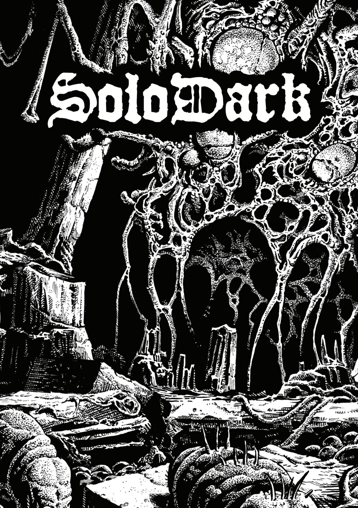
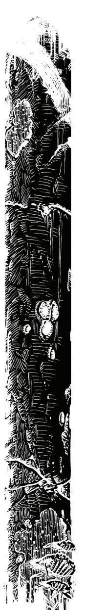
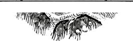
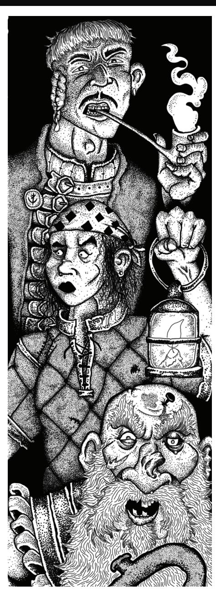
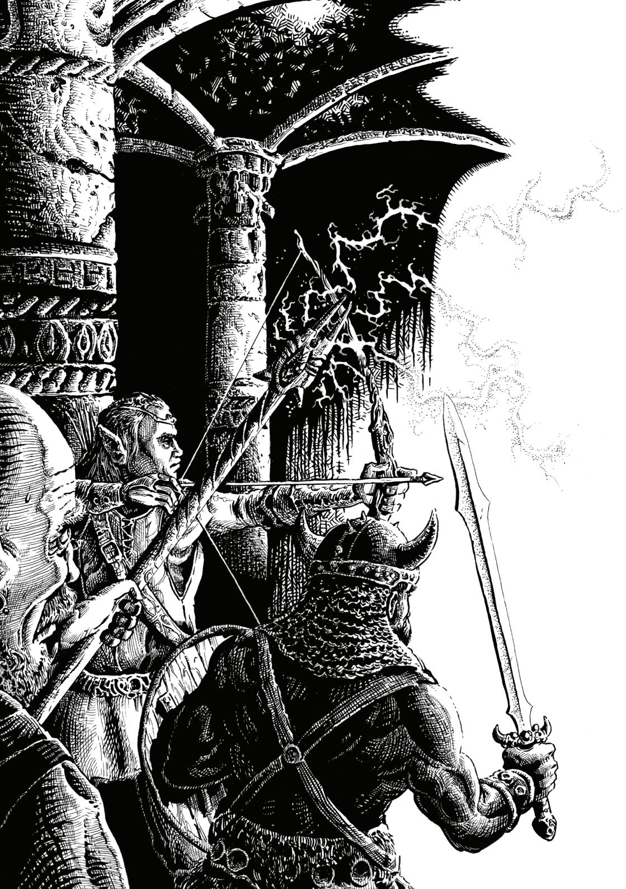
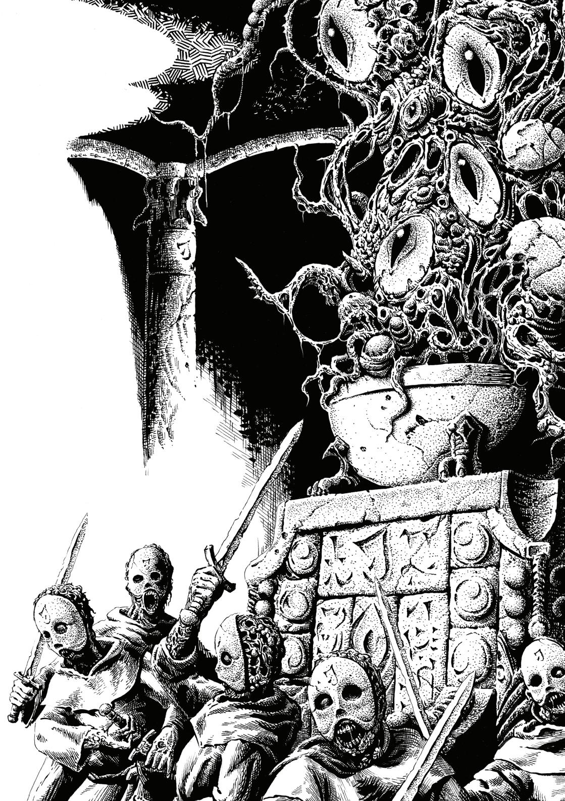
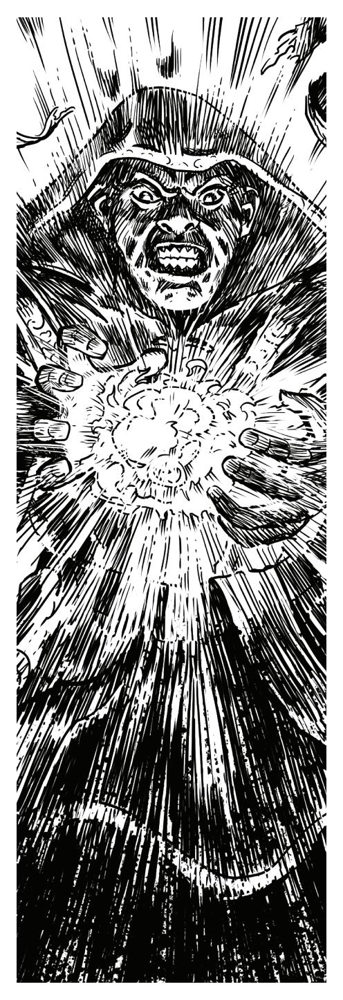
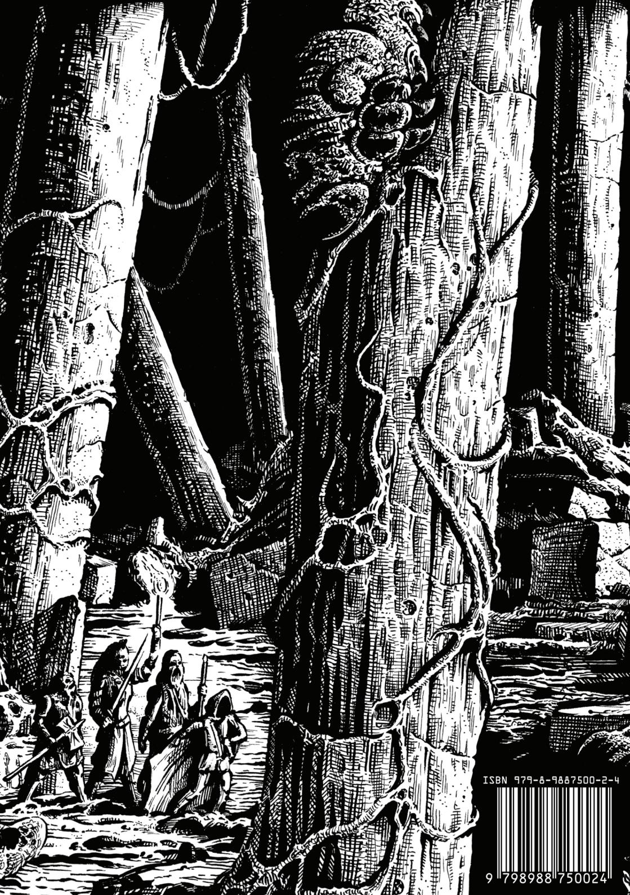

{0}------------------------------------------------

{1}------------------------------------------------

{2}------------------------------------------------

# SoloDark

#### **Writing, Design, Layout**

Kelsey Dionne.

#### **Art**

**Trade dress** by Brandish Gilhelm. **Cover Art:** Lucas Korte. **Interior Art:** Yuri Perkowski-Domingos pg. 2, Lucas Korte pg. 5-6, Matt Morrow pg. 10.

#### **Fonts**

JSL Blackletter font © 2023 Jeffrey S. Lee. Old Newspaper font © 2023 Martin Steiner. Fullteron font © 2023 Emyself Design. Montserrat font family © 2023 Julieta Ulanovsky, Sol Matas, Juan Pablo del Peral, Jacques Le Bailly.

#### **Legal Information and Attribution Statement**

Not for resale or redistribution. Permission granted to copy for personal use only. *SoloDark* and *Shadowdark RPG* © 2023 The Arcane Library, LLC. The Arcane Library®, Shadowdark®, and SoloDark™ are trademarks of The Arcane Library, LLC. This work includes material taken from the System Reference Document 5.1 ("SRD 5.1") by Wizards of the Coast LLC and available at [https://](https://dnd.wizards.com/resources/systems-reference-document) [dnd.wizards.com/resources/systems-reference-document](https://dnd.wizards.com/resources/systems-reference-document). The SRD 5.1 is licensed under the Creative Commons Attribution 4.0 International License available at [https://creativecommons.org/](https://creativecommons.org/licenses/by/4.0/legalcode) [licenses/by/4.0/legalcode](https://creativecommons.org/licenses/by/4.0/legalcode).

{3}------------------------------------------------

# Solo Gameplay

Welcome to *SoloDark*, the solo gameplay rules for *Shadowdark RPG*!

As a solo player, you are both the characters *and* the Game Master.

And just like in any game, you don't want to know what's going to happen from the start. So you'll need a way to answer questions the GM would normally answer.

This booklet gives you roll tables to do just that:

#### **ORACLE**

Use the Oracle to answer yes or no questions about the game world. Sometimes you'll get an unexpected answer or twist! See the table on [pg. 10](#page-12-0).

#### **PROMPTS**

Use prompts to spark ideas or answer open-ended questions. See the table on [pg. 11](#page-13-0). Roll a verb + noun to generate a result.

#### **MODIFIED RULES**

*SoloDark* modifies some of *Shadowdark RPG's* normal rules.

**Group Initiative.** Choose one character and one enemy to make initiative checks on behalf of their respective groups.

You decide the order of actions on each group's turn. This can be different from round to round.

**Chaos Mode.** Reroll initiative at the start of every combat round (use group initiative).

**Light.** Light sources last 10 rounds each instead of 1 hour of real time.

**Luck.** If you roll a natural 20, gain a luck token.

You can have as many luck tokens as you have PCs in your group.

Note you cannot reroll out-ofgameplay results with luck, such as Oracle checks or talent rolls.

{4}------------------------------------------------

# Getting Started

#### **CHARACTERS**

The focus of your game is on the player characters (**PCs**) adventurers with class levels.

Generate new PCs with the standard *Shadowdark RPG*  character creation rules.

**Fortune's Favor.** New PCs begin with a luck token.

You'll typically want your group to have 2-4 PCs. If you have more than four, it can be hard to track.

If you want to have only one PC in your group, consider starting at a higher level.

#### **JUMP IN!**

You can head into a pre-written dungeon and use the Oracle to help decide your characters' choices. Or you can create an entirely new adventure from scratch (get ideas on [pg. 7\)](#page-9-0)!

See [pg. 3-](#page-5-0)[4](#page-6-0) for gameplay examples and further resources.

{5}------------------------------------------------

# Solo Examples

#### **YOUTUBE**

- **[The Arcane Library](https://www.youtube.com/watch?v=xzArzhOxbmU&list=PLsIJw22Nm-csTrEXxsoM--VqN54Hv2F2h).** Kelsey runs *Shadowdark RPG* with the *SoloDark* solo rules.
- **[Night Noon Games.](https://www.youtube.com/watch?v=LyhbHkor4B4&list=PL50f8J1emg4zBp76rRi7PFD4UWJLTGjoU)** Michael runs *Shadowdark RPG* with *Mythic Game Master Emulator*'s handy card deck.
- **[Me, Myself and Die!](https://www.youtube.com/watch?v=I9ag6U3a8eM&list=PLDvunq75UfH_GAUWYcYSGL_vftZG0nzR-)** Trevor Devall, a professional voice actor, runs *Broken Empires RPG* (his own game), *Savage Worlds* (with Mythic GME), *Five Parsecs From Home* (solo system), and much more!
- **[Geek Gamers.](https://www.youtube.com/channel/UCLnDxuZE6qWwWxZCN9y8JQA)** Lots of advice and creative gameplay examples spanning countless systems and supplements.
- **[Wizard Deadloss](https://www.youtube.com/watch?v=UaOIc7piVQY&list=PL6BJhxpciBcMqwVDqj-oyNDMEztNp1VjY).** The wizard uses BECMI D&D rules to run classic adventures including *The Keep on the Borderlands* and *The Veiled Society*. He uses a simple d6 solo system.
- **[Kill Ten Rats RPG.](https://www.youtube.com/@killtenratsrpg/playlists)** Minimalist, approachable soloing with *Knave*, *Black Sword Hack*, *Ironsworn*, and other systems.

#### **BLOGS**

- **[Castle Grief.](https://substack.com/@castlegrief)** Solo gameplay with a variety of old-school systems. Resources, play reports, and amazing handdrawn original material!
- **[Chaoclypse.](https://substack.com/@chaoclypse)** Guides, art, game design theory, and system reviews.
- **[Lone Horizons.](https://lonehorizons.blogspot.com/)** Session reports, solo gameplay video episodes, and resources.
- **[The Soloist.](https://soloist.substack.com)** News, resources, and game reviews for all sorts of solo RPGs.

#### **PODCASTS**

- **[The Lone Adventurer.](https://theloneadventurer.podbean.com)** Fantastic narration with 5E solo gameplay.
- **[Solo Dungeon Crawler.](https://www.youtube.com/watch?v=xC_443qtsig&list=PLifdT0dC91p92aBgzy-M9JauS9YCBG1f0)** Solo gameplay with Original D&D that passes in real-world time.

#### **SOCIAL MEDIA**

• **[r/Solo\\_Roleplay.](https://www.reddit.com/r/Solo_Roleplaying/)** A friendly community for advice, resources, and game reports.

{6}------------------------------------------------

# I Need A...

#### **MONSTER**

- **[Shadowdark RPG](https://www.thearcanelibrary.com/collections/shadowdark-rpg/products/shadowdark-rpg)** by The Arcane Library, pg. 189-193.
- **[The Monster Overhaul](https://www.drivethrurpg.com/en/product/421868/the-monster-overhaul)** by Skerples.
- **[Index Card RPG: Master](https://www.runehammer.online/online-store/Index-Card-RPG-Masters-Edition-p613134345)  [Edition](https://www.runehammer.online/online-store/Index-Card-RPG-Masters-Edition-p613134345)** by Runehammer Games, pg. 382-383.
- **[Knave 2E](http://questingblog.com/knave-2e/)** by Ben Milton, pg. 64-67.

### **NPC**

- **[Shadowdark RPG](https://www.thearcanelibrary.com/collections/shadowdark-rpg/products/shadowdark-rpg)** pg. 124-129.
- **[Knave 2E](http://questingblog.com/knave-2e/)** pg. 53-59.
- **[Masks 1,000 Memorable](https://www.drivethrurpg.com/en/product/93319/masks-1-000-memorable-npcs-for-any-roleplaying-game)  [NPCs](https://www.drivethrurpg.com/en/product/93319/masks-1-000-memorable-npcs-for-any-roleplaying-game)** by the GnomeStew.com authors.
- **[UNE, The Universal NPC](https://www.drivethrurpg.com/en/product/134163/UNE-The-Universal-NPC-Emulator-rev)  [Emulator Revised](https://www.drivethrurpg.com/en/product/134163/UNE-The-Universal-NPC-Emulator-rev)** by Zach Best.

### **TREASURE**

- **[Shadowdark RPG](https://www.thearcanelibrary.com/collections/shadowdark-rpg/products/shadowdark-rpg)** pg. 270-277.
- **[Index Card RPG: Master](https://www.runehammer.online/online-store/Index-Card-RPG-Masters-Edition-p613134345)  [Edition](https://www.runehammer.online/online-store/Index-Card-RPG-Masters-Edition-p613134345)** pg. 384-398.
- **[Ensorcelled Loot](https://www.drivethrurpg.com/en/product/469973/Ensorcelled-Loot-Designed-for-Use-with-ShadowDark-RPG) Deck** by Philip Reed.

#### **ENCOUNTER**

- **[Shadowdark RPG](https://www.thearcanelibrary.com/collections/shadowdark-rpg/products/shadowdark-rpg)** pg. 142-185.
- **[City Encounters for Swords &](https://www.drivethrurpg.com/en/product/468112/city-encounters-for-swords-wizardry)  [Wizardry](https://www.drivethrurpg.com/en/product/468112/city-encounters-for-swords-wizardry)** by Matt Finch.
- **[Deck of Old-School](https://www.drivethrurpg.com/en/product/463489/deck-of-old-school-encounters-systemless-fantasy-rpg-cards)  [Encounters](https://www.drivethrurpg.com/en/product/463489/deck-of-old-school-encounters-systemless-fantasy-rpg-cards)** by Philip Reed.

### **DUNGEON**

- **[Shadowdark RPG](https://www.thearcanelibrary.com/collections/shadowdark-rpg/products/shadowdark-rpg)** pg. 130-131.
- **[The Gardens of Ynn](https://www.drivethrurpg.com/en/product/237544/the-gardens-of-ynn)** and **[The](https://www.drivethrurpg.com/en/product/257113/the-stygian-library)  [Stygian Library](https://www.drivethrurpg.com/en/product/257113/the-stygian-library)** by Emmy Allen.
- **[Tome of Adventure Design](https://www.drivethrurpg.com/en/product/396154/tome-of-adventure-design-revised)  [\(Revised\)](https://www.drivethrurpg.com/en/product/396154/tome-of-adventure-design-revised)** by Matt Finch, chapter three.
- **[Axebane's Deck of Many](https://www.thegamecrafter.com/games/axebane-s-deck-of-many-dungeons)  [Dungeons.](https://www.thegamecrafter.com/games/axebane-s-deck-of-many-dungeons)**
- **[Knave 2E](http://questingblog.com/knave-2e/)** pg. 14-17.

#### **WILDERNESS**

- **[Shadowdark RPG](https://www.thearcanelibrary.com/collections/shadowdark-rpg/products/shadowdark-rpg)** pg. 132-133.
- **[The Hexanomicon #1](https://www.drivethrurpg.com/en/product/281016/the-hexanomicon-1)** by Zariel Kuri.
- **[Sandbox Generator](https://www.drivethrurpg.com/en/product/430675/sandbox-generator)** by Atelier Clandestin.
- **[Tarvannion](https://castlegrief.itch.io/tarvannion)** by Castle Grief.

{7}------------------------------------------------

{8}------------------------------------------------

{9}------------------------------------------------

# Dungeon Names

|       |            | DUNGEON NAMES       |          |
|-------|------------|---------------------|----------|
| d100  | Name 1     | Name 2              | Name 3   |
| 01    | Citadel    | of the Haunted      | Idol     |
| 02-03 | Wreck      | of the Forgotten    | Betrayer |
| 04-05 | Ruins      | of the Disgraced    | King     |
| 06-07 | Chapel     | of the Barbaric     | Elephant |
| 08-09 | Library    | of the Monstrous    | God      |
| 10-11 | Grave      | of the Fallen       | Cult     |
| 12-13 | Fortress   | of the Cursed       | Knight   |
| 14-15 | Laboratory | of the Bound        | Hero     |
| 16-17 | Abbey      | of the Poisonous    | Pirates  |
| 18-19 | Prison     | of the Cyclopean    | Spirit   |
| 20-21 | Tomb       | of the Sky          | Sisters  |
| 22-23 | Forge      | of the Frozen       | Sword    |
| 24-25 | Ravine     | of the Burning      | Beast    |
| 26-27 | Monastery  | of the Thieving     | Ancients |
| 28-29 | Spire      | of the Crystalline  | Lost     |
| 30-31 | Hideout    | of the Otherworldly | Outcasts |
| 32-33 | Castle     | of the Blighted     | Sailor   |
| 34-35 | Tunnels    | of the Celestial    | Undead   |
| 36-37 | Halls      | of the Draconic     | Mage     |
| 38-39 | Tower      | of the Ethereal     | Hoard    |
| 40-41 | Steading   | of the Desecrated   | Mummy    |
| 42-43 | Undercity  | of the Reptilian    | Usurper  |
| 44-45 | Aerie      | of the Metallic     | Saint    |
|       |            |                     |          |

{10}------------------------------------------------

| d100  | Name 1                     | Name 2              | Name 3      |
|-------|----------------------------|---------------------|-------------|
| 46-47 | Vaults of the Insectoid |                     | Mechanism   |
| 48-49 | Observatory                | of the Elemental    | Brothers    |
| 50-53 | Asylum                     | of the Arachnid     | Lord        |
| 54-55 | Sepulcher                  | of the Demonic      | Descendant  |
| 56-57 | Barrow                     | of the Fungal       | Abomination |
| 58-59 | Palace                     | of the Golden       | Hermit      |
| 60-61 | Keep                       | of the Fey          | Warlord     |
| 62-63 | Caverns                    | of the Lightning    | Hunter      |
| 64-65 | Fane                       | of the Piscine      | Guild       |
| 66-67 | Garden                     | of the Corrupt      | Vampire     |
| 68-69 | Temple                     | of the Righteous    | Philosopher |
| 70-71 | Maze                       | of the Mud          | Warriors    |
| 72-73 | Redoubt                    | of the Night        | Queen       |
| 74-75 | Pyramid                    | of the Hidden       | Gem         |
| 76-77 | Sanctum                    | of the Forbidden    | Secret      |
| 78-79 | Mines                      | of the Shimmering   | Emperor     |
| 80-81 | Lair                       | of the Glass        | Weapon      |
| 82-83 | Den                        | of the Radiant      | Sorcerer    |
| 84-85 | Pits                       | of the Mad          | Crown       |
| 86-87 | Grotto                     | of the Wild         | Ancestor    |
| 88-89 | Depths                     | of the Lost         | Runes       |
| 90-91 | Stronghold                 | of the Majestic     | Tree        |
| 92-93 | Manse                      | of the Antediluvian | Assassin    |
| 94-95 | Warrens                    | of the Prophesied   | Relic       |
| 96-97 | Monolith                   | of the Shrouded     | Blessing    |
| 98-99 | Crypts                     | of the Cosmic       | Ritual      |
| 00    | Dungeon                    | of the Legendary    | Overlord    |

{11}------------------------------------------------

# Oracle

#### **WHAT'S AN ORACLE?**

An oracle is a system to answer "yes" or "no" questions.

For example, you might ask the oracle if the old wizard you've been looking for is in the tavern. Then, you make an oracle check to find out.

#### **BEST PRACTICES**

**Plausibility.** Only ask reasonable questions. Don't ask, "Is there a *+3 longbow* lying on the floor?"

**Defer To Game Rules.** See if the game rules can solve your question first. For example, allow Jorbin to make a DEX check to avoid a falling rock instead of asking, "Does the rock hit him?"

**Phrasing.** Ask your question with affirmative phrasing. Instead of asking, "Are there no orcs in this room?" ask, "Are there orcs in this room?"

**Limit.** Ask no more than three questions per situation.

#### **INTERPRETING**

If an oracle result needs more information to make sense, use the Prompts Table on [pg. 11](#page-13-0).

For example, if your character hears a strange sound in the next room, you can roll a prompt to determine the sound's nature.

### **HOW IT WORKS**

Each time you ask the oracle a question, you must determine the **odds** and then make an **oracle check**.

#### **ODDS**

Before you make an oracle check, decide how likely your question is to get a "yes" result.

**Unlikely or Impossible.** Roll the oracle check with disadvantage.

**Even Chance.** Make a standard oracle check.

**Likely or Certain.** Roll the oracle check with advantage.

{12}------------------------------------------------

|       | ORACLE |  |
|-------|--------|--|
| d20   | Result |  |
| 1-9   | No     |  |
| 10    | Twist  |  |
| 11-20 | Yes    |  |

### **ORACLE CHECK**

To make an oracle check, roll a **d20** on the above Oracle Table, modified by the odds.

**Twist.** Something unexpected happens! Roll a prompt [\(pg.](#page-13-0)  [11](#page-13-0)) to determine its nature.

**Odd Number.** If your oracle check is an odd number (excluding a 1), the outcome has a turnabout phrased as a "but."

This alters the situation without fully negating the oracle result.

*"Is there a way to climb out of this pit? No, but a rusty chain lies in the mud nearby..."*

**Critical.** If you roll a natural 1 or 20, the outcome is the most **extreme** version possible.

*"Will the king meet with us? Yes, and he wants to see us at once!"*

{13}------------------------------------------------

# Prompts

|      |            | PROMPTS     |      |             |           |
|------|------------|-------------|------|-------------|-----------|
| d100 | Verb       | Noun        | d100 | Verb        | Noun      |
| 01   | Stop       | Fault       | 24   | Block       | Freedom   |
| 02   | Tell       | Life        | 25   | Consume     | Weakness  |
| 03   | Trust      | Battle      | 26   | Pursue      | Unknown   |
| 04   | Prevent    | Lie         | 27   | Reward      | Glory     |
| 05   | Deliver    | Vice        | 28   | Expand      | Friend    |
| 06   | Dismantle  | Memory      | 29   | Waste       | Discovery |
| 07   | Create     | Burden      | 30   | Capture     | Lead      |
| 08   | Resist     | Treachery   | 31   | Weaken      | Storm     |
| 09   | Imbue      | Trial       | 32   | Reveal      | Enemy     |
| 10   | Befriend   | Risk        | 33   | Investigate | Integrity |
| 11   | Sneak      | Prosperity  | 34   | Forbid      | Science   |
| 12   | Disagree   | Time        | 35   | Start       | Asset     |
| 13   | Illuminate | Conflict    | 36   | Surprise    | Crime     |
| 14   | Assemble   | Light       | 37   | Endure      | Wisdom    |
| 15   | Free       | Unnatural   | 38   | Pull        | Justice   |
| 16   | Combine    | Information | 39   | Unleash     | Strife    |
| 17   | Disrupt    | Hope        | 40   | Avoid       | Disgust   |
| 18   | Demand     | Journey     | 41   | Advance     | Danger    |
| 19   | Obstruct   | Mundane     | 42   | Agree       | Balance   |
| 20   | Push       | Hazard      | 43   | Deliver     | Nature    |
| 21   | Arrive     | Family      | 44   | Link        | Chaos     |
| 22   | Slow       | Obstacle    | 45   | Hinder      | Ambush    |
| 23   | Overcome   | Doubt       | 46   | Withhold    | Wealth    |

{14}------------------------------------------------

|      |          |             | PROMPTS |           |             |
|------|----------|-------------|---------|-----------|-------------|
| d100 | Verb     | Noun        | d100    | Verb      | Noun        |
| 47   | Lose     | Thought     | 74      | Take      | Essence     |
| 48   | Evolve   | Dark        | 75      | Question  | Dream       |
| 49   | Fortify  | Connection  | 76      | Drop      | Anger       |
| 50   | Punish   | Door        | 77      | Accept    | Vision      |
| 51   | Ignite   | Fear        | 78      | Sacrifice | Safety      |
| 52   | Awaken   | Sorcery     | 79      | Drain     | Result      |
| 53   | Defy     | Honor       | 80      | Hint      | Place       |
| 54   | Conceal  | Spirit      | 81      | Fumble    | Path        |
| 55   | Invite   | Trust       | 82      | Fall      | Nourishment |
| 56   | Break    | Loss        | 83      | Ascend    | Theft       |
| 57   | Allow    | Failure     | 84      | Protect   | Decay       |
| 58   | Open     | Peril       | 85      | Escape    | Truth       |
| 59   | Repel    | Plan        | 86      | Defeat    | People      |
| 60   | Activate | Trick       | 87      | Mend      | Help        |
| 61   | Gather   | Mind        | 88      | Acquire   | Gear        |
| 62   | Give     | Pain        | 89      | Guide     | Idea        |
| 63   | Reverse  | Victory     | 90      | Mislead   | Order       |
| 64   | Warn     | Death       | 91      | Banish    | Success     |
| 65   | Confront | Control     | 92      | Uphold    | Barrier     |
| 66   | Betray   | Knowledge   | 93      | Build     | Goal        |
| 67   | Secure   | Secret      | 94      | Change    | Luck        |
| 68   | Darken   | Kindness    | 95      | Revoke    | Identity    |
| 69   | Flee     | Exploration | 96      | Seek      | Harm        |
| 70   | Win      | Surprise    | 97      | Destroy   | Wilderness  |
| 71   | Scatter  | Magic       | 98      | Uncover   | Motive      |
| 72   | Contain  | Animal      | 99      | Rest      | Shelter     |
| 73   | Assist   | Way         | 00      | Release   | Power       |
|      |          |             |         |           |             |

{15}------------------------------------------------

